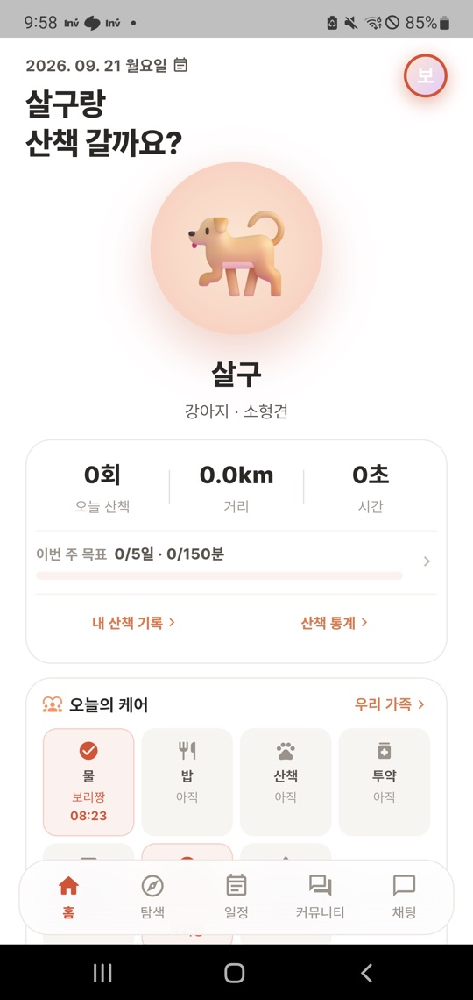
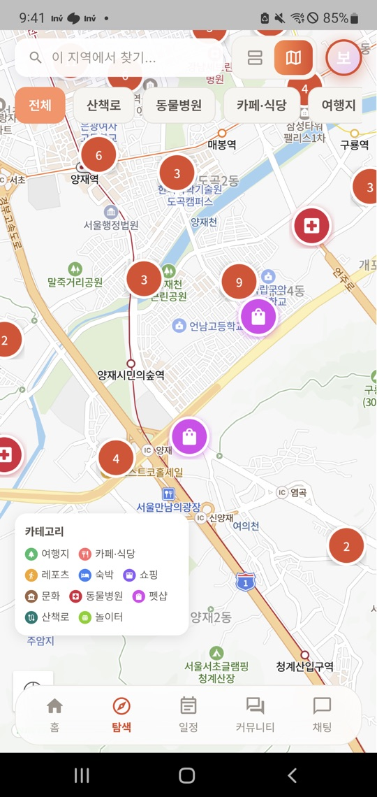
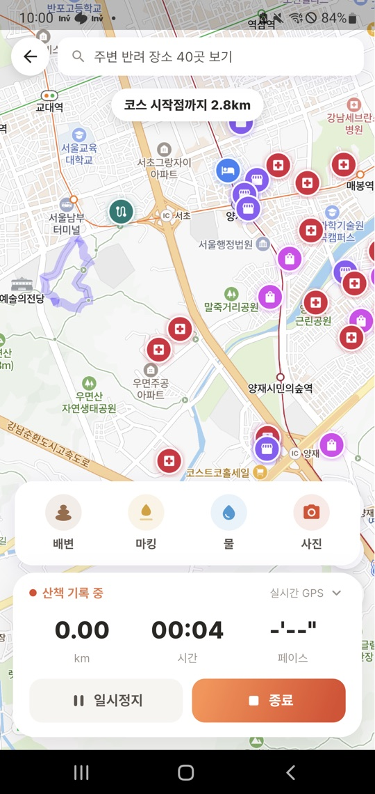
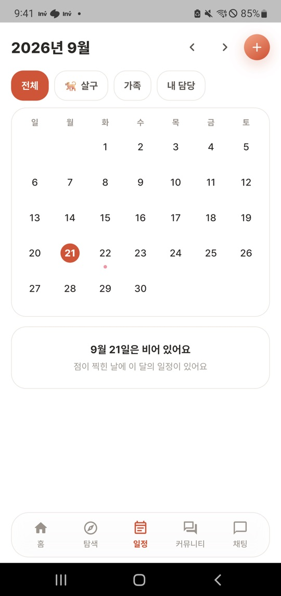
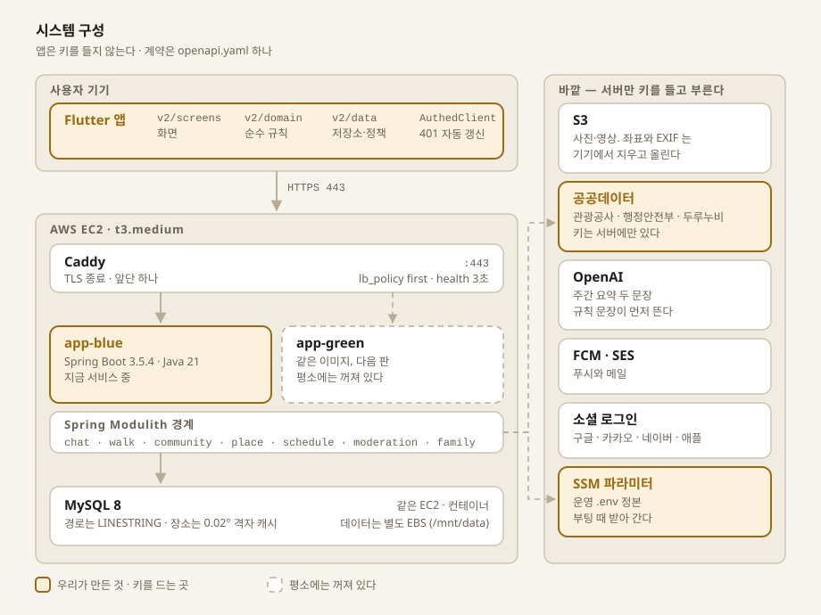
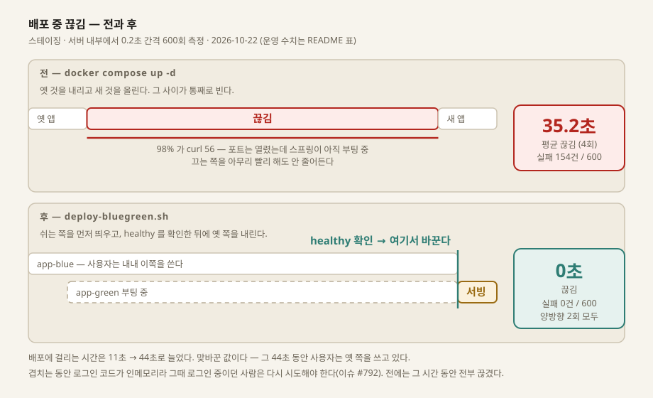
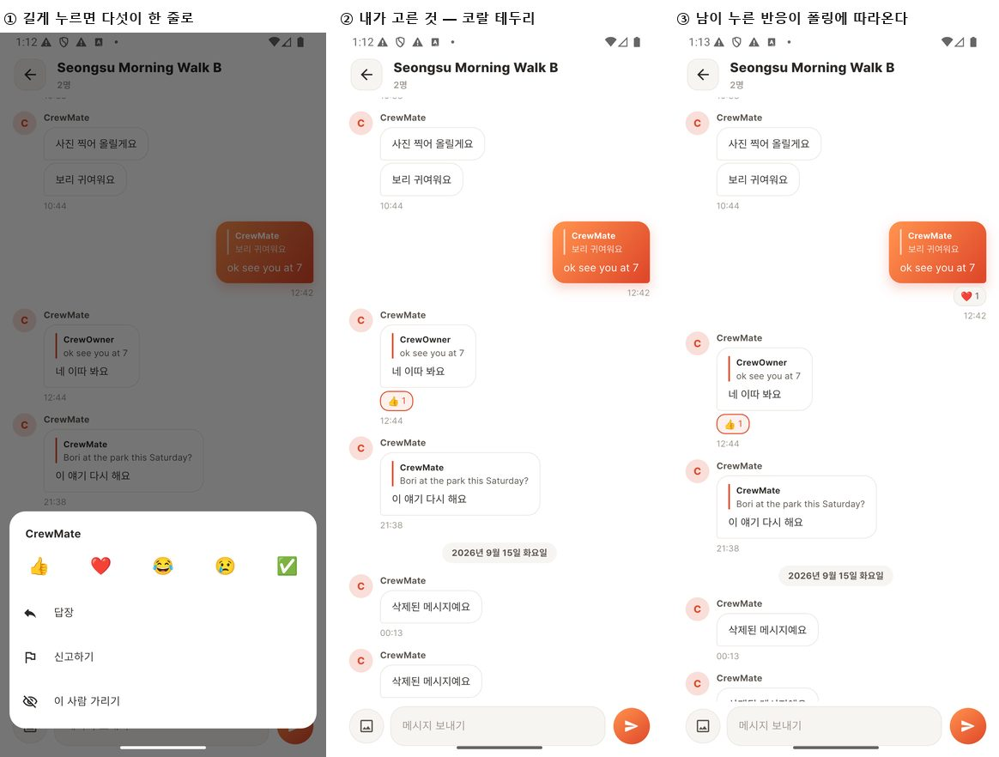
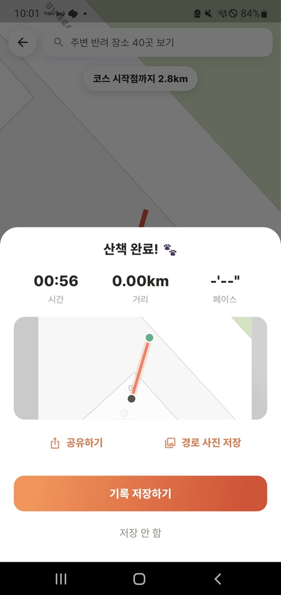
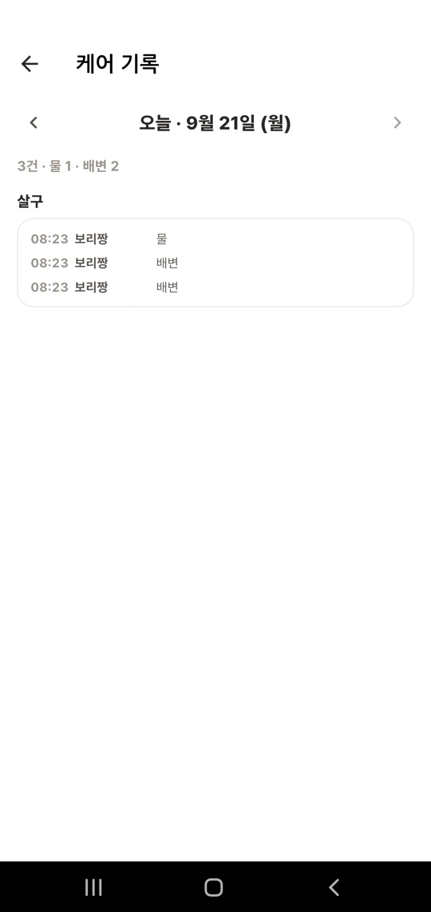
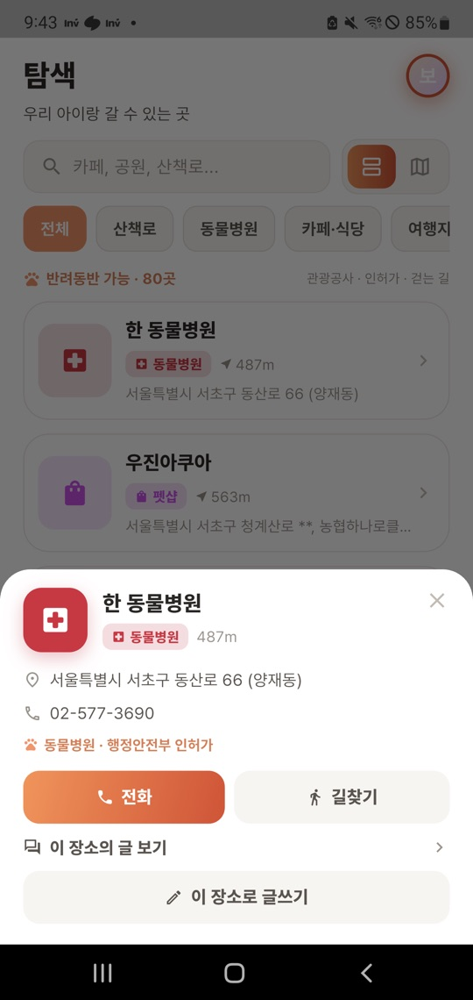

# Pawloop(포루프) 🐾

> **반려동물과 함께 걷고, 가족과 나누고, 동네 반려인들과 연결되는 공간.**
> 산책 GPS 트래킹 · 반려동반 장소 지도 · 가족 케어 공유 · 일정 · 커뮤니티 · 채팅 — Flutter 앱과 Spring Boot 서버를 함께 담은 모노레포입니다.

<p>
  
  
  
  
  
</p>

<sub>실기기(1440×3040) 캡처입니다. 2026 관광데이터 활용 공모전에 낸 기능설명서에 쓴 것과 같습니다.</sub>

산책을 좁은 쐐기로 시작해 **반려 일상(산책 → 건강·식사·병원·동네)** 으로 넓히는 앱입니다. 다섯 탭 — 홈 · 지도 · 일정 · 커뮤니티 · 채팅 — 이고 다섯 칸이 같은 폭입니다. 산책은 홈의 "산책 시작" 이 열고, 통계는 홈과 프로필에서 들어갑니다.

---

## 무엇을 하는 앱인가

| | |
| :--- | :--- |
| **산책** | 실 GPS 경로 기록 · 라이브 스탯 · 산책 중 사진 · 끝내면 서버 저장(못 보내면 초안 큐) · 코스로 남기기 |
| **지도** | 반려동반 장소(관광공사) · 동물병원 · 펫샵(행정안전부 인허가) · 산책로(두루누비 · 동네 길 1,302개) · 놀이터 — 전부 실데이터 |
| **일정** | 월 달력 · 반복 · 담당자 · 알림(전날 저녁·당일 아침) · 완료하면 오늘의 케어에 한 줄이 남습니다 |
| **가족** | 초대코드로 묶인 가족 그룹 · 오늘의 케어 공유(밥·물·산책·투약·병원) · 산책 주의사항 |
| **채팅** | 가족 방 · 크루 방 · 사진 · 답장(인용) · 반응 · 미읽음 · 신고/가리기/강퇴 |
| **커뮤니티** | 동네 반려인 게시판 — 글·댓글·반응·사진/영상·저장한 글, 그리고 **크루**(동네 모임 · 품앗이) |
| **통계** | 주간 산책 차트 · 자주 가는 곳 · **AI 주간 요약 두 문장**(규칙 문장이 먼저, AI 는 그 아래) |

---

## 숫자로 보는 저장소

| | 앱 (Flutter) | 서버 (Spring Boot) |
| :--- | ---: | ---: |
| 제품 코드 | 206 파일 · 55,033 줄 | 455 파일 · 45,119 줄 |
| 테스트 코드 | 291 파일 · 50,461 줄 | 274 파일 · 66,196 줄 |
| 돌아가는 테스트 | 2,351 | 2,012 |

| | |
| :--- | ---: |
| 화면 | 37 |
| 계약(openapi) 경로 | 88 |
| DB 표 | 38 |
| 마이그레이션 스크립트 | 52 |
| 결정 기록(ADR) | 23 |
| 문서 | 44 파일 · 16,548 줄 |

> 서버는 **테스트 코드가 제품 코드보다 깁니다**(66,196 : 45,119). 대부분이 목이 아니라 Testcontainers 로 진짜 MySQL 을 띄우는 통합 테스트이고, 나머지는 계약·문서·마이그레이션을 코드와 대조하는 게이트입니다.

<sub>2026-10-22 실측. 테스트 수는 실행된 개수입니다 — 서버는 JUnit 결과 XML 268개를 합산했고, 앱은 <code>flutter test</code> 의 보고를 그대로 적었습니다.</sub>

---

## 아키텍처

<picture>
  <source media="(prefers-color-scheme: dark)" srcset="docs/diagrams/architecture-dark.svg">
  
</picture>

**앱** — Flutter 3.44.4 / Dart 3.12.2 · `flutter_naver_map` · `fl_chart` · `go_router` · `provider`
한 코드베이스로 양대 스토어에 올립니다. 지도는 국내 좌표·POI 품질 때문에 네이버를 골랐습니다.

**서버** — Java 21 · Spring Boot 3.5.4 · Spring Modulith · JPA · JWT
모듈 경계를 **구조 검사**로 강제하되 이벤트는 들이지 않았습니다 → [ADR-0012](docs/99-decisions/decision-log.md)

**DB** — MySQL 8 + `hibernate-spatial`
경로는 `LINESTRING`, 장소는 0.02° 격자 캐시입니다. **`SPATIAL INDEX` 는 만들지 않습니다** → [ADR-0015](docs/99-decisions/decision-log.md)

**계약** — `docs/04-api/openapi.yaml` 하나가 정본
앱과 서버가 같은 문서를 보고, 스펙 테스트가 컨트롤러 매핑과 대조합니다 → [ADR-0017](docs/99-decisions/decision-log.md)

**관측** — Micrometer · Prometheus · Grafana
폴링의 빈 응답 비율처럼 **설계를 바꿀 근거**가 되는 수만 봅니다.

---

## 배포 — "무중단" 이라고 쓰기 전에 재었습니다

<picture>
  <source media="(prefers-color-scheme: dark)" srcset="docs/diagrams/deploy-dark.svg">
  
</picture>

먼저 **재는 스크립트부터 만들었습니다.** 0.2초 간격으로 `/actuator/health` 를 찔러 실패 건수와 끊긴 구간을 세고, `curl` 종료 코드로 종류를 가릅니다 — `7`(연결 거부)은 포트가 아직 없는 것이고 `56`(수신 실패)은 **포트는 열렸는데 앱이 아직 부팅 중**입니다.

그 숫자가 방향을 바꿨습니다. 처음엔 "종료를 우아하게 하면 줄겠지" 싶었는데, 실패 154건의 **98%가 `56`** 이었습니다. 끄는 쪽이 아니라 **켜는 쪽이 사용자에게 보이고 있던 것**입니다. 끄는 쪽을 고쳐도(PR #791) 36.0초 → 36.0초, 바뀌지 않았습니다.

그래서 앱을 두 벌 두고 **새 쪽이 healthy 가 된 것을 확인한 뒤에** 옛 쪽을 내립니다. 부팅 시간이 사용자 뒤로 숨습니다.

**스테이징** — 서버 안에서 `/actuator/health` 를 0.2초 간격으로.

| | 끊긴 시간 | 실패 / 표본 | 배포에 걸린 시간 |
| :--- | ---: | ---: | ---: |
| 전 — `docker compose up -d` | 35.2초 | 154 / 600 | 11.0초 |
| 종료만 고친 뒤 | 36.0초 | 157 / 600 | 3.1초 |
| 후 — 블루/그린 | **0초** | **0 / 600** | 44.2초 |

끊긴 시간은 **첫 실패부터 마지막 실패까지**입니다. 그 사이에 200 이 간간이 섞여서, `끊긴 초 ÷ 0.2` 보다 실패 건수가 적습니다. 네 회차 평균입니다.

**운영** — 2026-10-22. 이번엔 서버 안이 아니라 **인터넷 너머에서** `https://api.pawloop.app` 을 찔렀습니다. TLS·Caddy·앱을 다 지나는, 사용자가 실제로 가는 길입니다.

| | 끊긴 시간 | 실패 / 표본 |
| :--- | ---: | ---: |
| 구조를 바꾼 한 번뿐인 이전 | 44.0초 | 30 / 261 |
| 그 뒤 블루/그린 | **0초** | **0 / 1,108** |

44초의 안을 열어 보면 `curl 7`(Caddy 재생성) 9건 · `curl 28`(시간 초과) 12건 · `502`(앱 부팅 중) 9건입니다. 블루/그린이 없애는 것은 그중 `502` 쪽입니다. **이 줄은 블루/그린으로 갈아타는 단 한 번의 비용**이지 옛 방식의 평소 끊김이 아닙니다 — 그건 위 표의 35.2초입니다.

실패가 30건뿐인데 44초인 것은 **탐침이 타임아웃에 붙잡히기 때문**입니다. `curl -m 3` 이라 `curl 28` 한 건이 3초를 먹고(12건 = 36초), 표본 261개가 107초에 걸쳐 평균 간격 0.41초가 됩니다. 서버 안 측정(0.2초 고정)과 **표본 밀도가 다르므로 두 표를 직접 빼면 안 됩니다.**

배포 시간이 네 배가 된 것은 맞바꾼 값입니다 — 그 44초 동안 사용자는 옛 쪽을 쓰고 있습니다. 겹치는 동안 로그인 코드가 인메모리라 그때 **로그인 중이던 사람만** 다시 시도해야 합니다([#792](https://github.com/sanghyunbang/pawloop/issues/792)). 전에는 그 시간 동안 전부 끊겼습니다.

<details>
<summary><strong>CI 는 바뀐 쪽만 돌립니다</strong></summary>

<br/>

`.github/workflows/ci.yml` 이 먼저 **변경 경로를 판별**하고, 안 바뀐 쪽 잡은 건너뜁니다. 문서만 고친 PR 에서 Flutter 를 띄우지 않기 위해서입니다.

| 잡 | 2026-10-22 의 한 PR 에서 |
| :--- | ---: |
| 변경 경로 판별 | 7초 |
| 백엔드 — 테스트 + 커버리지 | 6분 47초 |
| 프론트 · 문서 | 건너뜀(안 바뀜) |
| 비밀값 스캔(gitleaks) | 12초 |

건너뛴 잡은 깃헙에서 "Skipped" 로 보고되므로 **필수 상태 검사로 지정해도 머지를 막지 않습니다.** `main` 은 보호돼 있고 "CI 통과" 를 요구합니다.

로컬에서 같은 명령을 돌리는 길도 있습니다 — `bash scripts/local-ci.sh`.

</details>

---

## 엔지니어링에서 볼 만한 것

### 1. 채팅 폴링의 커서는 `id` 가 아니라 방별 순번입니다

`AUTO_INCREMENT` 는 배정 시점에 정해지고 가시성은 커밋 시점에 생깁니다. `id` 를 커서로 쓰면 **늦게 커밋된 작은 id 를 영구히 건너뜁니다.** 그래서 방마다 `room_seq` 를 발급하고, 발급은 MySQL 이 문서로 제시한 한 문장(`UPDATE … SET last_seq = LAST_INSERT_ID(last_seq + 1)`)으로 합니다. 스레드 20개를 같은 방에 붙여 재 보니, 읽고-더해-쓰는 판은 **20개 중 17개가 죽었습니다.**

미읽음은 캐시가 아니라 `room.last_seq − member.last_read_seq` 뺄셈이고, 지워진 말도 목록에서 빼지 않습니다 — 빼면 그 번호가 클라이언트에 도달하지 않아 뱃지가 영원히 안 지워집니다. → [ADR-0011](docs/99-decisions/decision-log.md)

### 2. 이미 보낸 말이 바뀌면 폴링이 못 봅니다 — 축을 하나 더 놨습니다

델타는 커서보다 **큰** 번호만 줍니다. 그래서 남이 지운 말도, 반응이 붙은 말도 영영 오지 않았습니다. 방 단위 **변경 번호**를 따로 발급해 바뀐 행에 찍고 응답에 `changed` 를 더했습니다. `room_seq` 를 다시 발급하는 길은 기각했습니다 — 오래된 말이 대화 맨 아래로 뛰고 모두의 미읽음이 1 늘기 때문입니다. → [ADR-0023](docs/99-decisions/decision-log.md)

<p></p>

### 3. 멱등을 DB 제약 위에 세웁니다

- 전송은 `clientMsgId` 와 `UNIQUE (room_id, sender_user_id, client_msg_id)`. 재전송은 409 가 아니라 **200** 입니다 — 재시도한 쪽 입장에서 그 요청은 성공했습니다.
- 반응·저장은 토글 하나가 아니라 **켜기(`POST`)와 끄기(`DELETE`)** 입니다. 토글이면 네트워크 재시도 한 번이 사용자의 반응을 조용히 되돌립니다.
- 삽입은 `ON DUPLICATE KEY UPDATE id = id` 한 문장입니다. 예외를 삼키는 판은 트랜잭션이 rollback-only 로 표시돼 **동시 요청에서만** 500 이 납니다.

### 4. 좌표와 EXIF 는 기기에서 지우고 올립니다

사진에는 촬영 위치가 실려 있습니다. 앱이 올리기 전에 다시 인코딩해 EXIF 를 지우고, 영상은 위치 상자를 덮은 뒤 흔적이 남으면 **올리지 않습니다.** 테스트가 나간 바이트를 값으로 잽니다. 좌표가 기기를 떠나는 경로 자체도 컴파일 타임 정책 한 곳으로 모았습니다. → [ADR-0018](docs/99-decisions/decision-log.md) · [위치정보법 정리](docs/00-product/legal-lbs-compliance.md)

### 5. 마이그레이션은 문서가 아니라 검사입니다

`backend/mysql/post-start/` 의 52개 스크립트는 전부 **멱등**이고, 사전 점검과 사후 검증(`[D]` 블록)이 붙어 있어 모양이 다르면 스스로 멈춥니다. 스크립트마다 **진짜 MySQL 컨테이너에 돌려 보는 실행 테스트**가 있고, 런북과 확인 스크립트에 빠진 파일이 없는지도 테스트가 잠급니다.

```bash
bash scripts/check-migrations.sh    # 이 DB 에 무엇이 덜 들어갔는지 묻고, 돌릴 파일 이름을 찍는다
```

### 6. 모듈 경계를 테스트가 지킵니다

`chat` 은 `users`·`family_group`·`dog` 로 **FK 를 내지 않습니다.** 걸면 탈퇴 경로가 DB 삭제 순서에 묶이고, `CASCADE` 면 탈퇴 한 번에 남의 대화가 사라집니다. 이 규칙은 주석이 아니라 검사입니다 — 커밋된 DDL 을 빈 DB 에 **실제로 적용해** `chat_*` 의 FK 목록을 읽고, 밖으로 나간 것이 하나라도 있으면 빨간불입니다.

### 7. 문서와 계약이 코드와 어긋나면 빌드가 멈춥니다

계약의 경로 집합과 컨트롤러 매핑, 스키마 문서와 정본 DDL, 결정 기록의 목차와 본문, 화면 문서와 실제 화면 파일 — 넷 다 테스트가 대조합니다. 이 저장소에서 문서는 "나중에 고치는 것" 이 아닙니다.

README 의 그림도 같은 규칙 아래 있습니다. `scripts/build_diagrams.py` 가 밝은 판과 어두운 판을 **한 소스에서** 뽑고, `--check` 가 커밋된 `.svg` 와 대조합니다 — 두 판을 손으로 맞추면 한쪽만 고친 채로 넘어가기 때문입니다.

### 8. "테스트를 넣었다" 를 근거로 치지 않습니다

기능마다 **되돌려서 빨간불**을 남깁니다. 코드에 변형을 하나 넣고(들어갔는지 `grep` 으로 확인), 테스트가 실제로 빨간불인지 보고, 되돌린 뒤 해시로 대조한 표를 PR 에 붙입니다. 이 방법으로 *테스트는 초록인데 아무것도 지키지 못하던* 자리를 여러 번 찾았습니다.

가장 최근 예는 금칙어 목록을 코드에서 설정으로 뺄 때였습니다([#789](https://github.com/sanghyunbang/pawloop/issues/789)). 검사용 낱말을 `.properties` 에 적었더니 **값은 들어오고 개수도 맞게 찍히는데** 자바 규약상 그 파일이 ISO-8859-1 로 읽혀 글자가 달라졌습니다. 아무것도 안 걸렸고, **에러도 로그도 없었습니다.** 되돌려 보는 표를 만들다가 그 구간이 400 이 아니라 201 로 통과하는 것을 봤습니다.

---

## 화면 몇 장 더

| 산책을 끝내면 | 오늘의 케어 | 장소 상세 |
| :---: | :---: | :---: |
|  |  |  |

레퍼런스와 우리 화면의 전·후 캡처는 [`docs/01-design/references/`](docs/01-design/references/) 에 출처와 함께 모여 있습니다.

---

## 시작하기

```bash
git clone https://github.com/sanghyunbang/pawloop.git
cd pawloop

# 앱 — Flutter 3.44.4
cd app
flutter pub get
flutter run --dart-define-from-file=dart-define.json   # 예시는 dart-define.example.json

# 서버 — JDK 21 + MySQL 8 (+ Docker: 통합 테스트가 Testcontainers 를 쓴다)
cd ../backend
./gradlew bootRun --args='--spring.profiles.active=dev'
```

환경값은 `.env` 에셋이 아니라 **컴파일 타임 `--dart-define`** 으로 들어갑니다 — 번들된 `.env` 는 APK 안에 원문 그대로 실려 나갑니다. 외부 API 서비스키는 **서버 환경변수로만** 존재하고 앱에는 지도 SDK 키 하나만 남습니다.

설치·에뮬레이터·소셜 로그인 로컬 테스트는 [개발 환경 세팅](docs/05-build/setup.md)에 있습니다.

## 검증

```bash
bash scripts/local-ci.sh            # 앱 · 서버 · 문서 전부
bash scripts/local-ci.sh backend    # 하나만 (backend | app | docs)
```

깃헙 액션(`.github/workflows/ci.yml`)이 PR 마다 같은 것을 돌립니다. 비밀값 스캔(`secret-scan.yml`)은 따로 돌고 `.gitleaks.toml` 이 오탐 허용 목록입니다.

---

## 문서

전체 인덱스는 [`docs/README.md`](docs/README.md) 입니다. 이 저장소를 처음 본다면 이 순서를 권합니다.

| | |
| :--- | :--- |
| [구현 현황](docs/05-build/implementation-status.md) | 화면·기능이 지금 어디까지 와 있는가 |
| [결정 기록(ADR) 23건](docs/99-decisions/decision-log.md) | 무엇을 **고르지 않았는지**까지 적혀 있습니다 |
| [시스템 개요](docs/02-architecture/system-overview.md) · [백엔드 구조](docs/02-architecture/backend-structure.md) · [프론트 구조](docs/02-architecture/frontend-structure.md) | 구성도와 패키지 규약 |
| [ERD](docs/03-database/erd.md) · [스키마](docs/03-database/schema.md) | 표 38개의 DDL·제약·인덱스와 그 이유 |
| [openapi.yaml](docs/04-api/openapi.yaml) · [API 명세](docs/04-api/api-spec.md) | 계약 정본과 사람이 읽는 판 |
| [디자인 시스템](docs/01-design/design-system.md) · [화면 명세](docs/01-design/screen-spec.md) | 흰 바탕 · 외곽선 카드 · 코랄레드 하나 |
| [제품 기획](docs/00-product/concept.md) · [페르소나](docs/00-product/personas.md) · [수익화](docs/00-product/monetization.md) | 왜 이 제품인가 |

---

## 지금 상태

커뮤니티 · 실데이터 지도 · 일정 · 크루 · 채팅(사진·답장·반응·변경 피드)까지 서버 연동이 끝났고, 운영 서버는 AWS EC2 에서 돌고 있습니다. 스토어는 원스토어에 올려 두었고 앱스토어는 심사 지침 1.2(사용자 생성 콘텐츠) 대응을 마치고 재제출을 준비 중입니다. 마일스톤은 [로드맵](docs/05-build/roadmap.md)에 있습니다.

<details>
<summary><strong>자바 패키지가 <code>com.heattrip</code> 인 이유</strong></summary>

<br/>

이 프로젝트는 2026-07 에 **감정 여행 앱 heattrip → 반려 앱 Pawloop(포루프)** 로 피벗했습니다. 제품·도메인·화면은 전부 교체됐고, 앱 식별자도 2026-09-17 에 `app.pawloop` 으로 옮겼습니다([#597](https://github.com/sanghyunbang/pawloop/issues/597)). 저장소 이름은 2026-10-21 에 `pawloop` 으로 바꿨습니다([#788](https://github.com/sanghyunbang/pawloop/issues/788)).

[ADR-0002](docs/99-decisions/decision-log.md)가 식별자 변경을 "스토어 등록 시점에 일괄 정리" 로 미뤄 뒀는데, 그 시점이 왔습니다. 식별자를 바꾸면 스토어 등록·재서명·OAuth 콘솔 재등록이 연쇄로 따라오므로, **첫 등록 전이 유일하게 싼 때**였습니다.

아직 옛 이름이 남은 곳이 셋 있습니다 — Gradle group(`com.heattrip`), DB 이름(`heat_trip_db`), Dart 패키지명(`heat_trip_flutter`). 셋 다 **사용자에게 안 보이고** 스토어 등록과도 무관해서 미뤄 둔 것입니다. 바꾸는 값보다 바꾸다 깨뜨릴 위험이 큽니다.

미룰 수 없었던 것도 있습니다. 로그인 콜백 스킴은 2026-09 에 `pawloop://login-callback` 으로 옮겼습니다([#649](https://github.com/sanghyunbang/pawloop/issues/649)) — 같은 스킴을 주장하는 예전 앱이 콜백을 가로챘기 때문입니다. 운영 API 주소도 `api.pawloop.app` 입니다([#682](https://github.com/sanghyunbang/pawloop/issues/682)). 감정 여행 시절의 서버 패키지와 앱 셸은 2026-09-06 에 지웠습니다.

**문서와 UI 표기는 언제나 Pawloop(포루프)** 입니다.

</details>

## 라이선스

**라이선스 파일을 두지 않았습니다.** 라이선스가 명시되지 않은 저장소는 저작권자에게 모든 권리가 있어, 읽고 포크하는 것(깃헙 약관)은 되지만 복제·수정·재배포는 허용되지 않습니다. 스토어에 올리는 제품이라 **의도한 선택**입니다.

---

*cetaceaLab*
