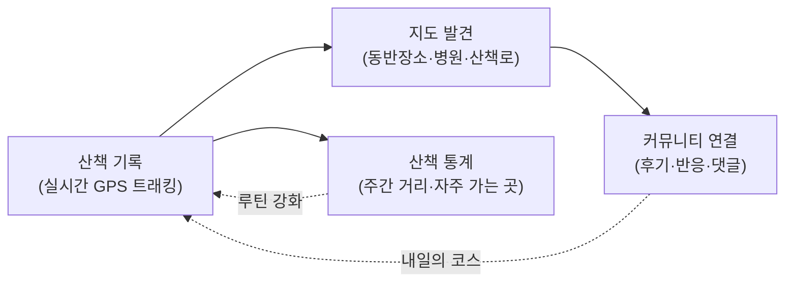

# Pawloop(포루프) 컨셉

> 반려동물(강아지 중심) **산책·동반장소·커뮤니티** 앱. 매일 반복되는 산책 루틴을 기록하고, 동반 가능한 장소를 지도에서 발견하며, 동네 반려인들과 연결되는 하나의 **loop**를 만든다.

- **제품명**: Pawloop / 포루프 · **회사**: cetaceaLab
- **앱스토어명**: Pawloop: Pet Walk & Community / 포루프: 반려동물 산책 커뮤니티
- **한 줄**: "반려동물과 함께 걷고, 동네 반려인들과 연결되는 공간"
- **타겟**: 도시 강아지 반려인(산책 중심). 개발자 1인 포트폴리오 겸 실서비스 지향.

---

## 1. `loop`의 3중 의미

브랜드명 **Pawloop**의 `loop`는 제품 전체를 관통하는 세 겹의 순환을 뜻한다.

| # | loop | 의미 | 앱에서의 구현 |
|---|------|------|----------------|
| 1 | **루틴 loop** | 매일 반복되는 산책·케어 루틴의 기록 | 실시간 산책 트래킹 → 산책 기록/통계(주간 거리 차트) |
| 2 | **커뮤니티 loop** | 동네 반려인들과 연결되는 관계의 순환 | 게시판·반응·댓글로 후기와 정보를 주고받음 |
| 3 | **경로 loop** | 오늘 걸은 산책 경로 그 자체 | GPS 폴리라인으로 그려지는 한 바퀴 산책 코스 |

세 loop는 서로를 먹인다. 오늘의 **경로 loop**가 **루틴 loop**로 쌓이고, 그 기록과 발견이 **커뮤니티 loop**로 공유되며, 커뮤니티에서 얻은 코스·장소 정보가 다시 내일의 산책을 만든다.

---

## 2. 핵심 가치 제안

반려 일상에서 가장 **자주, 매일** 일어나는 행동은 산책이다. Pawloop은 이 반복 행동을 붙잡는 것을 wedge로 삼는다.

- **산책이 그냥 사라지지 않는다** — 걸은 거리·시간·페이스·경로가 자동으로 기록되고 통계로 쌓인다.
- **어디로 갈지 고민이 준다** — 반려 동반 가능 장소(카페·식당·공원)와 동물병원·펫샵·산책로를 한 지도에서 카테고리로 발견한다.
- **혼자 걷지 않는다** — 같은 동네 반려인들의 코스 후기·동반장소 정보·건강 상담이 커뮤니티에 흐른다.
- **우리 아이 중심** — 견종·크기·나이·중성화 여부를 담은 강아지 프로필이 홈과 기록의 주인공이다.

한 문장으로: **"산책이라는 매일의 행동을, 기록·발견·연결이 도는 하나의 loop로 묶는다."**

---

## 3. 감정 앱에서의 피벗 배경

Pawloop은 원래 **"감정 여행(heattrip)"** — 장소에서의 감정 변화(mood delta)를 다루던 앱 — 에서 출발했다. 2026-07 반려동물 앱으로 방향을 틀며 감정 요소를 전부 제거했다.

- **왜 바꿨나**: 감정이라는 축은 측정·검증이 어렵고 매일 쓸 이유(daily habit)를 만들기 힘들었다. 반려 산책은 **매일 강제로 발생하는 행동**이라 리텐션의 뿌리가 훨씬 단단하다.
- **무엇을 물려받았나**: 지도(장소 발견)·커뮤니티(사람 연결)·기록이라는 뼈대와 디자인 시스템(오라 배경 + 글래스 카드)은 그대로 살렸고, "감정" 자리에 "강아지·산책"을 넣었다.
- **코드에도 남은 흔적**: 도메인 모델 주석에 *"반려(강아지) 도메인 모델. 감정 도메인을 대체한다"* 로 피벗 사실이 명시돼 있다(`lib/v2/domain/pet.dart`).

---

## 4. 확장 전략 — 산책 wedge → 반려 일상 로그

좁게 시작해서 넓게 확장한다. 산책이라는 하나의 뾰족한 wedge로 습관을 만든 뒤, 반려인의 하루 전체(건강·식사·병원·동네)로 로그의 범위를 넓힌다.

```
[산책 wedge]  →  [반려 일상 로그]  →  [반려인 네트워크]
  MVP 집중          post-MVP 확장         장기
```

| 단계 | 범위 | 상태 |
|------|------|------|
| **Wedge (MVP)** | 실시간 산책 트래킹 + 산책 기록/통계 | **집중** |
| 로그 확장 | 건강 로그, 식사 로그, 병원·접종 기록 | post-MVP |
| 로그 확장 | 동네 로그(자주 가는 곳·산책로) | post-MVP |
| 네트워크 | 반려인 매칭 / 산책 크루, 로그인, 실위치 | 장기 |

핵심 논리: **"산책 기록을 남기러 매일 들어오는 앱"** 이 되면, 그 안에 밥·건강·병원 로그를 얹는 것은 자연스러운 확장이다. 반대로 처음부터 종합 관리 앱으로 넓게 가면 매일 쓸 이유가 흐려진다.

> 데이터 모델의 `care_log(type: meal/health/vet/med)`는 이 확장을 미리 담은 스키마이며, 현재는 산책(`walk`)만 활성이다.

---

## 5. 핵심 사용 루프 (Daily Loop)

Pawloop의 하루 사용은 **기록 → 발견 → 연결** 세 걸음이 도는 형태다.



1. **산책 기록** — 홈에서 가운데 산책 버튼(FAB)을 눌러 실시간 트래킹 시작. 경로·거리·시간·페이스가 라이브로 그려지고, 끝내면 기록으로 저장된다.
2. **지도 발견** — 다음 산책지를 지도 탭에서 찾는다. 반려 동반 장소 + 동물병원·펫샵·산책로 레이어를 카테고리 필터로 탐색.
3. **커뮤니티 연결** — 좋았던 코스·장소를 커뮤니티에 후기로 남기고, 건강·병원 질문을 나눈다. 반응(도움돼요·귀여워요·공감)과 댓글로 관계가 순환한다.
4. **되먹임** — 쌓인 통계는 루틴을 강화하고, 커뮤니티의 코스 정보는 다음 산책의 목적지가 된다. → loop가 닫히며 다시 1번으로.

내비게이션도 이 루프를 그대로 반영한다 — **홈 · 지도 · [산책] · 커뮤니티 · 채팅** 4탭 + 산책 FAB 구조(통계는 탭이 아니라 홈 요약·마이 화면에서 연다)(`lib/v2/screens/main_shell.dart`).

---

## 6. MVP 범위 요약

| 축 | 내용 |
|----|------|
| **산책** | 실시간 GPS 트래킹(경로/거리/시간/페이스) + 산책 기록·통계 |
| **지도** | 반려 동반 장소(관광공사) + 동물병원·펫샵·산책로 레이어 + 카테고리 필터 |
| **커뮤니티** | 게시판(산책로 후기·동반장소·건강·병원·자유·자랑) + 반응 3종 + 댓글 |
| **프로필** | 강아지 프로필(견종·크기·나이·중성화) |

> 상세 화면 구현 현황은 [프로덕트/현황 문서]와 [ERD](../03-database/erd.md)를 참고. 로그인·실위치·가족·케어·채팅·장소 프록시는 **서버 연동이 끝났다**(#11·#12·#14 · #74~#82 · #40). 남은 더미는 병원/펫샵/산책로 레이어와 커뮤니티·산책 기록·통계다.
