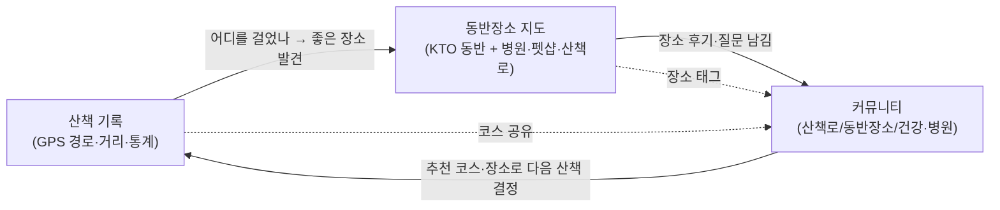

# 시장·경쟁 분석 (Market & Competition)

> Pawloop(포루프)는 **산책을 wedge로 한 "반려 일상 로그 + 동반장소 지도 + 커뮤니티" 통합 앱**이다. 국내 반려 인구가 임계점을 넘긴 지금, 개별 카테고리(산책 트래킹 / 동반장소 지도 / 반려 커뮤니티)는 이미 존재하지만 **세 가지를 하나의 흐름(loop)으로 묶고 공공데이터로 해자를 만든 앱은 아직 비어 있다.** 이 문서는 그 빈틈을 근거로 Pawloop의 포지셔닝을 정리한다.

---

## 1. 시장 개요 (Market)

### 1.1 반려 인구·시장 규모 (일반적 수준의 추정)

| 항목 | 대략적 규모 | 비고 |
| --- | --- | --- |
| 국내 반려동물 양육 가구 | 약 4가구 중 1가구 수준 (600만 가구+) | 1인·2인 가구 증가와 함께 지속 확대 |
| 반려 인구 | 1,000만~1,500만 명대로 통상 인용 | "천만 반려인" 이 대중적 표현으로 정착 |
| 반려동물 산업 규모 | 수조 원대, 연 두 자릿수 성장 추세 | 사료·용품 → 헬스케어·서비스로 지출 축 이동 |
| 강아지 vs 고양이 | 강아지 양육 비중이 여전히 최다 | Pawloop은 **강아지(산책)** 를 1차 타깃으로 좁힘 |

> 수치는 정부 통계(농림축산식품부 반려동물 보호·복지 실태조사 등)와 업계 리포트에서 통상 인용되는 일반적 수준의 값이다. 마케팅/IR용으로는 최신 원자료 재확인이 필요하다.

### 1.2 왜 "산책"이 wedge인가

- **강아지 반려인의 데일리 코어 행동**: 사료·간식·병원은 간헐적이지만, 산책은 하루 1~2회 반복되는 **가장 잦은 접점**이다. 반복 행동은 습관형 앱(리텐션)의 재료가 된다.
- **위치·경로 데이터가 자연 발생**: 산책은 본질적으로 GPS 경로·거리·시간·페이스를 남긴다. 이 데이터가 지도(어디를 걷는가)·커뮤니티(어디가 좋은가)·확장 로그(건강·활동량)로 자연스럽게 이어진다.
- **동반장소 니즈와 직결**: "우리 아이랑 갈 수 있는 곳"은 산책·나들이의 연장선이다. 산책 사용자는 곧 동반 카페·공원·여행지 수요자다.

### 1.3 산책·반려 앱의 흐름 (제품 카테고리)

시장의 반려 앱은 대체로 아래 4개 축으로 나뉘고, **대부분 한두 축에만 집중**한다.

1. **산책·활동 트래킹**: GPS 산책 기록, 거리·시간·통계, 챌린지.
2. **동반장소/지도 탐색**: 반려동반 카페·식당·숙소·공원 검색, 지도·필터.
3. **커뮤니티·SNS**: 자랑·정보 공유·Q&A, 지역 반려인 연결.
4. **케어·헬스·커머스**: 건강 기록, 병원 예약, 사료·용품 커머스, 펫시터/돌봄 매칭.

Pawloop은 **1(산책)을 진입점**으로 삼아 **2(지도)·3(커뮤니티)를 하나의 앱에서 잇고**, 4(케어·헬스)는 post-MVP로 확장한다.

---

## 2. 경쟁 지형 (Competitors)

> 아래는 국내에서 통상 언급되는 대표 반려 앱을 **카테고리별 대표성** 기준으로 정리한 것이다. 각 앱의 세부 기능은 시점에 따라 달라질 수 있어, 여기서는 일반적으로 알려진 포지셔닝·강약점 수준으로 기술한다.

### 2.1 카테고리별 대표 경쟁 앱

| 앱(서비스) | 핵심 포지셔닝 | 강점 | 약점 / Pawloop 관점의 빈틈 |
| --- | --- | --- | --- |
| **도그메이트** | 펫시터·산책·방문 돌봄 **매칭 서비스** | 돌봄이라는 명확한 유료 수요, 검증된 시터 풀, 예약·결제 완결 | 산책 "기록/습관" 앱이 아니라 **돌봄 중개 마켓**. 매일 쓰는 데일리 툴 성격은 약함 |
| **왈** | 산책·활동 등 반려 **라이프 기록/케어** 지향 | 기록 UX, 반려 라이프 전반을 담으려는 시도 | 동반장소 **지도 탐색·공공데이터 레이어**는 핵심이 아님. 커뮤니티 결합도 제한적 |
| **페딧(Pawdit)** | 반려인 **SNS/커뮤니티** 중심 | 콘텐츠·소통·바이럴, 유저 생성 콘텐츠 축적 | 산책 GPS 트래킹·지도 기반 장소 데이터가 약함. "행동 기록 → 장소"의 loop 부재 |
| **포포즈(4paws 계열)** | 반려동반 장소/나들이 정보·플레이스 | 동반장소 정보 큐레이션 | 산책 기록·통계와 결합 약함. 공공데이터 기반의 넓은 커버리지보다 큐레이션 위주 |
| **페오펫** | 반려동물 **등록·신원(펫 등록증)** 등 | 등록/행정 니즈, 제휴 | 데일리 산책·지도·커뮤니티의 통합 데일리 앱은 아님 |
| **핏펫(Fitpet)** | 반려 **헬스케어·검사·커머스** | 건강검사·용품 커머스 수직 통합 | 산책/지도/커뮤니티가 핵심이 아님. 케어·커머스 축 |
| 범용 지도(네이버/카카오맵) | 일반 지도 + "반려동반" 키워드 검색 | 압도적 데이터·정확도·사용자 습관 | 반려 **전용 필터·레이어(병원/펫샵/산책로/동반등급)·산책 기록**이 없음 |
| 범용 러닝/산책 앱(스트라바 등) | GPS 트래킹 일반 | 성숙한 트래킹·통계·소셜 | **반려 맥락(동반장소·견종·산책 커뮤니티) 전무** |

### 2.2 경쟁 지형 요약

- **매칭/돌봄(도그메이트 등)**: 유료 수요는 명확하나 "매일 여는 앱"은 아님 → Pawloop과 직접 경쟁 축이 다름(향후 크루/매칭으로 접점 가능).
- **기록/케어(왈 등)**: 기록은 겹치나 **동반장소 지도 + 공공데이터**가 약함.
- **커뮤니티/SNS(페딧 등)**: 소통은 강하나 **행동 데이터(산책 GPS)와 장소 데이터가 분리**됨.
- **장소/나들이(포포즈 등)**: 장소는 있으나 **산책 기록과의 loop**가 없음.
- **범용 지도·러닝 앱**: 데이터/습관은 강하나 **반려 전용성**이 없음.

즉, **각 조각은 존재하지만 "산책 기록 ↔ 동반장소 지도 ↔ 커뮤니티"를 하나의 loop로 엮은 통합 앱**은 시장에서 비어 있다. 이것이 Pawloop의 진입 지점이다.

---

## 3. Pawloop 차별화 (Differentiation)

### 3.1 한 문장

> **"산책으로 시작해, 우리 동네 반려 생활 전체를 하나의 loop로 잇는다."**
> 산책(행동) → 동반장소 지도(공간) → 커뮤니티(사람)가 끊기지 않고 서로를 강화한다.

### 3.2 세 가지 통합 = 단일 loop

- **산책 → 지도**: 산책 기록이 "자주 가는 곳"·경로 데이터를 만들고, 지도가 다음 목적지를 제안.
- **지도 → 커뮤니티**: 장소마다 후기·질문·반응(도움돼요/귀여워요/공감)이 붙어 **장소 단위 UGC**가 축적.
- **커뮤니티 → 산책**: 추천 코스·동반장소가 다음 산책의 목적지로 환류.

> 경쟁 앱들은 이 화살표 중 **1~2개만** 구현한다. Pawloop은 **세 노드를 한 앱에서 닫힌 loop로 연결**하는 것이 제품 정의 그 자체다.

### 3.3 공공데이터 해자 (Data Moat)

Pawloop의 지도·장소 레이어는 **공개 공공데이터**를 기반으로 넓은 커버리지를 저비용으로 확보한다. 이는 수작업 큐레이션 위주 경쟁 앱 대비 **커버리지·갱신·확장성**에서 구조적 우위다.

| 레이어 | 데이터 원천 | 현재 상태 | 해자 포인트 |
| --- | --- | --- | --- |
| 반려동반 가능 장소 | 관광공사 **KorPetTourService2**(반려동물 동반여행, PK 15135102) | **실연동** (서울 45곳 등 KTO API 호출) | 여행지/카페·식당/레포츠/숙박/쇼핑/문화 등 contenttypeid 전 카테고리 커버 |
| 동물병원 | 행안부 인허가(공공데이터포털 `1741000/animal_hospitals`, 전국 ~9,445건) | **실연동**(#291) — 서버가 월 1회 받아 EPSG:5174→WGS84 로 바꿔 카탈로그에 이어 붙인다 | 전국 단위 병원 레이어를 공공데이터로 확보 |
| 펫샵(동물판매업) | 행안부 인허가(`1741000/animal_sales`, 전국 ~8,907건) | **실연동**(#291) | 인허가 기반 신뢰도 |
| 산책로 코스 | 관광공사 **두루누비**(걷기여행길, GPX) | **실연동**(#291) — 시작점은 카탈로그, 선은 별도 응답 | 검증된 코스 좌표/거리로 "산책로" 레이어 차별화 |

**해자의 성격**
- **선점형 데이터가 아니라 축적형 데이터**: 공공데이터는 진입 장벽을 낮추지만, 여기에 **산책 GPS 경로 + 장소별 커뮤니티 UGC**가 얹히면 **경쟁사가 복제하기 어려운 사용자 생성 레이어**가 형성된다. → 공공데이터는 콜드스타트를 깨는 부트스트랩, UGC·경로 데이터가 진짜 해자.
- **백엔드 프록시+캐싱으로 원가·품질 관리**: KTO 호출을 **백엔드 프록시로 옮겼다**(#40). 좌표를 0.02° 격자로 접어 셀 단위로 캐시하고, 일 1,000콜 한도를 DB 행 하나가 게이트로 지킨다 → **속도·안정성·비용**을 경쟁 우위로 전환.

### 3.4 제품·디자인 차별화

- **데일리 습관 앱 포지셔닝**: 매칭/커머스가 아닌 **매일 여는 산책 툴**로 리텐션 설계(실시간 트래킹 + 주간 통계 + 자주 가는 곳).
- **반려 전용 지도 UX**: 범용 지도가 못 주는 **반려 전용 필터·레이어·범례**(동반등급, 병원/펫샵/산책로, 견종 크기 맥락).
- **감성 디자인 시스템**: 파스텔 오라 그라데이션 배경 + 글래스 카드 + 플로팅 바텀네비(가운데 솟은 산책 FAB) + Fluent Emoji 3D + Pretendard. "정보 앱"이 아니라 **곁에 두고 싶은 반려 앱**의 톤.
- **강아지 프로필 컨텍스트**: 견종·크기·나이·중성화 정보가 장소 추천·커뮤니티 태그·(post-MVP)건강 로그로 연결.

### 3.5 확장 로드맵과 방어선 (post-MVP)

산책 wedge에서 확보한 사용자·데이터를 축으로 확장하며, 각 확장이 경쟁 카테고리에 대한 방어선이 된다.

| 확장 축 | 내용 | 어떤 경쟁 카테고리를 방어/흡수하나 |
| --- | --- | --- |
| 건강/식사/병원 로그 | care_log(meal/health/vet/med) | 헬스케어 앱(핏펫 등) 축 흡수 |
| 동네 로그·지역화 | 동네 단위 장소·소식 | 지역 커뮤니티/나들이 앱 축 |
| 반려인 매칭·산책 크루 | 함께 걷기, 이웃 연결 | 매칭 서비스(도그메이트 등) 접점 진입 |
| 로그인·실위치 | 소셜 로그인(#11·#12·#14), geolocator | **둘 다 실동작.** 로그인 없이도 4대 흐름을 쓸 수 있고, 위치는 실좌표 기준이다 |

---

## 4. 포지셔닝 한 컷

| 구분 | 산책만(트래킹 앱) | 지도만(장소 앱) | 커뮤니티만(SNS) | 매칭·커머스 | **Pawloop** |
| --- | --- | --- | --- | --- | --- |
| 데일리 반복 사용 | ○ | △ | △ | ✕ | **○** |
| 동반장소 지도 | ✕ | ○ | ✕ | △ | **○ (공공데이터)** |
| 산책 GPS 기록·통계 | ○ | ✕ | ✕ | ✕ | **○** |
| 장소 결합 커뮤니티 | ✕ | △ | ○ | ✕ | **○** |
| 세 축의 단일 loop | ✕ | ✕ | ✕ | ✕ | **◎** |

**결론**: Pawloop의 경쟁력은 개별 기능의 우열이 아니라, **산책·지도·커뮤니티를 공공데이터 해자 위에서 하나의 loop로 통합**했다는 구조에 있다. 시장은 조각으로 나뉘어 있고, 그 조각을 잇는 자리가 비어 있다.

---

> 참고: 본 문서의 시장 수치·경쟁 앱 특성은 일반적으로 알려진 수준의 근거이며, 대외 발표·투자 자료로 활용 시 최신 원자료(정부 통계·앱 스토어·각 서비스 현행 기능)로 재검증이 필요하다. 관련 문서: [제품 개요](./concept.md), [ERD](../03-database/erd.md).
