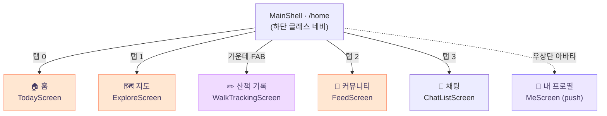
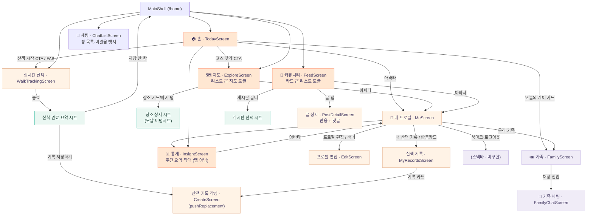
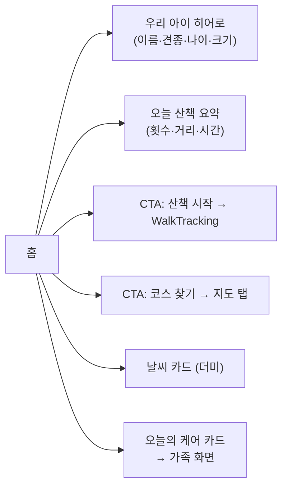
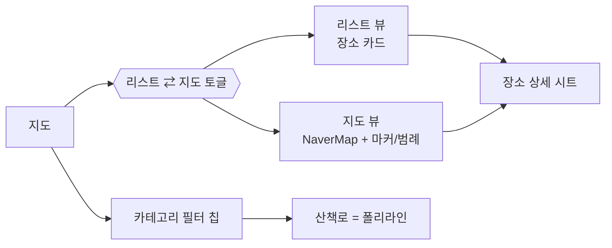
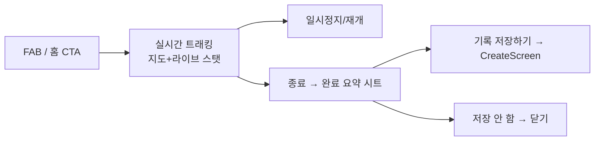
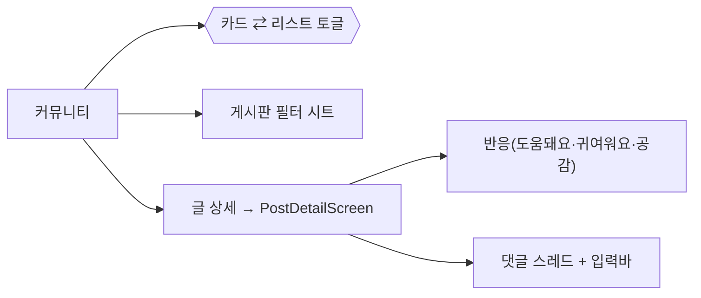
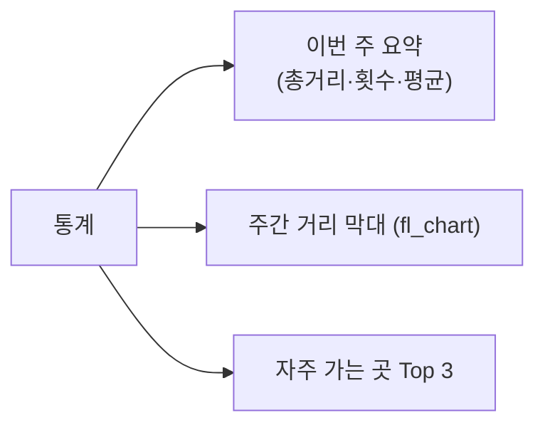
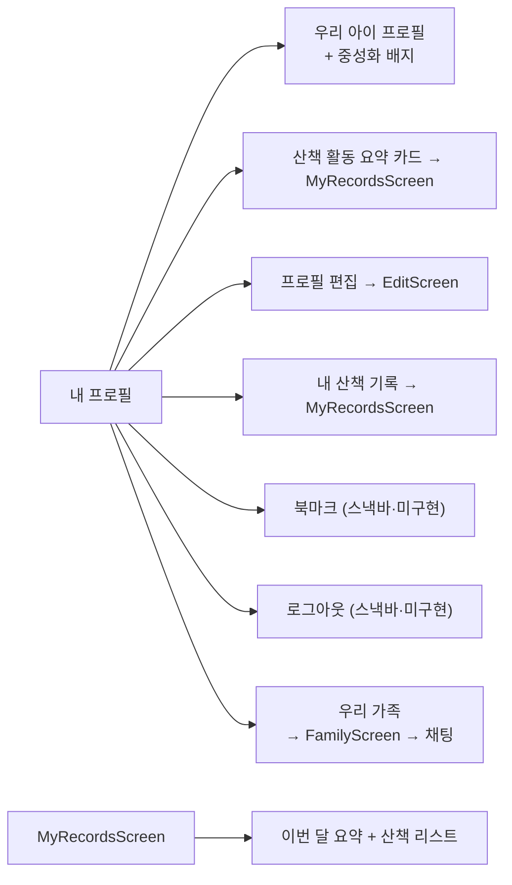

# 정보구조(IA) — Pawloop(포루프)

> 5탭(홈 / 지도 / 산책 FAB / 커뮤니티 / 채팅) 셸 + 각 탭의 하위 화면 트리와 네비게이션 규칙. 실제 구현(`app/lib/v2/`) 기준으로 작성.

관련 문서: [화면 목록](./screen-spec.md) · [디자인 시스템](./design-system.md) · [ERD](../03-database/erd.md)

---

## 1. 한눈에 보기

- **진입점**: `main.dart` → `go_router`(`initialLocation: '/home'`) → `MainShell`(`app/lib/v2/screens/main_shell.dart`).
- **셸 구조**: 하단에 떠 있는 글래스 알약 네비(4탭) + 가운데 솟은 **산책 기록(+) FAB**. 총 **5개 진입 슬롯**.
- **탭 전환 방식**: 탭은 화면을 **push하지 않고** `RootTab.index`(`ValueNotifier<int>`)로 본문만 교체(IndexedStack 유사). 상세/작성 화면만 `Navigator.push`로 위에 쌓임.
- **글로벌 진입**: 모든 메인 탭 우상단의 **프로필 아바타**(`ProfileAvatar`)를 탭하면 어디서든 `MeScreen`(내 프로필)을 push.

> 참고: `lib/v2/`가 정식 화면 트리다. `app_router.dart`에 남아 있는 `StatefulShellRoute`(explore/record/journey/profile/emotion_map 브랜치)와 `foryou`/`start` 라우트들은 **구버전(피벗 이전) 잔재**로, `/home` 진입 시 사용되지 않는다.

---

## 2. 최상위 네비게이션 (5탭 셸)

| 슬롯 | 라벨 | 화면 | 파일 | 전환 |
|---|---|---|---|---|
| 탭 0 | 홈 | `TodayScreen` | `today_screen.dart` | `RootTab.index=0` |
| 탭 1 | 지도 | `ExploreScreen` | `explore_screen.dart` | `RootTab.index=1` |
| FAB(가운데) | (산책 기록) | `WalkTrackingScreen` | `walk_tracking_screen.dart` | `Navigator.push` |
| 탭 2 | 커뮤니티 | `FeedScreen` | `feed_screen.dart` | `RootTab.index=2` |
| 탭 3 | 채팅 | `ChatListScreen` | `chat_list_screen.dart` | `RootTab.index=3` |

> **통계(`InsightScreen`)는 탭이 아니다.** 진입점이 **둘**이다 — `me_screen`(마이 화면 메뉴)과 `today_screen`(홈의 오늘 산책 요약). 2026-08 에 탭에서 내려갔고 그 자리에 채팅이 들어왔다(#78~#81).
| 글로벌 | 내 프로필 | `MeScreen` | `me_screen.dart` | 아바타 탭 → `push` |

> **주의**: 가운데 FAB은 탭 상태(index)를 바꾸지 않고 `WalkTrackingScreen`을 **위에 push**한다. 즉 산책 트래킹은 탭이 아니라 "실행되는 흐름"이며, 종료 후 원래 탭으로 되돌아온다.

---

## 3. 전체 화면 트리

---

## 4. 탭별 하위 구조

### 4.1 🏠 홈 (`TodayScreen`)

- 진입점 2개: **산책 시작**(→ `WalkTrackingScreen` push), **코스 찾기**(→ `RootTab.index=1` 지도 탭).
- 데이터: `kMyDog`(`ValueNotifier<DogProfile>`), `WalkFeedData.today`(오늘 요약 — 서버 + 전송 대기).
- **오늘의 케어 카드**(`widgets/today_care_card.dart`): 탭하면 가족 화면(`family_screen`) push, 가족 화면에서 채팅(`family_chat_screen`)으로 진입. **서버 연동됐다**(#76·#81) — `family_repository.dart`. [기능 명세 §6](./feature-spec.md) 참조.

### 4.2 🗺️ 지도 (`ExploreScreen`)

- **뷰 토글**: `list` / `map`. `RootTab.exploreView`로 외부(홈 등)에서도 초기 뷰 지정 가능.
- **필터 칩**(`kPetCategories`): 전체 · 여행지 · 카페·식당 · 레포츠 · 숙박 · 쇼핑 · 문화(관광공사 실연동) / 병원 · 펫샵 · 산책로(공공데이터 예정 — 현재 더미 레이어).
- **장소 상세**: 카드/마커 탭 → **모달 바텀시트**(이름·카테고리·거리·주소·전화·동반가능 배지). 별도 화면 아님.
- 산책로 필터는 리스트에선 카드, 지도에선 폴리라인으로 표시.

### 4.3 ✏️ 산책 기록 FAB (`WalkTrackingScreen`)

- 라이브 패널: 거리(km)·시간·페이스 + 일시정지/종료. (실 GPS — `geolocator` 스트림 → `walk.path` LINESTRING 저장. 위치를 못 쓰면 이유별 안내 화면 + 직접 입력.)
- **종료 → 완료 시트 → 기록 저장하기**가 `CreateScreen`으로의 핵심 진입점(`pushReplacement`, `prefillPlace: '오늘 산책'`).

### 4.4 💬 커뮤니티 (`FeedScreen`)

- **게시판**(`kPetBoards`): 전체 · 산책로 후기 · 동반장소 · 건강·병원 · 자유 · 자랑. 상단 `전체 ▾` → 모달 시트로 선택.
- **반응**(`kPetReactions`): 도움돼요 / 귀여워요 / 공감.
- 글 상세에서 반응 토글·댓글 작성은 **로컬 상태**(백엔드 미연동, 더미).
- ⚠️ **글쓰기 진입점 없음**: 현재 커뮤니티에는 새 글 작성 버튼이 없다. `CreateScreen`은 "산책 기록"용이며 게시판 글쓰기와 분리됨(향후 커뮤니티 글쓰기 진입점 추가 필요).

### 4.5 📊 통계 (`InsightScreen`) — **탭이 아니다. `me_screen`·`today_screen` 둘에서 push**

- 순수 열람 화면. 하위 push 없음(우상단 아바타 → 프로필만 예외).
- 데이터: `WalkStats.weekKm`(요일별 거리, KST 주 경계). 장소 빈도는 **없다** — `Walk` 에 장소 축이 없다.

### 4.6 👤 내 프로필 (`MeScreen`, 글로벌 push)

- 진입: 어느 탭이든 우상단 아바타 → push. 자체 뒤로가기 버튼 보유.
- `EditScreen`(견종·나이·크기·중성화 편집 → `kMyDog` 갱신), `MyRecordsScreen`(산책 기록 목록, 기록 카드 → `CreateScreen`).
- 메뉴 **"우리 가족"** → 가족 화면(`family_screen`: 멤버·초대코드·케어 현황·주의사항·채팅 진입) → 가족 채팅(`family_chat_screen`). 셋 다 서버 연동됐다(#75·#76·#81).

---

## 5. 네비게이션 규칙

| 규칙 | 내용 |
|---|---|
| **탭 이동** | 화면 push가 아니라 `RootTab.index` 값 변경으로 본문 교체. 탭 간 상태 보존, 백스택 미증가. |
| **탭 프로그램 전환** | 화면 코드에서 `RootTab.index.value = n`으로 탭 이동(예: 홈 "코스 찾기" → 지도). |
| **딥 전환 후 복귀** | `RootTab.go(context, i)`는 push된 모든 화면을 `popUntil(isFirst)`로 닫고 지정 탭으로 이동(옵션 `exView`로 지도 뷰 지정). |
| **상세/작성/트래킹** | `Navigator.push`(또는 `pushReplacement`)로 셸 위에 스택. 하단 네비 위에 전체화면으로 덮음. |
| **모달 시트** | 장소 상세·산책 완료·게시판 선택은 `showModalBottomSheet`. 라우트가 아니라 컨텍스트 오버레이. |
| **뒤로가기** | push된 화면은 좌상단 back 버튼(또는 시스템 back)으로 pop. 탭 화면 자체엔 back 없음(루트). |
| **프로필 글로벌 진입** | 모든 메인 탭 헤더 `ProfileAvatar` 공유 → 항상 `MeScreen` push로 일관. |

---

## 6. 핵심 진입점 요약 (Task Entry Points)

| 작업 | 주 진입점 | 대체 진입점 |
|---|---|---|
| **산책 시작** | 가운데 FAB(모든 탭) | 홈 "산책 시작" CTA |
| **산책 기록 저장** | 트래킹 종료 → 완료 시트 → "기록 저장하기" (`CreateScreen`) | 내 산책 기록(`MyRecordsScreen`)의 기록 카드 |
| **동반 장소 찾기** | 지도 탭(리스트/지도 + 카테고리 필터) | 홈 "코스 찾기" CTA |
| **장소 상세** | 지도 장소 카드/마커 → 바텀시트 | — |
| **커뮤니티 글 읽기** | 커뮤니티 탭 → 글 상세 | — |
| **커뮤니티 글쓰기** | ⚠️ 진입점 미구현 (향후 추가) | — |
| **프로필/우리 아이 편집** | 아바타 → 내 프로필 → 프로필 편집 | 내 프로필 상단 배너 |
| **가족 케어 확인/기록** | 홈 "오늘의 케어" 카드 → 가족 화면(`family_screen`) | 프로필 메뉴 "우리 가족" |
| **가족 채팅** | 가족 화면 → 채팅 진입(`family_chat_screen`) · 탭 3 | — |

---

## 7. 미구현/더미 (IA 관점)

- **로그인/온보딩**: `main.dart` 가 `AuthState.init()` 을 돌리고 `app_router.dart` 의 `refreshListenable` + `authRedirect` 가 **splash → consent → onboarding → login → home** 을 가른다(#12·#180). 인증 게이트가 있다.
- **북마크**: 메뉴 항목 존재하나 화면 없음(스낵바). ERD `bookmark` 테이블과 미연동.
- **커뮤니티 글쓰기**: 화면·진입점 모두 없음.
- **실위치**: 지도·트래킹 모두 **실 GPS** 다(#145). 지도는 `LocationService.current()` 로 현위치를 잡고 **실패했을 때만** 서울시청으로 떨어진다. 트래킹은 위치를 못 쓰면 이유별 안내 화면 + 직접 입력이다(#160).
- **장소 상세 → 산책 기록 prefill**: `CreateScreen(prefillPlace:)` 파라미터는 존재하나, 지도 장소 시트에서 이를 호출하는 버튼은 아직 없음(트래킹 완료 경로만 사용).
- **가족 케어 & 채팅**: 홈 "오늘의 케어" 카드 · `family_screen`(멤버·초대코드·케어 현황·주의사항·채팅 진입) · `family_chat_screen` · `chat_list_screen`(탭 3). **전부 서버 연동됐다**(M2.5·M2.6 — #75·#76·#78~#81). 데이터는 `lib/v2/domain/pet.dart` 의 로컬 상수가 아니라 `lib/v2/data/family_repository.dart`·`chat_repository.dart` 가 든다 — 상세는 [기능 명세 §6](./feature-spec.md).
