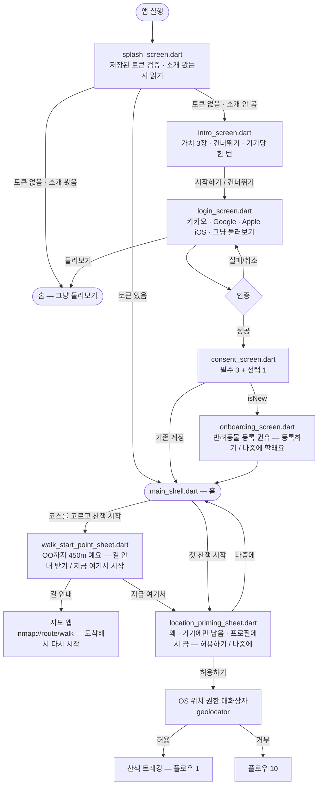
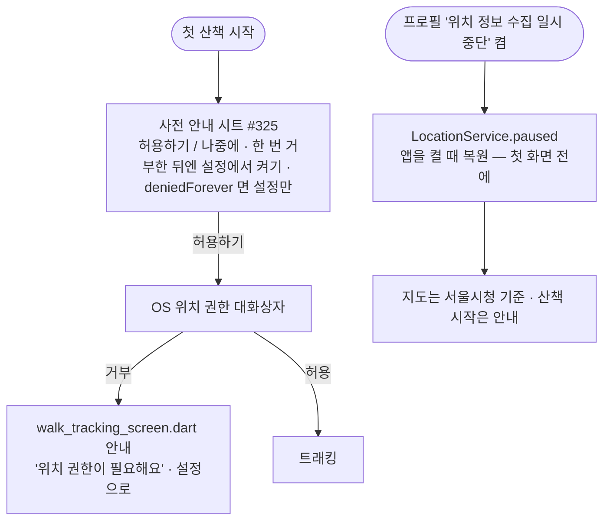
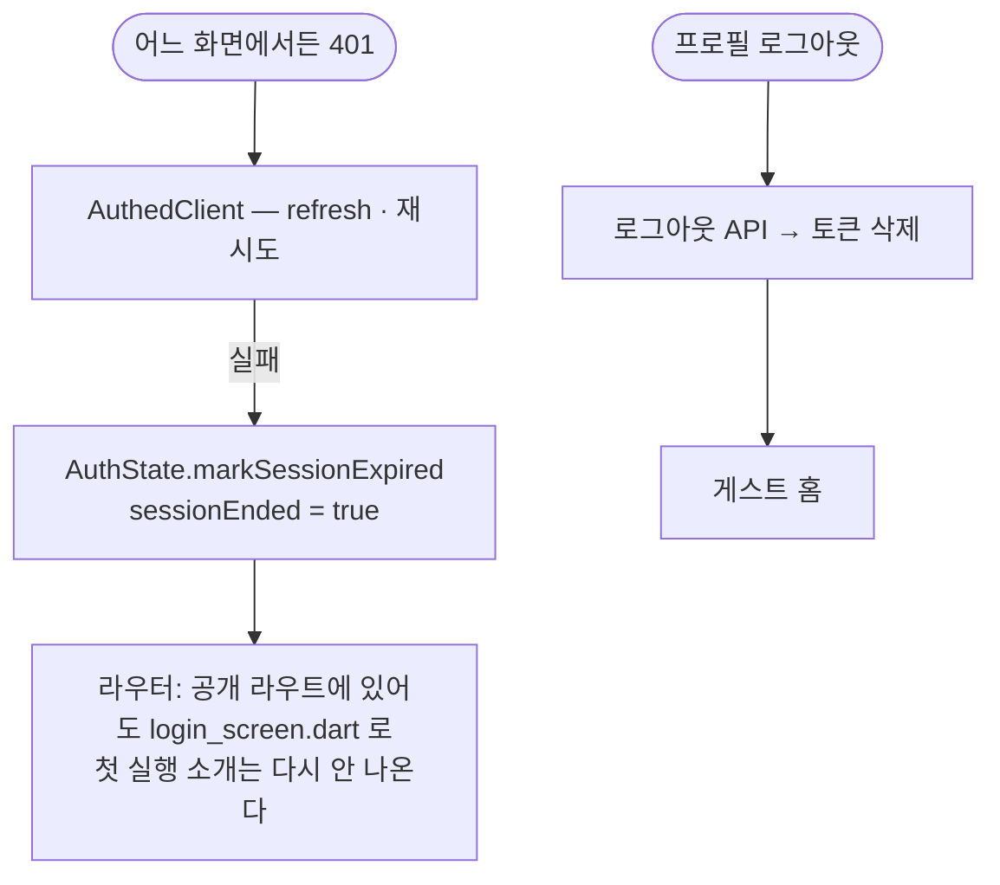
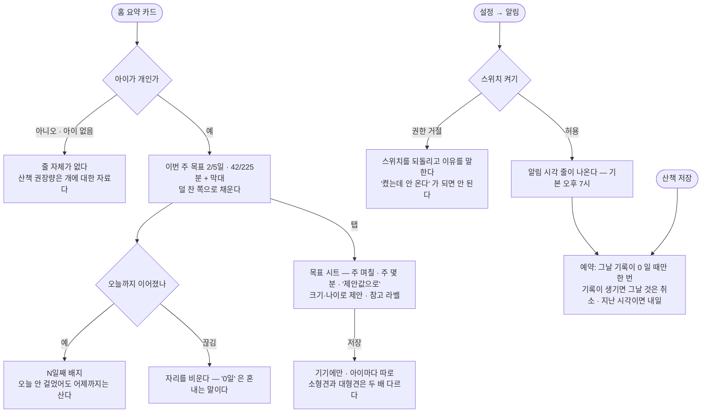
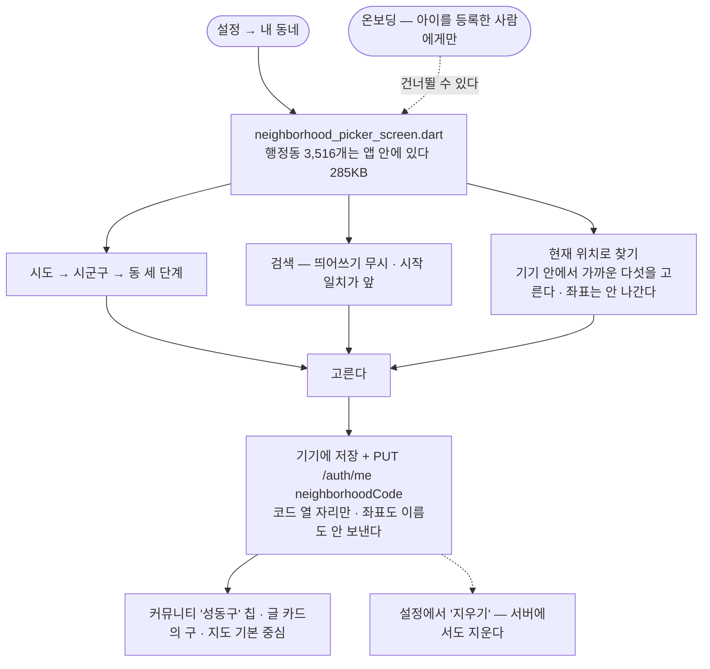
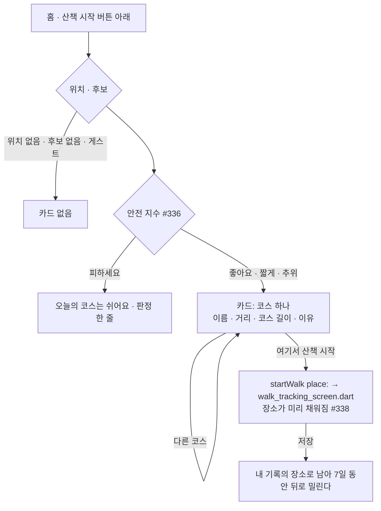

# 사용자 플로우 (User Flows)

> Pawloop(포루프)의 사용자 여정을 mermaid flowchart 로 정리한 문서. 모든 플로우는 **실제 구현**(`app/lib/v2/screens/`)을 기준으로 적고, 아직 없는 흐름은 점선 노드 + 이슈 번호로만 표시한다 — 만들기 전 흐름을 실선으로 그리면 문서가 코드보다 앞서 가고, 그 차이는 아무도 모르는 사이에 커진다(#345 가 그렇게 생겼다).
>
> 2026-09-07 앱을 처음부터 끝까지 걸어 보고(#322) 코드와 대조해 다시 썼고, 2026-09-08 에 #338~#342 가 나간 뒤 다시 맞췄다. 화면 파일 **29개**가 전부 이 문서 어딘가에 나온다.
>
> **점선 노드는 두 가지를 뜻한다** — 아직 안 만든 것, 그리고 **만들었지만 이 빌드에서 꺼져 있는 것**(코스 #339: 위치기반서비스 신고 전에는 화면에 없다). 둘을 같은 모양으로 그리는 이유는 사용자에게 보이는 결과가 같아서다.

## 개요

| # | 플로우 | 진입점 | 관련 화면 |
|---|--------|--------|-----------|
| 1 | 산책 시작 → 실시간 트래킹 → 종료 → 기록 저장 | 홈 "산책 시작" · 가운데 산책 FAB | `today_screen.dart` → `start_walk.dart` → `walk_tracking_screen.dart` → `create_screen.dart` |
| 2 | 지도에서 장소 찾기 → 상세 | 지도 탭 | `explore_screen.dart`(장소 바텀시트) |
| 3 | 커뮤니티 글 읽기 / 쓰기 / 고치기 | 커뮤니티 탭 | `feed_screen.dart` → `post_detail_screen.dart` · `post_write_screen.dart` |
| 4 | 첫 실행 → 소개 → 로그인 → 동의 → 반려동물 등록 권유 | 앱 실행 | `splash_screen.dart` → `intro_screen.dart` → `login_screen.dart` → `consent_screen.dart` → `onboarding_screen.dart` → `main_shell.dart` |
| 5 | 가족 그룹 만들기 · 초대 · 참여 | 홈 케어 카드 "만들기" · 채팅 탭 · 프로필 | `family_screen.dart` · `invite_join_screen.dart` |
| 6 | 오늘의 케어 기록 | 홈 · 가족 화면의 케어 칸 | `today_screen.dart` · `family_screen.dart` |
| 7 | 채팅 — 방 목록 → 첫 진입 규칙 → 대화 | 채팅 탭 · 가족 화면 | `chat_list_screen.dart` → `family_chat_screen.dart` |
| 8 | 산책 기록 보기 → 회고 → 지우기 · 통계 · 저장한 글 · 아이 사진첩 | 프로필 | `me_screen.dart` → `myrecords_screen.dart` → `walk_detail_screen.dart` · `insight_screen.dart` · `saved_posts_screen.dart` · `dog_gallery_screen.dart` |
| 9 | 프로필 편집 · 설정 · 약관 · 탈퇴 | 프로필 | `edit_screen.dart` · `settings_screen.dart` · `settings/legal_document_screen.dart` · `settings/account_delete_screen.dart` |
| 10 | 위치 권한 거부 · 위치 이용중지 | 첫 산책 · 프로필 토글 | `walk_tracking_screen.dart` · `me_screen.dart` · `explore_screen.dart` |
| 11 | 세션 만료 · 로그아웃 | 어느 화면에서든 | 라우터(`auth_redirect.dart`) → `login_screen.dart` |
| 12 | 못 보낸 산책 초안의 재전송 | 산책 저장 실패 | `create_screen.dart` · `today_screen.dart` · `myrecords_screen.dart` |
| 13 | 주간 목표 · 연속 일수 · 저녁 알림 | 홈 요약 카드 · 설정 | `today_screen.dart`(목표 줄) · `settings_screen.dart`(알림) |
| 14 | 내 동네 고르기 → 커뮤니티 · 지도의 기준 | 설정 · 온보딩 | `neighborhood_picker_screen.dart` → `feed_screen.dart` · `explore_screen.dart` |
| 15 | 일정 적기 → 달력에서 보기 → 완료 표시 | 일정 탭 | `schedule_screen.dart`(월 달력 · 그날 목록 · 만들기 시트) |
| 16 | 우리 동네 크루 찾기 → 참여 → 대화방 | 커뮤니티 탭 > 크루 | `crew_section.dart`(내 크루 · 우리 동네) → `crew_home_screen.dart` → `family_chat_screen.dart` |
| 17 | 크루 만들기 → 초대 코드 보내기 | 커뮤니티 탭 > 크루 | `widgets/crew_create_sheet.dart` → `crew_home_screen.dart`(초대 코드 보내기) |
| 18 | 오늘의 코스 → 여기서 산책 시작 | 홈 · 산책 시작 버튼 아래 | `widgets/today_course_card.dart`(규칙 `domain/course_recommender.dart`) → `walk_tracking_screen.dart` |
| 19 | 할 일 만들기 → 순서 바꾸기 → 접기 | 우리 가족 · 오늘의 케어 카드 아래 | `family_screen.dart`(할 일 고치기 줄) → `care_items_screen.dart`(추가 시트 · 끌기 손잡이 · 접기) |

네비게이션 골격은 `main_shell.dart` 의 다섯 자리다: **홈 · 지도 · 일정 · 커뮤니티 · 채팅**(산책은 홈이 연다, #446). 일정은 #419 가 더했다 — 왼쪽 셋 · 오른쪽 둘로 나눈 것은 FAB 오른쪽에 셋을 두면 알약의 무게가 쏠리기 때문이다. 통계·기록·가족·설정은 탭이 아니라 프로필(`me_screen.dart`)에서 들어간다. `pin_picker_screen.dart` 는 파일은 있으나 지금 어디에서도 열리지 않는다(#322 에서 확인 — 지울지는 따로 정한다).

---

## 1. 산책 시작 → 실시간 트래킹 → 종료 → 기록 저장

가장 중요한 wedge 플로우. **실 GPS** 다 — `geolocator` 위치 스트림(5m)을 구독해 그리고, 종료하면 거리·시간·메모를 `POST /api/walks` 로 보낸다. 경로 좌표는 **A안 빌드에서는 서버로 나가지 않는다**(`LocationUploadPolicy.pathForUpload` 가 `null`, #235·#238) — 경로는 기기에서만 그린다.

```mermaid
flowchart TD
    A([홈 "산책 시작"]) --> S
    B([홈 "산책 시작"]) --> S
    S{start_walk.dart<br/>로그인했나?}
    S -->|아니오| L[스낵바 '로그인하면 산책 기록이 남아요'<br/>→ login_screen.dart]
    S -->|예| C[walk_tracking_screen.dart<br/>_boot: 첫 위치 판정 → 지도 생성]
    C -->|위치 권한 없음| P[OS 권한 대화상자<br/>거부하면 플로우 10]
    C --> E[위치 스트림 5m 구독<br/>거리·시간·페이스 갱신 · 폴리라인 · 카메라 추적]
    E -.일시정지.-> G[일시정지] -.재개.-> E
    E -.사진.-> PH[카메라 → walk_photos/ 파일<br/>배지 · 열 장까지 #450] -.-> E
    E -->|종료| H[산책 완료 시트<br/>시간·거리·페이스 · 경로 미리보기<br/>'배변 2회 · 물 1회' · 경로 위에 점 #340<br/>사진 띠 · 공유 카드는 첫 장이 배경 #450]
    H -->|"기록 저장하기"| I[create_screen.dart<br/>pushReplacement · 장소는 시작한 곳으로 #338]
    H -->|"저장 안 함"| Z([홈])
    H -->|"경로 사진 저장"| Q[갤러리에 PNG<br/>끝내기 순간의 지도 스냅숏 위 경로 #483 · 업로드 없음]
    I --> J[날짜 · 거리 · 시간 · 메모]
    J -->|저장| K[사진 먼저 POST /media WALK_IMAGE → mediaIds<br/>POST /api/walks · 경로 좌표 없이]
    K -->|성공| Z2([홈 — 오늘 요약 갱신])
    K -->|실패| D[초안 큐에 남김 → 플로우 12]
    C -.상단 뒤로가기.-> Z
    E --> F2[한 손 기록 #340<br/>배변 · 마킹 · 물 — 한 탭 · 5초 안 다시 누르면 취소]
    F2 --> H
    P2([지도 '여기서 산책 시작' #338]) --> C
    P2 -.-> K
    K --> CL[저장 뒤 오늘의 케어에도 #326 · #340<br/>walk 한 줄 + 눌러 둔 것 한 줄씩]
    E --> BG[화면 꺼짐 — 포그라운드 서비스 알림<br/>5초마다 스냅숏 · 앱이 죽으면 '이어서 기록할까요?']
    H -.-> R1[[이 길을 코스로 남기기 — 위치 신고 뒤 #339]]:::todo
    classDef todo fill:#f5f0ff,stroke:#9B7BFF,stroke-dasharray:5 4,color:#463C64;
```

**구현 메모**

- 진입은 홈의 "산책 시작" 하나이고 `start_walk.dart` 의 `startWalk()` 를 지난다. 미로그인 안내는 거기 한 곳에 있다.
- `_boot()` 이 `LocationService.locate()` 로 첫 위치를 잡은 **뒤에야** 지도를 만든다. 판정 전에 그리면 대기 중 찍힌 점이 경로에 섞인다.
- 지도 키(`NAVER_MAP_CLIENT_ID`)가 없으면 지도 자리에 안내 카드가 뜨고 기록은 계속된다(`map_unavailable.dart`, #182).
- 저장 화면의 거리·시간은 GPS 로 온 값이면 **읽기 전용**이다(#327) — "GPS 로 잰 값이에요 · 여기서는 고칠 수 없어요". 손입력 기록일 때만 스텝퍼가 움직인다.
- **한 손 기록(#340)** 은 스탯 패널 위에 항상 있다 — 패널을 접어도 보인다. 규칙(5초 안 취소)은 화면이 아니라 `WalkMomentLog`(도메인)에 있다: 이 화면은 지도·GPS 를 물고 있어 위젯 테스트로 못 띄운다. 어디서 눴는지는 **경로의 몇 번째 점**으로만 들고 서버에 안 나간다(A안 #235).
- **장소(#338)** 는 지도의 "여기서 산책 시작" 으로 들어와 추적 화면 → 초안 → 저장 화면 이름 칸까지 따라간다. 카탈로그에서 온 값이라 통계의 "자주 가는 곳" 에 쌓인다.
- 저장이 끝나면 오늘의 케어에도 남는다 — `walk` 한 줄(#326)과 눌러 둔 배변·마킹·물 한 줄씩(#340). **가족이 없으면 조용히 안 간다**(오류가 아니다).

---

## 2. 지도에서 장소 찾기 → 상세

`explore_screen.dart` 는 리스트/지도 토글 + 카테고리 칩 아홉으로 "우리 아이랑 갈 수 있는 곳" 을 보여 준다. 데이터는 전부 실데이터다 — 관광공사 반려동반(여행지·카페식당·레포츠·숙박·쇼핑·문화), 행정안전부 인허가(동물병원·펫샵), 두루누비 걷기여행길(산책로) — 카탈로그 한 벌을 기기에 받아 두고(24시간마다 갱신) **거리 계산은 기기 안에서** 한다(#291·#317).

```mermaid
flowchart TD
    A([지도 탭]) --> B[카탈로그 캐시 확인<br/>없거나 24h 지났으면 GET /api/places/catalog]
    B --> C{현위치}
    C -->|동의·권한 있음| D[현위치 중심]
    C -->|게스트 · 권한 없음 · 실패| E0{고른 동네가 있나 #342}
    E0 -->|있음| E1[그 동네 중심<br/>'현재 위치를 못 받아 성수1가1동 기준이에요']
    E0 -->|없음| E[서울시청 중심<br/>'…서울시청 기준이에요 · 위치를 켜면 내 주변']
    E1 --> V
    D --> V{뷰 토글}
    E --> V
    V -->|리스트| L[장소 카드<br/>사진 먼저 · 이름 · 카테고리 · 거리 · 주소]
    V -->|지도| M[네이버 지도 + 카테고리색 핀]
    subgraph 칩[카테고리 칩 — 누르면 다시 조회 #317]
      F1[전체 / 여행지 / 카페·식당 / 레포츠 / 숙박 / 쇼핑 / 문화]
      F2[동물병원 / 펫샵 — 8km 안]
      F3[산책로 — 반경 없이 가까운 20개 #321]
    end
    L --> 칩
    M --> 칩
    L -->|카드 탭| S[장소 바텀시트<br/>이름 · 카테고리 · 거리 · 주소 · 전화 · 출처]
    M -->|마커 탭| S
    S -->|산책로| T[GET /api/places/trails/{id} → 선을 지도에]
    S -->|"이 장소로 글쓰기"| W[post_write_screen.dart<br/>장소 연결됨]
    S -->|닫기| V
    S --> A1[전화 · 길찾기 · 산책로는 지도에서 보기<br/>글쓰기는 두 번째 #328]
    S -->|"병원 · 이름에 24시"| H1[24시 · 이름 기준 배지<br/>병원 칩 안 24시 토글 #337]
    S -->|"여행지·카페·레포츠·산책로"| K1[여기서 산책 시작 #338<br/>→ 추적 화면에 place 전달]
    K1 --> K2[저장 화면 이름 칸이 그 장소로<br/>→ 통계 자주 가는 곳에 쌓인다]
    칩 -.->|"산책로 + 이웃 코스 — 위치 신고 뒤"| C1[["공개 코스 한 벌 GET /api/courses/public<br/>가까운 20개는 기기가 고른다 #339"]]:::todo
    C1 -.-> C2[["코스 시트: 선 · 태그 · 이 코스 다시 걷기<br/>→ 추적 화면에 연한 선"]]:::todo
    B -.-> N4[[동네 길 · 놀이터 데이터 #346]]:::todo
    classDef todo fill:#f5f0ff,stroke:#9B7BFF,stroke-dasharray:5 4,color:#463C64;
```

**구현 메모**

- 검색바("카페, 공원, 산책로…")는 아직 입력이 안 된다 — 플레이스홀더다.
- 칩을 누르면 `fetchNearby(contentTypeId: 칩)` 으로 다시 조회하고, 늦게 온 응답은 `_loadSeq` 로 버린다(#317).
- 병원 시트의 `24시 · 이름 기준` 배지와 칩 안의 `24시` 토글은 **이름으로 짐작한 것**이다(#337) — 진료시간을 주는 공공 데이터가 없다(`external-data.md §8`).
- "여기서 산책 시작"(#338)은 걸을 만한 카테고리에만 붙는다. 그 장소는 추적 화면 → 초안 → 저장 화면까지 따라가고, 카탈로그에서 온 값이라 통계의 "자주 가는 곳" 에 쌓인다.
- "이웃 코스"(#339)는 사람들이 올린 공개 코스다. 서버는 한 벌을 그냥 주고 **가까운 것 고르기는 기기에서** 한다 — 좌표를 서버로 안 보내는 A안(#235)이 그것으로 산다. 공개 코스의 선은 **양 끝 100m 가 잘려** 있다. **다만 공모전 빌드에는 이 토글이 없다** — 코스의 선은 서버가 `walk.path` 를 베껴 만드는데 A안에서는 그 선이 안 올라가 만들 코스가 없다(`LocationUploadPolicy.sharesRoutes`, `legal-lbs-compliance.md` §1.3). 위치기반서비스 신고 뒤 `--dart-define=UPLOAD_LOCATION=true` 로 함께 켜진다.
- 지도의 기본 중심은 **고른 동네**다(#342). 그 좌표는 앱에 든 행정동 자산에서 읽고 서버를 부르지 않는다 — 위치 권한도 필요 없다. 동네를 안 골랐을 때만 서울시청이다.
- 리스트의 "우리 동네 업체 자리(제휴)" 자리표시 카드는 #328 에서 뺐다. 지도 핀은 겹치면 숫자로 접히고(클러스터링), 산책로 칩은 카메라를 가까운 코스에 맞추며 8km 밖이면 그 말을 한다.

---

## 3. 커뮤니티 글 읽기 / 쓰기 / 고치기

`feed_screen.dart`(목록) → `post_detail_screen.dart`(상세) → `post_write_screen.dart`(쓰기·고치기). **읽기·쓰기·수정·삭제·반응·댓글 전부 서버다**(#170·#171·#172·#211·#243). 게스트도 읽을 수 있고, 쓰기·반응·댓글은 로그인이 필요하다(ADR-0019).

```mermaid
flowchart TD
    A([커뮤니티 탭]) --> B[feed_screen.dart<br/>GET /api/community/posts 커서 페이지]
    B --> V{뷰 토글}
    V -->|카드| C1[작성자 + 구 #342 · 게시판 · 제목 · 본문 · 반응 칩 · 댓글 수]
    V -->|리스트| C2[제목 · 게시판 · 댓글 수]
    B --> F[게시판 필터 시트<br/>전체 / 산책로 후기 / 동반장소 / 건강·병원 / 자유 / 자랑]
    F -->|선택| B
    B --> ND{동네를 골랐나 #342}
    ND -->|아니오| B
    ND -->|예| NC[칩 '성동구' — 켜면 ?neighborhood=mine<br/>같은 구의 글만 · 동네 없는 사람의 글은 빠진다]
    NC --> B
    B -->|비었을 때| E[빈 상태 '아직 글이 없어요' + 글쓰기]
    C1 -->|글 탭| D[post_detail_screen.dart<br/>GET .../posts/{id}/comments]
    C2 -->|글 탭| D
    D --> R[반응 셋 — 동시 선택 가능<br/>멱등 POST / DELETE .../reactions/{type}]
    D --> M[댓글 — 오래된 것부터<br/>POST .../comments · 내 댓글 삭제]
    D -->|내 글| X[수정 → post_write_screen.dart 편집 모드 PATCH<br/>삭제 → DELETE 확인 대화상자]
    B -->|글쓰기| W0{writePost 게이트<br/>로그인했나?}
    E -->|글쓰기| W0
    W0 -->|아니오| L[로그인 안내]
    W0 -->|예| W[post_write_screen.dart<br/>공개 범위 고지 · 게시판 · 제목 200 · 본문 5000]
    W -->|올리기| P[POST /api/community/posts] --> B
    D -.-> T1[[상세 제목을 게시판 이름으로 · 날짜 표기 #331]]:::todo
    W -.-> T2[[코스 붙이기 — 위치 신고 뒤 #339]]:::todo
    classDef todo fill:#f5f0ff,stroke:#9B7BFF,stroke-dasharray:5 4,color:#463C64;
```

**구현 메모**

- 글쓰기 진입점 셋(피드 버튼 · 빈 목록 · 지도 장소 시트)이 `writePost()` 하나를 지나고 거기서 미로그인을 안내한다.
- 상세 반응은 서버 응답의 집계를 그대로 그린다 — 로컬에서 세지 않는다.
- 게시판 값은 `CommunityBoard` enum 이 ASCII 키(`walk_review`)와 한글 라벨을 함께 가진다.
- **"우리 동네"(#342)** 는 동네를 고른 사람에게만 칩이 보인다. 켜면 `?neighborhood=mine` 이 나가고 **구 코드는 안 보낸다** — 보내면 아무 구나 골라 훑을 수 있다. 글 카드에는 글쓴이의 **구까지만** 보이고(`authorDistrict`) 그 이름은 서버가 자기 표에서 붙인다.

---

## 4. 첫 실행 → 소개 → 로그인 → 동의 → 반려동물 등록 권유



**구현 메모**

- **첫 실행 소개는 기기 단위로 한 번이다**(#323, 2026-09-07). `IntroGate`(`intro_seen_v1`)가 봤는지 기억하고, 라우터는 모르는 동안(`null`) 스플래시에 머문다. 소개는 `concept.md` §2 의 가치 세 줄뿐이고 **사용법·기능 홍보는 넣지 않는다**(근거는 Epic #322 의 자료 표). 건너뛰기와 시작하기는 둘 다 로그인 화면으로 간다. 다시 보려면 설정 > 앱 소개 다시 보기.
- 판정은 `app/lib/app/auth_redirect.dart` 의 **순수 함수** 하나다 — 라우터·상태에서 떼어 놨기 때문에 화면 없이 단위 테스트로 전 갈래를 돈다.
- **동의 게이트가 로그인과 온보딩 사이에 있다**(#180). 위치기반서비스 약관 동의 전에는 `/consent` 로 보낸다.
- 반려동물 등록 권유는 소셜 첫 로그인(`isNew`)에만 나온다. 이메일 로그인(디버그 전용, ADR-0022)과 기존 계정은 홈의 빈 히어로("아직 등록된 아이가 없어요 → 우리 아이 등록하기")가 대신한다.
- 데이터: `users(provider, social_id, role, email nullable, nickname)` + `dog(user_id FK, name, species, breed, size, birth, neutered, avatar)`.

---

## 5. 가족 그룹 만들기 · 초대 · 참여

```mermaid
flowchart TD
    A([홈 케어 카드 "만들기"]) -->|그룹 없으면 이름 시트 바로| S
    B([프로필 "우리 가족"]) --> F
    C([채팅 탭 "우리 가족 관리"]) --> F
    F[family_screen.dart<br/>GET /api/groups/me]
    F -->|그룹 없음| N[카드 '아직 가족 그룹이 없어요'<br/>가족 그룹 만들기 / 초대 코드로 참여하기]
    N -->|만들기| S[이름 시트 — 기본 '우리 가족'<br/>POST /api/groups] --> G
    N -->|초대 코드로 참여| J
    F -->|그룹 있음| G[구성원 · 오늘의 케어 · 산책 주의사항 … 메뉴 · 가족 채팅 카드]
    G -->|"초대"| I[초대 시트 — 코드 · 공유하기 OS 공유 시트 · 코드 복사 · 만료·횟수 문구<br/>POST /api/chat/rooms/{id}/invites · 방장만]
    J[invite_join_screen.dart<br/>POST /api/chat/invites/{code}/join] -->|성공| F
    G -->|"가족 채팅"| CH[플로우 7]
```

**구현 메모**

- 그룹 = 채팅 방(ADR-0011). 그룹을 만들면 방이 생기고 이름이 같다.
- 초대는 `chat_room_invite` 행이라 만료·사용 횟수·회수가 있다. 시트의 문구는 발급 응답의 `expiresAt`·`maxUses` 로 만든다(기본 7일 · 횟수 무제한). "초대" 를 다시 누르면 새 코드가 하나 더 생기고 먼저 만든 코드도 그대로 산다.
- 홈의 "만들기" 는 이름 시트를 바로 연다(`FamilyScreen(openCreate: true)`) — 전에는 가족 화면에서 한 번 더 눌러야 했다(#329).
- 케어 칸을 다시 누르면 **내** 기록은 지우기 / 한 번 더 기록 / 취소를 고른다(`DELETE …/care-logs/{id}`). 남의 기록은 "그래도 기록할까요?" 만 묻는다. 길게 누르기도 남아 있다.
- "오늘 걸은 거리" 카드는 없다 — 서버가 거리를 주는 경로가 없고, 위치 사업 제약(#235)이 풀린 뒤 다시 넣는다.

---

## 6. 오늘의 케어 기록

```mermaid
flowchart TD
    A([홈 케어 카드]) --> K
    B([가족 화면 케어 카드]) --> K
    K[물 · 밥 · 산책 · 투약 · 병원 — 다섯 칸]
    K -->|칸 탭| P[POST /api/groups/{id}/care-logs<br/>type · doneBy · occurredAt]
    P --> D[칸이 '닉네임 · 시각' 으로 바뀐다<br/>가족 모두에게 같은 값]
    D -->|내 기록을 다시 탭| U[지우기 / 한 번 더 기록 / 취소<br/>DELETE .../care-logs/{id} #209]
    D -->|남의 기록을 탭| Q['그래도 기록할까요?' 만 묻는다]
    K -->|그룹 없음| N[플로우 5 의 만들기]
    W([산책 저장 #326]) --> P
    M2([산책 중 한 손 기록 #340]) --> P
    P --> H2[poop · pee 는 카드에 칸이 없다<br/>산책 저장 화면과 가족 목록에서 보인다]
```

**구현 메모**

- 내 기록을 다시 누르면 **지우기 / 한 번 더 기록 / 취소** 를 고른다(`DELETE .../care-logs/{id}`, #209·#304). 남의 기록에는 "그래도 기록할까요?" 만 묻는다 — 남의 기록을 지우는 길은 없다.
- 산책을 저장하면 "산책" 칸이 함께 채워진다(#326). **가족이 없으면 조용히 안 간다** — 오류가 아니다.
- 계약의 케어 종류는 일곱이다 — 물·밥·산책·투약·병원에 **배변·마킹**(#340)이 더해졌다. 그런데 **홈 카드는 다섯 칸 그대로**다: 다섯도 이미 좁아 라벨이 잘리던 자리라(#326) 칸을 늘리면 두 줄 배치를 함께 봐야 한다. 그 결정 전까지 배변·마킹은 산책 저장 화면(요약 줄)과 가족 케어 목록에서 보인다.

---

## 7. 채팅 — 방 목록 → 첫 진입 규칙 → 대화

```mermaid
flowchart TD
    A([채팅 탭]) --> L[chat_list_screen.dart<br/>GET /api/chat/rooms — 이름 · 태그 · 마지막 메시지 · 안 읽음]
    A -->|게스트| G[카드 '로그인이 필요해요' → #324]
    L -->|방 탭| T{ChatTermsGate<br/>이 기기 · 이 계정이 규칙에 동의했나}
    B([가족 화면 "가족 채팅"]) --> T
    T -->|아니오| R[대화상자 '대화를 시작하기 전에'<br/>두 줄 요약 · 자세히 → 신고 · 가리기 · 내보내기 · 탈퇴 뒤 표시 — 나중에 / 동의하고 시작]
    T -->|예| C
    R -->|동의| C[family_chat_screen.dart<br/>적응형 폴링 afterSeq · ETag<br/>묶인 말풍선 · 날짜 구분선 · 새 메시지 알약 #452]
    C -->|보내기| S[낙관적 표시 → POST 메시지<br/>실패하면 재시도]
    C -->|길게 누르기| M[신고 · 가리기 시트 #82]
    C -->|방장| K[내보내기]
    L -.-> T1[[내 메시지는 안 읽음에서 뺀다 #330]]:::todo
    classDef todo fill:#f5f0ff,stroke:#9B7BFF,stroke-dasharray:5 4,color:#463C64;
```

**구현 메모**

- 방 목록 · 방 안 · 가족 화면 셋 다 서버에서 받는다. 폴링 기준선은 #197 에서 실측했다.
- 첫 진입 규칙은 기기 + 계정별로 한 번이다(`chat_terms_agreed_v1_{userId}`).
- 내가 보낸 메시지가 방 목록에 안 읽음 1 로 잡힌다 — #330.

---

## 8. 산책 기록 보기 → 회고 → 지우기 · 통계

```mermaid
flowchart TD
    A([프로필 me_screen.dart]) -->|내 산책 기록| R[myrecords_screen.dart<br/>GET /api/walks 커서 · 전송 대기 · 거절 큐]
    A -->|산책 통계| I[insight_screen.dart<br/>GET /api/walks/stats/weekly — 주간 막대 · 요약 · 자주 가는 곳 #338]
    A -->|저장한 글| B[saved_posts_screen.dart<br/>GET /api/community/bookmarks — 저장한 순 · 사진 벽 + 한 줄 #451]
    B -->|타일·줄 탭| P[post_detail_screen.dart — 책갈피로 빼면 돌아올 때 다시 읽음]
    A -->|아이 머리 아래 사진첩| G[dog_gallery_screen.dart<br/>GET /api/community/posts?dogId= — 그 아이가 찍힌 글 #451]
    R -->|카드 탭| D[walk_detail_screen.dart<br/>회고 쓰기 PUT /api/walks/{id}/memo]
    R -->|길게 누르기| X[삭제 확인 → DELETE /api/walks/{id}]
    R -->|산책 기록하기| C[create_screen.dart — 수동 기록]
    I -.-> T1[["AI 주간 리포트" 라벨 제거 · 눈금 · 자주 가는 곳 #332 → 진짜 요약 #359]]:::todo
    classDef todo fill:#f5f0ff,stroke:#9B7BFF,stroke-dasharray:5 4,color:#463C64;
```

**구현 메모**

- 통계의 "자주 가는 곳" 은 실값이다(#338) — 카탈로그에서 고른 장소만 센다. 손으로 적은 이름은 `PlaceRef` 를 만들 수 없어 여기 안 들어가고, 기록 카드에는 그대로 보인다.
- 통계 응답에 요일별 **분**(`weekMinutes`)이 함께 온다(#341) — 홈의 주간 목표가 그 값을 쓴다.
- 통계의 "AI 주간 리포트" 는 문자열 조립이다(#332 에서 라벨을 떼고 #359 가 진짜로 만든다).

---

## 9. 프로필 편집 · 설정 · 약관 · 탈퇴

```mermaid
flowchart TD
    A([아바타 탭]) --> M[me_screen.dart<br/>우리 아이들 · 활동 요약 · 위치 이용중지 토글 · 메뉴]
    M -->|프로필 편집 · 우리 아이 정보 관리| E[edit_screen.dart<br/>PUT /api/dogs/{id} · 테두리색 · 종류 · 품종 · 크기 · 나이 · 중성화]
    M -->|추가| E2[반려동물 등록 시트]
    M -->|설정| S[settings_screen.dart]
    S -->|약관 넷| L[settings/legal_document_screen.dart<br/>assets/terms/*.md]
    S -->|내 동네 #342| ND[neighborhood_picker_screen.dart<br/>플로우 14]
    S -->|저녁 산책 알림 #341| AL[스위치 + 알림 시각<br/>플로우 13]
    S -->|앱 소개 다시 보기| I[intro_screen.dart 닫기 모드]
    S -->|회원 탈퇴| X[settings/account_delete_screen.dart<br/>확인 → DELETE /auth/me] --> R[라우터가 로그인 화면으로]
    M -->|로그아웃| O[로그아웃 API → 게스트 홈]
    M -.-> T1[[중복 메뉴 · 북마크 제거 · 'local' 노출 #332]]:::todo
    classDef todo fill:#f5f0ff,stroke:#9B7BFF,stroke-dasharray:5 4,color:#463C64;
```

**구현 메모**

- 탈퇴는 화면이 직접 이동하지 않는다 — 상태를 내리면 라우터가 보낸다(`legacy_shell_reachability_test.dart` 가 잠근다).
- 프로필 머리의 "닉네임 · local" 은 로그인 제공자 이름이 그대로 보이는 것이다(#332).
- 설정에는 절이 다섯이다 — 약관 및 정책 · **내 동네**(#342) · **알림**(#341) · 앱 · 계정. 동네와 알림 둘 다 **기기에만** 사는 값이다(동네는 코드만 서버에 함께 둔다).
- **게스트는 설정에 못 닿는다**(#404). 프로필의 설정 카드가 `if (!guest)` 안이라 그냥 둘러보는 사람은 약관도, 내 동네도, 알림도 열 수 없다. 셋 다 로그인과 상관없는 값이라 설계와 화면이 어긋나 있다 — 2026-09-08 에뮬레이터에서 확인했다.

---

## 10. 위치 권한 거부 · 위치 이용중지



**구현 메모**

- 이용중지는 위치정보법 제24조의 자리다. `main.dart` 가 첫 화면이 그려지기 전에 복원한다 — 늦으면 중단해 둔 사용자의 현위치를 한 번 조회한 뒤에 꺼진다.
- 게스트는 동의한 적이 없으므로 `LocationService.consented` 가 `false` 다 — 지도가 현위치를 묻지 않는다(#180).
- 첫 산책 시작의 사전 안내는 `LocationPriming.stateFor()` 가 OS 권한을 읽어 정한다 — 이미 허용됐으면 시트 없이 바로 트래킹, "허용하기" 를 누른 적이 있는데 또 거부 상태면 설정 길을 함께, `deniedForever` 면 설정 길만(#325).

---

## 11. 세션 만료 · 로그아웃



**구현 메모**

- 화면이 직접 `goNamed('login')` 하지 않는다. 라우터가 `AuthState.status` 를 `refreshListenable` 로 듣는다(#11·#12).
- `sessionEnded` 는 1회성 신호다 — 라우터가 소비하지 않으면 로그인 화면을 닫을 때마다 다시 끌려온다.

---

## 12. 못 보낸 산책 초안의 재전송


**구현 메모**

- 초안 큐는 #159 에서 생겼다. 홈의 "오늘 산책" 은 서버 값과 전송 대기를 합쳐 보여 준다(`WalkFeedData.today`).

---

## 13. 주간 목표 · 연속 일수 · 저녁 알림 (#341)

앱이 기록을 받기만 하고 **먼저 말을 걸지 않던** 자리다. 목표는 **주 단위**이고(하루 목표는 못 지킨 날마다 실패를 만든다), 알림은 **푸시가 아니라** 기기 안 예약이다 — 서버(#83, FCM)와 무관하다.



**구현 메모**

- 목표는 **기기에만** 둔다(`WalkGoalStore`). 서버에 둘 이유는 "가족이 같은 목표를 본다" 를 할 때 생긴다.
- 이번 주 날 수·분은 `GET /api/walks/stats/weekly` 의 `weekKm`·`weekMinutes`(#341 이 더했다)에 **전송 대기 초안을 얹어** 센다. 연속 일수는 목록 첫 장의 날짜만 모아 계산한다 — 서버에 질문을 하나 더 만들지 않는다.
- 알림 문구에 **날씨를 안 적는다** — 몇 시간 전에 예약되는 알림이라 아침에 잰 기온을 저녁에 보여 주면 틀린 숫자다. 안전 지수는 앱을 열면 그 자리에서 다시 잰다(플로우 2 · `walk_safety_card.dart`).
- 정확 알람(`SCHEDULE_EXACT_ALARM`)을 안 쓴다. 실측(에뮬레이터 2026-09-07): **21:15:00 예약 → 21:19:14 도착, 4분 14초 늦음** — `dumpsys alarm` 의 `window=+4m13s` 그대로다.

---

## 14. 내 동네 고르기 → 커뮤니티 · 지도의 기준 (#342)

위치기반서비스 신고 전(A안 #235)이라 서버는 사용자 위치를 모른다. **사용자가 목록에서 고른 행정동**은 단말이 잰 값이 아니라 위치정보가 아니고, 그래서 지금도 쓸 수 있다.



**구현 메모**

- 목록은 **앱에 넣어** 둔다 — 바뀌는 주기가 몇 년이고, 빌드 때 받으면 그 순간 인터넷이 없을 때 앱이 안 나온다. 285KB 를 첫 화면에서 읽지 않으려고 **이 화면을 열 때** 파싱한다.
- 원자료는 통계청 SGIS(공공누리 1유형), 가공본은 [vuski/admdongkor](https://github.com/vuski/admdongkor) 로 **CC BY 4.0** 이다. 파생물에도 출처 표시 의무가 남아 **고르기 화면 아래 한 줄**로 보인다 — 지우면 안 된다.
- "현재 위치로 찾기" 는 **후보만** 준다. 중심점 사이의 거리라 경계와 다를 수 있어서, 자동으로 정하면 옆 동이 된다 — 고르는 것은 사람이다.
- 서버로는 **코드 열 자리 하나**만 간다. 이름은 서버가 250줄 시군구 표에서 붙인다(`NeighborhoodCatalog`) — 받으면 아무나 자기 동네를 "청와대" 라고 적어 글 카드에 띄울 수 있다.
- 남에게 보이는 단위는 **구까지**다. 설정 화면도 고른 직후 그 말을 한다("남에게는 성동구 까지만 보여요").
- 개인정보처리방침 v1.6 의 수집 항목에 "동네(읍·면·동, 선택)" 가 있고, **"단말이 측정한 좌표가 아닙니다"** 가 그 옆에 적혀 있다.

---

## 15. 오늘의 코스 → 여기서 산책 시작 (#485)



- 고르는 것은 `domain/course_recommender.dart`(규칙, LLM 없음) — 재료 넷은 기기 안: 카탈로그 · 내 코스 · 안전 지수 · 주간 목표.

## 관련 문서

- 화면 표: [screen-spec.md](screen-spec.md) · 기능 명세: [feature-spec.md](feature-spec.md)
- 데이터 모델: [ERD](../03-database/erd.md)
- 위치 제약(A안): [legal-lbs-compliance.md](../00-product/legal-lbs-compliance.md)
- 걸어 본 결과와 점검 이슈: Epic #322 · 다음 기능: Epic #334
