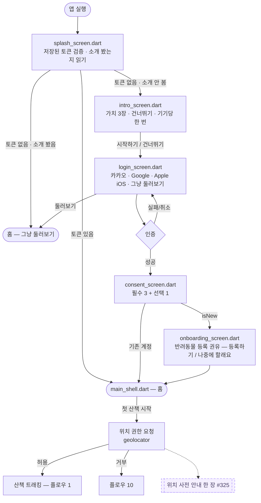
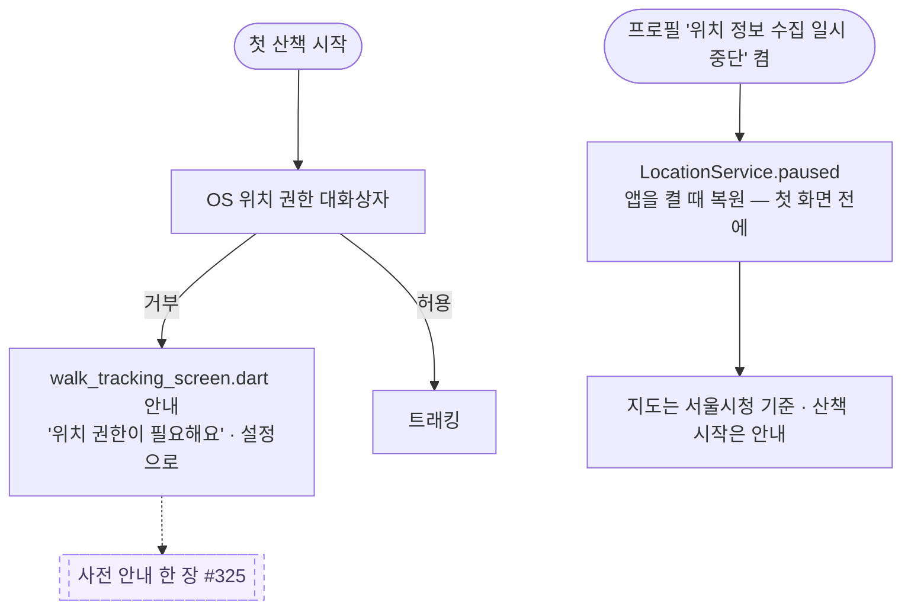
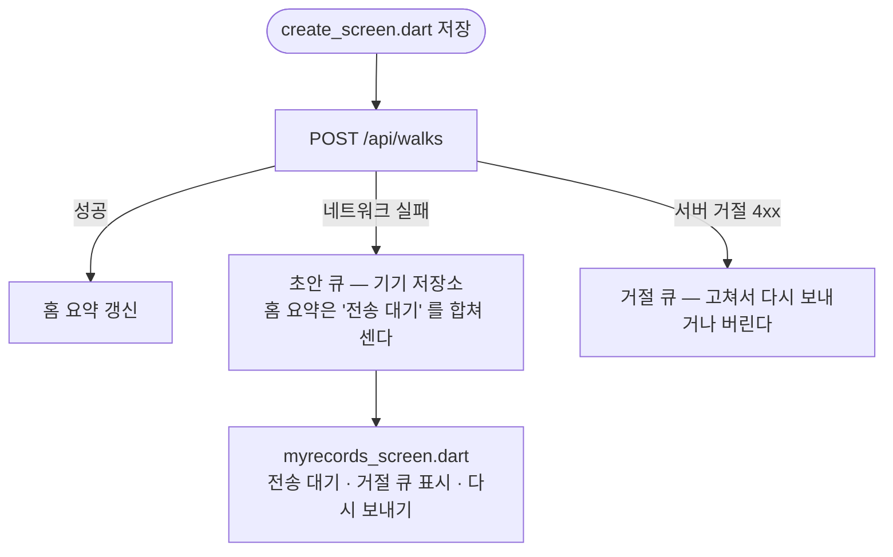

# 사용자 플로우 (User Flows)

> Pawloop(포루프)의 사용자 여정을 mermaid flowchart 로 정리한 문서. 모든 플로우는 **실제 구현**(`app/lib/v2/screens/`)을 기준으로 적고, 아직 없는 흐름은 점선 노드 + 이슈 번호로만 표시한다 — 만들기 전 흐름을 실선으로 그리면 문서가 코드보다 앞서 가고, 그 차이는 아무도 모르는 사이에 커진다(#345 가 그렇게 생겼다).
>
> 2026-09-07 앱을 처음부터 끝까지 걸어 보고(#322) 코드와 대조해 다시 썼다. 화면 파일 27개가 전부 이 문서 어딘가에 나온다.

## 개요

| # | 플로우 | 진입점 | 관련 화면 |
|---|--------|--------|-----------|
| 1 | 산책 시작 → 실시간 트래킹 → 종료 → 기록 저장 | 홈 "산책 시작" · 가운데 산책 FAB | `today_screen.dart` → `start_walk.dart` → `walk_tracking_screen.dart` → `create_screen.dart` |
| 2 | 지도에서 장소 찾기 → 상세 | 지도 탭 | `explore_screen.dart`(장소 바텀시트) |
| 3 | 커뮤니티 글 읽기 / 쓰기 / 고치기 | 커뮤니티 탭 | `feed_screen.dart` → `post_detail_screen.dart` · `post_write_screen.dart` |
| 4 | 첫 실행 → 소개 → 로그인 → 동의 → 반려동물 등록 권유 | 앱 실행 | `splash_screen.dart` → `intro_screen.dart` → `login_screen.dart` → `consent_screen.dart` → `onboarding_screen.dart` → `main_shell.dart` |
| 5 | 가족 그룹 만들기 · 초대 · 참여 | 홈 케어 카드 "만들기" · 채팅 탭 · 프로필 | `family_screen.dart` · `invite_join_screen.dart` |
| 6 | 오늘의 케어 기록 | 홈 · 가족 화면의 케어 칸 | `today_screen.dart` · `family_screen.dart` |
| 7 | 채팅 — 방 목록 → 첫 진입 규칙 → 대화 | 채팅 탭 · 가족 화면 | `chat_list_screen.dart` → `family_chat_screen.dart` |
| 8 | 산책 기록 보기 → 회고 → 지우기 · 통계 | 프로필 | `me_screen.dart` → `myrecords_screen.dart` → `walk_detail_screen.dart` · `insight_screen.dart` |
| 9 | 프로필 편집 · 설정 · 약관 · 탈퇴 | 프로필 | `edit_screen.dart` · `settings_screen.dart` · `settings/legal_document_screen.dart` · `settings/account_delete_screen.dart` |
| 10 | 위치 권한 거부 · 위치 이용중지 | 첫 산책 · 프로필 토글 | `walk_tracking_screen.dart` · `me_screen.dart` · `explore_screen.dart` |
| 11 | 세션 만료 · 로그아웃 | 어느 화면에서든 | 라우터(`auth_redirect.dart`) → `login_screen.dart` |
| 12 | 못 보낸 산책 초안의 재전송 | 산책 저장 실패 | `create_screen.dart` · `today_screen.dart` · `myrecords_screen.dart` |

네비게이션 골격은 `main_shell.dart` 의 다섯 자리다: **홈 · 지도 · [가운데 산책 FAB] · 커뮤니티 · 채팅**. 통계·기록·가족·설정은 탭이 아니라 프로필(`me_screen.dart`)에서 들어간다. `pin_picker_screen.dart` 는 파일은 있으나 지금 어디에서도 열리지 않는다(#322 에서 확인 — 지울지는 따로 정한다).

---

## 1. 산책 시작 → 실시간 트래킹 → 종료 → 기록 저장

가장 중요한 wedge 플로우. **실 GPS** 다 — `geolocator` 위치 스트림(5m)을 구독해 그리고, 종료하면 거리·시간·메모를 `POST /api/walks` 로 보낸다. 경로 좌표는 **A안 빌드에서는 서버로 나가지 않는다**(`LocationUploadPolicy.pathForUpload` 가 `null`, #235·#238) — 경로는 기기에서만 그린다.

```mermaid
flowchart TD
    A([홈 "산책 시작"]) --> S
    B([가운데 산책 FAB]) --> S
    S{start_walk.dart<br/>로그인했나?}
    S -->|아니오| L[스낵바 '로그인하면 산책 기록이 남아요'<br/>→ login_screen.dart]
    S -->|예| C[walk_tracking_screen.dart<br/>_boot: 첫 위치 판정 → 지도 생성]
    C -->|위치 권한 없음| P[OS 권한 대화상자<br/>거부하면 플로우 10]
    C --> E[위치 스트림 5m 구독<br/>거리·시간·페이스 갱신 · 폴리라인 · 카메라 추적]
    E -.일시정지.-> G[일시정지] -.재개.-> E
    E -->|종료| H[산책 완료 시트<br/>시간·거리·페이스 · 경로 미리보기]
    H -->|"기록 저장하기"| I[create_screen.dart<br/>pushReplacement · 장소 '오늘 산책' prefill]
    H -->|"저장 안 함"| Z([홈])
    H -->|"경로 사진 저장"| Q[갤러리에 PNG<br/>타일 없이 그린 경로 · 업로드 없음]
    I --> J[날짜 · 거리 · 시간 · 메모]
    J -->|저장| K[POST /api/walks<br/>경로 좌표 없이]
    K -->|성공| Z2([홈 — 오늘 요약 갱신])
    K -->|실패| D[초안 큐에 남김 → 플로우 12]
    C -.상단 뒤로가기.-> Z
    K -.-> F1[[장소 붙이기 #338]]:::todo
    E -.-> F2[[배변·물 한 탭 #340]]:::todo
    E -.-> F3[[화면 꺼짐 · 포그라운드 서비스 #335]]:::todo
    classDef todo fill:#f5f0ff,stroke:#9B7BFF,stroke-dasharray:5 4,color:#463C64;
```

**구현 메모**

- 진입 둘(홈 CTA · FAB)이 모두 `start_walk.dart` 의 `startWalk()` 를 지난다. 미로그인 안내는 거기 한 곳에 있다.
- `_boot()` 이 `LocationService.locate()` 로 첫 위치를 잡은 **뒤에야** 지도를 만든다. 판정 전에 그리면 대기 중 찍힌 점이 경로에 섞인다.
- 지도 키(`NAVER_MAP_CLIENT_ID`)가 없으면 지도 자리에 안내 카드가 뜨고 기록은 계속된다(`map_unavailable.dart`, #182).
- 저장 화면의 거리·시간 스텝퍼는 GPS 로 잰 값도 고칠 수 있다 — #327 이 읽기 전용으로 바꾼다.

---

## 2. 지도에서 장소 찾기 → 상세

`explore_screen.dart` 는 리스트/지도 토글 + 카테고리 칩 아홉으로 "우리 아이랑 갈 수 있는 곳" 을 보여 준다. 데이터는 전부 실데이터다 — 관광공사 반려동반(여행지·카페식당·레포츠·숙박·쇼핑·문화), 행정안전부 인허가(동물병원·펫샵), 두루누비 걷기여행길(산책로) — 카탈로그 한 벌을 기기에 받아 두고(24시간마다 갱신) **거리 계산은 기기 안에서** 한다(#291·#317).

```mermaid
flowchart TD
    A([지도 탭]) --> B[카탈로그 캐시 확인<br/>없거나 24h 지났으면 GET /api/places/catalog]
    B --> C{현위치}
    C -->|동의·권한 있음| D[현위치 중심]
    C -->|게스트 · 권한 없음 · 실패| E[서울시청 중심<br/>화면에 그 말은 없다 → #324]
    D --> V{뷰 토글}
    E --> V
    V -->|리스트| L[장소 카드<br/>이미지 · 카테고리 · 거리 · 주소]
    V -->|지도| M[네이버 지도 + 카테고리색 핀]
    subgraph 칩[카테고리 칩 — 누르면 다시 조회 #317]
      F1[전체 / 여행지 / 카페·식당 / 레포츠 / 숙박 / 쇼핑 / 문화]
      F2[동물병원 / 펫샵 — 8km 안]
      F3[산책로 — 반경 없이 가까운 20개 #321]
    end
    L --> 칩
    M --> 칩
    L -->|카드 탭| S[장소 바텀시트<br/>이름 · 카테고리 · 거리 · 주소 · 전화 · 출처]
    M -->|마커 탭| S
    S -->|산책로| T[GET /api/places/trails/{id} → 선을 지도에]
    S -->|"이 장소로 글쓰기"| W[post_write_screen.dart<br/>장소 연결됨]
    S -->|닫기| V
    S --> A1[전화 · 길찾기 · 산책로는 지도에서 보기<br/>글쓰기는 두 번째 #328]
    S -.-> N1[[24시 필터 · 응급 진입 #337]]:::todo
    S -.-> N2[[여기서 산책 시작 #338]]:::todo
    B -.-> N4[[동네 길 · 놀이터 데이터 #346]]:::todo
    classDef todo fill:#f5f0ff,stroke:#9B7BFF,stroke-dasharray:5 4,color:#463C64;
```

**구현 메모**

- 검색바("카페, 공원, 산책로…")는 아직 입력이 안 된다 — 플레이스홀더다.
- 칩을 누르면 `fetchNearby(contentTypeId: 칩)` 으로 다시 조회하고, 늦게 온 응답은 `_loadSeq` 로 버린다(#317).
- 리스트의 "우리 동네 업체 자리(제휴)" 자리표시 카드는 #328 에서 뺐다. 지도 핀은 겹치면 숫자로 접히고(클러스터링), 산책로 칩은 카메라를 가까운 코스에 맞추며 8km 밖이면 그 말을 한다.

---

## 3. 커뮤니티 글 읽기 / 쓰기 / 고치기

`feed_screen.dart`(목록) → `post_detail_screen.dart`(상세) → `post_write_screen.dart`(쓰기·고치기). **읽기·쓰기·수정·삭제·반응·댓글 전부 서버다**(#170·#171·#172·#211·#243). 게스트도 읽을 수 있고, 쓰기·반응·댓글은 로그인이 필요하다(ADR-0019).

```mermaid
flowchart TD
    A([커뮤니티 탭]) --> B[feed_screen.dart<br/>GET /api/community/posts 커서 페이지]
    B --> V{뷰 토글}
    V -->|카드| C1[작성자 · 게시판 · 제목 · 본문 · 반응 칩 · 댓글 수]
    V -->|리스트| C2[제목 · 게시판 · 댓글 수]
    B --> F[게시판 필터 시트<br/>전체 / 산책로 후기 / 동반장소 / 건강·병원 / 자유 / 자랑]
    F -->|선택| B
    B -->|비었을 때| E[빈 상태 '아직 글이 없어요' + 글쓰기]
    C1 -->|글 탭| D[post_detail_screen.dart<br/>GET .../posts/{id}/comments]
    C2 -->|글 탭| D
    D --> R[반응 셋 — 동시 선택 가능<br/>멱등 POST / DELETE .../reactions/{type}]
    D --> M[댓글 — 오래된 것부터<br/>POST .../comments · 내 댓글 삭제]
    D -->|내 글| X[수정 → post_write_screen.dart 편집 모드 PATCH<br/>삭제 → DELETE 확인 대화상자]
    B -->|글쓰기| W0{writePost 게이트<br/>로그인했나?}
    E -->|글쓰기| W0
    W0 -->|아니오| L[로그인 안내]
    W0 -->|예| W[post_write_screen.dart<br/>공개 범위 고지 · 게시판 · 제목 200 · 본문 5000]
    W -->|올리기| P[POST /api/community/posts] --> B
    D -.-> T1[[상세 제목을 게시판 이름으로 · 날짜 표기 #331]]:::todo
    W -.-> T2[[코스 붙이기 — 위치 신고 뒤 #339]]:::todo
    classDef todo fill:#f5f0ff,stroke:#9B7BFF,stroke-dasharray:5 4,color:#463C64;
```

**구현 메모**

- 글쓰기 진입점 셋(피드 버튼 · 빈 목록 · 지도 장소 시트)이 `writePost()` 하나를 지나고 거기서 미로그인을 안내한다.
- 상세 반응은 서버 응답의 집계를 그대로 그린다 — 로컬에서 세지 않는다.
- 게시판 값은 `CommunityBoard` enum 이 ASCII 키(`walk_review`)와 한글 라벨을 함께 가진다.

---

## 4. 첫 실행 → 소개 → 로그인 → 동의 → 반려동물 등록 권유



**구현 메모**

- **첫 실행 소개는 기기 단위로 한 번이다**(#323, 2026-09-07). `IntroGate`(`intro_seen_v1`)가 봤는지 기억하고, 라우터는 모르는 동안(`null`) 스플래시에 머문다. 소개는 `concept.md` §2 의 가치 세 줄뿐이고 **사용법·기능 홍보는 넣지 않는다**(근거는 Epic #322 의 자료 표). 건너뛰기와 시작하기는 둘 다 로그인 화면으로 간다. 다시 보려면 설정 > 앱 소개 다시 보기.
- 판정은 `app/lib/app/auth_redirect.dart` 의 **순수 함수** 하나다 — 라우터·상태에서 떼어 놨기 때문에 화면 없이 단위 테스트로 전 갈래를 돈다.
- **동의 게이트가 로그인과 온보딩 사이에 있다**(#180). 위치기반서비스 약관 동의 전에는 `/consent` 로 보낸다.
- 반려동물 등록 권유는 소셜 첫 로그인(`isNew`)에만 나온다. 이메일 로그인(디버그 전용, ADR-0022)과 기존 계정은 홈의 빈 히어로("아직 등록된 아이가 없어요 → 우리 아이 등록하기")가 대신한다.
- 데이터: `users(provider, social_id, role, email nullable, nickname)` + `dog(user_id FK, name, species, breed, size, birth, neutered, avatar)`.

---

## 5. 가족 그룹 만들기 · 초대 · 참여

```mermaid
flowchart TD
    A([홈 케어 카드 "만들기"]) --> F
    B([프로필 "우리 가족"]) --> F
    C([채팅 탭 "우리 가족 관리"]) --> F
    F[family_screen.dart<br/>GET /api/groups/me]
    F -->|그룹 없음| N[카드 '아직 가족 그룹이 없어요'<br/>가족 그룹 만들기 / 초대 코드로 참여하기]
    N -->|만들기| S[이름 시트 — 기본 '우리 가족'<br/>POST /api/groups] --> G
    N -->|초대 코드로 참여| J
    F -->|그룹 있음| G[구성원 · 오늘의 케어 · 산책 주의사항 · 가족 채팅 카드]
    G -->|"초대"| I[초대 시트 — 코드 · 코드 복사<br/>POST /api/chat/rooms/{id}/invites · 방장만]
    J[invite_join_screen.dart<br/>POST /api/chat/invites/{code}/join] -->|성공| F
    G -->|"가족 채팅"| CH[플로우 7]
    G -.-> T1[[공유 버튼 · 한 단계 만들기 · '연동 전' 카드 제거 #329]]:::todo
    classDef todo fill:#f5f0ff,stroke:#9B7BFF,stroke-dasharray:5 4,color:#463C64;
```

**구현 메모**

- 그룹 = 채팅 방(ADR-0011). 그룹을 만들면 방이 생기고 이름이 같다.
- 초대는 `chat_room_invite` 행이라 만료·사용 횟수·회수가 있다. 누를 때마다 새 코드가 생긴다.
- 홈의 "만들기" 는 가족 화면으로 간 뒤 다시 "가족 그룹 만들기" 를 눌러야 한다 — 두 단계다(#329).

---

## 6. 오늘의 케어 기록

```mermaid
flowchart TD
    A([홈 케어 카드]) --> K
    B([가족 화면 케어 카드]) --> K
    K[물 · 밥 · 산책 · 투약 · 병원 — 다섯 칸]
    K -->|칸 탭| P[POST /api/groups/{id}/care-logs<br/>type · doneBy · occurredAt]
    P --> D[칸이 '닉네임 · 시각' 으로 바뀐다<br/>가족 모두에게 같은 값]
    K -->|그룹 없음| N[플로우 5 의 만들기]
    D -.-> T1[[되누르면 취소 DELETE .../care-logs/{id} #329]]:::todo
    D -.-> T2[[산책 저장이 산책 칸을 채운다 #326]]:::todo
    classDef todo fill:#f5f0ff,stroke:#9B7BFF,stroke-dasharray:5 4,color:#463C64;
```

**구현 메모**

- 서버에는 `DELETE .../care-logs/{id}`(본인 것만, #304)가 있으나 앱에서 되돌리는 길은 아직 없다.
- 산책을 저장해도 케어의 "산책" 칸은 채워지지 않는다 — 두 기록이 이어져 있지 않다(#326).

---

## 7. 채팅 — 방 목록 → 첫 진입 규칙 → 대화

```mermaid
flowchart TD
    A([채팅 탭]) --> L[chat_list_screen.dart<br/>GET /api/chat/rooms — 이름 · 태그 · 마지막 메시지 · 안 읽음]
    A -->|게스트| G[카드 '로그인이 필요해요' → #324]
    L -->|방 탭| T{ChatTermsGate<br/>이 기기 · 이 계정이 규칙에 동의했나}
    B([가족 화면 "가족 채팅"]) --> T
    T -->|아니오| R[대화상자 '대화를 시작하기 전에'<br/>신고 · 가리기 · 내보내기 · 탈퇴 뒤 표시 — 나중에 / 동의하고 시작]
    T -->|예| C
    R -->|동의| C[family_chat_screen.dart<br/>적응형 폴링 afterSeq · ETag]
    C -->|보내기| S[낙관적 표시 → POST 메시지<br/>실패하면 재시도]
    C -->|길게 누르기| M[신고 · 가리기 시트 #82]
    C -->|방장| K[내보내기]
    L -.-> T1[[내 메시지는 안 읽음에서 뺀다 #330]]:::todo
    classDef todo fill:#f5f0ff,stroke:#9B7BFF,stroke-dasharray:5 4,color:#463C64;
```

**구현 메모**

- 방 목록 · 방 안 · 가족 화면 셋 다 서버에서 받는다. 폴링 기준선은 #197 에서 실측했다.
- 첫 진입 규칙은 기기 + 계정별로 한 번이다(`chat_terms_agreed_v1_{userId}`).
- 내가 보낸 메시지가 방 목록에 안 읽음 1 로 잡힌다 — #330.

---

## 8. 산책 기록 보기 → 회고 → 지우기 · 통계

```mermaid
flowchart TD
    A([프로필 me_screen.dart]) -->|내 산책 기록| R[myrecords_screen.dart<br/>GET /api/walks 커서 · 전송 대기 · 거절 큐]
    A -->|산책 통계| I[insight_screen.dart<br/>GET /api/walks/stats/weekly — 주간 막대 · 요약]
    R -->|카드 탭| D[walk_detail_screen.dart<br/>회고 쓰기 PUT /api/walks/{id}/memo]
    R -->|길게 누르기| X[삭제 확인 → DELETE /api/walks/{id}]
    R -->|산책 기록하기| C[create_screen.dart — 수동 기록]
    I -.-> T1[["AI 주간 리포트" 라벨 제거 · 눈금 · 자주 가는 곳 #332 → 진짜 요약 #359]]:::todo
    classDef todo fill:#f5f0ff,stroke:#9B7BFF,stroke-dasharray:5 4,color:#463C64;
```

**구현 메모**

- 통계의 "자주 가는 곳" 은 늘 비어 있다 — `walk` 에 장소 축이 없다(#338 이 붙인다).
- 통계의 "AI 주간 리포트" 는 문자열 조립이다(#332 에서 라벨을 떼고 #359 가 진짜로 만든다).

---

## 9. 프로필 편집 · 설정 · 약관 · 탈퇴

```mermaid
flowchart TD
    A([아바타 탭]) --> M[me_screen.dart<br/>우리 아이들 · 활동 요약 · 위치 이용중지 토글 · 메뉴]
    M -->|프로필 편집 · 우리 아이 정보 관리| E[edit_screen.dart<br/>PUT /api/dogs/{id} · 테두리색 · 종류 · 품종 · 크기 · 나이 · 중성화]
    M -->|추가| E2[반려동물 등록 시트]
    M -->|설정| S[settings_screen.dart]
    S -->|약관 넷| L[settings/legal_document_screen.dart<br/>assets/terms/*.md]
    S -->|앱 소개 다시 보기| I[intro_screen.dart 닫기 모드]
    S -->|회원 탈퇴| X[settings/account_delete_screen.dart<br/>확인 → DELETE /auth/me] --> R[라우터가 로그인 화면으로]
    M -->|로그아웃| O[로그아웃 API → 게스트 홈]
    M -.-> T1[[중복 메뉴 · 북마크 제거 · 'local' 노출 #332]]:::todo
    classDef todo fill:#f5f0ff,stroke:#9B7BFF,stroke-dasharray:5 4,color:#463C64;
```

**구현 메모**

- 탈퇴는 화면이 직접 이동하지 않는다 — 상태를 내리면 라우터가 보낸다(`legacy_shell_reachability_test.dart` 가 잠근다).
- 프로필 머리의 "닉네임 · local" 은 로그인 제공자 이름이 그대로 보이는 것이다(#332).

---

## 10. 위치 권한 거부 · 위치 이용중지



**구현 메모**

- 이용중지는 위치정보법 제24조의 자리다. `main.dart` 가 첫 화면이 그려지기 전에 복원한다 — 늦으면 중단해 둔 사용자의 현위치를 한 번 조회한 뒤에 꺼진다.
- 게스트는 동의한 적이 없으므로 `LocationService.consented` 가 `false` 다 — 지도가 현위치를 묻지 않는다(#180).

---

## 11. 세션 만료 · 로그아웃


**구현 메모**

- 화면이 직접 `goNamed('login')` 하지 않는다. 라우터가 `AuthState.status` 를 `refreshListenable` 로 듣는다(#11·#12).
- `sessionEnded` 는 1회성 신호다 — 라우터가 소비하지 않으면 로그인 화면을 닫을 때마다 다시 끌려온다.

---

## 12. 못 보낸 산책 초안의 재전송



**구현 메모**

- 초안 큐는 #159 에서 생겼다. 홈의 "오늘 산책" 은 서버 값과 전송 대기를 합쳐 보여 준다(`WalkFeedData.today`).

---

## 관련 문서

- 화면 표: [screen-spec.md](screen-spec.md) · 기능 명세: [feature-spec.md](feature-spec.md)
- 데이터 모델: [ERD](../03-database/erd.md)
- 위치 제약(A안): [legal-lbs-compliance.md](../00-product/legal-lbs-compliance.md)
- 걸어 본 결과와 점검 이슈: Epic #322 · 다음 기능: Epic #334
