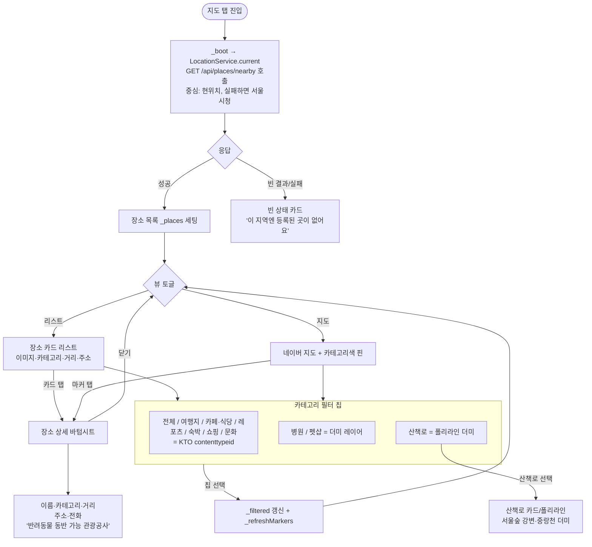
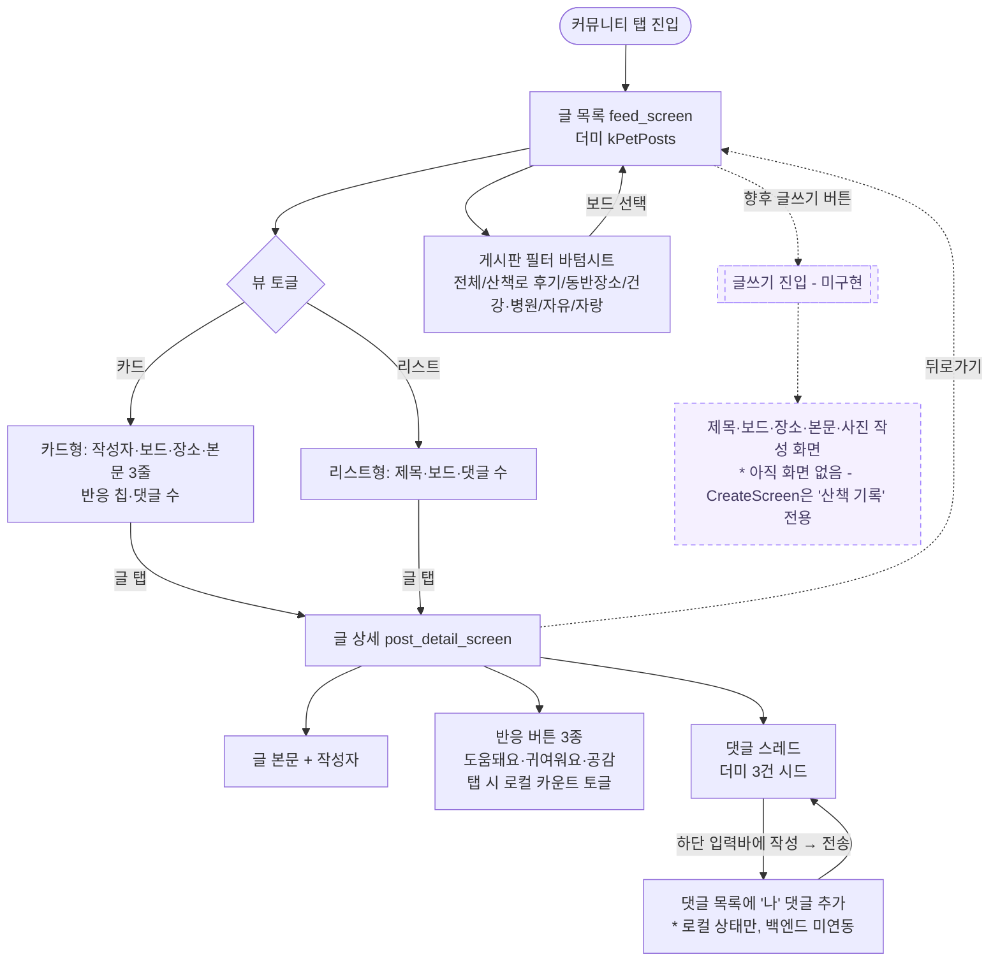
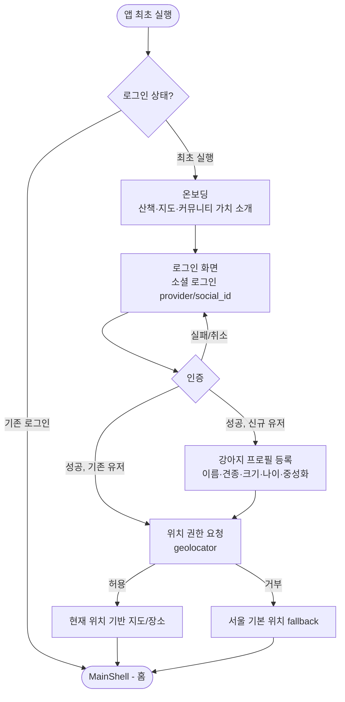

# 사용자 플로우 (User Flows)

> Pawloop(포루프)의 핵심 사용자 여정을 mermaid flowchart로 정리한 문서. 각 플로우는 실제 구현(`app/lib/v2/screens/`)을 기준으로 하며, 미구현/더미 구간은 명시한다.

## 개요

| # | 플로우 | 진입점 | 관련 화면 |
|---|--------|--------|-----------|
| 1 | 산책 시작 → 실시간 트래킹 → 종료 → 기록 저장 | 홈 "산책 시작" · 가운데 기록(+) FAB | `today_screen` → `walk_tracking_screen` → `create_screen` |
| 2 | 지도에서 동반장소 찾기 → 상세 | 지도 탭 | `explore_screen`(장소 바텀시트) |
| 3 | 커뮤니티 글 읽기 / 쓰기 | 커뮤니티 탭 | `feed_screen` → `post_detail_screen` |
| 4 | 온보딩 + 로그인 | 앱 최초 실행 | `splash` → `consent` → `onboarding` → `login` → `MainShell` |

네비게이션 골격은 `main_shell.dart`의 5개 진입점이다: **홈 · 지도 · [가운데 기록 FAB] · 커뮤니티 · 채팅**. 통계는 탭이 아니라 `me_screen`·`today_screen` 둘에서 push 한다. 가운데 FAB와 홈의 "산책 시작" 버튼은 모두 실시간 산책 트래킹 화면(`WalkTrackingScreen`)으로 이동한다.

---

## 1. 산책 시작 → 실시간 트래킹 → 종료 → 기록 저장

가장 중요한 wedge 플로우. **실 GPS** 다 — `geolocator` 위치 스트림(5m)을 구독해 그리고, 종료하면 `walk.path`(LINESTRING)로 저장한다(#145). 위치를 못 쓰는 여섯 경우는 각각 이유를 말하는 화면을 띄우고 직접 입력으로 넘긴다 — 가짜 경로를 그리지 않는다(#160).

```mermaid
flowchart TD
    A([홈 화면]) -->|"산책 시작" 버튼| C
    B([가운데 기록 + FAB]) --> C
    C[실시간 트래킹 화면<br/>WalkTrackingScreen]
    C --> D[네이버 지도 로드<br/>onMapReady → 트래킹 자동 시작]
    D --> E{1초 타이머 루프}
    E -->|경로 한 점 추가| F[거리·시간·페이스 갱신<br/>폴리라인 그리기<br/>카메라 추적]
    F --> E

    E -.일시정지.-> G[일시정지됨<br/>_paused = true]
    G -.재개.-> E

    E -->|종료 버튼| H[산책 완료 바텀시트<br/>시간·거리·페이스 요약]
    H -->|"기록 저장하기"| I[산책 기록 작성 화면<br/>CreateScreen<br/>pushReplacement, 장소 prefill '오늘 산책']
    H -->|"저장 안 함"| Z([홈으로 복귀])

    I --> J[장소·날짜·거리·시간·사진·메모 입력<br/>거리/시간 스텝퍼]
    J -->|"저장" / "산책 기록 저장하기"| K[스낵바 '산책 기록이 저장됐어요 🐾'<br/>* 현재 백엔드 미저장 - 로컬 알림만]
    K --> Z2([이전 화면으로 복귀])

    C -.상단 뒤로가기.-> Z
```

**구현 메모**
- `_boot()`이 `LocationService.locate()` 로 첫 위치를 잡은 **뒤에야** 지도를 만든다. 판정 전에 그리면 대기 중 찍힌 점이 경로 앞머리에 남는다.
- 종료 바텀시트의 "기록 저장하기"는 `pushReplacement`로 `CreateScreen(prefillPlace: '오늘 산책')` 진입 → 트래킹 화면은 스택에서 교체된다.
- `CreateScreen._save()`는 `WalkRepository.saveWalk()` 로 `POST /api/walks` 에 올린다. 못 보내면 초안이 큐에 남고 나중에 다시 보낸다(`walk_outbox`). 사진 첨부는 아직 플레이스홀더.

---

## 2. 지도에서 동반장소 찾기 → 상세

`explore_screen`은 리스트/지도 토글 + 카테고리 필터로 "우리 아이랑 갈 수 있는 곳"을 보여준다. 관광공사 반려동물 동반여행(KTO) API는 **실연동**, 병원/펫샵/산책로 레이어는 **더미**(향후 LOCALDATA·두루누비).



**구현 메모**
- `_load()` → `PetPlacesRepository.fetchNearby(lat, lng, radius 8000m)` → 백엔드 `GET /api/places/nearby`(거리순). 서버가 실패하거나 호출 예산이 소진되면 **빈 목록**이다 — 앱은 그것을 "이 주변에 장소가 없음" 과 구분하지 못한다(#40 의 알려진 한계).
- 검색바("카페, 공원, 산책로...")는 현재 **플레이스홀더**(입력 미동작).
- 리스트 카드/지도 마커 탭 모두 `_showPlaceSheet(p)` 호출 → 동일 바텀시트.
- 상세 시트에는 아직 "여기서 산책 기록 쓰기"·북마크 액션 없음(향후 `bookmark` 연동 및 `CreateScreen` prefill 확장 지점).

---

## 3. 커뮤니티 글 읽기 / 쓰기

`feed_screen`(목록) → `post_detail_screen`(상세). 게시판·반응·댓글은 도메인 정의(`kPetBoards`, `kPetReactions`)를 따르며, 데이터는 **더미**(`kPetPosts`)다. 상세의 반응/댓글은 로컬 상태로만 토글·추가된다.



**구현 메모**
- 목록의 보드 필터는 `_openBoardSheet()` 바텀시트로 선택(가로 칩이 무한정 늘지 않도록).
- 상세 반응은 `_toggleReaction()`으로 `_picked` 집합 토글 + 카운트 ±1(로컬). 댓글은 `_send()`로 `_cmts`에 '나' 추가 후 입력창 초기화.
- **커뮤니티 글쓰기 화면은 아직 없음.** `CreateScreen`은 산책 기록 전용이다. 커뮤니티 글 작성은 post-MVP 확장 지점(위 다이어그램 점선 노드).
- 향후: `post(user_id, board, place_id?, title, body)` / `comment` / `reaction(type[help/cute/empathy])` 백엔드 연동. `place_id`로 동반장소 상세 ↔ 커뮤니티 글 연결.

---

## 4. 온보딩 + 로그인

**구현됐다**(#12·#180). `main.dart` 가 `AuthState.init()` 을 돌리고, `app_router.dart` 의 `refreshListenable` 이 인증 상태와 동의 상태를 함께 듣는다. 판정은 **순수 함수** `authRedirect(status, location, pending, sessionEnded, consented)` 하나가 한다.



**구현 메모**
- 판정은 `app/lib/app/auth_redirect.dart` 의 **순수 함수** 하나다 — 라우터·상태에서 떼어 놨기 때문에 화면 없이 단위 테스트로 전 갈래를 돈다.
- **동의 게이트가 로그인과 온보딩 사이에 있다**(#180). 위치기반서비스 약관 동의 전에는 `/consent` 로 보낸다 — 위치정보법 제18·19조가 요구하는 것이고, 그 화면을 지나기 전에는 `LocationService.locate()` 자체가 거부한다.
- 데이터: `users(provider, social_id, role, email nullable, nickname)` + `dog(user_id FK, name, species, breed, size, birth, neutered, avatar)`.
- 위치 권한(`geolocator`)은 **도입됐다**(#145). 지도는 현위치로 시작하고 **실패했을 때만** 서울시청으로 떨어진다.

---

## 관련 문서

- 데이터 모델: [ERD](../03-database/erd.md)
- 화면/디자인 시스템: 프로젝트 컨텍스트 참조 (AuroraBackground / GlassCard / 플로팅 바텀네비)
