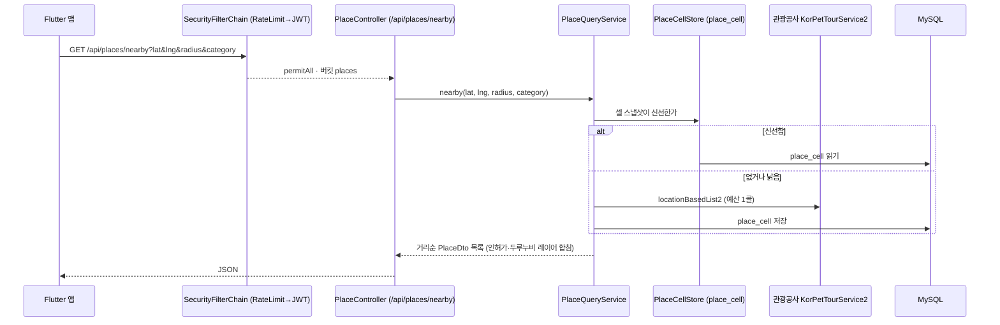

# 백엔드 구조 (Backend Structure)

> Pawloop(포루프) 백엔드는 **Spring Boot 3.5 + MySQL(공간형)** 기반이다. 감정 여행(heattrip) 시절의 패키지 아홉(`tour` `explore` `curation` `social` `llm` `schedules` `bookmark` `feedback` `kakao`)은 **2026-09-06 에 #94 로 지웠다** — 앱의 레거시 셸(#318)이 사라져 부르는 화면이 없어졌기 때문이다. 표는 지우지 않았다(§9).

---

## 1. 한눈에 보기

| 항목 | 값 |
| --- | --- |
| 프레임워크 | Spring Boot `3.5.4` (Spring Framework 6 / Jakarta) |
| 언어 | Java 21 (toolchain). Kotlin 은 `curation` 에만 있었고 #94 로 플러그인째 뺐다 |
| 빌드 | Gradle (Groovy DSL, `build.gradle`), `rootProject.name = heat_trip_backend` |
| 영속 | Spring Data JPA + `spring-boot-starter-data-jdbc`, MySQL (`mysql-connector-j`) |
| 매핑 | Lombok + MapStruct `1.5.5` (+ lombok-mapstruct-binding) |
| 외부호출 | WebFlux `WebClient`(공공데이터 — KTO · 행정안전부 인허가 · 두루누비), `RestClient` 미사용 |
| 인증 | Spring Security + OAuth2 Client(구글/카카오/Apple — Apple 은 OIDC, #301) + JWT(jjwt 0.11.5), 세션 STATELESS |
| 문서화 | springdoc-openapi (Swagger UI) |
| AI | Spring AI `1.0.0` (OpenAI) — `observability/ai` 의 오류 요약에만 쓴다 |
| 저장소 | AWS S3 (`aws-java-sdk-s3 1.12.574`) 미디어 업로드 |
| 관측 | Actuator + Micrometer + Prometheus |
| 그룹/버전 | `com.heattrip` / `2.0.0` |

> 참고: 프론트 스택은 [프론트엔드 구조](./frontend-structure.md), 데이터 모델은 [ERD](../03-database/erd.md).

---

## 2. 진입점 & 기본 패키지

- 루트 패키지: `com.heattrip.heat_trip_backend`
- 진입 클래스: `HeatTripBackendApplication` — `@SpringBootApplication`. 스케줄링은 `config/SchedulingConfig` 가 켠다(§6).

```
com.heattrip.heat_trip_backend
├─ HeatTripBackendApplication      # 진입점
├─ config/                         # 보안·KTO WebClient·OpenAPI·스케줄링 설정
├─ security/                       # ApiRateLimitFilter · ChatRateLimitFilter · 429 본문
├─ error/                          # GlobalExceptionHandler — 계약의 오류 봉투 (#114)
├─ OAuth/ · user/                  # 인증(소셜 로그인 + JWT + 회원)
│
│  ── Pawloop 축 (반려동물·산책·가족·채팅) ──
├─ dog/                            # 반려동물 프로필                        (#145)
├─ walk/                           # 산책 기록·경로(LINESTRING)·통계·회고   (#145 · #187)
│   └─ course/                     # 내가 남긴 코스 — walk.path 를 베껴 양 끝 100m 를 자른다 (#339)
├─ walksafety/                     # 산책 안전 지수 재료 — 기상청·에어코리아 서버 프록시, 격자만 받고 저장 없음 (#336)
├─ care/                           # 오늘의 케어 로그 · 산책 주의사항        (#76)
├─ group/                          # 가족 그룹                              (#73~#75)
├─ chat/                           # 채팅 도메인(방·메시지·신고·차단)        (#78~#82)
├─ chatweb/                        # 채팅 HTTP 표면(컨트롤러·요청/응답)      (ADR-0011, #72)
├─ schedule/                       # 앞으로 할 일 — 규칙 한 줄을 서버가 펼친다 (#418~#421)
├─ crew/                           # 동네 반려인 모임 — 표 하나, 방은 chat 것 (#417)
├─ place/                          # KTO 프록시 · 격자 캐시 · 호출 예산 · 공공데이터 레이어(layer/) (ADR-0013, #40 · #291)
├─ community/                      # 커뮤니티 글·댓글·반응·신고             (#169·#170·#211·#166)
├─ consent/                        # 약관 동의 이력 — 서버 정본, 재동의는 앱이  (#190, ADR-0020)
├─ moderation/                     # 신고·가리기 — 도메인 공용             (#166, ADR-0016)
├─ moderationweb/                  # 가리기의 HTTP 표면                    (#166)
├─ push/                           # 푸시 — 기기 토큰 · 전체 끄기 · 커밋 뒤 비동기 발송 (#83)
│
│  ── 공통 ──
├─ S3/                             # 미디어 업로드(presigned/direct) — 반려동물·게시글 사진
└─ observability/                  # 로깅·에러·알림·AI 오류 요약
```

> **이 목록은 `ls backend/src/main/java/com/heattrip/heat_trip_backend/` 와 같아야 합니다.**
> 2026-09-02 에 대조했을 때 여덟(`walk` `dog` `care` `group` `chat` `chatweb` `llm` `place`)이
> 빠져 있었고, #110 에서 지운 `login/` 이 남아 있었습니다. 이 문서는 스스로 "현재 실제 코드
> 구조를 서술한다" 고 선언하는데 **어떤 테스트도 이 파일을 보지 않았습니다** — #157 에서
> `StructureDocDriftTest` 에 검사를 달았습니다. 2026-09-06 에는 감정 여행 패키지 아홉이
> 실제로 사라졌으므로 트리에서도 뺐습니다(#94).

---

## 3. 레이어 아키텍처

전통적 3계층이다. 감정 여행 시절 `explore`·`curation` 이 쓰던 포트-어댑터 스타일은 그 패키지와 함께 사라졌다.

```
controller  →  service  →  repository(JPA)  →  entity
   (web)         (@Service)   (JpaRepository)     (@Entity)
    │               │
    └── dto ────────┘   (요청/응답 DTO — record)
```

- **controller**: `@RestController` + `@RequestMapping`. 얇은 어댑터, 검증 후 서비스 위임. 채팅·가리기처럼 HTTP 표면을 도메인과 분리한 곳은 `*web/` 패키지가 컨트롤러를 든다(ADR-0011).
- **service**: `@Service`. 비즈니스 로직·트랜잭션·외부호출 조합.
- **repository**: Spring Data JPA `JpaRepository`, 필요한 곳만 네이티브/커스텀 쿼리(예: `walk` 의 공간 질의).
- **entity**: JPA `@Entity`. 모듈 밖에서 부르는 엔티티는 `@NamedInterface("entity")` 로 공개 표면을 선언한다(ADR-0012, `ModularityBaselineTest`).
- **dto**: 계층 경계 전송 객체. 계약(`openapi.yaml`)의 스키마 이름을 따른다(ADR-0017).

---

## 4. 도메인 패키지별 상세

도메인별 서술은 [backend/](./backend/) 아래 문서가 정본이다 — [auth](./backend/auth.md) · [dogs](./backend/dogs.md) · [walks](./backend/walks.md) · [places](./backend/places.md) · [community](./backend/community.md) · [bookmarks](./backend/bookmarks.md)(계획) · [push](./backend/push.md). 여기서는 공통 둘만 적는다.

### 4.1 `S3` — 미디어 업로드

- `S3/media/*` — multipart 업로드, presigned URL 발급, 업로드 객체 원장(`media_objects`). **2026-09-13 까지 앱이 부르는 화면이 없었다** — 예전 서술의 "앱의 `shared/media` 가 프로필 사진에 쓴다" 는 틀렸다. 그 모듈은 완성품이지만 라우터에서 도달하는 화면이 없다(#429).
- `S3/MediaAttachment` — **밖으로 내놓는 유일한 표면**(#429). `community` 가 이것으로 글에 사진·영상을 붙이고(`attach`·`replace`), 목록에 그릴 것을 한 번에 묻고(`attachedTo`), 글이 사라질 때 함께 지운다(`detachAll`). `walk.CourseAttachment` 와 같은 모양이다 — 하위 패키지의 `MediaService` 를 직접 부르면 Modulith 기준선이 는다. `walk`(#450 산책 사진, `REF_WALK`)와 `chatweb`(#452 말풍선 사진, `REF_CHAT` — `chat` 은 경계 밖을 못 보므로 붙이는 것도 chatweb 이고, INSERT 와 같은 트랜잭션에서 붙인다)도 같은 표면을 쓴다.
- `S3/media/MediaOrphanSweeper` — 올려 놓고 글을 안 쓴 사진을 하루 뒤 거둔다(새벽 4:10). 벌크 삭제라 두 인스턴스가 함께 돌아도 같다(📌 #86 원칙 2). `POST_*` 카테고리만 본다.
- 레이트리밋 버킷 `upload`(`/media/**`). multipart 상한은 파일당 10MB(`spring.servlet.multipart.max-file-size`) — 2026-09-13 이전에는 Spring 기본값 1MB 라 폰 사진 한 장도 못 받았다.
- **영상은 이 모듈을 통과하지 않는다.** `api.pawloop.app` 앞의 Cloudflare 가 요청 본문을 100MB 에서 끊어서, 영상은 세 단계다 — `POST /media/videos` 가 `pending` 행과 15분짜리 서명 PUT 을 주고, 앱이 S3 에 직접 올리고, `POST /media/{mediaId}/complete` 에서 서버가 `FileStorage.stat`(HEAD)으로 실제 크기·형식을 확인해 `ready` 로 바꾼다. 서명 PUT 은 크기 조건을 못 걸어서(SDK v1) HEAD 의 답이 판정이다. `MediaController` 가 multipart 로 온 `POST_VIDEO` 를 400 으로 막는다. 한 글에 영상은 하나다.

### 4.2 `error` — 전역 예외 처리 (계약의 오류 봉투)

- `error/GlobalExceptionHandler` — 유일한 `@RestControllerAdvice`. 4xx·5xx 본문을 계약의 `Error`(`{ error: { code, message, traceId } }` — 정확한 모양은 `openapi.yaml`) 하나로 만든다(#10). 401 만 본문이 다르다 — 필터 계층에서 나가기 때문이다.
- **2026-09-06 까지 `S3/media/error/` 에 있었다** — 외부 서비스 패키지 밑 3단계에 전 애플리케이션의 에러 계약이 있어 `security` 가 `S3` 내부를 참조했고, 그것이 모듈 경계 위반 둘이었다(#114).
- 필터 계층(`security/ErrorBodyWriter`)은 MVC 밖이라 이 advice 를 못 타므로 같은 `ErrorResponse` 를 직접 써서 같은 모양을 낸다.

---

## 5. 인증 · 보안

### 5.1 구성

- `config/SecurityConfig` — `SecurityFilterChain` 단일 정의. `cors` 활성, `csrf`/`formLogin` 비활성, **세션 STATELESS**.
- 소셜 로그인: `oauth2Login` + `OAuth/service/CustomOAuth2UserService`(구글/카카오/Apple `OAuth2UserInfo` 분기) + `OAuth/AppleOidcUserService`(OIDC 경로 — Apple, #301 — 모듈 루트에 둔 이유는 그 javadoc)
- JWT: `OAuth/jwt/JWTProvider`(발급/검증) + `OAuth/jwt/JWTAuthenticationFilter`(요청당 토큰 파싱). `UsernamePasswordAuthenticationFilter` 앞에 등록.
- 레이트리밋: `security/ApiRateLimitFilter`를 JWT 필터보다 **앞에** 등록.
- 비밀번호: `BCryptPasswordEncoder`. 자체 로그인/회원은 `user/`(`AuthController`, `UserService`, `User`). 예전에 있던 `login/loginController` 는 **#110 에서 지웠습니다.**

### 5.2 접근 정책 (실제 매처)

> 이 표는 **요약**이다. 인가 경계의 정본은 계약([openapi.yaml](../04-api/openapi.yaml))의
> Auth 태그 설명이고(`SecurityConfig.java` 의 `PUBLIC_MATCHERS` 주석이 그렇게 선언한다), 서술형 정본은
> [auth.md](./backend/auth.md) 다. 셋이 갈라지면 **계약을 따른다.**

| 매처 | 정책 |
| --- | --- |
| `/`, `/oauth2/**`, `/login/**`, `/error` | `permitAll` |
| `/auth/signup`, `/auth/signup/verify`, `/auth/signup/resend`, `/auth/password/reset-request`, `/auth/password/reset`, `/auth/login`, `/auth/oauth/**`, `/auth/token/refresh` | `permitAll` — **열거된 이것뿐이다.** `/auth/**` 통짜 permitAll 은 #23-D 에서 없앴고, 가입 인증과 재설정의 넷도 와일드카드가 아니라 낱개다(#635). 비밀번호를 잊은 사람은 토큰이 없으므로 재설정도 비인증이어야 한다 |
| 그 밖의 `/auth/*` (`GET`·`PUT`·`DELETE /auth/me`, `POST /auth/logout`) | `authenticated` — `anyRequest()` 로 떨어진다 |
| `/actuator/health/**`, `/actuator/info`, `/actuator/prometheus` | `permitAll` |
| `/api/places/nearby`, `/api/places/*`, `/api/places/trails/*/route` | `permitAll` — 관광공사 프록시(#40) · 산책로의 선(#291). 지도는 로그인 전에도 보여야 한다. **`/api/places/**` 와일드카드는 쓰지 않는다** — 레이트리밋 표가 못 덮는 자리가 인증도 한도도 없는 경로가 된다 |
| `GET /api/walk-safety/now` | `permitAll` — 산책 안전 지수 재료(#336). 5km 격자 번호만 받고 누구의 요청인지 모르게 둔다. IP 한도 `walk-safety` 버킷 |
| `GET /api/community/posts`, `GET /api/community/posts/*`, `GET /api/community/posts/*/comments` | `permitAll` — 커뮤니티 읽기는 인증이 선택이다(ADR-0016 결정 3). 메서드까지 적는 이유는 같은 경로의 `POST` 를 열지 않기 위해서다 |
| `/v3/api-docs/**`, `/swagger-ui.html`, `/swagger-ui/**` | `docsPublic` 플래그가 true일 때만 공개 (셋 다) |
| `/public/**` | `authenticated` |
| 그 외 (`anyRequest`) | `authenticated` |

`/api/explore/**`(공개 조회)와 `/api/curation/**`(`authenticated`, `admin/**` 만 `ROLE_ADMIN`)은 감정 여행 시절의 매처였고 #94 로 컨트롤러와 함께 지웠다. 공개 경로마다 레이트리밋 버킷이 있는지는 `PublicPathsAreRateLimitedTest` 가 `PUBLIC_MATCHERS` 를 돌며 잰다(#232).

미인증 요청에는 302 로그인 리다이렉트가 아니라 **401** 이 나간다 — `oauth2Login()` 의 기본
진입점을 `HttpStatusEntryPoint(UNAUTHORIZED)` 로 덮어썼다. 앱의 `AuthedClient` 는 401 에서만
refresh 를 타므로 이 차이가 클라이언트 분기를 바꾼다.

- CORS 허용 오리진은 `PublicSecurityProperties.allowedOrigins`(쉼표 구분) 주입. 메서드 `GET/POST/PUT/DELETE/OPTIONS`, 자격증명 허용.
- **Pawloop 방침**: 소셜 로그인이 들어온 뒤(#11 · #12 · #14) 반려 도메인 API 는 `anyRequest().authenticated()` 로 떨어진다. 공개로 남는 것은 위 표의 목록뿐이고, 새로 열 때는 **경로를 하나씩** 적고 레이트리밋 표에도 같은 줄을 더한다.

---

## 6. 스케줄러 (외부데이터 동기화)

`config/SchedulingConfig` 가 `@EnableScheduling` 을 켜고, 잡은 `place` 모듈에 있다.

| 잡 | 언제 | 무엇 |
| --- | --- | --- |
| `place/service/PlaceCatalogWarmupScheduler` | 매일 04:40 KST (#279) | KTO 반려동반 장소 전국 한 벌을 받아 `place_catalog` 의 `kto` 행을 갱신한다 |
| `place/layer/LayerCatalogScheduler` | 매월 1일 05:20 KST + 부팅 예열 (#291) | 행정안전부 인허가(동물병원·동물판매업)와 두루누비 코스·GPX 를 받아 `localdata`·`durunubi` 행과 `trail_route` 를 갱신한다 |

둘 다 `KtoCallBudget`(풀별 일일 예산)과 `UpstreamGate`(중복 적재 잠금)를 지난다. 감정 여행 시절의 `tour/schedules/TourFetchScheduler`(관광공사 전 지역 수집, 비활성)는 #94 로 지웠다.

---

## 7. 외부 연동 · 설정 (`config/`)

| 설정 클래스 | 내용 |
| --- | --- |
| `config/KtoWebClientConfig` | `korPetTourWebClient`·`korServiceDetailWebClient`(#40) · 인허가·두루누비·GPX 클라이언트(#291). 연결·응답·읽기·쓰기 **타임아웃 네 겹** + 인코딩 끔(서비스키가 이미 URL 인코딩돼 있어 재인코딩하면 인증이 깨진다) |
| `config/SchedulingConfig` | `@EnableScheduling` — §6 |
| `config/AsyncConfig` | `@EnableAsync` + `pushExecutor`(스레드 2~4 · 큐 1,000 · 넘치면 버리고 경고) — 푸시 발송(#83). 큐는 인메모리 상태다(#86 §2) |
| `config/OpenApiConfig` | springdoc Swagger UI 메타 |
| `config/SecurityConfig` / `PublicSecurityConfig` / `PublicSecurityProperties` | 보안 필터체인 + 공개 경로/오리진 프로퍼티 |

- 프로파일: `application.properties`(공통) + `application-dev/-prod/-private.properties`. 비밀값은 `application-private.properties`(git 미추적)·환경변수(`SPRING_DATASOURCE_URL`, `TOUR_API_SECRET`, OAuth 키 등)로 주입한다.
- DB: MySQL, `ddl-auto`는 dev `update` / prod `validate`. 타임존 `Asia/Seoul`, UTF-8.
- 관측성: `observability/`(logging·error·alert·ai·config) + Actuator + Prometheus 스크레이프(`/actuator/prometheus`).
- 감정 여행 시절의 `WebClientConfig`(관광공사 배치 적재·카카오 로컬)와 `LlmWebClientConfig`(추천 서버)는 #94 로 지웠다.

---

## 8. 요청 처리 흐름 (예: 주변 장소 조회)



---

## 9. 감정 여행 잔재 — 정리 결과 (2026-09-06, #94)

| 패키지 | 판정 | 결과 |
| --- | --- | --- |
| `tour` | 관광공사 전 지역 수집·`places` 표 | **지웠다.** `place` 의 상세 폴백(`KnownPlaceIds`)도 함께 — v2 의 id 는 전부 목록·카탈로그를 거친다 |
| `explore` | 장소 탐색/검색 | **지웠다.** 공개 매처 `/api/explore/**`·버킷 셋(search·explore-read·feedback)도 함께 |
| `curation` · `llm` | 감정 추천(LLM) | **지웠다.** Kotlin 소스는 여기뿐이라 플러그인·의존성도 뺐다. `spring-ai` 는 `observability/ai` 가 쓰므로 남는다 |
| `social` | 감정카드 | **지웠다.** 반려 커뮤니티(`community`)는 처음부터 따로 만든 것이다 |
| `schedules` · `bookmark` · `feedback` | 여정/일정 · v1 북마크 · 피드백 | **지웠다.** v2 북마크는 계약의 `x-status: planned` 그대로 |
| `kakao` | 카카오 로컬 백필 | **지웠다.** 소비자가 `social` 뿐이었다. 카카오 **OAuth** 는 무관하다 |
| `BootstrapRunner` · `k6/` · `mysql/seed` | 수집 부트스트랩 · 레거시 부하 테스트 · `places` 더미 시드 | **지웠다** |
| `resources/data/place_traits.csv` | `tour`·`curation` 만 읽던 시드 | **남긴다** — 파일은 지우지 않기로 한 약속이다 |

**표는 지우지 않았다.** 운영 DB 의 `places` · `emotion_card` · `bookmarks` · `journey` 등 23개 표와 데이터는 그대로다. 다만 `01_schema.sql` 은 엔티티에서 뽑으므로 새 DB 에는 그 표가 생기지 않는다 — [schema.md 부록 A](../03-database/schema.md) 참고. 지우는 SQL 은 만들지 않았다. 되돌릴 수 없는 일은 따로 정한다.
