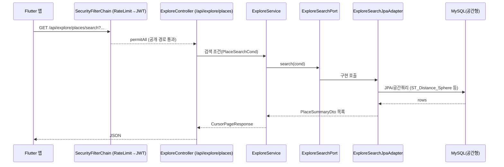

# 백엔드 구조 (Backend Structure)

> Pawloop(포루프) 백엔드는 **Spring Boot 3.5 + MySQL(공간형)** 기반이다. 현재 `backend/src`에는 감정여행(heattrip) 시절의 코드가 그대로 남아 있으며, 반려(Pawloop) 피벗은 이 코드를 **재사용(tour·social·auth)** 하고 **감정 도메인(curation/explore emotion)을 제거·대체**하는 방향으로 진행된다. 이 문서는 **현재 실제 코드 구조**를 먼저 서술하고, 각 패키지가 Pawloop에서 어떤 역할로 이어지는지(재사용/대체/제거)를 명시한다. 검증 기준: `backend/build.gradle`, `backend/src/main/java/com/heattrip/heat_trip_backend/`.

---

## 1. 한눈에 보기

| 항목 | 값 |
| --- | --- |
| 프레임워크 | Spring Boot `3.5.4` (Spring Framework 6 / Jakarta) |
| 언어 | Java 21 (toolchain) + Kotlin `2.2.20` 혼용 |
| 빌드 | Gradle (Groovy DSL, `build.gradle`), `rootProject.name = heat_trip_backend` |
| 영속 | Spring Data JPA + `spring-boot-starter-data-jdbc`, MySQL (`mysql-connector-j`) |
| 매핑 | Lombok + MapStruct `1.5.5` (+ lombok-mapstruct-binding) |
| 외부호출 | WebFlux `WebClient`(공공데이터/카카오/LLM), `RestClient` 미사용 |
| 인증 | Spring Security + OAuth2 Client(구글/카카오/네이버) + JWT(jjwt 0.11.5), 세션 STATELESS |
| 문서화 | springdoc-openapi (Swagger UI) |
| AI | Spring AI `1.0.0` (OpenAI) — **감정 추천 레거시, 반려 맥락 재검토 대상** |
| 저장소 | AWS S3 (`aws-java-sdk-s3 1.12.574`) 미디어 업로드 |
| 관측 | Actuator + Micrometer + Prometheus |
| 그룹/버전 | `com.heattrip` / `2.0.0` |

> 참고: 프론트 스택은 [프론트엔드 구조](./frontend-structure.md), 데이터 모델은 [ERD](../03-database/erd.md).

---

## 2. 진입점 & 기본 패키지

- 루트 패키지: `com.heattrip.heat_trip_backend`
- 진입 클래스: `HeatTripBackendApplication` — `@SpringBootApplication` 단일 애노테이션(별도 `@EnableScheduling`/`@EnableJpaAuditing` 미선언).
- 부트스트랩 러너: `BootstrapRunner.java`(앱 기동 시 시드/초기화 훅), `tour/bootstrap/TraitBootstrap.java`, `kakao/runner/KakaoLinkBackfillRunner.java`.

```
com.heattrip.heat_trip_backend
├─ HeatTripBackendApplication      # 진입점
├─ BootstrapRunner                 # 기동 초기화
├─ config/                         # 보안·WebClient·OpenAPI·LLM 설정
├─ security/                       # ApiRateLimitFilter
├─ OAuth/ · user/                  # 인증(소셜 로그인 + JWT + 회원)
│
│  ── Pawloop 축 (반려동물·산책·가족·채팅) ──
├─ dog/                            # 반려동물 프로필                        (#145)
├─ walk/                           # 산책 기록·경로(LINESTRING)·통계·회고   (#145 · #187)
├─ care/                           # 오늘의 케어 로그 · 산책 주의사항        (#76)
├─ group/                          # 가족 그룹                              (#73~#75)
├─ chat/                           # 채팅 도메인(방·메시지·신고·차단)        (#78~#82)
├─ chatweb/                        # 채팅 HTTP 표면(컨트롤러·요청/응답)      (ADR-0011, #72)
├─ place/                          # KTO 프록시 · 격자 캐시 · 호출 예산      (ADR-0013, #40)
├─ community/                      # 커뮤니티 글·댓글·반응 (지금은 엔티티뿐)  (#169, ADR-0016)
│
│  ── 감정 여행에서 물려받은 것 ──
├─ tour/                           # 공공데이터(관광공사) 장소 수집·저장   ← place 캐시로 재사용
├─ kakao/                          # 카카오 로컬 API 연동(장소 링크 백필)   ← 병원/펫샵 좌표 보강에 재사용 후보
├─ explore/                        # 장소 탐색/검색(헥사고날 스타일)        ← 지도·장소검색으로 재사용, 감정필드 제거
├─ curation/                       # 감정 기반 추천(LLM/scoring)           ← 제거 대상 (#174)
├─ social/                         # 감정 카드 커뮤니티(카드/댓글/반응)     ← post/comment/reaction 으로 대체 (#164)
├─ llm/                            # LLM 호출 클라이언트                    ← curation 이 쓴다
├─ schedules/                      # 여정(Journey)/일정(Schedule)          ← 감정여행 코스, 제거 대상
│
│  ── 공통 ──
├─ bookmark/                       # 북마크·컬렉션                         ← 재사용
├─ feedback/                       # 피드백                                ← 재사용/축소
├─ S3/                             # 미디어 업로드                          ← 재사용(강아지/게시글 사진)
└─ observability/                  # 로깅·에러·알림·AI 관측
```

> **이 목록은 `ls backend/src/main/java/com/heattrip/heat_trip_backend/` 와 같아야 합니다.**
> 2026-09-02 에 대조했을 때 여덟(`walk` `dog` `care` `group` `chat` `chatweb` `llm` `place`)이
> 빠져 있었고, #110 에서 지운 `login/` 이 남아 있었습니다. 이 문서는 스스로 "현재 실제 코드
> 구조를 서술한다" 고 선언하는데 **어떤 테스트도 이 파일을 보지 않습니다** — #157 에서
> `DocDriftTest` 에 검사를 답니다.

---

## 3. 레이어 아키텍처

두 가지 스타일이 공존한다. **신규(explore/curation)는 포트-어댑터(헥사고날)**, **기존(tour/social/user 등)은 전통적 3계층**이다.

### 3.1 전통 3계층 (tour·social·user·bookmark·feedback·schedules)

```
controller  →  service  →  repository(JPA)  →  entity/domain
   (web)         (@Service)   (JpaRepository)     (@Entity)
    │               │
    └── dto ────────┘   (요청/응답 DTO, MapStruct/PlaceMapper로 변환)
```

- **controller**: `@RestController` + `@RequestMapping`. 얇은 어댑터, 검증 후 서비스 위임.
- **service**: `@Service` + `@RequiredArgsConstructor`. 비즈니스 로직·트랜잭션·외부호출 조합.
- **repository**: Spring Data JPA `JpaRepository`, 일부 커스텀 쿼리(`explore/repository/PlaceQueryRepository`).
- **entity/domain**: JPA `@Entity`. `tour`는 `domain/` 이름, 나머지는 `entity/`.
- **dto**: 계층 경계 전송 객체. 변환은 `mapper/`(MapStruct: `EmotionMapper`, `PlaceMapper`).

### 3.2 포트-어댑터 (explore·curation)

`explore`, `curation`은 도메인이 인프라에 직접 의존하지 않도록 포트를 둔다.

```
web/Controller → service(도메인 유스케이스) → port(인터페이스) ← adapter(구현)
                                                    │              (JPA / OpenAI 등)
```

- `explore/port/ExploreSearchPort` ← `explore/adapter/jpa/ExploreSearchJpaAdapter`(JPA 구현).
- `curation/port/RecommendationPort`(Kotlin) ← `curation/adapter/out/OpenAiRecommendationAdapter`(Kotlin, OpenAI 호출).
- 이 패턴은 Pawloop에서 **장소 검색(explore)** 을 유지하면서 데이터소스(공공데이터/DB/캐시)를 갈아끼우기 좋은 구조이므로 재사용 가치가 높다.

---

## 4. 도메인 패키지별 상세

### 4.1 `tour` — 공공데이터 장소 수집 (★ Pawloop `place` 캐시의 핵심)

관광공사 KorService2 API에서 지역별 장소를 페이지네이션 수집해 DB에 배치 저장한다. 반려동반 장소는 **별개 경로**다 — `place` 모듈이 `KorPetTourService2` 를 온디맨드로 부르고 격자 셀로 캐시한다(#40). 두 경로 다 KTO 를 부르므로 일 1,000콜 한도를 함께 쓴다.

| 클래스 | 계층 | 역할 |
| --- | --- | --- |
| `service/TourApiClient` | 외부 클라이언트 | `tourApiWebClient`로 `/areaBasedList2` 호출. `serviceKey`는 `${TOUR.API.SECRET}` 주입, `_type=json`, `MobileApp=HeatTrip` |
| `service/PlaceImportService` | 서비스(오케스트레이션) | 17개 `areaCode` 순회 → JSON 파싱(`ObjectMapper`) → `PlaceItemDto` → `PlaceMapper.toEntity` → `PlaceService.saveInBatches(200)`. 페이지당 1000행, 마지막 페이지 감지 후 종료 |
| `service/PlaceService` | 서비스 | `saveInBatches(List<Place>, batchSize)` 배치 영속화 |
| `service/TraitSnapshotService` | 서비스 | 조인 결과를 물리 스냅샷 테이블로 재빌드(FK 없음) |
| `mapper/PlaceMapper` | 매퍼 | DTO→Entity 변환(정적 메서드) |
| `domain/Place` 외 | 엔티티 | `Place`, `PlaceDescription`, `PlaceHashtag`, `PlaceSimpleTag`, `PlaceTrait`, `PlaceTraitSnapshot` |
| `util/XmlParser`, `util/Sanitizers` | 유틸 | XML 파싱(현재 JSON 경로 사용), 문자열 정제 |
| `schedules/TourFetchScheduler` | 스케줄러 | 아래 6절 참조 |
| `web/PlaceImportController` | 컨트롤러 | **현재 빈 클래스(스텁)** — 수동 임포트 엔드포인트 미구현 |
| `bootstrap/TraitBootstrap` | 부트스트랩 | 기동 시 trait 초기 데이터 |

### 4.2 `kakao` — 카카오 로컬 API 연동

- `client/KakaoLocalClient` + `config/WebClientConfig`의 `kakaoWebClient`(헤더 `Authorization: KakaoAK ...`, base-url `https://dapi.kakao.com`).
- `service/KakaoLinkBackfillService` + `runner/KakaoLinkBackfillRunner`: 장소를 카카오 place와 매칭해 링크(`PlaceKakaoLink`) 백필. `service/GeoUtils` 좌표 유틸.
- **Pawloop 활용**: 동물병원/펫샵 좌표 보강 및 상세 링크(길찾기)에 재사용 후보.

### 4.3 `explore` — 장소 탐색/검색 (재사용, 감정 필드 제거)

- `web/ExploreController` `@RequestMapping("/api/explore/places")`: 상세(`/{id}`), 목록(`GET`), 무한스크롤(`/scroll`, 커서 페이지네이션 `CursorPageResponse`), 특성(`/{contentId}/features`), 감정리뷰(`/{contentId}/emotional-reviews`), 피드백(`POST /{contentId}/feedback`), 검색(`/search`).
- `service/ExploreService`, `service/ExploreEmotionService` / 포트 `ExploreSearchPort` + `adapter/jpa/ExploreSearchJpaAdapter`.
- **보안 예외**: `/api/explore/**`는 `permitAll`(공개). Pawloop 지도/장소 검색의 공개 조회 경로로 자연스럽게 이어진다. `emotional-reviews`/`EmotionReviewEntity` 등 감정 필드는 제거·중립화 대상.

### 4.4 `social` — 커뮤니티 (감정카드 → Pawloop 게시판으로 대체)

- `controller/SocialController` `@RequestMapping("/api/social")`: 카드 생성(`POST /cards`), 목록(`GET /cards`), 반응(`POST /cards/{id}/reactions`), 댓글(`POST /cards/{id}/comments`, `GET /cards/{id}/comments`).
- 엔티티 `EmotionCard`/`CardComment`/`CardReaction`.
- **Pawloop 대체**: 도메인만 감정카드 → `post`(게시판: 산책로후기/동반장소/건강·병원/자유/자랑) + `comment` + `reaction`(도움돼요/귀여워요/공감)으로 치환. 카드↔반응↔댓글 3자 구조와 API 형태는 그대로 이식 가능.

### 4.5 `curation` — 감정 추천 (★ Pawloop 제거 대상)

- `controller/CurationController` `@RequestMapping("api/curation")`: `/rank`, `/categories`, `/recommend`, `/places/emotion-map`, `/places/search`.
- Java 스코어링(`ScoringService`, `EmotionMapService`, `PlaceSearchService`) + Kotlin LLM 어댑터(`OpenAiRecommendationAdapter`, `RecommendationPort`).
- PAD 감정 모델(`mood/MoodPadPreset`, `dto/PadDTO`), 시드/UGC 감정 집계(`seed/`, `ugc/UgcEmotionAggregationService`).
- **피벗 방침**: 감정 요소 전면 제거 → Pawloop MVP에서 미사용. `/api/curation/**` 는 `authenticated()` 필수이고, **`/api/curation/admin/**` 만 `hasRole("ADMIN")`** 이다(더 앞에 등록된다).

### 4.6 `bookmark` · `feedback` · `schedules` · `S3`

| 패키지 | 내용 | Pawloop |
| --- | --- | --- |
| `bookmark` | 북마크(`Bookmark`) + 컬렉션(`Collection`/`CollectionItem`) CRUD | 재사용(장소 저장) |
| `feedback` | 일반 피드백(`Feedback`) | 재사용/축소 |
| `schedules` | 여정(`Journey`, `JourneyController`/`_v2`)·일정(`Schedule`) | 감정여행 코스, 제거 대상 |
| `S3` | `S3/media/*` 이미지 업로드(presigned/direct), 에러 처리 | 재사용(강아지·게시글 사진) |

---

## 5. 인증 · 보안

### 5.1 구성

- `config/SecurityConfig` — `SecurityFilterChain` 단일 정의. `cors` 활성, `csrf`/`formLogin` 비활성, **세션 STATELESS**.
- 소셜 로그인: `oauth2Login` + `OAuth/service/CustomOAuth2UserService`(구글/카카오/네이버 `OAuth2UserInfo` 분기) + `OAuth/handler/OAuth2SuccessHandler`(로그인 성공 시 JWT 발급).
- JWT: `OAuth/jwt/JWTProvider`(발급/검증) + `OAuth/jwt/JWTAuthenticationFilter`(요청당 토큰 파싱). `UsernamePasswordAuthenticationFilter` 앞에 등록.
- 레이트리밋: `security/ApiRateLimitFilter`를 JWT 필터보다 **앞에** 등록.
- 비밀번호: `BCryptPasswordEncoder`. 자체 로그인/회원은 `user/`(`AuthController`, `UserService`, `User`). 예전에 있던 `login/loginController` 는 **#110 에서 지웠습니다.**

### 5.2 접근 정책 (실제 매처)

> 이 표는 **요약**이다. 인가 경계의 정본은 계약([openapi.yaml](../04-api/openapi.yaml))의
> Auth 태그 설명이고(`SecurityConfig.java:69` 가 그렇게 선언한다), 서술형 정본은
> [auth.md](./backend/auth.md) 다. 셋이 갈라지면 **계약을 따른다.**

| 매처 | 정책 |
| --- | --- |
| `/`, `/oauth2/**`, `/login/**`, `/error` | `permitAll` |
| `/auth/signup`, `/auth/login`, `/auth/oauth/**`, `/auth/token/refresh` | `permitAll` — **이 네 경로뿐이다.** `/auth/**` 통짜 permitAll 은 #23-D 에서 없앴다 |
| 그 밖의 `/auth/*` (`GET`·`PUT`·`DELETE /auth/me`, `POST /auth/logout`) | `authenticated` — `anyRequest()` 로 떨어진다 |
| `/actuator/health/**`, `/actuator/info`, `/actuator/prometheus` | `permitAll` |
| `/api/explore/**` | `permitAll`(공개 조회) |
| `/api/places/nearby`, `/api/places/*` | `permitAll` — 관광공사 프록시(#40). 지도는 로그인 전에도 보여야 한다. **`/api/places/**` 와일드카드는 일부러 피했다** — 그렇게 열면 `ApiRateLimitFilter` 의 경로 분기가 못 덮는 자리(`/api/places/a/b`)가 인증 없음 + 한도 무한이 된다 |
| `/v3/api-docs/**`, `/swagger-ui.html`, `/swagger-ui/**` | `docsPublic` 플래그가 true일 때만 공개 (셋 다) |
| `/api/curation/admin/**` | `hasRole("ADMIN")` — **`/api/curation/**` 보다 먼저** 등록된다. 먼저 일치하는 규칙이 이기므로 순서를 뒤집으면 이 줄이 죽는다 |
| `/api/curation/**`, `/public/**` | `authenticated` (위 admin 경로 제외) |
| 그 외 (`anyRequest`) | `authenticated` |

미인증 요청에는 302 로그인 리다이렉트가 아니라 **401** 이 나간다 — `oauth2Login()` 의 기본
진입점을 `HttpStatusEntryPoint(UNAUTHORIZED)` 로 덮어썼다. 앱의 `AuthedClient` 는 401 에서만
refresh 를 타므로 이 차이가 클라이언트 분기를 바꾼다.

- CORS 허용 오리진은 `PublicSecurityProperties.allowedOrigins`(쉼표 구분) 주입. 메서드 `GET/POST/PUT/DELETE/OPTIONS`, 자격증명 허용.
- **Pawloop 방침**: 소셜 로그인이 들어온 뒤(#11 · #12 · #14) 반려 도메인 API 는 `anyRequest().authenticated()` 로 떨어진다. 공개로 남는 것은 위 표의 목록뿐이고, 새로 열 때는 **경로를 하나씩** 등재한다 — 와일드카드로 열면 rate limit 표가 못 덮는 자리가 함께 열린다.

---

## 6. 스케줄러 (외부데이터 동기화)

`tour/schedules/TourFetchScheduler`가 장소 동기화 스케줄러다.

- 의존: `PlaceImportService`(수집) + `TraitSnapshotService`(스냅샷 재빌드), `@RequiredArgsConstructor` 주입.
- 계획된 잡: **매일 02:10(Asia/Seoul)** `fullImportAllAreas()` → `rebuildAllSnapshots(1000)`.
- **현재 상태: 비활성.** `@Scheduled(cron = "0 10 2 * * *", zone = "Asia/Seoul")`와 `@PostConstruct` 부트 실행이 **모두 주석 처리**되어 있고, 진입 클래스에 `@EnableScheduling`도 없다. 즉 자동 동기화는 **미가동(수동/향후 활성화)** 상태다.

```
[스케줄러(비활성)] ─▶ PlaceImportService.fullImportAllAreas()
                          └─ areaCode 17개 순회
                               └─ TourApiClient.fetchAreaBasedList(area, page, 1000)  ─▶ 공공데이터 API
                               └─ JSON 파싱 → DTO → Entity → PlaceService.saveInBatches(200)
                     ─▶ TraitSnapshotService.rebuildAllSnapshots(1000)  (스냅샷 물리테이블 재빌드)
```

**Pawloop 동기화 계획**: 위 파이프라인을 그대로 활용하되 대상 API를 KorPetTourService2(반려동반)로 바꾸고, 추가로 LOCALDATA(동물병원 ~9,445건, EPSG:5174→WGS84 변환)·두루누비(산책로 GPX)용 임포트 잡을 동일 스케줄러 패턴으로 추가한다. `@EnableScheduling` 활성화 + cron 주석 해제가 최소 착수 작업이다.

---

## 7. 외부 연동 · 설정 (`config/`)

| 설정 클래스 | 내용 |
| --- | --- |
| `config/WebClientConfig` | `tourApiWebClient`(관광공사 KorService2 배치 적재용, in-memory 버퍼 10MB), `kakaoWebClient`(카카오 로컬, 인증 헤더). **타임아웃이 없다** — 배치라 감수하는 것이고, 공개 경로 뒤의 프록시는 아래 빈을 쓴다 |
| `config/KtoWebClientConfig` | `korPetTourWebClient`·`korServiceDetailWebClient`(#40). 연결·응답·읽기·쓰기 **타임아웃 네 겹** + 인코딩 끔(서비스키가 이미 URL 인코딩돼 있어 재인코딩하면 인증이 조용히 실패한다) |
| `config/LlmWebClientConfig` | LLM(OpenAI) 호출용 WebClient — 감정 추천 레거시 |
| `config/OpenApiConfig` | springdoc Swagger UI 메타 |
| `config/SecurityConfig` / `PublicSecurityConfig` / `PublicSecurityProperties` | 보안 필터체인 + 공개 경로/오리진 프로퍼티 |

- 프로파일: `application.properties`(공통) + `application-dev/-prod/-private.properties`. 비밀값은 `application-private.properties`(git 미추적)·환경변수(`SPRING_DATASOURCE_URL`, `TOUR.API.SECRET`, 카카오/OAuth 키 등)로 주입.
- DB: MySQL, `ddl-auto`는 dev `update` / prod `validate`. 타임존 `Asia/Seoul`, UTF-8.
- 관측성: `observability/`(logging·error·alert·ai·config) + Actuator + Prometheus 스크레이프(`/actuator/prometheus`).

---

## 8. 요청 처리 흐름 (예: 장소 조회)



---

## 9. Pawloop 전환 요약 (재사용/대체/제거)

| 현재 패키지 | 판정 | Pawloop 대응 |
| --- | --- | --- |
| `tour`(+`TourApiClient`, 스케줄러) | **재사용** | 관광공사 반려동반 POI 수집·캐싱, place 테이블 |
| `explore` | **재사용(감정 제거)** | 지도/장소 검색·상세, 공개 조회 경로 |
| `kakao` | **재사용 후보** | 병원/펫샵 좌표 보강, 길찾기 링크 |
| `social` | **대체** | 감정카드 → post/comment/reaction 커뮤니티 |
| `bookmark`, `S3`, `feedback` | **재사용** | 장소 저장·이미지 업로드·피드백 |
| `curation`(감정/LLM) | **제거** | 반려 MVP에서 미사용 |
| `schedules`(여정/일정) | **제거** | 감정여행 코스 |
| (신규 필요) | **추가** | `dog`(강아지 프로필), `walk`(GPS 산책 LINESTRING), `trail`(산책로), post-MVP `care_log` — [ERD](../03-database/erd.md) 참조 |

> 주의: 위 판정은 **계획**이며, 현재 `backend/src`에는 감정여행 코드가 그대로 존재한다. 실제 리팩터링은 감정 도메인 제거 + 반려 엔티티(`dog`/`walk`/`trail`) 신규 추가로 진행된다.
