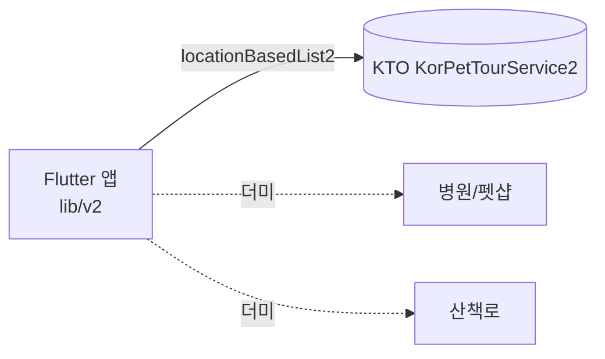
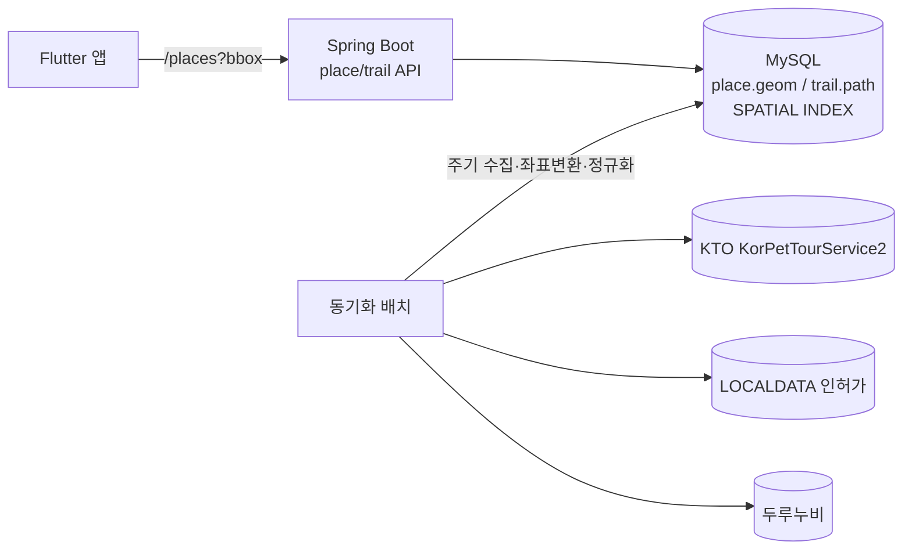

# 외부 공개데이터 연동

> Pawloop(포루프)이 지도·산책로 레이어를 채우기 위해 사용하는 외부 공개데이터(관광공사 반려동물 동반여행, 행안부 LOCALDATA 동물병원·펫샵, 두루누비 걷기여행길)의 엔드포인트·필드·좌표계·인증·한계와 `place`/`trail` 캐싱 전략을 정리한다.

관련 문서: [ERD](../03-database/erd.md) · [시스템 아키텍처](./system-overview.md) · [API 명세](../04-api/api-spec.md)

---

## 0. 한눈에 보기

| 소스 | 제공기관 | 채우는 레이어(카테고리 key) | 좌표계 | 현재 상태 |
|---|---|---|---|---|
| **KorPetTourService2** | 한국관광공사 | 여행지`12`·문화`14`·레포츠`28`·숙박`32`·쇼핑`38`·카페/식당`39` | WGS84 (경위도) | **실연동** (백엔드 프록시 경유, 서울 ~45곳) |
| **LOCALDATA 인허가** | 행정안전부 | 병원`vet`·펫샵`shop` | **EPSG:5174** → WGS84 변환 필요 | 더미 (미연동) |
| **두루누비 걷기여행길** | 한국관광공사 | 산책로`trail` | WGS84 (GPX/좌표) | 더미 폴리라인 (미연동) |

- 카테고리 key는 `lib/v2/domain/pet.dart`의 `kPetCategories` SSOT를 그대로 사용한다. 숫자 key(`12`/`14`/`28`/`32`/`38`/`39`)는 KTO `contenttypeid`, 문자 key(`vet`/`shop`/`trail`)는 별도 공공데이터 레이어(`kLayerKeys`)다.
- KTO 는 **백엔드가 부른다**(#40). 앱은 `GET /api/places/nearby` 만 안다(`lib/v2/data/pet_places_repository.dart`). 나머지 두 소스(`vet`/`shop`/`trail`)는 아직 더미다(→ [6. 캐싱·동기화](#6-캐싱동기화-전략placetrail)).

---

## 1. KTO KorPetTourService2 (반려동물 동반여행)

한국관광공사 "반려동물 동반여행 서비스"(data.go.kr, 데이터 PK `15135102`). 반려동반 가능 관광지·카페·숙박 등을 좌표와 함께 제공한다. Pawloop 지도의 **동반가능 장소** 레이어를 채우는 유일한 실연동 소스다.

### 1.1 기본 정보

| 항목 | 값 |
|---|---|
| Base URL | `https://apis.data.go.kr/B551011/KorPetTourService2` |
| 인증 | 쿼리 파라미터 `serviceKey` (data.go.kr 발급) |
| 응답 포맷 | `_type=json` (기본 XML) |
| 호출 한도 | 개발계정 기준 **1,000 calls/day** (운영계정 신청 시 상향) |
| **호출 위치** | **백엔드** `place/service/KtoApiClient.fetchNearby()`. 앱은 이 API 를 모른다(#40) |
| 앱이 부르는 것 | `GET /api/places/nearby` (우리 백엔드) → `PetPlacesRepository.fetchNearby()` |

### 1.2 오퍼레이션

| 오퍼레이션 | 용도 | Pawloop 사용 |
|---|---|---|
| `locationBasedList2` | 좌표 반경 내 장소(거리순) | **사용 중** (내 주변 동반장소) |
| `areaBasedList2` | 지역코드 기반 목록 | 향후 배치 수집(도시 단위 프리로드)에 적합 |
| `searchKeyword2` | 키워드 검색 | 미사용 |
| `detailPetTour2` | 반려동반 상세정보(동반조건 등) | 미사용 (장소 상세 확장 시 후보) |

> 참고: 백엔드에는 감정여행 레거시의 일반 관광 `TourApiClient`가 남아 `areaBasedList2`를 호출한다(`backend/.../tour/service/TourApiClient.java`). 반려 전용 프록시는 **이미 붙었다**(#40). 다만 그 `WebClient` 를 재사용하지 **않았다** — 타임아웃이 하나도 없어서 공개 경로 뒤에 두면 위험하다. `KtoWebClientConfig` 가 타임아웃 네 겹을 건 빈을 따로 만든다. 예전 서술: 이 패턴을 재사용해 `KorPetTourService2`로 붙이면 된다.

### 1.3 요청 파라미터 (`locationBasedList2`)

실제 앱 코드가 조립하는 쿼리스트링(`fetchNearby`) 기준:

| 파라미터 | 예시값 | 설명 |
|---|---|---|
| `serviceKey` | (인코딩 키) | **이미 인코딩된 키를 그대로** 붙인다(재인코딩 금지 — 아래 1.6) |
| `MobileOS` | `ETC` | 필수. 앱은 `ETC` 사용 |
| `MobileApp` | `heattrip` | 필수. 서비스 식별자 |
| `_type` | `json` | 응답 포맷 |
| `numOfRows` | `80` | 페이지당 건수 (앱 기본 80) |
| `pageNo` | `1` | 페이지 번호 |
| `mapX` | `127.04` | **경도(lng)** |
| `mapY` | `37.54` | **위도(lat)** |
| `radius` | `8000` | 반경(m). 앱 기본 8km |
| `arrange` | `E` | 정렬 — `E`=거리순(이미지 우선) |
| `contentTypeId` | `39` | (선택) 카테고리 필터. 없으면 전체 |

주의: KTO 파라미터는 `mapX`=경도, `mapY`=위도로 **경도가 먼저**다. 서버가 `mapX=경도&mapY=위도` 로 넘긴다(뒤바꾸면 결과 0건).

### 1.4 호출 예시 (서버가 보낸다)

```
GET https://apis.data.go.kr/B551011/KorPetTourService2/locationBasedList2
  ?serviceKey={ENCODED_KEY}
  &MobileOS=ETC&MobileApp=heattrip&_type=json
  &numOfRows=80&pageNo=1
  &mapX=127.0396&mapY=37.5443&radius=8000&arrange=E
  &contentTypeId=39
```

서버 측 실코드(요약):

```java
// place/service/KtoApiClient — 서비스키가 사는 유일한 자리
String query = "serviceKey=" + serviceKey
        + "&MobileOS=ETC&MobileApp=heattrip&_type=json"
        + "&numOfRows=" + numOfRows + "&pageNo=1"
        + "&mapX=" + centerLng + "&mapY=" + centerLat
        + "&radius=" + GridCell.FETCH_RADIUS_M + "&arrange=E";
```

반경이 사용자 요청값이 아니라 **셀 중심에서 20km 고정**인 것에 주의. 사용자 반경을 그대로
쓰면 같은 셀이 반경마다 따로 캐시돼야 하고 셀당 콜이 여러 배가 된다. 넓게 한 번 받아 두고
서빙할 때 좁힌다.

### 1.5 응답 필드 매핑

응답 구조는 `response.body.items.item[]`. 단건이면 `item`이 배열이 아니라 객체로 오므로 배열 정규화가 필요하다(**서버** `KtoApiClient.items()` 가 처리). `items`가 빈 문자열/문자열이면 결과 0건으로 간주한다.

아래 매핑도 **서버가** 한다. 앱은 오른쪽 열(계약의 `Place`)만 안다 — KTO 의 모양을 앱이 또 알면 해석이 두 곳에 살고 한쪽만 고치면 조용히 갈라진다(#40).

| KTO 응답 필드 | 계약 `Place` / 앱 `PetPlace` | 비고 |
|---|---|---|
| `contentid` | `contentId` | 고유 ID |
| `title` | `title` | 장소명 |
| `contenttypeid` | `contentTypeId` | 카테고리(→ `petCatByType`로 `PetCategory` 매핑) |
| `addr1` | `addr` | 주소 |
| `firstimage` / `firstimage2` | `image` | 대표 이미지(없을 수 있음) |
| `tel` | `tel` | 전화 |
| `mapy` | `lat` | **위도** |
| `mapx` | `lng` | **경도** |
| `dist` | `distM` | 기준점으로부터 거리(m). `locationBasedList2`만 제공 |

- `contenttypeid` 코드표: `12`관광지 · `14`문화시설 · `28`레포츠 · `32`숙박 · `38`쇼핑 · `39`음식점. 매핑에 없는 값은 "기타"로 폴백.
- `lat`/`lng`가 0인 항목(좌표 결측)은 앱에서 걸러낸다.

### 1.6 서비스키 취급 (중요)

- **키는 서버에만 있다**(#40). 환경변수 `TOUR_API_SECRET` 이고, 앱 바이너리에는 없다.
- 여기까지 온 경로: `.env` 를 에셋으로 번들링 → APK 를 풀면 그대로 보여서 `--dart-define` 으로 옮김(#29) → **그것도 완화일 뿐**(문자열이 바이너리에 남아 `strings` 한 번이면 나온다) → 호출 자체를 서버로 옮김(#40).
- **명칭은 "Decoding"이지만 실제로는 인코딩(URL-encoded)된 키**다. 그래서 서버의 WebClient 는 `EncodingMode.NONE` 이다 — 재인코딩하면 `%2B` 가 `%252B` 가 되어 `SERVICE_KEY_IS_NOT_REGISTERED_ERROR` 가 나고, **그 실패가 HTTP 200 이라** "이 주변에 장소가 없음" 으로 보인다.
- 그래서 서버는 `response.header.resultCode` 를 먼저 본다. `0000` 이 아니면 **캐시하지 않는다** — 실패를 캐시하면 사용자가 있던 셀들이 빈 지도로 굳는다.

### 1.7 한계·주의

- **호출 한도 1,000/day**: 앱이 직접 부르던 시절에는 지도를 움직일 때마다 호출이 나가 금세 소진됐다. 지금은 서버가 좌표를 **0.02° 격자**로 접어 셀 단위로 캐시하고, `kto_call_budget` 표가 하루 상한을 게이트로 지킨다(#40).
  - 서울 전역이 **154셀**이라 하루에 다 데워도 `nearby` 상한 300 의 절반이다. **사용자가 몇 명이든 이 수는 안 변한다** - 상한을 만드는 것이 사람 수가 아니라 땅 넓이다.
  - 일 총량을 1,000 이 아니라 **500** 으로 잡았다. 상대의 쿼터 리셋 시각을 몰라서, 경계가 어긋나면 상대의 24시간 창에 우리 두 날이 겹칠 수 있기 때문이다.
- **응답 형태 불안정**: `items`가 빈 문자열, `item`이 객체/배열 혼재 → 방어적 파싱 필수(구현됨).
- **이미지 결측** 잦음(`firstimage` 없음) → UI 플레이스홀더 필요.
- 좌표는 WGS84라 별도 변환 불필요(LOCALDATA와 대비).

---

## 2. LOCALDATA 인허가 (동물병원 · 펫샵)

행정안전부 지방행정 인허가데이터(LOCALDATA). 동물병원은 전국 약 **9,445건**, 그 외 동물미용·펫샵·펫호텔 업종이 있다. 지도의 `vet`/`shop` 레이어를 채운다. **현재 앱은 더미**이며, 좌표계 변환이 최대 관문이다.

### 2.1 좌표계 변환 — EPSG:5174 → WGS84 (필수)

LOCALDATA 좌표(`x`, `y`)는 경위도가 아니라 **EPSG:5174 (중부원점 TM, Bessel 타원체)** 미터 좌표다. 지도(WGS84 경위도)에 찍으려면 반드시 변환해야 하며, 안 하면 한반도 밖(혹은 바다)에 찍힌다.

| 필드 | 의미 |
|---|---|
| `x` | TM 동쪽(easting), meter |
| `y` | TM 북쪽(northing), meter |

- **원본**: `EPSG:5174` (Korea 2000 / Central Belt, 중부원점, Bessel 1841)
- **목표**: `EPSG:4326` (WGS84 경위도)
- 주의: 5174는 5186(GRS80 중부원점)과 **타원체가 달라(Bessel vs GRS80)** 혼용 시 수십~수백 m 오차. LOCALDATA는 5174가 맞다.

변환은 **백엔드 배치에서 1회 수행 후 `place.geom`에 WGS84로 저장**하는 것을 권장(앱은 변환 부담 없음). 예: PROJ / GeoTools / proj4 계열.

```
# proj4 정의 (EPSG:5174)
+proj=tmerc +lat_0=38 +lon_0=127.0028902777778 +k=1 +x_0=200000 +y_0=500000
+ellps=bessel +units=m +no_defs
+towgs84=-115.80,474.99,674.11,1.16,-2.31,-1.63,6.43
```

### 2.2 주요 필드 (인허가 공통 스키마)

| 필드 | 의미 | `place` 매핑 |
|---|---|---|
| `bplcNm` | 사업장명 | `name` |
| `siteWhlAddr` / `rdnWhlAddr` | 지번/도로명 주소 | `addr` |
| `x`, `y` | EPSG:5174 좌표 | 변환 후 `geom(POINT)` |
| `trdStateNm` | 영업상태(영업/폐업) | 필터(영업 중만) |
| `siteTel` | 전화 | `raw_json` |
| `uptaeNm` | 업태(동물병원/미용 등) | `category` 판별 |

- **폐업 필터 필수**: `trdStateNm`(또는 `trdStateGbn`)로 영업 중만 적재. 안 하면 폐업 병원이 지도에 남음.
- 업종별로 파일/서비스가 나뉘므로(동물병원, 동물판매업 등) `source`를 `localdata_vet`/`localdata_shop`으로 구분해 저장.

### 2.3 상태·한계

- 현재 지도의 병원/펫샵은 **하드코딩 더미**(`kLayerKeys = {vet, shop, trail}` 레이어).
- 좌표 변환 + 폐업 필터 + 주기적(월 단위) 재적재가 실연동의 전제.

---

## 3. 두루누비 걷기여행길 (산책로)

한국관광공사 두루누비(walk trail) 데이터. 걷기여행길 코스의 경로 좌표/GPX를 제공한다. 지도의 `trail` 레이어(폴리라인)와 `trail` 테이블을 채운다.

| 항목 | 값 |
|---|---|
| 제공 | 한국관광공사 두루누비 |
| 형식 | 코스 좌표열 / GPX 트랙 |
| 좌표계 | WGS84 (변환 불필요) |
| 매핑 | 코스명 → `trail.name`, 좌표열 → `trail.path(LINESTRING)`, 총거리 → `trail.length_m` |
| 현재 상태 | **더미 폴리라인**(실데이터 미연동) |

- GPX/좌표열을 `LINESTRING`으로 변환해 `trail.path`에 저장, `length_m`는 사전 계산해 넣는다(지도 렌더 시 재계산 회피).
- 두루누비 코스는 도시 산책 규모보다 긴 트레킹 코스가 많아, MVP 지도에는 **도심 근처 코스만 선별 적재** 권장.

---

## 4. 좌표계 요약

| 소스 | 원본 좌표계 | 처리 |
|---|---|---|
| KTO KorPetTourService2 | WGS84(경위도, `mapx`/`mapy`) | 그대로 사용 |
| LOCALDATA 인허가 | **EPSG:5174 (Bessel TM)** | **→ WGS84 변환 필수(백엔드 배치)** |
| 두루누비 | WGS84 | 그대로 사용 |

지도 SDK(`flutter_naver_map`)와 DB `POINT`/`LINESTRING`은 모두 WGS84 기준으로 통일한다.

---

## 5. 데이터 흐름 (현재 vs 목표)

**현재** - KTO 는 프록시 경유, 나머지 더미:



**목표** — 백엔드 프록시 + `place`/`trail` 캐시:



---

## 6. 캐싱·동기화 전략(`place`/`trail`)

세 소스 모두 **호출 한도·좌표변환·응답 불안정** 이슈가 있어, 앱이 직접 외부 API를 때리지 않고 **백엔드가 미리 수집·정규화해 `place`/`trail`에 캐시**하는 구조를 목표로 한다.

### 6.1 캐시 테이블 (→ [ERD](../03-database/erd.md))

| 테이블 | 컬럼(핵심) | 채우는 소스 |
|---|---|---|
| `place` | `source`, `category`, `name`, `geom POINT`, `addr`, `tel`, `raw_json`, `updated_at` | `kto_pet` / `localdata_vet` / `localdata_shop` |
| `trail` | `source`, `name`, `path LINESTRING`, `length_m` | 두루누비 |

- `source`로 출처 구분: `kto_pet`, `localdata_vet`, `localdata_shop`.
- `raw_json`에 원본 응답을 보관해 스키마 변경/재파싱에 대비.
- 공간질의는 `ST_Distance_Sphere` / `MBRContains` + `SPATIAL INDEX`(→ 지도 bbox·반경 조회).

### 6.2 동기화 주기

| 소스 | 갱신 성격 | 권장 주기 |
|---|---|---|
| KTO 반려동반 | 저빈도 변경 | 주 1회 배치(도시별 `areaBasedList2` 페이지네이션 수집) |
| LOCALDATA | 인허가 변동(개·폐업) | 월 1회 재적재 + 폐업 필터 |
| 두루누비 | 거의 정적 | 분기/수동 |

### 6.3 갱신 규칙

- **upsert 키**: KTO는 `contentid`, LOCALDATA는 관리번호/사업장 식별자. 동일 키는 `updated_at` 갱신.
- **좌표 변환은 적재 시 1회**(LOCALDATA 5174→WGS84) → 조회·렌더는 변환 부담 0.
- **호출 한도 회피**: KTO 1,000/day는 배치가 한 번에 페이지네이션으로 소진하고, 사용자 요청은 전부 캐시(`place`)에서 응답.
- 이미지/전화 등 결측은 캐시 단계에서 정규화(빈 문자열 통일)해 앱 분기 단순화.

### 6.4 이전 로드맵

1. ~~KTO 프록시 엔드포인트 신설~~ → **완료**(#40). 경로는 `GET /api/places/nearby?lat&lng&radius&category&limit` 다(`?bbox=` 가 아니다 - 앱이 갖고 있는 것이 중심 좌표와 반경이라 그쪽이 계약과 맞는다).
2. LOCALDATA 배치(좌표변환 포함) → `place`(`vet`/`shop`) 적재 → 더미 제거.
3. 두루누비 배치 → `trail` 적재 → 더미 폴리라인 제거.

---

## 부록 A. 관련 코드 위치

| 파일 | 역할 |
|---|---|
| `app/lib/v2/data/pet_places_repository.dart` | 백엔드 `GET /api/places/nearby` 호출·파싱(`PetPlace`). **KTO 를 직접 안 부른다** |
| `app/lib/v2/domain/pet.dart` | 카테고리 SSOT(`kPetCategories`, `kLayerKeys`, `petCatByType`) |
| `backend/.../place/` | 프록시 본체 - 격자 캐시(`GridCell`·`CellSnapshotStore`) · 호출 예산(`KtoCallBudget`) · KTO 호출(`KtoApiClient`) |
| `--dart-define` (템플릿 `app/dart-define.example.json`) | `NAVER_MAP_CLIENT_ID` 뿐. **관광공사 키는 여기 없다**(#40) |
| `backend/.../tour/service/TourApiClient.java` | `areaBasedList2` 배치 적재(감정추천용). **타임아웃이 없다** - 배치라 감수하는 것이고, 프록시는 `KtoWebClientConfig` 의 빈을 쓴다 |
| `backend/mysql/post-start/10_place_cache.sql` | `kto_call_budget`·`place_cell`·`pet_place_detail` |
