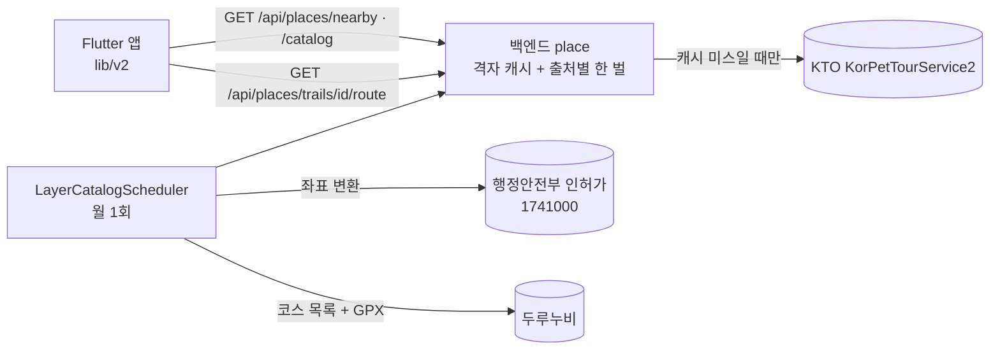
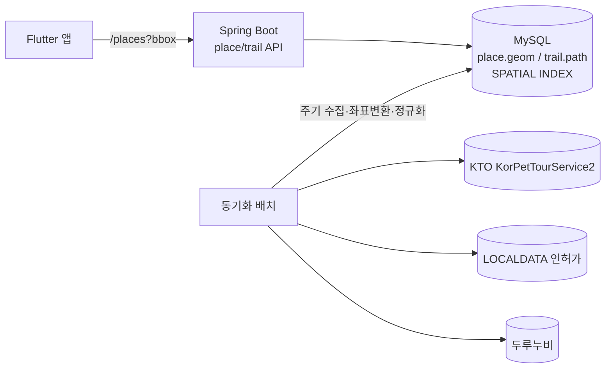

# 외부 공개데이터 연동

> Pawloop(포루프)이 지도·산책로 레이어를 채우기 위해 사용하는 외부 공개데이터(관광공사 반려동물 동반여행, 행안부 LOCALDATA 동물병원·펫샵, 두루누비 걷기여행길)의 엔드포인트·필드·좌표계·인증·한계와 `place`/`trail` 캐싱 전략을 정리한다.

관련 문서: [ERD](../03-database/erd.md) · [시스템 아키텍처](./system-overview.md) · [API 명세](../04-api/api-spec.md)

---

## 0. 한눈에 보기

| 소스 | 제공기관 | 채우는 레이어(카테고리 key) | 좌표계 | 현재 상태 |
|---|---|---|---|---|
| **KorPetTourService2** | 한국관광공사 | 여행지`12`·문화`14`·레포츠`28`·숙박`32`·쇼핑`38`·카페/식당`39` | WGS84 (경위도) | **실연동** (백엔드 프록시 경유, 서울 ~45곳) |
| **행정안전부 인허가** (공공데이터포털 `1741000/animal_hospitals`·`animal_sales`) | 행정안전부 | 병원`vet`·펫샵`shop` | **EPSG:5174** → WGS84 (서버가 proj4j 로 변환) | **실연동** (#291 — 전국, 월 1회, `place_catalog` 의 `localdata` 행) |
| **두루누비 걷기여행길** (`B551011/Durunubi/courseList` + GPX) | 한국관광공사 | 산책로`trail` | WGS84 (GPX) | **실연동** (#291 — 월 1회, 시작점은 `place_catalog` 의 `durunubi` 행, 선은 `trail_route`) |
| **행정동 경계** (통계청 SGIS · [vuski/admdongkor](https://github.com/vuski/admdongkor)) | 통계청 | — (동네 고르기 #342) | WGS84 | **내장 자산** — API 를 안 부른다. 아래 §7 |

- 카테고리 key는 `lib/v2/domain/pet.dart`의 `kPetCategories` SSOT를 그대로 사용한다. 숫자 key(`12`/`14`/`28`/`32`/`38`/`39`)는 KTO `contenttypeid`, 문자 key(`vet`/`shop`/`trail`)는 별도 공공데이터 레이어(`kLayerKeys`)다.
- 셋 다 **백엔드가 부른다**(#40 · #291). 앱은 `GET /api/places/nearby`·`GET /api/places/catalog`·`GET /api/places/trails/{courseId}/route` 만 안다(`lib/v2/data/pet_places_repository.dart`·`place_catalog_repository.dart`·`trail_route_repository.dart`). 세 API 는 공공데이터포털의 **같은 인증키**(`TOUR_API_SECRET`)를 쓰되 API 마다 활용신청이 따로다.

---

## 1. KTO KorPetTourService2 (반려동물 동반여행)

한국관광공사 "반려동물 동반여행 서비스"(data.go.kr, 데이터 PK `15135102`). 반려동반 가능 관광지·카페·숙박 등을 좌표와 함께 제공한다. Pawloop 지도의 **동반가능 장소** 레이어를 채우는 유일한 실연동 소스다.

### 1.1 기본 정보

| 항목 | 값 |
|---|---|
| Base URL | `https://apis.data.go.kr/B551011/KorPetTourService2` |
| 인증 | 쿼리 파라미터 `serviceKey` (data.go.kr 발급) |
| 응답 포맷 | `_type=json` (기본 XML) |
| 호출 한도 | 개발계정 기준 **1,000 calls/day** (운영계정 신청 시 상향) |
| **호출 위치** | **백엔드** `place/service/KtoApiClient.fetchNearby()`. 앱은 이 API 를 모른다(#40) |
| 앱이 부르는 것 | `GET /api/places/nearby` (우리 백엔드) → `PetPlacesRepository.fetchNearby()` |

### 1.2 오퍼레이션

| 오퍼레이션 | 용도 | Pawloop 사용 |
|---|---|---|
| `locationBasedList2` | 좌표 반경 내 장소(거리순) | **사용 중** (내 주변 동반장소) |
| `areaBasedList2` | 지역코드 기반 목록 | 향후 배치 수집(도시 단위 프리로드)에 적합 |
| `searchKeyword2` | 키워드 검색 | 미사용 |
| `detailPetTour2` | 반려동반 상세정보(동반조건 등) | 미사용 (장소 상세 확장 시 후보) |

> 참고: 백엔드에는 감정여행 레거시의 일반 관광 `TourApiClient`가 남아 `areaBasedList2`를 호출한다(`backend/.../tour/service/TourApiClient.java`). 반려 전용 프록시는 **이미 붙었다**(#40). 다만 그 `WebClient` 를 재사용하지 **않았다** — 타임아웃이 하나도 없어서 공개 경로 뒤에 두면 위험하다. `KtoWebClientConfig` 가 타임아웃 네 겹을 건 빈을 따로 만든다. 예전 서술: 이 패턴을 재사용해 `KorPetTourService2`로 붙이면 된다.

### 1.3 요청 파라미터 (`locationBasedList2`)

실제 앱 코드가 조립하는 쿼리스트링(`fetchNearby`) 기준:

| 파라미터 | 예시값 | 설명 |
|---|---|---|
| `serviceKey` | (인코딩 키) | **이미 인코딩된 키를 그대로** 붙인다(재인코딩 금지 — 아래 1.6) |
| `MobileOS` | `ETC` | 필수. 앱은 `ETC` 사용 |
| `MobileApp` | `heattrip` | 필수. 서비스 식별자 |
| `_type` | `json` | 응답 포맷 |
| `numOfRows` | `80` | 페이지당 건수 (앱 기본 80) |
| `pageNo` | `1` | 페이지 번호 |
| `mapX` | `127.04` | **경도(lng)** |
| `mapY` | `37.54` | **위도(lat)** |
| `radius` | `8000` | 반경(m). 앱 기본 8km |
| `arrange` | `E` | 정렬 — `E`=거리순(이미지 우선) |
| `contentTypeId` | `39` | (선택) 카테고리 필터. 없으면 전체 |

주의: KTO 파라미터는 `mapX`=경도, `mapY`=위도로 **경도가 먼저**다. 서버가 `mapX=경도&mapY=위도` 로 넘긴다(뒤바꾸면 결과 0건).

### 1.4 호출 예시 (서버가 보낸다)

```
GET https://apis.data.go.kr/B551011/KorPetTourService2/locationBasedList2
  ?serviceKey={ENCODED_KEY}
  &MobileOS=ETC&MobileApp=heattrip&_type=json
  &numOfRows=80&pageNo=1
  &mapX=127.0396&mapY=37.5443&radius=8000&arrange=E
  &contentTypeId=39
```

서버 측 실코드(요약):

```java
// place/service/KtoApiClient — 서비스키가 사는 유일한 자리
String query = "serviceKey=" + serviceKey
        + "&MobileOS=ETC&MobileApp=heattrip&_type=json"
        + "&numOfRows=" + numOfRows + "&pageNo=1"
        + "&mapX=" + centerLng + "&mapY=" + centerLat
        + "&radius=" + GridCell.FETCH_RADIUS_M + "&arrange=E";
```

반경이 사용자 요청값이 아니라 **셀 중심에서 20km 고정**인 것에 주의. 사용자 반경을 그대로
쓰면 같은 셀이 반경마다 따로 캐시돼야 하고 셀당 콜이 여러 배가 된다. 넓게 한 번 받아 두고
서빙할 때 좁힌다.

### 1.5 응답 필드 매핑

응답 구조는 `response.body.items.item[]`. 단건이면 `item`이 배열이 아니라 객체로 오므로 배열 정규화가 필요하다(**서버** `KtoApiClient.items()` 가 처리). `items`가 빈 문자열/문자열이면 결과 0건으로 간주한다.

아래 매핑도 **서버가** 한다. 앱은 오른쪽 열(계약의 `Place`)만 안다 — KTO 의 모양을 앱이 또 알면 해석이 두 곳에 살고 한쪽만 고치면 조용히 갈라진다(#40).

| KTO 응답 필드 | 계약 `Place` / 앱 `PetPlace` | 비고 |
|---|---|---|
| `contentid` | `contentId` | 고유 ID |
| `title` | `title` | 장소명 |
| `contenttypeid` | `contentTypeId` | 카테고리(→ `petCatByType`로 `PetCategory` 매핑) |
| `addr1` | `addr` | 주소 |
| `firstimage` / `firstimage2` | `image` | 대표 이미지(없을 수 있음) |
| `tel` | `tel` | 전화 |
| `mapy` | `lat` | **위도** |
| `mapx` | `lng` | **경도** |
| `dist` | `distM` | 기준점으로부터 거리(m). `locationBasedList2`만 제공 |

- `contenttypeid` 코드표: `12`관광지 · `14`문화시설 · `28`레포츠 · `32`숙박 · `38`쇼핑 · `39`음식점. 매핑에 없는 값은 "기타"로 폴백.
- `lat`/`lng`가 0인 항목(좌표 결측)은 앱에서 걸러낸다.

### 1.6 서비스키 취급 (중요)

- **키는 서버에만 있다**(#40). 환경변수 `TOUR_API_SECRET` 이고, 앱 바이너리에는 없다.
- 여기까지 온 경로: `.env` 를 에셋으로 번들링 → APK 를 풀면 그대로 보여서 `--dart-define` 으로 옮김(#29) → **그것도 완화일 뿐**(문자열이 바이너리에 남아 `strings` 한 번이면 나온다) → 호출 자체를 서버로 옮김(#40).
- **명칭은 "Decoding"이지만 실제로는 인코딩(URL-encoded)된 키**다. 그래서 서버의 WebClient 는 `EncodingMode.NONE` 이다 — 재인코딩하면 `%2B` 가 `%252B` 가 되어 `SERVICE_KEY_IS_NOT_REGISTERED_ERROR` 가 나고, **그 실패가 HTTP 200 이라** "이 주변에 장소가 없음" 으로 보인다.
- 그래서 서버는 `response.header.resultCode` 를 먼저 본다. `0000` 이 아니면 **캐시하지 않는다** — 실패를 캐시하면 사용자가 있던 셀들이 빈 지도로 굳는다.

### 1.7 한계·주의

- **호출 한도 1,000/day**: 앱이 직접 부르던 시절에는 지도를 움직일 때마다 호출이 나가 금세 소진됐다. 지금은 서버가 좌표를 **0.02° 격자**로 접어 셀 단위로 캐시하고, `kto_call_budget` 표가 하루 상한을 게이트로 지킨다(#40).
  - 서울 전역이 **154셀**이라 하루에 다 데워도 `nearby` 상한 300 의 절반이다. **사용자가 몇 명이든 이 수는 안 변한다** - 상한을 만드는 것이 사람 수가 아니라 땅 넓이다.
  - 일 총량을 1,000 이 아니라 **500** 으로 잡았다. 상대의 쿼터 리셋 시각을 몰라서, 경계가 어긋나면 상대의 24시간 창에 우리 두 날이 겹칠 수 있기 때문이다.
- **응답 형태 불안정**: `items`가 빈 문자열, `item`이 객체/배열 혼재 → 방어적 파싱 필수(구현됨).
- **이미지 결측** 잦음(`firstimage` 없음) → UI 플레이스홀더 필요.
- 좌표는 WGS84라 별도 변환 불필요(LOCALDATA와 대비).

---

## 2. 행정안전부 인허가 (동물병원 · 동물판매업) — 실연동 (#291)

행정안전부 지방행정인허가데이터의 **전국** 동물병원·동물판매업. 공공데이터포털이 게이트웨이(`apis.data.go.kr/1741000/…`)로 준다 — 동물병원 9,445건 · 동물판매업 8,907건(폐업 포함, 2025-11 기준). 지도의 `vet`/`shop` 칩을 채운다.

> 2026-09-06 이전 이 절과 #291 본문은 서울 열린데이터광장만 보고 "서울만 있다" 고 적었다. 그 자료의 원천인 지방행정인허가데이터가 전국을 한 API 로 준다 — 서울 한정은 없어졌고, "서울만" 칩 표시도 만들지 않았다.

### 2.1 기본 정보

| 항목 | 값 |
|---|---|
| 동물병원 | `https://apis.data.go.kr/1741000/animal_hospitals/info` — 공공데이터포털 "행정안전부_동물_동물병원 조회서비스"(15154952) |
| 동물판매업 | `https://apis.data.go.kr/1741000/animal_sales/info` — "행정안전부_동물_동물판매업 조회서비스"(15155083) |
| 인증 | `serviceKey` — KTO 와 **같은 키**(`TOUR_API_SECRET`). 다만 포털에서 API 마다 **활용신청**이 따로다(자동 승인). 안 돼 있으면 게이트웨이가 `returnReasonCode=30` 을 준다 |
| 한 페이지 | `numOfRows` 상한 **100**. 영업 중만 받으면 업종당 50페이지 안팎 |
| 필터 | `cond[SALS_STTS_CD::EQ]=01` — 영업/정상만. 폐업까지 받으면 페이지가 두 배다 |
| 한도 | 개발계정 10,000/일. 우리 풀(`kto_call_budget.pool = localdata`)은 500/일 |
| 갱신 | **월 1회**(매월 1일 05:20 KST, `LayerCatalogScheduler`) + 기동 시 한 벌이 없으면 한 번 |
| 호출 위치 | 백엔드 `place/layer/LocalDataApiClient` → `LayerCatalogService.refreshLocalData()` |

### 2.2 좌표계 변환 — EPSG:5174 → WGS84 (서버가 한다)

`CRD_INFO_X`/`CRD_INFO_Y` 는 경위도가 아니라 **Bessel 중부원점 TM(EPSG:5174) 미터 좌표**다("보정계수 안들어간 Bessel 중부원점TM" — 데이터 설명 그대로). 그대로 찍으면 한반도 밖에 찍힌다. `place/layer/Tm5174` 가 proj4j 로 바꾼다 — 정의 문자열은 아래이고 EPSG 파라미터 DB 는 들이지 않았다.

```
+proj=tmerc +lat_0=38 +lon_0=127.0028902777778 +k=1 +x_0=200000 +y_0=500000
+ellps=bessel +units=m +no_defs +towgs84=-115.80,474.99,674.11,1.16,-2.31,-1.63,6.43
```

`Tm5174Test` 가 서울 다섯 곳(열린데이터광장 sample 행의 TM 좌표 ↔ 카카오 주소검색 WGS84)을 **60m 안**에서 맞추는지 잰다. 타원체나 원점을 틀리면 수백 m 가 어긋나 빨간불이다. 한국 밖으로 떨어지는 결과는 버린다.

### 2.3 필드 매핑 (`LocalDataPlaceMapper`)

| 응답 필드 | 계약 `Place` | 비고 |
|---|---|---|
| `MNG_NO` | `contentId` = `vet:관리번호` / `shop:관리번호` | KTO 숫자 키와 겹치지 않게 접두사. 상세 경로 없음(404) |
| `BPLC_NM` | `title` | |
| `SALS_STTS_CD` | (필터) | `01` 이 아니면 버린다 — 호출이 걸러도 한 번 더 본다 |
| `CRD_INFO_X` / `CRD_INFO_Y` | `lat` / `lng` | 변환 뒤. 비어 있으면 버린다(개업 며칠 안 된 곳은 비어 온다 — 서울 실측) |
| `ROAD_NM_ADDR` → `LOTNO_ADDR` | `addr` | 도로명이 없으면 지번 |
| `TELNO` | `tel` | |
| `DTL_TASK_SE_NM` | `summary` | 판매업만 — 동물판매업/동물미용업 구분 |
| — | `source` = `category` = `vet`/`shop`, `contentTypeId` = null | 앱은 `contentTypeId` 가 없으면 `category` 를 본다 |

### 2.4 한계·주의

- 공공데이터포털의 정상 코드가 서비스마다 다르다(KTO `0000`, 여기는 `00` 으로 적혀 있다). `DataGoKrEnvelope` 는 코드를 판정하지 않고 넘기고, `body` 가 있으면 계속한다 — 실측 뒤 맞춘다.
- 키 미등록(30)·한도 초과(22)를 받으면 **그날 풀을 닫는다.** 활용신청이 안 된 API 를 하루 종일 두드리지 않는다. KTO 한 벌은 그와 무관하게 나간다.
- 중간 페이지가 실패하면 **아무것도 저장하지 않는다.** 옛 한 벌이 반쪽보다 낫다(KTO 카탈로그와 같은 원칙).
- 대안으로 파일 다운로드(`file.localdata.go.kr/file/download/animal_hospitals/info`, 매일 갱신 CSV, 로그인 없음)가 있다. 키가 필요 없지만 CP949 CSV 와 zip 을 풀어야 하고 증분이 없어 API 를 골랐다. 포털 API 가 막히는 날의 예비다.

---

## 3. 두루누비 걷기여행길 (산책로) — 실연동 (#291)

한국관광공사 두루누비의 걷기여행길. 코스 목록은 API 가, 선은 코스마다 **GPX 파일**이 준다. "중간에 변환" 이 이것이다 — 선을 받아서 **시작점은 카탈로그의 점**으로, **선은 `trail_route`** 로 나눠 담는다.

| 항목 | 값 |
|---|---|
| 코스 목록 | `https://apis.data.go.kr/B551011/Durunubi/courseList?brdDiv=DNWW&numOfRows=100&pageNo=n&_type=json` — 공공데이터포털 "한국관광공사_두루누비 정보 서비스_GW"(15101974). `brdDiv=DNWW` 가 걷기길(명세: "걷기 길만 제공되고 있음") |
| 인증 | KTO 와 같은 키. **활용신청 따로**(자동 승인). 2026-09-06 실측: 신청 전이라 `returnReasonCode=30` |
| 한도 | 개발계정 1,000/일. 우리 풀(`durunubi`)은 100/일. GPX 파일은 두루누비 웹서버라 안 센다 |
| 응답 필드 | `crsIdx`(코스 번호) · `crsKorNm` · `routeIdx` · `crsDstnc`(km) · `crsTotlRqrmHour`(분) · `crsLevel`(1~3) · `crsCycle` · `sigun` · `crsSummary` · **`gpxpath`**(GPX URL) |
| GPX | `<trkpt lat lon>` 를 순서대로 읽고(`GpxParser`), Douglas–Peucker 로 **300점 이하**로 줄여 `[[경도, 위도]]` JSON 으로 `trail_route.payload` 에 둔다. 길이는 줄이기 전에 잰다 |
| 카탈로그 항목 | `contentId` = `trail:crsIdx` · `lat/lng` = 선의 첫 점 · `addr` = `sigun` · `summary` = "12.3km · 약 4시간 · 보통 · 순환" |
| 선 응답 | `GET /api/places/trails/{courseId}/route` — `TrailRoute{courseId, name, lengthM, pointCount, points}`. `Cache-Control: max-age=86400` |
| 갱신 | 월 1회. 이미 30일 안에 받은 코스의 GPX 는 다시 받지 않는다 |
| 호출 위치 | `place/layer/DurunubiApiClient` · `GpxFetcher` → `LayerCatalogService.refreshDurunubi()` |

- 응답이 JSON 인지 XML 인지 실측 전이다 — `DataGoKrEnvelope` 가 둘 다 같은 트리로 읽는다.
- 코스 하나의 선은 10KB 안팎이라 2,000 코스면 16MB 다. 그래서 카탈로그에 선을 싣지 않는다.
- 앱은 산책로 시트를 열 때 선을 받아 지도에 폴리라인을 그린다(`TrailRouteRepository`). 지도 키 없는 빌드는 카드의 `summary` 만 본다.

---

## 3.5 행정동 목록 — 앱에 넣어 둔다 (#342)

**API 가 아니다.** 받아서 쓰는 것이 아니라 **저장소에 커밋한 파일**이다. 사용자가 자기 동네를 고르는 목록이고, 목록이 바뀌는 주기가 몇 년이라 실시간으로 받을 이유가 없다 — 빌드 때 받으면 그 순간 인터넷이 없을 때 앱이 안 나온다.

| 항목 | 값 |
|---|---|
| 원자료 | 통계청 SGIS 행정동 경계 (공공누리 제1유형 — 출처표시) |
| 가공본 | [vuski/admdongkor](https://github.com/vuski/admdongkor) `ver20230101` — **CC BY 4.0** |
| 우리 파일 | `app/assets/regions/hangjeongdong.json` (시도 17 · 시군구 250 · 행정동 3,516 · 285KB) |
| 서버 파일 | `backend/src/main/resources/data/sigungu.json` (시군구 250 줄, 20KB) |
| 만드는 법 | `python app/tool/build_regions.py <geojson> app/assets/regions/hangjeongdong.json` |

**원본은 34MB 경계 GeoJSON 이다.** 우리에게 필요한 것은 이름·코드·중심점뿐이라 스크립트가 그 셋만 뽑는다. 중심점은 가장 큰 폴리곤 링의 꼭짓점 평균이다 — 지도 첫 화면의 중심으로만 쓰므로 몇백 미터 차이가 뜻을 바꾸지 않는다.

**CC BY 4.0 은 파생물에도 출처 표시 의무가 남는다.** 그래서 출처가 세 군데 적혀 있다 — 생성된 JSON 의 `source` 필드, `NeighborhoodCatalog` 의 javadoc, 그리고 앱의 동네 고르기 화면 아래 한 줄. **지우면 안 된다.**

**서버는 시군구 250 줄만 든다.** 동 이름을 쓸 일이 없어서다 — 글 카드는 구까지만 보여 주고, 지도의 중심 좌표는 앱이 자기 자산에서 읽는다. 서버는 좌표를 받지도 저장하지도 않는다(#235 A안).

---

## 4. 좌표계 요약

| 소스 | 원본 좌표계 | 처리 |
|---|---|---|
| KTO KorPetTourService2 | WGS84(경위도, `mapx`/`mapy`) | 그대로 사용 |
| LOCALDATA 인허가 | **EPSG:5174 (Bessel TM)** | **→ WGS84 변환 필수(백엔드 배치)** |
| 두루누비 | WGS84 | 그대로 사용 |

지도 SDK(`flutter_naver_map`)와 DB `POINT`/`LINESTRING`은 모두 WGS84 기준으로 통일한다.

---

## 5. 데이터 흐름 (현재 vs 목표)

**현재** - 셋 다 백엔드가 받아 둔다(#291):



**목표** — 백엔드 프록시 + `place`/`trail` 캐시:



---

## 6. 캐싱·동기화 전략(`place`/`trail`)

세 소스 모두 **호출 한도·좌표변환·응답 불안정** 이슈가 있어, 앱이 직접 외부 API를 때리지 않고 **백엔드가 미리 수집·정규화해 `place`/`trail`에 캐시**하는 구조를 목표로 한다.

### 6.1 캐시 테이블 (→ [ERD](../03-database/erd.md))

| 테이블 | 컬럼(핵심) | 채우는 소스 |
|---|---|---|
| `place_catalog` | `id`, `source`, `payload`(계약 `Place[]` JSON), `etag`, `fetched_at` — **출처별 한 행** | `kto` / `localdata`(vet·shop) / `durunubi`(trail 시작점) |
| `trail_route` | `course_id`, `name`, `payload`(`[[경도, 위도]]`), `length_m`, `start_lat/lng`, `fetched_at` | 두루누비 GPX |

> 2026-09-06 이전 이 표는 `place(geom POINT)`·`trail(path LINESTRING)` 를 계획으로 적었다. 만들지 않았다 — 카탈로그는 앱이 통째로 받아 기기에서 거르고, 서버의 주변 조회는 메모리의 한 벌에서 하버사인으로 거른다(1만 점에 1ms 안팎). 공간 인덱스가 할 일이 없다.

- `source`로 출처 구분: `kto_pet`, `localdata_vet`, `localdata_shop`.
- `raw_json`에 원본 응답을 보관해 스키마 변경/재파싱에 대비.
- 공간질의는 `ST_Distance_Sphere` / `MBRContains` + `SPATIAL INDEX`(→ 지도 bbox·반경 조회).

### 6.2 동기화 주기

| 소스 | 갱신 성격 | 권장 주기 |
|---|---|---|
| KTO 반려동반 | 저빈도 변경 | 주 1회 배치(도시별 `areaBasedList2` 페이지네이션 수집) |
| 행정안전부 인허가 | 인허가 변동(개·폐업) | **월 1회**(매월 1일 05:20 KST) + 영업 중 필터 — 구현됨(#291) |
| 두루누비 | 거의 정적 | **월 1회**, 30일 안에 받은 GPX 는 재사용 — 구현됨(#291) |

### 6.3 갱신 규칙

- **upsert 키**: KTO는 `contentid`, LOCALDATA는 관리번호/사업장 식별자. 동일 키는 `updated_at` 갱신.
- **좌표 변환은 적재 시 1회**(LOCALDATA 5174→WGS84) → 조회·렌더는 변환 부담 0.
- **호출 한도 회피**: KTO 1,000/day는 배치가 한 번에 페이지네이션으로 소진하고, 사용자 요청은 전부 캐시(`place`)에서 응답.
- 이미지/전화 등 결측은 캐시 단계에서 정규화(빈 문자열 통일)해 앱 분기 단순화.

### 6.4 이전 로드맵

1. ~~KTO 프록시 엔드포인트 신설~~ → **완료**(#40). 경로는 `GET /api/places/nearby?lat&lng&radius&category&limit` 다(`?bbox=` 가 아니다 - 앱이 갖고 있는 것이 중심 좌표와 반경이라 그쪽이 계약과 맞는다).
2. ~~LOCALDATA 배치(좌표변환 포함) → `place`(`vet`/`shop`) 적재 → 더미 제거.~~ → **완료**(#291) — `place_catalog` 의 `localdata` 행.
3. ~~두루누비 배치 → `trail` 적재 → 더미 폴리라인 제거.~~ → **완료**(#291) — 시작점은 `place_catalog` 의 `durunubi` 행, 선은 `trail_route`.

---

## 부록 A. 관련 코드 위치

| 파일 | 역할 |
|---|---|
| `app/lib/v2/data/pet_places_repository.dart` | 백엔드 `GET /api/places/nearby` 호출·파싱(`PetPlace`). **KTO 를 직접 안 부른다** |
| `app/lib/v2/domain/pet.dart` | 카테고리 SSOT(`kPetCategories`, `kLayerKeys`, `petCatByType`) |
| `backend/.../place/` | 프록시 본체 - 격자 캐시(`GridCell`·`CellSnapshotStore`) · 호출 예산(`KtoCallBudget`) · KTO 호출(`KtoApiClient`) |
| `--dart-define` (템플릿 `app/dart-define.example.json`) | `NAVER_MAP_CLIENT_ID` 뿐. **관광공사 키는 여기 없다**(#40) |
| `backend/.../tour/service/TourApiClient.java` | `areaBasedList2` 배치 적재(감정추천용). **타임아웃이 없다** - 배치라 감수하는 것이고, 프록시는 `KtoWebClientConfig` 의 빈을 쓴다 |
| `backend/mysql/post-start/10_place_cache.sql` | `kto_call_budget`·`place_cell`·`pet_place_detail` |
| `backend/.../place/layer/` | 공공데이터 레이어(#291) — `LocalDataApiClient`·`LocalDataPlaceMapper`·`Tm5174`(좌표 변환)·`DurunubiApiClient`·`GpxFetcher`·`GpxParser`·`LayerCatalogService`·`LayerCatalogScheduler`(월 1회)·`LayerPlaceIndex`(주변 조회용 메모리 사본) |
| `backend/mysql/post-start/24_place_catalog_layers.sql` | `place_catalog.source`(출처별 한 행)·`trail_route` |
| `app/lib/v2/data/trail_route_repository.dart` | `GET /api/places/trails/{courseId}/route` — 산책로 시트를 열 때 선을 받아 지도에 그린다 |

## 7. 기상청 초단기실황 · 에어코리아 — 산책 안전 지수 (#336), **서버가 대신 부른다**

| 항목 | 내용 |
|:---|:---|
| 왜 서버인가 | 키를 앱에 두지 않는다(#40 — 바이너리에 남고 폐기하려면 재배포). 대신 앱은 **5km 격자 번호(nx, ny)만** 보내고, 요청에 인증이 없어 서버는 누구의 격자인지 모른다. 격자별 10분 캐시뿐, 저장하는 것이 없다 — 위치를 서버에 안 보내는 A안(#235)과의 절충이다. 위치기반서비스 이용약관 제3조 4) |
| 키 | `app.public-data.service-key` ← `PUBLIC_DATA_SERVICE_KEY`(없으면 `TOUR_API_SECRET`, 같은 공공데이터포털 키). 비어 있으면 `GET /api/walk-safety/now` 가 503 이고 앱은 카드를 안 그린다 |
| 경로 | `GET /api/walk-safety/now?nx=&ny=` — `walksafety` 모듈(`controller/service/dto`, [walk-safety.md](backend/walk-safety.md)). 응답 `WalkSafetyNow`([openapi](../04-api/openapi.yaml)) |
| 기상청 | `GET https://apis.data.go.kr/1360000/VilageFcstInfoService_2.0/getUltraSrtNcst?dataType=JSON&base_date=YYYYMMDD&base_time=HH00&nx=61&ny=126` — 매시 40분에 그 시각 실황이 나오므로 40분 전을 시 단위로 내려 부른다(`WalkSafetyService.kmaBase`, KST). 쓰는 항목 `T1H`(기온) · `REH`(습도) · `RN1`(1시간 강수) · `PTY`(강수형태). 기온이 없으면 503 |
| 에어코리아 | `MsrstnInfoInqireSvc/getMsrstnList`(측정소 목록, `dmX`=위도 `dmY`=경도, 서버 24h 캐시) → 격자 중심(`KmaGrid.toLatLng`, 역변환)에서 가장 가까운 측정소 → `ArpltnInforInqireSvc/getMsrstnAcctoRltmMesureDnsty?stationName=…&dataTerm=DAILY&ver=1.3` → `pm10Value` · `pm25Value`("-" 면 null). **API 마다 활용신청이 따로다**(둘 다 2026-09-08 승인). 게이트웨이 오류 둘을 헷갈리면 안 된다 — `SERVICE_KEY_IS_NOT_REGISTERED_ERROR` 는 **승인 전**이고, `NO_OPENAPI_SERVICE_ERROR`(해당 오픈API 서비스가 없거나 폐기됨)는 **우리 주소가 틀린 것**이다. 화면에서는 둘이 똑같이 보인다(PM 이 null) |
| 한도 | IP 분당 30(`walk-safety` 버킷, `ApiRateLimitFilter`). 기상청 쿼터는 격자 캐시로 격자 수에 묶인다 |
| 앱 | `app/lib/v2/data/walk_safety.dart`(격자 순변환 `kmaGrid` · 판정 규칙, 순수) · `walk_safety_repository.dart`(우리 서버 호출 · 30분 판정 캐시) · `widgets/walk_safety_card.dart` |

> **승인이 났는데도 미세먼지가 안 붙었다(2026-09-08).** 실시간 측정의 오퍼레이션 이름에 글자 둘이 더 붙어 있었다 — `getMsrstnAcct`**`nt`**`RltmMesureDnsty` 로 부르고 있었고 진짜 이름은 `getMsrstnAcctoRltmMesureDnsty` 다. 게이트웨이는 `NO_OPENAPI_SERVICE_ERROR` 를 돌려줬는데 그 응답이 **승인 대기와 똑같이 보였다** — 둘 다 PM 이 null 이다. 통합 테스트가 `AirKoreaClient` 를 통째로 가짜로 바꾸고 있어서 **요청 주소를 보는 눈이 하나도 없었다.** 지금은 `AirKoreaClientTest` 가 나가는 URI 를 잰다.
>
> **측정소 목록을 못 받으면 5분만 기억한다**(`WalkSafetyService.EMPTY_STATIONS_TTL`). 부팅 직후 인허가 레이어 적재(8,110행)와 같은 호스트를 두고 겹치면 5초 읽기 제한을 넘긴다 — 실측 5,812ms · `ReadTimeoutException`. 승인 전에는 빈 목록을 한 시간 기억하는 것이 맞았지만, 승인된 지금 빈 목록의 뜻은 "이번엔 못 받았다" 라서 한 시간을 기억하면 그 한 번의 겹침 때문에 미세먼지가 한 시간 사라진다.

## 8. 동물병원 진료시간 — **여는 데이터가 없다** (#337)

동물병원의 야간·24시 여부를 주는 공공 데이터를 찾다가 못 찾았습니다. 아래 넷을 봤고, 전부 **인허가**
데이터라 영업시간 항목이 애초에 없습니다.

| 출처 | 주는 것 | 진료시간 |
|:---|:---|:---|
| [행정안전부 동물_동물병원 조회서비스](https://www.data.go.kr/data/15154952/openapi.do) (LOCALDATA, 우리가 쓰는 것) | 사업장명 · 소재지 · 인허가일자 · 영업상태 · 전화번호 | 없음 |
| [서울 열린데이터광장 동물병원 인허가 정보](https://data.seoul.go.kr/dataList/OA-16007/S/1/datasetView.do) | 명칭 · 전화번호 · 도로명주소 | 없음 |
| [경기데이터드림 동물병원 현황](https://data.gg.go.kr/portal/data/service/selectServicePage.do?infId=Y5M0CVS8XM2C821G09A813809578&infSeq=3) | 시군 · 사업장명 · 주소 · 전화 · 좌표(WGS84) | 없음 |
| 구 단위 파일 데이터(종로·금천 등) | 위와 같은 인허가 항목 | 없음 |

**그래서 이름으로 짐작하고, 짐작이라고 적습니다.** `isTwentyFourHourByName`(`app/lib/v2/domain/vet_hours.dart`)
이 이름에서 `24시`·`24시간`·`24H` 를 찾고, 화면에는 늘 `24시 · 이름 기준` 으로 나갑니다. 채우는 길은
셋인데 이 이슈에서는 안 합니다 — (a) 병원이 직접 등록, (b) 이웃 후기(#338 의 `place_id` 필요),
(c) 지도 사업자 API 의 영업시간(약관·비용 확인 필요).
