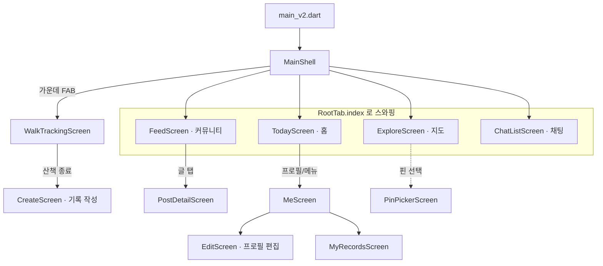
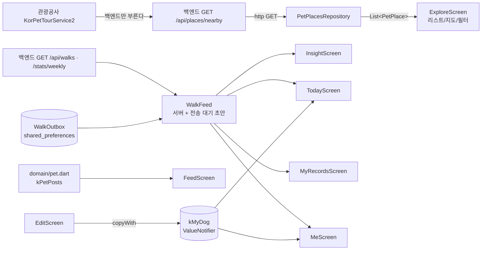

# 프론트엔드 구조 (Frontend Structure)

> Pawloop(포루프) Flutter 앱의 디렉터리 구조 · 상태관리 · 라우팅 · 데이터 흐름. 현재 화면은 모두 `lib/v2/` 하위에 있으며, 진입점은 `lib/main_v2.dart` → `MainShell`이다.

관련 문서: [ERD](../03-database/erd.md) · [시스템 아키텍처](./system-overview.md)

---

## 1. 두 개의 코드베이스: `lib/` (레거시) vs `lib/v2/` (현재)

앱 소스는 `app/lib/` 아래에 있고, 크게 두 세대로 나뉜다.

| 구분 | 진입점 | 라우팅 | 상태관리 | 상태 |
| --- | --- | --- | --- | --- |
| **레거시** `lib/` (app·core·features·shared) | `lib/main.dart` (`HeatTrip`) | `go_router` (`appRouter` → `MaterialApp.router`) | `provider` (MultiProvider DI) | 감정(heattrip) 시절 잔재. `foryou_v2`/`auth`/`emotion_map` 등 다수가 삭제·미정리 상태 |
| **현재** `lib/v2/` | `lib/main_v2.dart` (`HeatTripV2App`) | 없음 — `MaterialApp.home: MainShell()` 직접 지정 | `ValueNotifier` + `ValueListenableBuilder` (경량, 전역 정적 필드) | Pawloop 반려/산책 화면 전부. 실제 개발·데모 대상 |

- 실행: 현재 앱은 `flutter run -t lib/main_v2.dart`.
- 레거시 `lib/main.dart`는 `go_router` 기반이지만 반려 피벗 이후 화면 대부분이 제거되어 사실상 참고용이다. **이 문서는 `lib/v2/`를 기준으로 서술**한다.

---

## 2. `lib/v2/` 디렉터리 역할

```
lib/
├─ main_v2.dart            # v2 진입점: NaverMap 초기화(Env.naverMapClientId) → MainShell
├─ core/config/env.dart    # (레거시 core 재사용) --dart-define 값 단일 진입점 Env
└─ v2/
   ├─ screens/             # 화면 (탭 + 푸시 라우트)
   ├─ domain/pet.dart      # 도메인 모델 + 샘플 데이터 + 전역 상태(kMyDog 등)
   ├─ data/                # 레포지토리 (외부 API 호출)
   │  └─ pet_places_repository.dart
   ├─ widgets/             # 공용 위젯 (배경/카드/아바타/산책 완료 시트)
   ├─ walk/                # 경로 그림·갤러리 저장 (#310) — 네트워크 없음
   └─ theme/               # 디자인 토큰 + 배경 테마
```

### 2.1 `screens/` — 화면

`ValueNotifier` 하나(`RootTab.index`)로 스와핑되는 **4개 탭** + 가운데 **기록(+) FAB** + 여러 **푸시 라우트**로 구성된다.

| 파일 | 역할 | 진입 경로 |
| --- | --- | --- |
| `main_shell.dart` | 네비게이션 셸. 탭 스와핑 + 플로팅 글래스 바텀네비 + 산책 FAB | 루트 (`home`) |
| `today_screen.dart` | 홈(오늘) — 강아지 히어로 · 오늘 산책 요약 · 근처 동반장소 | 탭 0 |
| `explore_screen.dart` | 지도 — KTO 반려동반 장소 + 병원/펫샵/산책로 레이어 + 필터 (리스트/지도 토글) | 탭 1 |
| `feed_screen.dart` | 커뮤니티 — 게시글 카드/리스트 (더미) | 탭 2 |
| `insight_screen.dart` | 통계 — 이번 주 요약 + 주간 거리 막대(fl_chart). 자주 가는 곳은 빈 상태 | `me_screen` → push |
| `walk_tracking_screen.dart` | 실시간 산책 트래킹 (실 GPS, 경로 폴리라인 + 라이브 스탯) | FAB·홈 CTA → `startWalk()` |
| `create_screen.dart` | 산책 기록 작성 → `POST /api/walks` | 트래킹 종료 후 push (초안 동반) · 기록 목록에서 손입력 |
| `post_detail_screen.dart` | 커뮤니티 글 상세 — 반응 셋(멱등)·댓글 스레드 | feed → push |
| `post_write_screen.dart` | 커뮤니티 글쓰기 → `POST /api/community/posts`. `writePost()` 가 유일한 문이고 미로그인을 거기서 안내한다 | 피드의 글쓰기 버튼 · 빈 목록 안내 · 지도 장소 시트 |
| `me_screen.dart` | 프로필 — 강아지 프로필 + 활동 요약 + 메뉴 | 메뉴 → push |
| `edit_screen.dart` | 강아지 프로필 편집 + 프로필 테두리색 선택 | me → push |
| `myrecords_screen.dart` | 내 산책 기록 목록 | me → push |
| `pin_picker_screen.dart` | 지도에서 장소 핀 선택 | 보조 |
| `walk_detail_screen.dart` | 산책 회고 — 글을 나중에 고친다 → `PUT /api/walks/{id}/memo` | 기록 카드 탭 (#187) |
| `family_screen.dart` | 우리 가족 — 그룹·구성원·오늘의 케어 | me → push |
| `family_chat_screen.dart` | 가족 채팅방 (폴링) | family → push |
| `chat_list_screen.dart` | 방 목록 · 미읽음 | 탭 3 |
| `invite_join_screen.dart` | 초대 코드로 방 참여 | 링크·코드 입력 |
| `settings_screen.dart` | 설정 — 약관 넷 · 회원 탈퇴 · 운영자 연락처 | me → push (#165) |
| `settings/legal_document_screen.dart` | 약관 전문 렌더 (`assets/terms/*.md`) | 설정·동의 화면 → push |
| `settings/account_delete_screen.dart` | 회원 탈퇴 → `DELETE /auth/me` | 설정 → push |
| `consent_screen.dart` | **약관 동의 게이트** — 이용약관·개인정보·위치기반서비스(필수) + 마케팅 | 로그인 직후, 온보딩보다 앞 (#180) |
| `login_screen.dart` | 소셜 로그인(카카오·구글) · 그냥 둘러보기 | 미로그인 진입 |
| `onboarding_screen.dart` | 신규 가입자 — 반려동물 등록 권유 | 동의 후 (`isNew`) |
| `splash_screen.dart` | 저장된 토큰 검증 중 머무는 자리 | 앱 시작 |
| `start_walk.dart` | 산책 시작 진입 — 미로그인이면 로그인부터 | 화면 아님(함수) |

> **주의:** 화면 파일명은 감정 시절 이름(explore/feed/insight/me)을 유지하지만 내용은 전부 반려/산책으로 대체됐다. 예: `explore_screen.dart` = 지도, `insight_screen.dart` = 산책 통계.

> **이 표는 `find app/lib/v2/screens -name '*.dart'` 와 같아야 합니다.**
> 2026-09-02 에 세었을 때 실제 **25개**인데 표에는 12개뿐이었고, `settings_screen` ·
> `legal_document_screen` · `consent_screen` · `walk_detail_screen` 넷은 `docs/` 전체에서
> **0건**이었습니다. `consent_screen` 은 위치정보법 동의 게이트라 문서에 없으면 안 됩니다. (#201)

### 2.2 `domain/pet.dart` — 도메인 + 샘플 데이터 + 전역 상태

한 파일에 세 가지가 모여 있다.

- **도메인 모델**: `DogProfile`(견종·크기·나이·중성화·아바타, `copyWith` 지원), `DogSize`(소형/중형/대형), `PetCategory`(지도/필터 카테고리 SSOT), `PetPost`. 산책은 도메인 상수가 아니라 `data/walk_*.dart` 다(#145).
- **상수 SSOT**: `kPetCategories`(9종: KTO contenttypeid + vet/shop/trail 레이어), `kLayerKeys`, `kPetBoards`(커뮤니티 게시판), `kPetReactions`(도움돼요/귀여워요/공감).
- **샘플/더미 데이터**: `kPetPosts` — 백엔드 연동 전 화면을 채우는 상수. 산책 더미(`kWalks`·`kWeekKm`·`kWalkTodayIdx`·`WalkToday`·`WalkLog`)는 **지웠다**(#145). `kWeekDayLabels` 만 남았는데 그건 지어낸 기록이 아니라 달력의 사실이다.
- **전역 상태**: `kMyDog`(현재 반려견) — 아래 3장 참조.

`petCatByType(contentTypeId)`로 KTO 응답의 `contenttypeid` → 카테고리를 매핑한다.

### 2.3 `data/` — 레포지토리 (데이터 소스)

- `pet_places_repository.dart`: **우리 백엔드**의 `GET /api/places/nearby` 를 `http` 로 호출(#40). `PetPlace` 모델은 계약의 `Place` 를 그대로 읽는다(`lat`/`lng`/`contentTypeId`/`addr`/`tel`/`image`/`distM`).
  - **앱에 관광공사 서비스키가 없다.** 서버가 대신 부른다. 서버가 실패하면 빈 리스트다(앱이 죽지 않음).
  - ✅ 관광공사 키는 **이미 앱에서 사라졌다**. 예전 서술: 이 키는 앱 바이너리에 박히는 과금성 자격증명이다. [#40](https://github.com/sanghyunbang/heattrip/issues/40) 에서 호출을 백엔드 프록시로 옮기면 앱에서 완전히 사라진다 — 그때 이 레포는 KTO 대신 자체 백엔드를 호출한다.
  - 병원(vet)·펫샵(shop)·산책로(trail)는 **아직 레포가 없고** 화면(`explore_screen.dart`) 안 `_dummyVet`/`_dummyShop`/`_trailCoords` 상수로 대체 → 향후 LOCALDATA·두루누비 레포로 분리 예정.

### 2.4 `widgets/` — 공용 위젯

- `aurora.dart`:
  - `AuroraBackground` — 파스텔 오라 그라데이션 배경. 전역 `AppThemeCtl.index`를 구독해 테마 변경이 앱 전체에 반영됨.
  - `GlassCard` — `BackdropFilter` blur 기반 반투명 글래스 카드.
- `profile_avatar.dart` — 강아지 프로필 아바타(테두리색 선택 반영).
- `walk_finish_sheet.dart` — 산책 완료 바텀시트(`WalkFinishSheet`, #310). 요약 셋 + **경로 미리보기** + "경로 사진 저장" + 기록 저장/저장 안 함. 트래킹 화면이 geolocator·네이버 지도를 물고 있어 위젯 테스트로 못 띄우므로 시트를 밖으로 꺼냈다.
- `today_care_card.dart` · `message_actions_sheet.dart` 등 — 각 화면 문서 참조.

### 2.4-1 `walk/` — 경로 그림과 갤러리 저장 (#310)

- `route_image.dart` — `RouteProjection.fit`(경도·위도 → 상자 안 점, 등방 확대) · `RouteCanvasPainter`(단색+격자 배경, 폴리라인, 시작/끝, 거리·시간·날짜) · `RouteImage.renderPng`(`dart:ui` 로 위젯 트리 없이 PNG). **타일을 쓰지 않는다** — 네이버 지도 위에 그리면 카메라 궤적이 곧 경로라 좌표가 네이버에 간다(#235 C1).
- `route_photo_saver.dart` — `gal` 로 기기 갤러리 앨범 Pawloop 에 넣는다. 업로드 경로 없음. `route_photo_no_network_test` 가 이 두 파일과 시트에 네트워크 import 가 없는 것을 소스로 잠근다.

### 2.5 `theme/` — 디자인 토큰 + 배경 테마

- `app_tokens.dart` → 클래스 `T`: 텍스트 색(`textPrimary/Secondary/Muted/Faint`), 글래스 카드(`cardBg`·`cardBorder`·`radius`), 라일락 베이스(`lilacTop`/`lilacBottom`), 오라 블롭 색, 시그니처 그라데이션 `sig`(#FF9E7D→#D89BFF), `cardShadow`.
- `themes.dart` → `AppThemeDef` + `kThemes`(라일락/블루/민트/코랄/모노 5종 배경 테마) + `kAvatarBorders`(아바타 테두리 색 후보) + 전역 컨트롤러 `AppThemeCtl`.

---

## 3. 상태관리 — 전역 `ValueNotifier` (경량)

Provider/Riverpod/Bloc 없이 **정적 전역 `ValueNotifier`** 를 두고, 화면은 `ValueListenableBuilder`로 구독한다. DI·프레임워크 오버헤드가 없고 1인 개발에 적합하다.

| 전역 상태 | 위치 | 타입 | 역할 | 변경 지점 |
| --- | --- | --- | --- | --- |
| `kMyDog` | `domain/pet.dart` | `ValueNotifier<DogProfile>` | 현재 반려견 프로필 | `edit_screen.dart`가 `kMyDog.value = kMyDog.value.copyWith(...)`로 갱신 → 홈/프로필 자동 반영 |
| `RootTab.index` | `screens/main_shell.dart` | `ValueNotifier<int>` | 현재 탭(0~3) | 바텀네비 탭·`today_screen`의 "지도 보기"·result 화면의 "더 둘러보기" |
| `RootTab.exploreView` | `screens/main_shell.dart` | `ValueNotifier<String>` | 지도 리스트/지도 뷰('list'/'map') | 홈에서 지도 진입 시 초기 뷰 지정 |
| `AppThemeCtl.index` | `theme/themes.dart` | `ValueNotifier<int>` | 배경 테마(0~4) | `AuroraBackground`가 구독 → 앱 전체 배경 |
| `AppThemeCtl.avatarBorder` | `theme/themes.dart` | `ValueNotifier<Color>` | 아바타 테두리 색 | `edit_screen.dart`에서 선택 |

`RootTab`은 상태뿐 아니라 헬퍼도 제공한다. `RootTab.go(context, i, {exView})` 는 `Navigator.popUntil(isFirst)`로 푸시된 화면을 모두 닫고 특정 탭으로 되돌아간다 — 푸시 라우트(트래킹 결과 등)에서 탭 전환에 사용.

**패턴 요약**: 전역 값을 바꾸는 쪽은 `.value = ...` 한 줄, 구독하는 쪽은 `ValueListenableBuilder`. 화면 로컬 상태는 일반 `StatefulWidget` + `setState`(예: `explore_screen`의 로딩/필터).

---

## 4. 라우팅 — `MainShell` 탭 스와핑 + `Navigator.push`

현재 v2는 **`go_router`를 쓰지 않는다.** `MaterialApp.home: MainShell()`로 시작하고, 화면 전환은 두 방식이다.

1. **탭 전환 (선언적)** — `MainShell.body`가 `ValueListenableBuilder<int>(RootTab.index)`로 `switch(i)` 하여 홈/지도/커뮤니티/채팅 위젯을 교체. 바텀네비는 본문 위에 `Stack` 오버레이(배경 끊김 없이 항상 표시).
2. **세부 화면 (명령형)** — `Navigator.of(context).push(MaterialPageRoute(...))`. 산책 트래킹·기록 작성·글 상세·프로필 편집 등은 스택에 push.



> 레거시 `lib/main.dart`는 `go_router`(`appRouter`)를 쓰지만 반려 피벗 이후 실사용 경로가 아니다. v2 재정비 시 `go_router` 재도입은 열려 있는 선택지.

---

## 5. 데이터 흐름 — 레포 → 화면

실제 원격 데이터를 쓰는 경로는 **지도(장소 프록시)** 와 **산책**(#145) 둘이다. 나머지(커뮤니티·병원·펫샵·산책로)는 `domain/pet.dart` 상수 또는 화면 내부 더미다.



- **지도 (실연동)**: `ExploreScreen.initState` → `PetPlacesRepository.fetchNearby(lat,lng)` → `List<PetPlace>` → `setState`로 리스트/지도 마커 렌더. 병원·펫샵·산책로는 화면 내부 더미 레이어.
- **홈·프로필 (전역 상태)**: `kMyDog`를 구독. 편집 화면이 `copyWith`로 갱신하면 즉시 반영.
- **산책·통계 (실연동)**: `WalkFeed.load()` → `GET /api/walks` + `GET /api/walks/stats/weekly` + 전송 대기 초안을 합쳐 홈·통계·기록·프로필 넷이 함께 쓴다(#145). 자료가 바뀌면 `walkFeedRevision` 신호로 화면이 스스로 다시 부른다.
- **커뮤니티 (샘플 상수)**: `domain/pet.dart` 의 `kPetPosts` — 백엔드 연동 전 단계.

### 미구현/더미 (문서 기준 명시)

- **아직 없는 것**: 병원/펫샵/산책로 실데이터(M3), 건강/식사/병원 로그(M4), 커뮤니티 서버 연동(M3.1 — 지금은 `kPetPosts` 더미), 날씨.
- **이제 있는 것**: 소셜 로그인(#12), 실 GPS 와 `walk.path` 경로 저장(#145), 산책 삭제·회고(#161·#187), 반려동물 API(#145), 가족 그룹·케어·채팅, 약관 동의 게이트(#180). 산책 트래킹의 시뮬 이동은 #160 에서 **지웠다** — 위치를 못 잡으면 이유를 말하는 화면이 뜬다.

---

## 6. 레이어 요약

| 레이어 | 위치 | 책임 |
| --- | --- | --- |
| Presentation | `v2/screens/`, `v2/widgets/` | 화면·공용 위젯. `ValueListenableBuilder`로 전역 상태 구독, `setState`로 로컬 상태 |
| Domain | `v2/domain/pet.dart` | 모델·enum·카테고리 SSOT·샘플 데이터·전역 `ValueNotifier` |
| Data | `v2/data/` | 외부 API(레포지토리). 현재 KTO 장소 1종 |
| Config | `core/config/env.dart` | 컴파일 타임 `--dart-define` 값(베이스 URL·외부 키) 단일 진입점 `Env` |
| Theme | `v2/theme/` | 디자인 토큰(`T`) · 배경 테마(`AppThemeCtl`) |
