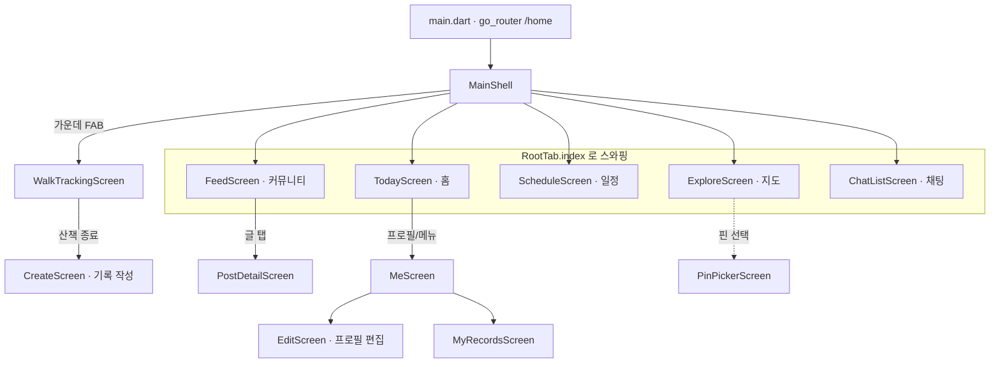
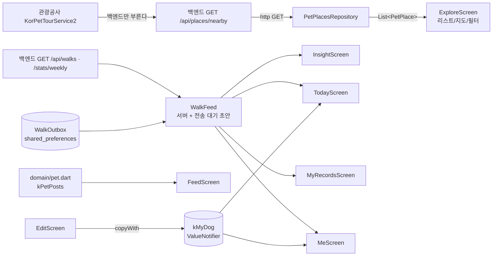

# 프론트엔드 구조 (Frontend Structure)

> Pawloop(포루프) Flutter 앱의 디렉터리 구조 · 상태관리 · 라우팅 · 데이터 흐름. 화면은 모두 `lib/v2/` 하위에 있으며, 진입점은 `lib/main.dart` → `go_router` 의 `/home` → `MainShell` 이다.

관련 문서: [ERD](../03-database/erd.md) · [시스템 아키텍처](./system-overview.md)

---

## 1. 코드베이스는 하나다 — `lib/main.dart` → `go_router` → `lib/v2/`

앱 소스는 `app/lib/` 아래에 있다. 감정 여행(heattrip) 시절의 레거시 셸(`lib/features/` 의 start·explore·record·journey·profile·bookmark·foryou_v2·emotion_map·social·feed·common, `core/widgets`, `theme`, `main_v2.dart`)은 **2026-09-06 에 #94 로 지웠다** — `main.dart` 에서 닿지 않는 175 파일이었다. 남은 것은 아래 넷이다.

| 디렉터리 | 역할 |
| --- | --- |
| `lib/v2/` | 화면·도메인·레포·위젯·테마 전부. 새 기능은 여기에 둔다 |
| `lib/app/` | `go_router`(`appRouter`)와 인증 리다이렉트 규칙(`auth_redirect.dart`), 네비게이터 키 |
| `lib/core/` | `config/env.dart`(--dart-define), `net/`(인증 클라이언트·토큰 저장소·로그 마스킹), `theme/` |
| `lib/features/auth/` · `lib/shared/media/` | 소셜 로그인의 데이터 계층(`auth_repository_impl` · `social_login_service` · `secure_token_store`)과 **디버그 빌드에만 붙는 이메일 로그인·가입 화면**(ADR-0022). `shared/media` 는 Provider 주입형 업로드 모듈인데 **부르는 화면이 없다** — 커뮤니티 사진 첨부(#429)는 `v2/data/post_media_repository.dart` 가 따로 한다 |

- 실행: `flutter run`(`lib/main.dart`). 라우트는 `/splash`·`/consent`·`/onboarding`·`/home`·`/auth/*` 뿐이고, `/home` 이 `MainShell` 이다. 나머지 화면은 `Navigator.push` 로 연다(4장).
- 상태관리는 `ValueNotifier` + `ValueListenableBuilder`(3장). `provider` 는 `main.dart` 가 미디어 업로드 클라이언트를 주입하는 데만 쓴다.

---

## 2. `lib/v2/` 디렉터리 역할

```
lib/
├─ main.dart               # 진입점: NaverMap 초기화(Env.naverMapClientId) → go_router(appRouter) → /home
├─ app/app_router.dart     # 라우트 다섯(splash·consent·onboarding·home·auth) + 인증 리다이렉트
├─ core/config/env.dart    # --dart-define 값 단일 진입점 Env
└─ v2/
   ├─ screens/             # 화면 (탭 + 푸시 라우트)
   ├─ domain/pet.dart      # 도메인 모델 + 샘플 데이터 + 전역 상태(kMyDog 등)
   ├─ data/                # 레포지토리 (외부 API 호출)
   │  ├─ pet_places_repository.dart
   │  ├─ place_catalog_repository.dart   # 전국 한 벌(KTO + 인허가 + 두루누비) 기기 캐시 (#273 · #291)
   │  └─ trail_route_repository.dart     # 산책로의 선 (#291)
   ├─ widgets/             # 공용 위젯 (배경/카드/아바타/산책 완료 시트)
   ├─ walk/                # 경로 그림·갤러리 저장 (#310) — 네트워크 없음
   └─ theme/               # 디자인 토큰 + 배경 테마
```

### 2.1 `screens/` — 화면

`ValueNotifier` 하나(`RootTab.index`)로 스와핑되는 **5개 탭** + 가운데 **기록(+) FAB** + 여러 **푸시 라우트**로 구성된다.

> **다섯째("일정")는 #419 가 더했다.** 왼쪽 셋(홈·지도·일정) · 오른쪽 둘(커뮤니티·채팅)로 나눈 것은 기록 버튼 오른쪽에 셋을 두면 왼쪽이 둘이라 알약의 무게가 쏠리기 때문이다. **커뮤니티·채팅의 번호가 하나씩 밀렸다** — `shell_tabs_overflow_test.dart` 가 라벨과 번호의 짝을 잠근다.

| 파일 | 역할 | 진입 경로 |
| --- | --- | --- |
| `main_shell.dart` | 네비게이션 셸. 탭 스와핑 + 플로팅 글래스 바텀네비 + 산책 FAB | 루트 (`home`) |
| `today_screen.dart` | 홈(오늘) — 강아지 히어로 · 오늘 산책 요약 · 근처 동반장소 | 탭 0 |
| `explore_screen.dart` | 지도 — KTO 반려동반 장소 + 병원/펫샵/산책로(실데이터, #291) + 필터 (리스트/지도 토글). 산책로 시트를 열면 선을 그린다 | 탭 1 |
| `schedule_screen.dart` | 일정 — 월 달력(종류별 점) · 그날 목록 · 필터 칩 · 만들기/고치기 시트 (#419·#421). 화면을 열 때 알림 예약을 다시 건다(#420). 되풀이하는 하루를 고칠 때는 "이 날만 / 앞으로 전부" 를 먼저 묻는다 | 탭 2 |
| `feed_screen.dart` | 커뮤니티 — 게시글 카드/리스트 (더미) | 탭 3 |
| `crew_section.dart` | 크루 목록 — 커뮤니티 탭 **안의 갈래**(#417). 내 크루 · 우리 동네 두 범위 · 만들기 · 초대 코드로 참여. 화면이 아니라 본문 조각이라 `Scaffold` 를 안 만든다 | 탭 3 안 |
| `crew_home_screen.dart` | 크루 홈 — 소개 · 멤버 · 대화방으로 가기 · 초대 코드 보내기(방장) · 나가기 · 강퇴(방장) · **품앗이**(목록 · 부탁 올리기 시트 `widgets/crew_favor_sheet.dart` · 제가 할게요 · 무르기 · 거둬들이기) · 방장 넘기기 · 크루 지우기(혼자일 때만) | `crew_section` → push |
| `insight_screen.dart` | 통계 — 이번 주 요약 + 주간 거리 막대(fl_chart). 자주 가는 곳은 빈 상태 | `me_screen` → push |
| `walk_tracking_screen.dart` | 실시간 산책 트래킹 (실 GPS, 경로 폴리라인 + 라이브 스탯) | FAB·홈 CTA → `startWalk()` |
| `create_screen.dart` | 산책 기록 작성 → `POST /api/walks` | 트래킹 종료 후 push (초안 동반) · 기록 목록에서 손입력 |
| `post_detail_screen.dart` | 커뮤니티 글 상세 — 반응 셋(멱등)·댓글 스레드 | feed → push |
| `post_write_screen.dart` | 커뮤니티 글쓰기 → `POST /api/community/posts`. `writePost()` 가 유일한 문이고 미로그인을 거기서 안내한다 | 피드의 글쓰기 버튼 · 빈 목록 안내 · 지도 장소 시트 |
| `me_screen.dart` | 프로필 — 강아지 프로필 + 활동 요약 + 메뉴 | 메뉴 → push |
| `edit_screen.dart` | 강아지 프로필 편집 + 프로필 테두리색 선택 | me → push |
| `myrecords_screen.dart` | 내 산책 기록 목록 | me → push |
| `pin_picker_screen.dart` | 지도에서 장소 핀 선택 | 보조 |
| `walk_detail_screen.dart` | 산책 회고 — 글을 나중에 고친다 → `PUT /api/walks/{id}/memo` | 기록 카드 탭 (#187) |
| `family_screen.dart` | 우리 가족 — 그룹·구성원·오늘의 케어 | me → push |
| `family_chat_screen.dart` | 가족 채팅방 (폴링) | family → push |
| `chat_list_screen.dart` | 방 목록 · 미읽음 | 탭 4 |
| `invite_join_screen.dart` | 초대 코드로 방 참여 | 링크·코드 입력 |
| `settings_screen.dart` | 설정 — 약관 넷 · 내 동네 · 저녁 알림 · 회원 탈퇴 · 운영자 연락처 | me → push (#165) |
| `neighborhood_picker_screen.dart` | 내 동네 고르기 — 시도→시군구→동 세 단계 · 검색 · "현재 위치로 찾기"(기기 안) | 설정 → push (#342) |
| `settings/legal_document_screen.dart` | 약관 전문 렌더 (`assets/terms/*.md`) | 설정·동의 화면 → push |
| `settings/account_delete_screen.dart` | 회원 탈퇴 → `DELETE /auth/me` | 설정 → push |
| `consent_screen.dart` | **약관 동의 게이트** — 이용약관·개인정보·위치기반서비스(필수) + 마케팅 | 로그인 직후, 온보딩보다 앞 (#180) |
| `login_screen.dart` | 소셜 로그인(카카오·구글) · 그냥 둘러보기 | 미로그인 진입 |
| `onboarding_screen.dart` | 신규 가입자 — 반려동물 등록 권유 | 동의 후 (`isNew`) |
| `splash_screen.dart` | 저장된 토큰 검증 중 머무는 자리 | 앱 시작 |
| `intro_screen.dart` | **첫 실행 소개** — 가치 3장 · 건너뛰기 · 기기당 한 번(`IntroGate`) · 설정 > 앱 소개 다시 보기 (#323) | 스플래시 뒤 · 로그인 앞 |
| `location_priming_sheet.dart` | **위치 사전 안내** — 첫 산책 시작 앞 한 장 · 허용하기 뒤에만 OS 대화상자 · 거부한 뒤엔 설정에서 켜기 (#325) | `startWalk()` |
| `start_walk.dart` | 산책 시작 진입 — 미로그인이면 로그인부터 · 아이가 둘 이상이면 "누구랑 나가요?"(`widgets/walk_dog_picker.dart`, #343) | 화면 아님(함수) |

> **주의:** 화면 파일명은 감정 시절 이름(explore/feed/insight/me)을 유지하지만 내용은 전부 반려/산책으로 대체됐다. 예: `explore_screen.dart` = 지도, `insight_screen.dart` = 산책 통계.

> **이 표는 `find app/lib/v2/screens -name '*.dart'` 와 같아야 합니다.**
> 2026-09-02 에 세었을 때 실제 **25개**인데 표에는 12개뿐이었고, `settings_screen` ·
> `legal_document_screen` · `consent_screen` · `walk_detail_screen` 넷은 `docs/` 전체에서
> **0건**이었습니다. `consent_screen` 은 위치정보법 동의 게이트라 문서에 없으면 안 됩니다. (#201)

### 2.2 `domain/pet.dart` — 도메인 + 샘플 데이터 + 전역 상태

한 파일에 세 가지가 모여 있다.

- **도메인 모델**: `DogProfile`(견종·크기·나이·중성화·아바타, `copyWith` 지원), `DogSize`(소형/중형/대형), `PetCategory`(지도/필터 카테고리 SSOT), `PetPost`. 산책은 도메인 상수가 아니라 `data/walk_*.dart` 다(#145).
- **상수 SSOT**: `kPetCategories`(9종: KTO contenttypeid + vet/shop/trail 레이어), `kLayerKeys`, `kPetBoards`(커뮤니티 게시판), `kPetReactions`(도움돼요/귀여워요/공감).
- **샘플/더미 데이터**: `kPetPosts` — 백엔드 연동 전 화면을 채우는 상수. 산책 더미(`kWalks`·`kWeekKm`·`kWalkTodayIdx`·`WalkToday`·`WalkLog`)는 **지웠다**(#145). `kWeekDayLabels` 만 남았는데 그건 지어낸 기록이 아니라 달력의 사실이다.
- **전역 상태**: `kMyDog`(현재 반려견) — 아래 3장 참조.

`petCatByType(contentTypeId)`로 KTO 응답의 `contenttypeid` → 카테고리를 매핑한다.

### 2.3 `data/` — 레포지토리 (데이터 소스)

- `pet_places_repository.dart`: **우리 백엔드**의 `GET /api/places/nearby` 를 `http` 로 호출(#40). `PetPlace` 모델은 계약의 `Place` 를 그대로 읽는다(`lat`/`lng`/`contentTypeId`/`addr`/`tel`/`image`/`distM`).
  - **앱에 관광공사 서비스키가 없다.** 서버가 대신 부른다. 서버가 실패하면 빈 리스트다(앱이 죽지 않음).
  - ✅ 관광공사 키는 **이미 앱에서 사라졌다**. 예전 서술: 이 키는 앱 바이너리에 박히는 과금성 자격증명이다. [#40](https://github.com/sanghyunbang/heattrip/issues/40) 에서 호출을 백엔드 프록시로 옮기면 앱에서 완전히 사라진다 — 그때 이 레포는 KTO 대신 자체 백엔드를 호출한다.
  - 병원(vet)·펫샵(shop)·산책로(trail)는 **서버가 같은 카탈로그에 이어 붙인다**(#291) — 앱에 별도 레포가 없고 `PetPlace.categoryKey`(`contentTypeId` 가 없으면 `category`)로 칩을 가른다. 산책로의 선만 `trail_route_repository.dart` 가 따로 받는다.
- `post_media_repository.dart` · `image_prep.dart` · `media_picker.dart` — 커뮤니티 글의 사진 첨부(#429). 고른 사진은 `ImagePrep` 이 **다시 인코딩**해(긴 변 1600px · EXIF 없음 → 촬영 좌표가 안 나간다, `image_prep_test` 가 값으로 잰다) `POST /media`(`category=POST_IMAGE`) 로 한 장씩 올리고, 글에는 돌려받은 `mediaIds` 만 싣는다. `MediaPicker` 는 `image_picker` 를 인터페이스 뒤에 둔 것 — 위젯 테스트가 가짜를 꽂는다. 도메인은 `domain/post_media.dart`(`PostMedia` · `PostMediaKind`). **영상**(#435 서버)은 `video_prep.dart` 가 720p 로 다시 인코딩한 뒤 `mp4_metadata_scrubber.dart` 가 `moov` 의 `udta`·`meta` 상자(Android `©xyz`·`loci`, iPhone `com.apple.quicktime.location.ISO6709`)를 **제자리에서 `free` 로 덮고** 다시 훑어 흔적이 남으면 올리지 않는다 — `mp4_metadata_scrubber_test`·`video_prep_test` 가 바이트로 잰다. 그 파일을 `POST /media/videos`(서명 PUT) → S3 직접 PUT(토큰 없이) → `POST /media/{id}/complete`(포스터) 로 올린다. 60초 · 150MB · 한 글에 하나.

### 2.4 `widgets/` — 공용 위젯

- `aurora.dart`:
  - `AuroraBackground` — 파스텔 오라 그라데이션 배경. 전역 `AppThemeCtl.index`를 구독해 테마 변경이 앱 전체에 반영됨.
  - `GlassCard` — `BackdropFilter` blur 기반 반투명 글래스 카드.
- `profile_avatar.dart` — 강아지 프로필 아바타(테두리색 선택 반영).
- `dog_gallery_screen.dart` — 아이 사진첩(#451 5번): 내 정보의 아이 머리 아래 "○○의 사진첩" 으로 연다. `feed(dogId:)` 로 그 아이가 찍힌 글만 — 사진 글은 `PostPhotoWall`, 글만 있는 글은 한 줄. 재료는 글쓰기의 "어떤 아이?" 칩(`_dogChips`, 새 글은 지금 고른 아이가 기본)이고 카드에는 아이 꼬리표(`_dogTag`)가 붙는다.
- `saved_posts_screen.dart` — 내 정보 > 저장한 글(#451 4번): `CommunityRepository.bookmarks()` 를 저장한 순으로 읽어 사진 글은 `PostPhotoWall`(하트 알약 없음), 글만 있는 글은 한 줄로. 게스트는 서버를 안 부르고 로그인 안내. 상세에서 저장을 빼고 돌아오면 다시 읽는다.
- `dog_avatar.dart` — 아이 아바타(#448): 사진(`DogProfile.photoUrl`)이 있으면 `ClipOval` 사진, 없으면 종 이모지. 홈 히어로·내 정보·아이 고르기·편집 화면이 전부 이것을 쓴다. 못 불러오면 이모지로 돌아간다.
- `like_burst.dart` — 두 번 탭 하트(#451 4번): `trigger` 가 바뀔 때마다 사진 위에서 한 번 튄다. 응답을 안 기다린다 — 손가락에 대한 대답이지 집계가 아니다.
- `post_photo_wall.dart` — 커뮤니티의 **사진 벽**(#451): 사진·영상이 있는 글만 두 열 벽돌(masonry)로. 열 나누기는 순수 함수 `split`(순서대로 더 짧은 열에, 높이는 폭 1 기준 `1/비율 + 글 두 줄`), 타일은 첫 장 하나에 4:5…1.91:1 로 잘린 비율. 피드의 카드/목록/격자 전환 중 격자가 이것이다.
- `neighbor_photo_strip.dart` — 홈의 **이웃의 사진** 한 줄(#451): 커뮤니티 목록 한 장에서 사진·영상 있는 글의 첫 장을 열두 개까지. 게스트에게는 없고, 없거나 못 불러오면 줄 자체가 없다. 타일은 글 상세로, "더 보기" 는 `RootTab.communityView = 'grid'` 로 커뮤니티 탭을 사진 벽으로 연다(피드가 읽고 되돌리는 한 번짜리 부탁).
- `form_kit.dart` — 폼 부품 한 벌(#445): `SheetFrame` · `PrimaryButton`/`SecondaryButton`(머티리얼 버튼을 감싼다 — 테스트의 `find.widgetWithText(FilledButton, …)` 이 그대로 산다) · `PickerButton` · `GlassField` · `PillChip` · `FormLabel` · `SigFab`. 일정 시트 · 아이 등록 시트 · 크루 만들기/고치기 시트가 쓴다.
- `walk_finish_sheet.dart` — 산책 완료 바텀시트(`WalkFinishSheet`, #310). 요약 셋 + **경로 미리보기** + "경로 사진 저장" + 기록 저장/저장 안 함. 트래킹 화면이 geolocator·네이버 지도를 물고 있어 위젯 테스트로 못 띄우므로 시트를 밖으로 꺼냈다.
- `post_media_field.dart` — 글쓰기의 사진 칸(#429): 고르는 순간 올리기 시작하고 밖으로는 `PostMediaSelection`(올라간 id 순서 · 올리는 중인가 · 실패가 있는가)을 낸다. 글쓰기 화면은 올리는 중이면 저장을 잠근다. `post_media_strip.dart` 는 카드·상세의 사진 자리(한 장 크게 · 둘 이상은 옆으로 넘기는 캐러셀에 "1/N" 과 점, #465) — `minAspect` 로 세로 사진 하한을 정한다(카드 1:1 · 상세 4:5), `post_media_viewer.dart` 는 전체 보기 대화상자 — 화면이 아니라 위젯이라 라우트 없이 `showDialog` 로 뜬다. 영상 칸은 하나이고(서버 상한) 압축 중 → 올리는 중(%) → 올라감을 그린다. 전체 보기의 영상 페이지는 포스터·재생 버튼으로 시작해 **눌러야** `video_player` 컨트롤러를 만든다 — 넘겨 보다 스친 영상이 데이터를 먹지 않는다.
- `crew_favor_sheet.dart` — 크루 홈의 부탁 올리기 시트(#417): 날짜(오늘부터) · 시간대(오전·오후·저녁, **기본값 없음** — 미리 골라 두면 안 바꾼 채 올리는 사람이 생긴다) · 내 아이(`kMyPets` 중 서버 id 가 있는 것만, 한 마리면 미리 골라짐) · 한 줄. 금액 칸이 없다 — 결제·평점·보증·중개는 안 한다는 이슈의 선을 시트 첫 줄이 말한다.
- `today_care_card.dart` · `message_actions_sheet.dart` 등 — 각 화면 문서 참조.

### 2.4-1 `walk/` — 경로 그림과 갤러리 저장 (#310)

- `route_image.dart` — `RouteProjection.fit`(경도·위도 → 상자 안 점, 등방 확대) · `RouteCanvasPainter`(단색+격자 배경, 폴리라인, 시작/끝, 거리·시간·날짜) · `RouteImage.renderPng`(`dart:ui` 로 위젯 트리 없이 PNG). **타일을 쓰지 않는다** — 네이버 지도 위에 그리면 카메라 궤적이 곧 경로라 좌표가 네이버에 간다(#235 C1).
- `route_photo_saver.dart` — `gal` 로 기기 갤러리 앨범 Pawloop 에 넣는다. 업로드 경로 없음. `route_photo_no_network_test` 가 이 두 파일과 시트에 네트워크 import 가 없는 것을 소스로 잠근다.

### 2.5 `theme/` — 디자인 토큰 + 배경 테마

- `app_tokens.dart` → 클래스 `T`: 텍스트 색(`textPrimary/Secondary/Muted/Faint`), 글래스 카드(`cardBg`·`cardBorder`·`radius`), 바탕(`bgTop`/`bgBottom`), 오라 블롭 색, 강조색 `accent`, 시그니처 그라데이션 `sig`(#FF9E7D→#E04A2B), 따뜻한 그라데이션 `warm`(#FF8F4D→#E04A2B)과 `warmText`·`warmMid`, `cardShadow`. 인라인 브랜드 색은 없다(#447).
- `themes.dart` → `AppThemeDef` + `kThemes`(화이트(기본)/라일락/블루/민트/코랄/모노 6종 배경 테마) + `kAvatarBorders`(아바타 테두리 색 후보) + 전역 컨트롤러 `AppThemeCtl`.

---

## 3. 상태관리 — 전역 `ValueNotifier` (경량)

Provider/Riverpod/Bloc 없이 **정적 전역 `ValueNotifier`** 를 두고, 화면은 `ValueListenableBuilder`로 구독한다. DI·프레임워크 오버헤드가 없고 1인 개발에 적합하다.

| 전역 상태 | 위치 | 타입 | 역할 | 변경 지점 |
| --- | --- | --- | --- | --- |
| `kMyDog` | `domain/pet.dart` | `ValueNotifier<DogProfile>` | 현재 반려견 프로필 | `edit_screen.dart`가 `kMyDog.value = kMyDog.value.copyWith(...)`로 갱신 → 홈/프로필 자동 반영 |
| `RootTab.index` | `screens/main_shell.dart` | `ValueNotifier<int>` | 현재 탭(0~4) | 바텀네비 탭·`today_screen`의 "지도 보기"·result 화면의 "더 둘러보기" |
| `RootTab.exploreView` | `screens/main_shell.dart` | `ValueNotifier<String>` | 지도 리스트/지도 뷰('list'/'map') | 홈에서 지도 진입 시 초기 뷰 지정 |
| `AppThemeCtl.index` | `theme/themes.dart` | `ValueNotifier<int>` | 배경 테마(0~4) | `AuroraBackground`가 구독 → 앱 전체 배경 |
| `AppThemeCtl.avatarBorder` | `theme/themes.dart` | `ValueNotifier<Color>` | 아바타 테두리 색 | `edit_screen.dart`에서 선택 |

`RootTab`은 상태뿐 아니라 헬퍼도 제공한다. `RootTab.go(context, i, {exView})` 는 `Navigator.popUntil(isFirst)`로 푸시된 화면을 모두 닫고 특정 탭으로 되돌아간다 — 푸시 라우트(트래킹 결과 등)에서 탭 전환에 사용.

**패턴 요약**: 전역 값을 바꾸는 쪽은 `.value = ...` 한 줄, 구독하는 쪽은 `ValueListenableBuilder`. 화면 로컬 상태는 일반 `StatefulWidget` + `setState`(예: `explore_screen`의 로딩/필터).

---

## 4. 라우팅 — `MainShell` 탭 스와핑 + `Navigator.push`

라우트는 다섯뿐이다(`app/app_router.dart`: splash·consent·onboarding·home·auth). `/home` 이 `MainShell` 이고, 그 안의 화면 전환은 두 방식이다.

1. **탭 전환 (선언적)** — `MainShell.body`가 `ValueListenableBuilder<int>(RootTab.index)`로 `switch(i)` 하여 홈/지도/일정/커뮤니티/채팅 위젯을 교체. 바텀네비는 본문 위에 `Stack` 오버레이(배경 끊김 없이 항상 표시).
2. **세부 화면 (명령형)** — `Navigator.of(context).push(MaterialPageRoute(...))`. 산책 트래킹·기록 작성·글 상세·프로필 편집 등은 스택에 push.



> 인증 리다이렉트(스플래시·동의·온보딩·로그인)는 `app/auth_redirect.dart` 의 순수 함수가 정하고 `app_router_test.dart` 가 규칙표를 잠근다. 레거시 셸의 `StatefulShellRoute`(여섯 브랜치)는 #94 로 지웠다(2026-09-06).

---

## 5. 데이터 흐름 — 레포 → 화면

실제 원격 데이터를 쓰는 경로는 **지도(장소 프록시 — KTO·인허가·두루누비, #40 · #273 · #291)** 와 **산책**(#145), **커뮤니티**(#170 · #171) 다.



- **지도 (실연동)**: `ExploreScreen.initState` → `PetPlacesRepository.fetchNearby(lat,lng)` → `List<PetPlace>` → `setState`로 리스트/지도 마커 렌더. 병원·펫샵·산책로는 화면 내부 더미 레이어.
- **홈·프로필 (전역 상태)**: `kMyDog`를 구독. 편집 화면이 `copyWith`로 갱신하면 즉시 반영.
- **산책·통계 (실연동)**: `WalkFeed.load()` → `GET /api/walks` + `GET /api/walks/stats/weekly` + 전송 대기 초안을 합쳐 홈·통계·기록·프로필 넷이 함께 쓴다(#145). 자료가 바뀌면 `walkFeedRevision` 신호로 화면이 스스로 다시 부른다.
- **커뮤니티 (샘플 상수)**: `domain/pet.dart` 의 `kPetPosts` — 백엔드 연동 전 단계.

### 미구현/더미 (문서 기준 명시)

- **아직 없는 것**: 병원/펫샵/산책로 실데이터(M3), 건강/식사/병원 로그(M4), 커뮤니티 서버 연동(M3.1 — 지금은 `kPetPosts` 더미), 날씨.
- **이제 있는 것**: 소셜 로그인(#12), 실 GPS 와 `walk.path` 경로 저장(#145), 산책 삭제·회고(#161·#187), 반려동물 API(#145), 가족 그룹·케어·채팅, 약관 동의 게이트(#180). 산책 트래킹의 시뮬 이동은 #160 에서 **지웠다** — 위치를 못 잡으면 이유를 말하는 화면이 뜬다.

---

## 6. 레이어 요약

| 레이어 | 위치 | 책임 |
| --- | --- | --- |
| Presentation | `v2/screens/`, `v2/widgets/` | 화면·공용 위젯. `ValueListenableBuilder`로 전역 상태 구독, `setState`로 로컬 상태 |
| Domain | `v2/domain/pet.dart` | 모델·enum·카테고리 SSOT·샘플 데이터·전역 `ValueNotifier` |
| Data | `v2/data/` | 외부 API(레포지토리). 현재 KTO 장소 1종 |
| Config | `core/config/env.dart` | 컴파일 타임 `--dart-define` 값(베이스 URL·외부 키) 단일 진입점 `Env` |
| Theme | `v2/theme/` | 디자인 토큰(`T`) · 배경 테마(`AppThemeCtl`) |
