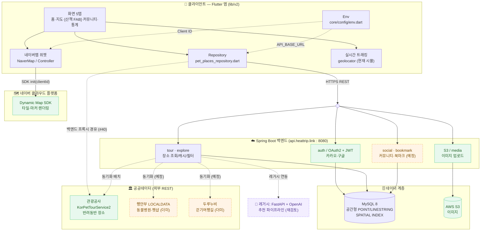
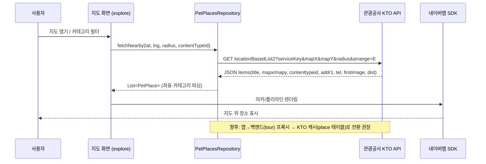
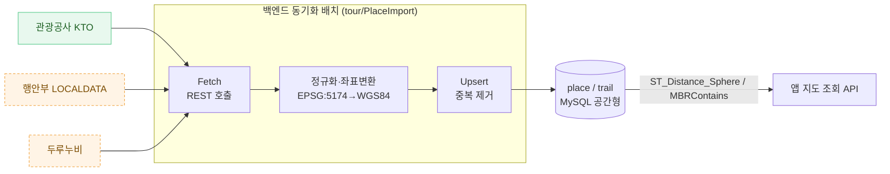
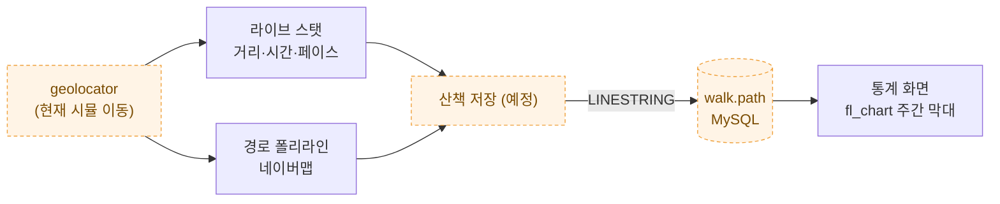
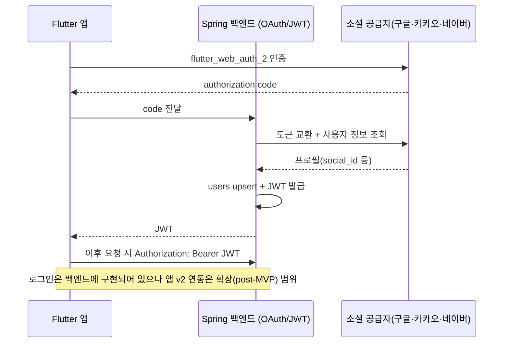

# 시스템 구성도 (System Overview)

> Pawloop(포루프) — 반려동물 산책·동반장소·커뮤니티 앱의 전체 시스템 구성과 데이터 흐름. Flutter 앱 ↔ Spring 백엔드 ↔ MySQL을 축으로, 네이버맵 SDK와 공공데이터(KTO/LOCALDATA/두루누비) 동기화를 함께 정리한다.

관련 문서: [ERD](../03-database/erd.md) · [외부 데이터 연동](./external-data.md)

---

## 1. 한눈에 보기

| 계층 | 구성요소 | 스택 | 현재 상태 |
| --- | --- | --- | --- |
| 클라이언트 | Pawloop 앱 (`lib/v2/`) | Flutter 3.44.4 / Dart 3.12.2, go_router, ValueNotifier | 됨 (일부 더미) |
| 지도 SDK | 네이버 Dynamic Map | `flutter_naver_map ^1.4.x` | 됨 (Client ID `--dart-define` 주입) |
| 백엔드 | Pawloop API | Spring Boot 3.5.4 / Java 21 (+Kotlin), Spring Security·OAuth2·JWT | 레거시(heattrip 패키지) 재사용 |
| DB | 관계형 | MySQL 8 (공간형 POINT/LINESTRING, SPATIAL INDEX) | 스키마 재정의 중 |
| 저장소 | 이미지 | AWS S3 | 됨 (레거시) |
| 외부데이터 | 관광공사·행안부·두루누비 | REST(JSON/XML) | KTO 실연동 / 나머지 더미 |
| 레거시 | 추천 파이프라인 | FastAPI + OpenAI | 반려 맥락 재검토 대상 |

> 참고: 백엔드 코드베이스는 감정여행(heattrip) 시절 패키지명(`tour`/`explore`/`OAuth`/`bookmark`/`S3`)을 그대로 재사용 중이며, 반려(Pawloop) 도메인으로 점진적 리네이밍 예정이다. 감정(emotion) 관련 모듈은 제거/비활성 대상이다.

---

## 2. 전체 시스템 구성도

> 실선 = 현재 동작하는 연결, 점선 = 예정·동기화·레거시 연결.
> `BACKENDGW`는 백엔드 진입점(REST API Gateway/컨트롤러 계층)을 나타내는 논리 노드다.

---

## 3. 계층별 역할

### 3.1 클라이언트 (Flutter, `lib/v2/`)

- 진입: `main.dart` → `MainShell`(go_router). 5탭 네비(홈/지도/[산책 FAB]/커뮤니티/통계).
- 상태관리: `ValueNotifier` + `ValueListenableBuilder`(경량). 예) `RootTab.index`, `kMyDog`.
- 지도: `main.dart`에서 `FlutterNaverMap().init(clientId: ...)` 초기화 후, `explore_screen.dart`의 `NaverMap` 위젯이 타일·마커를 그린다.
- 데이터 접근: `data/pet_places_repository.dart`(KTO), 도메인 `domain/pet.dart`(카테고리·강아지 프로필·산책/커뮤니티 샘플).
- 환경설정: `core/config/env.dart`가 베이스 URL과 키의 단일 진입점.

**Env 우선순위 (`env.dart`):**

| 우선순위 | 소스 | 값 |
| --- | --- | --- |
| 1 | `--dart-define=API_BASE=...` | 로컬/스테이징 override |
| 2 | `--dart-define=API_BASE_URL` | 운영 원격 (기본) |
| 3 | 하드코딩 폴백 | `http://10.0.2.2:8080` (에뮬레이터→호스트 로컬) |

- `NAVER_MAP_CLIENT_ID` — 네이버맵 SDK Client ID(모바일은 시크릿 불필요, 패키지명 허용목록으로 보호).
- ~~`YOUR_DECODING_SERVICE_KEY`~~ — **앱에서 제거됐다**(#40). 관광공사 서비스키는 서버 환경변수(`TOUR_API_SECRET`)로만 존재한다.

### 3.2 지도 SDK — 네이버 Dynamic Map

- 클라이언트가 `clientId`로 SDK를 직접 초기화. 지도 타일/카메라/마커 렌더링은 네이버 클라우드 플랫폼에서 처리.
- 앱은 KTO/공공데이터로 얻은 좌표(위경도)를 마커/폴리라인으로 지도 위에 얹는다.

### 3.3 백엔드 (Spring Boot)

- 스택: Spring Boot 3.5.4, Java 21(+Kotlin 2.2.20), Spring Web/Security/Validation, Data JPA·JDBC, OAuth2 Client, JWT(jjwt), WebFlux(외부 API 호출), Actuator/Prometheus, Spring AI(OpenAI, 기본 비활성).
- 주요 패키지: `auth`/`OAuth`(소셜 로그인+JWT), `tour`·`explore`(장소 임포트/조회/필터), `bookmark`(북마크·컬렉션), `S3`(이미지 업로드), `feedback`. → 반려(산책/케어/커뮤니티) 도메인으로 재편 예정.
- 보안: CORS 허용 오리진(`http://localhost:8080`,`http://10.0.2.2:8080`), IP 기반 레이트리밋(login/search/upload 등 엔드포인트별 한도).

### 3.4 데이터 계층

- **MySQL 8**: 공간형 컬럼(`POINT`/`LINESTRING`)과 `SPATIAL INDEX`로 근접 검색(`ST_Distance_Sphere`/`MBRContains`). GPS 경로는 `walk.path` 한 컬럼에 LINESTRING/인코딩 폴리라인으로 저장. 초기엔 RDB-only.
- **AWS S3**: 커뮤니티/프로필 이미지 저장. URL은 백엔드가 매핑.

### 3.5 외부 공개데이터

| 소스 | 제공 | 앱 상태 | 응답/좌표 | 비고 |
| --- | --- | --- | --- | --- |
| 관광공사 KorPetTourService2 (PK 15135102) | data.go.kr | **실연동** | JSON, `mapx`/`mapy`(경위도) | 1000콜/일 제한 → 백엔드 프록시+캐싱 권장 |
| 행안부 LOCALDATA (동물병원 ~9,445건, 펫샵) | data.go.kr | 더미 | 좌표 EPSG:5174→WGS84 변환 필요 | 인허가 데이터 |
| 두루누비 걷기여행길 | 관광공사 | 더미 | GPX/좌표 폴리라인 | 산책로 코스 |

---

## 4. 핵심 데이터 흐름

### 4.1 지도: 내 주변 반려동반 장소 조회 (KTO 실연동)

현재는 앱이 KTO를 **직접** 호출한다(`pet_places_repository.dart`의 `fetchNearby`).

### 4.2 공공데이터 동기화 (목표 아키텍처)

일 호출 한도(KTO 1000/일)와 좌표계 변환(LOCALDATA EPSG:5174→WGS84) 때문에, 외부데이터는 백엔드 배치가 주기적으로 당겨 MySQL `place`/`trail`에 캐시하는 구조로 수렴한다.

### 4.3 실시간 산책 트래킹

> 현재 트래킹은 시뮬 이동이며, 실위치(geolocator 실도입)와 `walk` 저장/조회 API는 미연동(더미)이다.

### 4.4 소셜 로그인 (OAuth2 + JWT, 레거시 재사용)

---

## 5. 배포·네트워크 관점

| 항목 | 값 | 근거 |
| --- | --- | --- |
| 운영 백엔드 | `api.heattrip.link` (원격, 8080) | `--dart-define=API_BASE_URL` |
| 로컬 개발 | `http://10.0.2.2:8080` (에뮬레이터→호스트) | `env.dart` 폴백 |
| 지도 인증 | 네이버 Client ID + 패키지명 허용목록 | `main.dart` init |
| 이미지 | AWS S3 | 백엔드 `S3` 모듈 |
| 관측성 | Actuator health/metrics, Prometheus | `application.properties` |

---

## 6. 현재 상태 요약 (구현 vs 더미)

| 영역 | 상태 |
| --- | --- |
| 지도 KTO 실연동(서울 반려동반 장소) | ✅ 됨 (백엔드 프록시 경유, #40) |
| 네이버맵 SDK 렌더링 | ✅ 됨 |
| 실시간 산책 트래킹 | ⚠️ 시뮬(실 GPS 미도입) |
| 산책 통계(fl_chart) | ✅ 됨 (샘플 데이터) |
| 병원·펫샵(LOCALDATA)·산책로(두루누비) | ⛔ 더미 레이어 |
| 커뮤니티(게시판·반응·댓글) | ⛔ 더미(백엔드 social 미연동) |
| 로그인(OAuth2/JWT) | ⚠️ 백엔드 구현·앱 v2 미연동(확장) |
| 공공데이터→MySQL 캐시 배치 | ⛔ 예정(목표 아키텍처) |

---

*본 문서는 실제 코드(`app/lib/v2`, `app/pubspec.yaml`, `app/lib/core/config/env.dart`, `backend/src`, `backend/build.gradle`)를 기준으로 작성되었으며, 없는 기능은 지어내지 않고 더미/예정으로 표기한다.*
