# ERD (개체-관계 다이어그램)

> Pawloop(포루프) MySQL 공간형 데이터 모델의 개체-관계도. GPS 산책 경로(`LINESTRING`)와 장소 좌표(`POINT`)를 공간 컬럼으로 저장하고, `SPATIAL INDEX` + `ST_Distance_Sphere`/`MBRContains`로 주변 검색을 수행한다. **가족 케어 공유**와 **채팅** 기능으로 `family_group`·`chat_room`·`chat_room_member`·`chat_room_invite`·`chat_message`·`walk_note` 엔티티가 추가되고, `care_log`는 `group_id`/`done_by`를 더해 "누가·언제 했는지"를 가족과 공유하는 케어 기록으로 확장된다. 방·멤버십·초대는 가족 그룹에 종속되지 않는 범용 3엔티티이고, `family_group` 은 `origin_kind`/`origin_ref` 쌍으로 방에 **불투명하게** 닿는다 — 그 방향의 FK 는 없다([ADR-0011](../99-decisions/decision-log.md#adr-0011--채팅은-가족-그룹-종속이-아니라-범용-다중-방이다)).

> **어디까지가 실재인가.** 정본은 `backend/mysql/init/01_schema.sql` 이고 거기에 표가 **47개** 있다(전체 목록은 [테이블 스키마 부록 A](./schema.md)). 이 문서가 그리는 엔티티 중 무엇이 실재인지는 아래 **엔티티 설명** 표의 "실재" 열이 정본이고, 그 집합은 [테이블 스키마](./schema.md)의 절 제목 **실재** 표시와 같다 — `DocDriftTest` 가 정본·절 제목·부록·이 표 넷을 대조한다(#176). 그림의 `place`·`bookmark` 는 아직 **계획**이다 — 그 둘이 낀 관계선에는 '계획' 꼬리표가 붙어 있다. 산책로는 `trail_route`(실재)가 선을 들고 `place_catalog` 의 두루누비 행이 시작점을 든다(#291). 감정 여행·관광 수집 시절의 표 21개는 정본에 있지만 반려 축에서 쓰지 않는다 — 지우지 않고 격리한다(#174). 감정카드 셋은 v2 커뮤니티(`post`·`comment`·`reaction`)와 다른 표라 그림에 따로 그렸다. 예전 이 문서는 사용자 테이블을 `app_user` 로 그렸는데, 그 이름의 테이블은 만들어진 적이 없다(→ [테이블 스키마 §1 각주](./schema.md)).

## ER 다이어그램

```mermaid
erDiagram
    users ||--o{ refresh_token : "발급된 refresh 토큰(회전마다 1행)"

    users ||--o{ dog       : "기른다"
    users ||--o{ post      : "작성"
    users ||--o{ comment   : "작성"
    users ||--o{ reaction  : "남긴다"
    users ||--o{ bookmark  : "저장 (계획 - bookmark 표는 아직 없다)"
    users ||--o{ chat_room_member : "방 참여 (DB FK 제약은 없음)"
    users ||--o{ chat_message : "작성 (DB FK 제약은 없음)"
    users ||--o{ care_log  : "수행(done_by)"

    family_group ||--o| chat_room    : "origin_kind/origin_ref — FK 아님"
    family_group ||--o| walk_note    : "산책 주의사항 (그룹당 한 장)"
    family_group |o--o{ care_log     : "케어 공유"
    users ||--o{ walk_note : "마지막 수정(updated_by)"

    chat_room ||--o{ chat_room_member : "멤버십"
    chat_room ||--o{ chat_room_invite : "초대코드"
    chat_room ||--o{ chat_message     : "메시지(room_seq 순)"

    dog      ||--o{ walk      : "산책 기록"
    dog      |o--o{ care_log  : "케어 기록 (nullable, ON DELETE SET NULL - #154)"

    place    ||--o{ post      : "태그 (계획 - place 표는 아직 없다)"
    place    ||--o{ bookmark  : "저장 대상 (계획)"

    post     ||--o{ comment   : "댓글"
    post     ||--o{ reaction  : "반응"

    users ||--o{ emotion_card  : "작성 (감정 여행 시절 - 격리 #174, FK 없음)"
    emotion_card ||--o{ card_comment  : "댓글 (격리 #174, FK 없음)"
    emotion_card ||--o{ card_reaction : "반응 (격리 #174, FK 없음)"

    users ||--o{ report        : "신고한다 (FK 없음 - 탈퇴가 신고를 못 지운다)"
    report ||--o{ report_snapshot : "대상 스냅샷 (CASCADE)"
    users ||--o{ user_block    : "가린다 (FK 없음)"
    users ||--o{ user_consent  : "동의 이력 (FK 없음)"

    users {
        BIGINT   id PK
        VARCHAR  provider   "local|kakao|google - naver 는 ADR-0010 에서 보류. nullable"
        VARCHAR  social_id  "소셜 고유 ID. 이메일 가입자는 NULL"
        VARCHAR  role       "ROLE_USER (NOT NULL)"
        VARCHAR  email      "로그인 ID. 카카오 미동의 시 NULL. UNIQUE"
        VARCHAR  nickname
        VARCHAR  name
        DATETIME created_at
        DATETIME updated_at
    }

    refresh_token {
        BIGINT   id PK
        BIGINT   user_id    "users.id (DB FK 제약은 없음)"
        VARCHAR  token_hash "RT 원문의 SHA-256. UNIQUE"
        DATETIME expires_at "발급 + 14일"
        DATETIME revoked_at "폐기 시각 - 폐기는 삭제가 아니다"
        DATETIME created_at
    }

    dog {
        BIGINT   id PK
        BIGINT   user_id FK
        VARCHAR  name
        VARCHAR  species   "dog|cat|other - 표 이름과 달리 고양이도 들어온다"
        VARCHAR  breed
        VARCHAR  size      "small|medium|large"
        DATE     birth
        BOOLEAN  neutered
        VARCHAR  avatar
        DATETIME deleted_at "nullable - 소프트 삭제(#156). 산책은 남는다"
    }

    walk {
        BIGINT     id PK
        BIGINT     dog_id FK
        DATETIME   started_at   "앱이 보낸 값 - 커서로 쓰지 않는다"
        DATETIME   ended_at
        INT        distance_m
        INT        duration_s
        LINESTRING path         "SRID 4326. NULL 가능 - 손입력·권한거부 기록 (ADR-0015)"
        VARCHAR    memo
        VARCHAR    weather
        VARCHAR    client_walk_id "재전송 멱등키. dog+client UNIQUE"
        DATETIME   created_at   "서버 시각 - 목록 커서의 기준"
    }

    care_log {
        BIGINT   id PK
        BIGINT   dog_id FK   "nullable - ON DELETE SET NULL. 값은 아직 항상 NULL (#154)"
        BIGINT   group_id FK "nullable - 가족 그룹 공유"
        VARCHAR  type        "water|meal|walk|med|vet"
        BIGINT   done_by FK  "수행자(users.id)"
        DATETIME occurred_at
        VARCHAR  memo
        DATETIME created_at
    }

    family_group {
        BIGINT   id PK
        VARCHAR  name
        DATETIME created_at
    }

    chat_room {
        BIGINT   id PK
        VARCHAR  origin_kind "방을 만든 도메인 - FAMILY 등"
        VARCHAR  origin_ref  "그 도메인의 id (문자열, FK 아님). kind+ref UNIQUE"
        VARCHAR  title
        BIGINT   last_seq    "room_seq 발급 카운터 = 미읽음 뺄셈의 좌변"
        DATETIME created_at
    }

    chat_room_member {
        BIGINT   id PK
        BIGINT   room_id FK
        BIGINT   user_id        "users.id (DB FK 제약은 없음). room+user UNIQUE"
        VARCHAR  role           "OWNER|MEMBER"
        BIGINT   last_read_seq  "미읽음 = room.last_seq - 이 값"
        DATETIME removed_at     "강퇴 - 행은 지우지 않는다"
        BIGINT   removed_by     "강퇴한 방장 (FK 없음)"
        BOOLEAN  rejoin_blocked "강퇴 = 재입장 금지"
        DATETIME joined_at
    }

    chat_room_invite {
        BIGINT   id PK
        BIGINT   room_id FK
        VARCHAR  code       "초대코드 (유니크)"
        BIGINT   created_by "발급한 방장 (FK 없음)"
        DATETIME expires_at "NULL = 무기한. 기본 7일"
        INT      max_uses   "NULL = 무제한"
        INT      used_count
        DATETIME revoked_at "재발급하면 이전 코드가 즉시 막힌다"
        DATETIME created_at
    }

    chat_message {
        BIGINT   id PK        "커서로 쓰지 않는다"
        BIGINT   room_id FK
        BIGINT   room_seq       "방별 순서. room+seq UNIQUE"
        BIGINT   sender_user_id "users.id (DB FK 제약은 없음)"
        VARCHAR  sender_name    "발신 시점 스냅샷 - 응답의 이름은 users 의 현재 값이다"
        VARCHAR  content_type
        TEXT     body
        VARCHAR  client_msg_id  "재전송 멱등키. room+client UNIQUE, NULL 은 여러 번 허용"
        DATETIME created_at
        DATETIME deleted_at    "소프트 삭제 - seq 에 빈틈을 내지 않는다"
    }

    walk_note {
        BIGINT   id PK
        BIGINT   group_id FK   "UNIQUE - 그룹당 한 장"
        VARCHAR  body         "산책 시 주의사항"
        BIGINT   updated_by FK "마지막으로 고친 사람(users.id)"
        DATETIME updated_at
    }

    place {
        BIGINT    id PK
        VARCHAR   source      "kto_pet|localdata_vet|localdata_shop"
        VARCHAR   category
        VARCHAR   name
        POINT     geom        "좌표 (공간타입)"
        VARCHAR   addr
        VARCHAR   tel
        JSON      raw_json
        DATETIME  updated_at
    }

    trail_route {
        VARCHAR  course_id PK  "두루누비 crsIdx"
        VARCHAR  name
        INT      point_count   "300 이하"
        INT      length_m      "원본 길이(m)"
        DOUBLE   start_lat
        DOUBLE   start_lng
        LONGTEXT payload       "[[경도, 위도], ...] JSON"
        DATETIME fetched_at    "Asia/Seoul 벽시계"
    }

    post {
        BIGINT   id PK
        BIGINT   user_id FK
        VARCHAR  board       "산책로후기|동반장소|건강·병원|자유|자랑"
        BIGINT   place_id FK "nullable"
        VARCHAR  title
        TEXT     body
        DATETIME created_at
    }

    comment {
        BIGINT   id PK
        BIGINT   post_id FK
        BIGINT   user_id FK
        TEXT     body
        DATETIME created_at
    }

    reaction {
        BIGINT   id PK
        BIGINT   post_id FK
        BIGINT   user_id FK
        VARCHAR  type      "help|cute|empathy"
        DATETIME created_at
    }

    bookmark {
        BIGINT   id PK
        BIGINT   user_id FK
        BIGINT   place_id FK
        DATETIME created_at
    }

    emotion_card {
        BIGINT   id PK
        BIGINT   user_id     "users.id - FK 없음"
        BIGINT   place_id    "nullable"
        VARCHAR  mood_key
        VARCHAR  body
        VARCHAR  handle      "작성 시점 닉네임 스냅샷"
        DATETIME created_at
    }

    card_comment {
        BIGINT   id PK
        BIGINT   card_id     "emotion_card.id - FK 없음"
        BIGINT   user_id
        VARCHAR  body
        VARCHAR  handle
        DATETIME created_at
    }

    card_reaction {
        BIGINT   id PK
        BIGINT   card_id
        BIGINT   user_id
        VARCHAR  reaction_type "UNIQUE(card_id, user_id, reaction_type)"
        DATETIME created_at
    }

    report {
        BIGINT   id PK
        BIGINT   reporter_user_id "FK 없음"
        BIGINT   reported_user_id "nullable"
        VARCHAR  reason      "spam|abuse|sexual|fraud|other"
        VARCHAR  memo
        DATETIME created_at
    }

    report_snapshot {
        BIGINT   id PK
        BIGINT   report_id FK "CASCADE"
        VARCHAR  role        "target|context"
        VARCHAR  target_type "community_post|community_comment|chat_message|chat_room"
        BIGINT   target_id
        TEXT     body        "target 이면 NOT NULL"
        DATETIME occurred_at
    }

    user_block {
        BIGINT   id PK
        BIGINT   blocker_user_id "UNIQUE(blocker, blocked)"
        BIGINT   blocked_user_id
        DATETIME created_at
    }

    user_consent {
        BIGINT   id PK
        BIGINT   user_id     "FK 없음 - 탈퇴해도 증빙은 남는다"
        VARCHAR  kind        "TERMS|PRIVACY|LOCATION|MARKETING"
        VARCHAR  version
        BIT      agreed
        DATETIME created_at  "UTC"
    }

    place_catalog {
        INT      id PK       "1 kto · 2 localdata · 3 durunubi"
        VARCHAR  source UK   "kto|localdata|durunubi (CHECK)"
        VARCHAR  etag
        LONGTEXT payload
        DATETIME fetched_at  "Asia/Seoul 벽시계"
    }

    place_cell {
        INT      lat_idx PK  "0.02 도 격자"
        INT      lng_idx PK
        LONGTEXT payload
        DATETIME fetched_at
    }

    pet_place_detail {
        VARCHAR  content_id PK
        VARCHAR  title
        DATETIME pet_fetched_at
        DATETIME common_fetched_at
        DATETIME not_found_at
    }

    kto_call_budget {
        DATE     day PK
        VARCHAR  pool PK
        INT      used
    }
```

> `trail_route` 는 두루누비 코스 하나의 선이다. 다른 엔티티와 FK 가 없다 — `course_id` 는 두루누비의 키이고, 카탈로그(`place_catalog` 의 `durunubi` 행)가 같은 코스의 시작점을 `trail:crsIdx` 로 든다(#291). 사용자가 산책로를 눌렀을 때만 선이 나간다.

## 엔티티 설명

| 엔티티 | 실재 | 한 줄 설명 |
| --- | --- | --- |
| `users` | 실재 | 앱 사용자 계정. **지금 DB 에 실재하는 테이블**이다. 소셜 계정의 식별 키는 `(provider, social_id)` 쌍이며 이메일이 아니다(#7). `role` 은 토큰 발급이 쓰고, `email` 은 카카오 미동의 시 NULL 이다. 공급자 집합은 [ADR-0010](../99-decisions/decision-log.md#adr-0010--소셜-로그인-공급자와-앱-세션-토큰-전략). |
| `refresh_token` | 실재 | 앱 세션의 refresh 토큰 원장(#9). RT 는 JWT 가 아니라 불투명 난수이고 SHA-256 해시로 저장한다. 회전·재사용 감지·전 기기 로그아웃이 이 테이블 위에서 돈다. **실재.** |
| `dog` | 실재 | 사용자의 반려견 프로필. 견종·크기·생일·중성화 여부. `users` 1:N `dog`. |
| `walk` | 실재 | 산책 기록 1건. GPS 경로를 `LINESTRING`으로, 거리·시간·페이스·메모 저장. `dog` 1:N `walk`. |
| `care_log` | 실재 | 반려 케어 로그(물/밥/산책/투약/병원). 누가(`done_by`)·언제 했는지 기록하고 가족 그룹(`group_id`, nullable)에 공유해 이중 급여·산책 누락을 방지. `dog_id` 는 `dog.id` 로 가는 FK 다(**#154**, `ON DELETE SET NULL` — 반려동물이 지워져도 기록은 남는다). 값은 아직 항상 `NULL` — 쓰기 경로가 `dogId` 를 안 받는다([schema.md §17](./schema.md)). |
| `family_group` | 실재 | 가족 케어 그룹. **이름과 생성 시각만** 든다 — 초대코드도 멤버십도 여기 없다. 방은 `chat_room` 이 `origin_kind`/`origin_ref` 로 불투명하게 가리킨다. |
| `chat_room` | 실재 | 채팅방. **가족 그룹 종속이 아니다** — 산책 크루 방도 같은 표에 산다. `UNIQUE(origin_kind, origin_ref)` 가 같은 출처에 방이 둘 생기는 것을 막고, `last_seq` 가 `room_seq` 발급기이자 미읽음 뺄셈의 좌변이다. |
| `chat_room_member` | 실재 | 방 멤버십. **멤버십 표는 이것 하나다**(`group_member` 를 따로 만들지 않는다). 강퇴는 행 삭제가 아니라 `removed_at`+`rejoin_blocked`, 미읽음은 `last_read_seq` 뺄셈. |
| `chat_room_invite` | 실재 | 초대코드. 유효기간·사용횟수·회수를 갖는다. 재발급하면 이전 코드가 즉시 막히되 기존 멤버는 남는다. |
| `chat_message` | 실재 | 채팅 메시지. 순서·델타·미읽음의 기준은 방별 `room_seq` 이고 **`id` 는 커서로 쓰지 않는다**(배정 시점과 가시성 시점이 달라 폴링이 메시지를 영구히 건너뛴다). 발신자는 값만 들고 `sender_name` 스냅샷을 함께 둔다. MVP는 폴링, 소켓은 트리거 기반(M2.9). |
| `walk_note` | 실재 | 산책 시 주의사항(가족 공유 메모). **`family_group` 1:1** — `UNIQUE(group_id)` 로 그룹당 한 장이고, 마지막으로 고친 사람(`updated_by`)과 시각을 든다. |
| `place` | 계획 | 동반장소·동물병원·펫샵 POI 캐시. 좌표 `POINT` + `SPATIAL INDEX`. 공공데이터 원본 `raw_json` 보관. |
| `trail_route` | 실재 | 산책로 코스의 선 — 두루누비 GPX 를 300점 이하로 줄인 `[[경도, 위도]]` JSON. 카탈로그에는 시작점만 실린다(#291). [schema.md §6](./schema.md). |
| `post` | 실재 | 커뮤니티 게시글. 게시판(board) 분류, 장소(`place`) 선택 태그 가능. `users` 1:N `post`. |
| `comment` | 실재 | 게시글 댓글. `post` 1:N, `users` 1:N. |
| `reaction` | 실재 | 게시글 반응(도움돼요/귀여워요/공감). `post` 1:N, `users` 1:N. |
| `bookmark` | 계획 | 사용자가 저장한 장소. `users`·`place` 각각 1:N (사용자-장소 조합 유니크 권장). |
| `emotion_card` | 실재 | 감정카드 — **감정 여행 시절의 표이고 반려 커뮤니티 `post` 와 다르다.** 지우지 않고 격리한다(#174). `users` 로의 FK 없이 `user_id` 와 `handle` 스냅샷을 든다. [schema.md §18](./schema.md). |
| `card_comment` | 실재 | 감정카드 댓글. 격리(#174). [schema.md §19](./schema.md). |
| `card_reaction` | 실재 | 감정카드 반응. `UNIQUE(card_id, user_id, reaction_type)`. 격리(#174). [schema.md §20](./schema.md). |
| `kto_call_budget` | 실재 | KTO 일 호출 예산. `PRIMARY KEY(day, pool)` 이 1,000콜 한도를 지키는 유일한 장치다(#40). [schema.md §21](./schema.md). |
| `place_cell` | 실재 | 주변 장소 셀 스냅샷 — 좌표를 0.02° 격자로 접은 키로 KTO 응답을 통째로 보관(#40). [schema.md §22](./schema.md). |
| `pet_place_detail` | 실재 | 장소 상세의 KTO 응답 캐시(`content_id` 키). [schema.md §23](./schema.md). |
| `place_catalog` | 실재 | 장소 한 벌 — **출처별 한 행**(`kto` 매일 04:40 예열 #279 · `localdata` 인허가 · `durunubi` 두루누비, 둘은 월 1회 #291). 응답은 셋을 이어 붙인 배열 하나이고 `etag` 는 세 해시의 해시. [schema.md §24](./schema.md). |
| `report` | 실재 | 신고. `users` 로 FK 를 안 건다 — 탈퇴가 신고를 못 지운다(#254). [schema.md §25](./schema.md). |
| `report_snapshot` | 실재 | 신고 시점의 대상 본문 스냅샷. `report` 에 CASCADE. [schema.md §26](./schema.md). |
| `user_block` | 실재 | 가리기(사람 단위). `chat_block` 에서 이름을 옮겼다. [schema.md §27](./schema.md). |
| `user_consent` | 실재 | 약관 동의 이력 — 덧붙이기만 한다(ADR-0020). [schema.md §28](./schema.md). |

## 공간(Spatial) 컬럼 요약

| 엔티티 | 컬럼 | 공간타입 | 용도 |
| --- | --- | --- | --- |
| `walk` | `path` | `LINESTRING` | 산책 GPS 경로(폴리라인). 거리 산출·경로 표시. |
| `place` | `geom` | `POINT` | 장소 좌표. `ST_Distance_Sphere`/`MBRContains`로 주변 검색. |

> 공간쿼리는 `SPATIAL INDEX`를 전제로 하며, 대량 GPS 시계열/장소검색(ES·Redis)은 규모 확장 시 옵션이다. 초기에는 RDB(MySQL 공간형) 단일 저장소로 운영한다. 상세 컬럼 정의는 [테이블 명세](../03-database/) 참조.
