# ERD (개체-관계 다이어그램)

> Pawloop(포루프) MySQL 공간형 데이터 모델의 개체-관계도. GPS 산책 경로(`LINESTRING`)와 장소 좌표(`POINT`)를 공간 컬럼으로 저장하고, `SPATIAL INDEX` + `ST_Distance_Sphere`/`MBRContains`로 주변 검색을 수행한다. **가족 케어 공유** 기능으로 `family_group`·`group_member`·`chat_message`·`walk_note` 엔티티가 추가되고, `care_log`는 `group_id`/`done_by`를 더해 "누가·언제 했는지"를 가족과 공유하는 케어 기록으로 확장된다.

> **어디까지가 실재인가.** `users` 와 `refresh_token` 만 지금 DB 에 있다 — 정본은 `backend/mysql/init/01_schema.sql` 이다. 나머지 엔티티는 아직 **계획**이다. 예전 이 문서는 사용자 테이블을 `app_user` 로 그렸는데, 그 이름의 테이블은 만들어진 적이 없다(→ [테이블 스키마 §1 각주](./schema.md)).

## ER 다이어그램

```mermaid
erDiagram
    users ||--o{ refresh_token : "발급된 refresh 토큰(회전마다 1행)"

    users ||--o{ dog       : "기른다"
    users ||--o{ post      : "작성"
    users ||--o{ comment   : "작성"
    users ||--o{ reaction  : "남긴다"
    users ||--o{ bookmark  : "저장"
    users ||--o{ group_member : "그룹 참여"
    users ||--o{ chat_message : "작성"
    users ||--o{ care_log  : "수행(done_by)"

    family_group ||--o{ group_member : "구성원"
    family_group ||--o{ chat_message : "그룹 채팅"
    family_group ||--o{ walk_note    : "산책 주의사항"
    family_group |o--o{ care_log     : "케어 공유"

    dog      ||--o{ walk      : "산책 기록"
    dog      ||--o{ care_log  : "케어 기록"

    place    ||--o{ post      : "태그"
    place    ||--o{ bookmark  : "저장 대상"

    post     ||--o{ comment   : "댓글"
    post     ||--o{ reaction  : "반응"

    users {
        BIGINT   id PK
        VARCHAR  provider   "local|kakao|google - naver 는 ADR-0010 에서 보류. nullable"
        VARCHAR  social_id  "소셜 고유 ID. 이메일 가입자는 NULL"
        VARCHAR  role       "ROLE_USER (NOT NULL)"
        VARCHAR  email      "로그인 ID. 카카오 미동의 시 NULL. UNIQUE"
        VARCHAR  nickname
        VARCHAR  name
        DATETIME created_at
        DATETIME updated_at
    }

    refresh_token {
        BIGINT   id PK
        BIGINT   user_id    "users.id (DB FK 제약은 없음)"
        VARCHAR  token_hash "RT 원문의 SHA-256. UNIQUE"
        DATETIME expires_at "발급 + 14일"
        DATETIME revoked_at "폐기 시각 - 폐기는 삭제가 아니다"
        DATETIME created_at
    }

    dog {
        BIGINT   id PK
        BIGINT   user_id FK
        VARCHAR  name
        VARCHAR  breed
        VARCHAR  size      "small|medium|large"
        DATE     birth
        BOOLEAN  neutered
        VARCHAR  avatar
    }

    walk {
        BIGINT     id PK
        BIGINT     dog_id FK
        DATETIME   started_at
        DATETIME   ended_at
        INT        distance_m
        INT        duration_s
        LINESTRING path       "GPS 경로 (공간타입)"
        VARCHAR    memo
        VARCHAR    weather
    }

    care_log {
        BIGINT   id PK
        BIGINT   dog_id FK
        BIGINT   group_id FK "nullable - 가족 그룹 공유"
        VARCHAR  type        "water|meal|walk|med|vet"
        BIGINT   done_by FK  "수행자(users.id)"
        DATETIME occurred_at
        VARCHAR  title
        VARCHAR  value
        VARCHAR  memo
        VARCHAR  photo
    }

    family_group {
        BIGINT   id PK
        VARCHAR  name
        VARCHAR  invite_code "초대코드 (유니크)"
        DATETIME created_at
    }

    group_member {
        BIGINT   id PK
        BIGINT   group_id FK
        BIGINT   user_id FK
        VARCHAR  role      "owner|member"
        DATETIME joined_at
    }

    chat_message {
        BIGINT   id PK
        BIGINT   group_id FK
        BIGINT   user_id FK
        TEXT     body
        DATETIME created_at
    }

    walk_note {
        BIGINT   id PK
        BIGINT   group_id FK
        VARCHAR  body      "산책 시 주의사항"
        DATETIME created_at
    }

    place {
        BIGINT    id PK
        VARCHAR   source      "kto_pet|localdata_vet|localdata_shop"
        VARCHAR   category
        VARCHAR   name
        POINT     geom        "좌표 (공간타입)"
        VARCHAR   addr
        VARCHAR   tel
        JSON      raw_json
        DATETIME  updated_at
    }

    trail {
        BIGINT     id PK
        VARCHAR    source   "durunubi (걷기여행길)"
        VARCHAR    name
        LINESTRING path     "산책로 경로 (공간타입)"
        INT        length_m
    }

    post {
        BIGINT   id PK
        BIGINT   user_id FK
        VARCHAR  board       "산책로후기|동반장소|건강·병원|자유|자랑"
        BIGINT   place_id FK "nullable"
        VARCHAR  title
        TEXT     body
        DATETIME created_at
    }

    comment {
        BIGINT   id PK
        BIGINT   post_id FK
        BIGINT   user_id FK
        TEXT     body
        DATETIME created_at
    }

    reaction {
        BIGINT   id PK
        BIGINT   post_id FK
        BIGINT   user_id FK
        VARCHAR  type      "help|cute|empathy"
        DATETIME created_at
    }

    bookmark {
        BIGINT   id PK
        BIGINT   user_id FK
        BIGINT   place_id FK
        DATETIME created_at
    }
```

> `trail`은 공공 산책로(두루누비) 데이터를 담는 독립 엔티티로, 현재 다른 엔티티와 FK 관계 없이 지도 레이어에만 사용된다(향후 `walk`/`post` 연결 확장 여지).

## 엔티티 설명

| 엔티티 | 한 줄 설명 |
| --- | --- |
| `users` | 앱 사용자 계정. **지금 DB 에 실재하는 테이블**이다. 소셜 계정의 식별 키는 `(provider, social_id)` 쌍이며 이메일이 아니다(#7). `role` 은 토큰 발급이 쓰고, `email` 은 카카오 미동의 시 NULL 이다. 공급자 집합은 [ADR-0010](../99-decisions/decision-log.md#adr-0010--소셜-로그인-공급자와-앱-세션-토큰-전략). |
| `refresh_token` | 앱 세션의 refresh 토큰 원장(#9). RT 는 JWT 가 아니라 불투명 난수이고 SHA-256 해시로 저장한다. 회전·재사용 감지·전 기기 로그아웃이 이 테이블 위에서 돈다. **실재.** |
| `dog` | 사용자의 반려견 프로필. 견종·크기·생일·중성화 여부. `users` 1:N `dog`. |
| `walk` | 산책 기록 1건. GPS 경로를 `LINESTRING`으로, 거리·시간·페이스·메모 저장. `dog` 1:N `walk`. |
| `care_log` | 반려 케어 로그(물/밥/산책/투약/병원). 누가(`done_by`)·언제 했는지 기록하고 가족 그룹(`group_id`, nullable)에 공유해 이중 급여·산책 누락을 방지. `dog` 1:N `care_log`. |
| `family_group` | 가족 케어 그룹. 이름·초대코드(`invite_code`)로 생성·참여. 케어 공유·주의사항·채팅의 단위. |
| `group_member` | 그룹 구성원. `family_group`↔`users` 연결(N:M 해소), `role`(owner/member)·참여 시각 보유. |
| `chat_message` | 가족 그룹 채팅 메시지. 커서 페이지네이션 조회(MVP는 폴링, 실시간 WebSocket/STOMP는 post-MVP). `family_group` 1:N, `users` 1:N. |
| `walk_note` | 산책 시 주의사항(가족 공유 메모). `family_group` 1:N. |
| `place` | 동반장소·동물병원·펫샵 POI 캐시. 좌표 `POINT` + `SPATIAL INDEX`. 공공데이터 원본 `raw_json` 보관. |
| `trail` | 산책로 코스. 경로를 `LINESTRING`으로 저장(두루누비 걷기여행길). |
| `post` | 커뮤니티 게시글. 게시판(board) 분류, 장소(`place`) 선택 태그 가능. `users` 1:N `post`. |
| `comment` | 게시글 댓글. `post` 1:N, `users` 1:N. |
| `reaction` | 게시글 반응(도움돼요/귀여워요/공감). `post` 1:N, `users` 1:N. |
| `bookmark` | 사용자가 저장한 장소. `users`·`place` 각각 1:N (사용자-장소 조합 유니크 권장). |

## 공간(Spatial) 컬럼 요약

| 엔티티 | 컬럼 | 공간타입 | 용도 |
| --- | --- | --- | --- |
| `walk` | `path` | `LINESTRING` | 산책 GPS 경로(폴리라인). 거리 산출·경로 표시. |
| `place` | `geom` | `POINT` | 장소 좌표. `ST_Distance_Sphere`/`MBRContains`로 주변 검색. |
| `trail` | `path` | `LINESTRING` | 산책로 코스 경로. 지도 폴리라인. |

> 공간쿼리는 `SPATIAL INDEX`를 전제로 하며, 대량 GPS 시계열/장소검색(ES·Redis)은 규모 확장 시 옵션이다. 초기에는 RDB(MySQL 공간형) 단일 저장소로 운영한다. 상세 컬럼 정의는 [테이블 명세](../03-database/) 참조.
