# ERD (개체-관계 다이어그램)

> Pawloop(포루프) MySQL 공간형 데이터 모델의 개체-관계도. GPS 산책 경로(`LINESTRING`)와 장소 좌표(`POINT`)를 공간 컬럼으로 저장하고, `SPATIAL INDEX` + `ST_Distance_Sphere`/`MBRContains`로 주변 검색을 수행한다. **가족 케어 공유**와 **채팅** 기능으로 `family_group`·`chat_room`·`chat_room_member`·`chat_room_invite`·`chat_message`·`walk_note` 엔티티가 추가되고, `care_log`는 `group_id`/`done_by`를 더해 "누가·언제 했는지"를 가족과 공유하는 케어 기록으로 확장된다. 방·멤버십·초대는 가족 그룹에 종속되지 않는 범용 3엔티티이고, `family_group` 은 `origin_kind`/`origin_ref` 쌍으로 방에 **불투명하게** 닿는다 — 그 방향의 FK 는 없다([ADR-0011](../99-decisions/decision-log.md#adr-0011--채팅은-가족-그룹-종속이-아니라-범용-다중-방이다)).

> **어디까지가 실재인가.** 정본은 `backend/mysql/init/01_schema.sql` 이고 거기에 표가 **26개** 있다(전체 목록은 [테이블 스키마 부록 A](./schema.md)). 이 문서가 그리는 엔티티 중 무엇이 실재인지는 아래 **엔티티 설명** 표의 "실재" 열이 정본이고, 그 집합은 [테이블 스키마](./schema.md)의 절 제목 **실재** 표시와 같다 — `DocDriftTest` 가 정본·절 제목·부록·이 표 넷을 대조한다(#176). 그림의 `place`·`bookmark` 는 아직 **계획**이다 — 그 둘이 낀 관계선에는 '계획' 꼬리표가 붙어 있다. 산책로는 `trail_route`(실재)가 선을 들고 `place_catalog` 의 두루누비 행이 시작점을 든다(#291). 감정 여행·관광 수집 시절의 표 21개는 정본에 있지만 반려 축에서 쓰지 않는다 — 지우지 않고 격리한다(#174). 감정카드 셋은 v2 커뮤니티(`post`·`comment`·`reaction`)와 다른 표라 그림에 따로 그렸다. 예전 이 문서는 사용자 테이블을 `app_user` 로 그렸는데, 그 이름의 테이블은 만들어진 적이 없다(→ [테이블 스키마 §1 각주](./schema.md)).

## ER 다이어그램

```mermaid
erDiagram
    users ||--o{ refresh_token : "발급된 refresh 토큰(회전마다 1행)"

    users ||--o{ dog       : "기른다"
    users ||--o{ post      : "작성"
    users ||--o{ comment   : "작성"
    users ||--o{ reaction  : "남긴다"
    users ||--o{ post_bookmark : "저장한다 (#451)"
    users ||--o{ bookmark  : "저장 (계획 - bookmark 표는 아직 없다)"
    users ||--o{ chat_room_member : "방 참여 (DB FK 제약은 없음)"
    users ||--o{ chat_message : "작성 (DB FK 제약은 없음)"
    users ||--o{ care_log  : "수행(done_by)"

    family_group ||--o| chat_room    : "origin_kind/origin_ref — FK 아님"
    crew         ||--o| chat_room    : "origin_kind='CREW'/origin_ref — FK 아님 (#417)"
    crew         ||--o{ crew_favor   : "품앗이 (#417)"
    users        ||--o{ crew_favor   : "부탁한 사람 / 맡은 사람"
    dog          |o--o{ crew_favor   : "맡기는 아이 (SET NULL)"
    family_group ||--o| walk_note    : "산책 주의사항 (그룹당 한 장)"
    family_group |o--o{ care_log     : "케어 공유"
    users ||--o{ walk_note : "마지막 수정(updated_by)"

    chat_room ||--o{ chat_room_member : "멤버십"
    chat_room ||--o{ chat_room_invite : "초대코드"
    chat_room ||--o{ chat_message     : "메시지(room_seq 순)"

    dog      ||--o{ walk      : "산책 기록 (대표 아이)"
    walk     ||--|{ walk_dog  : "함께 나간 아이들 (#343)"
    dog      ||--o{ walk_dog  : "이 아이가 낀 산책"
    dog      ||--o{ schedule  : "이 아이의 앞으로 할 일 (#418)"
    dog      |o--o{ post      : "이 아이가 찍힌 글 (#451, SET NULL)"
    users    ||--o{ schedule  : "적은 사람 / 맡은 사람"
    schedule ||--o{ schedule_exception : "하루짜리 예외 (#421)"
    dog      |o--o{ care_log  : "케어 기록 (nullable, ON DELETE SET NULL - #154)"

    place    ||--o{ post      : "태그 (계획 - place 표는 아직 없다)"
    place    ||--o{ bookmark  : "저장 대상 (계획)"

    post     ||--o{ comment   : "댓글"
    post     ||--o{ reaction  : "반응"
    post     ||--o{ post_bookmark : "저장됨 (#451)"
    post     ||--o{ media_objects : "첨부 사진·영상 (ref_type POST, ref_id post.id - DB FK 없음, #429)"

    users ||--o{ report        : "신고한다 (FK 없음 - 탈퇴가 신고를 못 지운다)"
    report ||--o{ report_snapshot : "대상 스냅샷 (CASCADE)"
    users ||--o{ user_block    : "가린다 (FK 없음)"
    users ||--o{ user_consent  : "동의 이력 (FK 없음)"
    users ||--o{ device_token  : "기기 토큰 (FK 없음 - #83)"
    users ||--o| push_preference : "알림 전체 끄기 (FK 없음 - #83)"

    users {
        BIGINT   id PK
        VARCHAR  provider   "local|kakao|google - naver 는 ADR-0010 에서 보류. nullable"
        VARCHAR  social_id  "소셜 고유 ID. 이메일 가입자는 NULL"
        VARCHAR  role       "ROLE_USER (NOT NULL)"
        VARCHAR  email      "로그인 ID. 카카오 미동의 시 NULL. UNIQUE"
        VARCHAR  nickname
        VARCHAR  name
        DATETIME created_at
        DATETIME updated_at
    }

    refresh_token {
        BIGINT   id PK
        BIGINT   user_id    "users.id (DB FK 제약은 없음)"
        VARCHAR  token_hash "RT 원문의 SHA-256. UNIQUE"
        DATETIME expires_at "발급 + 14일"
        DATETIME revoked_at "폐기 시각 - 폐기는 삭제가 아니다"
        DATETIME created_at
    }

    dog {
        BIGINT   id PK
        BIGINT   user_id FK
        VARCHAR  name
        VARCHAR  species   "dog|cat|other - 표 이름과 달리 고양이도 들어온다"
        VARCHAR  breed
        VARCHAR  size      "small|medium|large"
        DATE     birth
        BOOLEAN  neutered
        VARCHAR  avatar
        DATETIME deleted_at "nullable - 소프트 삭제(#156). 산책은 남는다"
    }

    walk_dog {
        BIGINT   dog_id  PK,FK "PK 앞자리 — '이 아이의 산책' 이 가장 잦은 질문"
        BIGINT   walk_id PK,FK "둘 다 ON DELETE CASCADE — 이음매라 남길 사실이 없다"
    }

    schedule_exception {
        DATE     on_date PK "PK 앞자리 — Hibernate 가 정한 순서다"
        BIGINT   schedule_id PK,FK "규칙을 지우면 함께 사라진다"
        VARCHAR  kind "skip|override — 펼치기에서는 둘이 같다"
    }

    crew {
        BIGINT   id PK
        VARCHAR  name              "방 이름도 이 값이다 - 고치면 함께 바뀐다"
        VARCHAR  intro             "nullable - 이름만으로 충분한 모임이 있다"
        VARCHAR  neighborhood_code "행정동 코드(#342) - 좌표가 아니다. nullable"
        VARCHAR  visibility        "invite(기본)|public"
        INT      capacity          "2..100, 기본 20 - 방장이 정한다. 방의 정원과 다른 숫자다"
        DATETIME created_at
        DATETIME updated_at
    }

    crew_favor {
        BIGINT   id PK
        BIGINT   crew_id FK  "CASCADE - 크루가 사라지면 부탁도"
        BIGINT   asked_by FK "nullable, SET NULL - 탈퇴해도 약속은 남는다"
        BIGINT   taken_by FK "nullable, SET NULL"
        BIGINT   dog_id FK   "nullable, SET NULL - 부탁한 사람의 아이"
        DATE     on_date     "사용자의 날짜(KST)"
        VARCHAR  slot        "morning|afternoon|evening - 시각이 아니다"
        VARCHAR  note
        VARCHAR  status      "open|taken - 끝났는지는 일정이 안다"
        BIGINT   schedule_id "맡으면 생기는 크루 일정 - FK 아님(모듈 경계)"
        DATETIME created_at
        DATETIME updated_at
    }

    schedule {
        BIGINT   id PK
        VARCHAR  owner_kind "dog|group|room - FK 아님. chat_room 과 같은 방식(ADR-0011)"
        BIGINT   owner_ref  "그 도메인의 id - 소유권은 서버가 확인한다"
        BIGINT   dog_id FK  "nullable, SET NULL - owner 와 별개다"
        VARCHAR  kind       "walk|vet|med|groom|bath|food|etc"
        VARCHAR  title
        VARCHAR  memo
        DATE     on_date    "사용자의 날짜(KST)"
        TIME     at_time    "nullable - 비면 하루 종일. 0시로 채우지 않는다"
        BIGINT   assignee FK "nullable, SET NULL - 탈퇴해도 그 일은 남는다"
        VARCHAR  status     "planned|done|skipped"
        DATETIME done_at    "planned 로 되돌리면 다시 NULL"
        INT      version    "낙관적 잠금 - 뒤에 온 편집이 409 를 받는다"
        BIGINT   created_by FK "CASCADE - 그 사람의 계획이다"
        BIGINT   updated_by FK "nullable, SET NULL"
        VARCHAR  repeat_kind "none|daily|weekly|monthly - 요일·날짜는 on_date 에서 나온다"
        DATE     repeat_until "nullable - 비면 끝이 없다"
        BIGINT   origin_id FK "nullable, CASCADE - 어느 규칙의 하루를 대신하는가"
    }

    walk {
        BIGINT     id PK
        BIGINT     dog_id FK
        DATETIME   started_at   "앱이 보낸 값 - 커서로 쓰지 않는다"
        DATETIME   ended_at
        INT        distance_m
        INT        duration_s
        LINESTRING path         "SRID 4326. NULL 가능 - 손입력·권한거부 기록 (ADR-0015)"
        VARCHAR    memo
        VARCHAR    weather
        VARCHAR    client_walk_id "재전송 멱등키. dog+client UNIQUE"
        VARCHAR    place_source "kto|vet|shop|trail. FK 없음 - 스냅숏 (#338)"
        VARCHAR    place_content_id "카탈로그 contentId. source 와 짝"
        VARCHAR    place_name "화면에 나갈 이름. 손으로 적으면 이것만"
        DATETIME   created_at   "서버 시각 - 목록 커서의 기준"
    }

    course {
        BIGINT   id PK
        BIGINT   user_id FK  "탈퇴하면 함께 사라진다 - CASCADE"
        BIGINT   walk_id FK  "nullable - 산책을 지워도 코스는 남는다 (SET NULL)"
        VARCHAR  name
        VARCHAR  note
        VARCHAR  tags        "leash|poopbag|shade 콤마"
        LINESTRING path      "양 끝 100m 를 자른 선 (#339)"
        INT      distance_m  "자른 뒤의 길이"
        INT      duration_s
        VARCHAR  visibility  "private|public - 기본은 private"
        DATETIME created_at
    }

    care_log {
        BIGINT   id PK
        BIGINT   dog_id FK   "nullable - ON DELETE SET NULL. 값은 아직 항상 NULL (#154)"
        BIGINT   group_id FK "nullable - 가족 그룹 공유"
        VARCHAR  type        "water|meal|walk|med|vet|poop|pee (#340)"
        BIGINT   done_by FK  "수행자(users.id)"
        DATETIME occurred_at
        VARCHAR  memo
        DATETIME created_at
    }

    family_group {
        BIGINT   id PK
        VARCHAR  name
        DATETIME created_at
    }

    chat_room {
        BIGINT   id PK
        VARCHAR  origin_kind "방을 만든 도메인 - FAMILY 등"
        VARCHAR  origin_ref  "그 도메인의 id (문자열, FK 아님). kind+ref UNIQUE"
        VARCHAR  title
        BIGINT   last_seq    "room_seq 발급 카운터 = 미읽음 뺄셈의 좌변"
        DATETIME created_at
    }

    chat_room_member {
        BIGINT   id PK
        BIGINT   room_id FK
        BIGINT   user_id        "users.id (DB FK 제약은 없음). room+user UNIQUE"
        VARCHAR  role           "OWNER|MEMBER"
        BIGINT   last_read_seq  "미읽음 = room.last_seq - 이 값"
        DATETIME removed_at     "강퇴 - 행은 지우지 않는다"
        BIGINT   removed_by     "강퇴한 방장 (FK 없음)"
        BOOLEAN  rejoin_blocked "강퇴 = 재입장 금지"
        DATETIME joined_at
        DATETIME muted_at       "방별 음소거 - NULL 이면 알림이 간다 (#83)"
    }

    chat_room_invite {
        BIGINT   id PK
        BIGINT   room_id FK
        VARCHAR  code       "초대코드 (유니크)"
        BIGINT   created_by "발급한 방장 (FK 없음)"
        DATETIME expires_at "NULL = 무기한. 기본 7일"
        INT      max_uses   "NULL = 무제한"
        INT      used_count
        DATETIME revoked_at "재발급하면 이전 코드가 즉시 막힌다"
        DATETIME created_at
    }

    chat_message {
        BIGINT   id PK        "커서로 쓰지 않는다"
        BIGINT   room_id FK
        BIGINT   room_seq       "방별 순서. room+seq UNIQUE"
        BIGINT   sender_user_id "users.id (DB FK 제약은 없음)"
        VARCHAR  sender_name    "발신 시점 스냅샷 - 응답의 이름은 users 의 현재 값이다"
        VARCHAR  content_type
        TEXT     body
        VARCHAR  client_msg_id  "재전송 멱등키. room+client UNIQUE, NULL 은 여러 번 허용"
        DATETIME created_at
        DATETIME deleted_at    "소프트 삭제 - seq 에 빈틈을 내지 않는다"
    }

    walk_note {
        BIGINT   id PK
        BIGINT   group_id FK   "UNIQUE - 그룹당 한 장"
        VARCHAR  body         "산책 시 주의사항"
        BIGINT   updated_by FK "마지막으로 고친 사람(users.id)"
        DATETIME updated_at
    }

    place {
        BIGINT    id PK
        VARCHAR   source      "kto_pet|localdata_vet|localdata_shop"
        VARCHAR   category
        VARCHAR   name
        POINT     geom        "좌표 (공간타입)"
        VARCHAR   addr
        VARCHAR   tel
        JSON      raw_json
        DATETIME  updated_at
    }

    trail_route {
        VARCHAR  course_id PK  "두루누비 crsIdx"
        VARCHAR  name
        INT      point_count   "300 이하"
        INT      length_m      "원본 길이(m)"
        DOUBLE   start_lat
        DOUBLE   start_lng
        LONGTEXT payload       "[[경도, 위도], ...] JSON"
        DATETIME fetched_at    "Asia/Seoul 벽시계"
    }

    post {
        BIGINT   id PK
        BIGINT   user_id FK
        VARCHAR  board       "산책로후기|동반장소|건강·병원|자유|자랑"
        BIGINT   place_id FK "nullable"
        VARCHAR  title
        TEXT     body
        DATETIME created_at
        BIGINT   course_id FK "nullable - 붙은 코스. 코스를 지워도 글은 남는다 SET NULL (#339)"
        BIGINT   dog_id FK "nullable - 찍힌 아이. 아이가 사라져도 글은 남는다 SET NULL (#451)"
    }

    comment {
        BIGINT   id PK
        BIGINT   post_id FK
        BIGINT   user_id FK
        TEXT     body
        DATETIME created_at
    }

    reaction {
        BIGINT   id PK
        BIGINT   post_id FK
        BIGINT   user_id FK
        VARCHAR  type      "help|cute|empathy"
        DATETIME created_at
    }

    post_bookmark {
        BIGINT   id PK
        BIGINT   post_id FK
        BIGINT   user_id FK "탈퇴하면 행이 사라진다 (CASCADE)"
        DATETIME created_at "저장한 순간 - 목록의 정렬 축"
    }

    media_objects {
        BIGINT   id PK
        VARCHAR  category    "JOURNEY_IMAGE|PROFILE_IMAGE|REVIEW_IMAGE|POST_IMAGE|POST_VIDEO"
        VARCHAR  owner_id    "users.id 를 문자열로 - 감정 여행 시절의 흔적"
        VARCHAR  ref_type    "POST 면 글. NULL 이면 아직 안 붙었다"
        VARCHAR  ref_id      "post.id - FK 는 없다"
        VARCHAR  media_key   "S3 object key. UNIQUE"
        VARCHAR  status      "pending|ready - 영상은 앱이 S3 에 직접 올려 중간 상태가 있다"
        VARCHAR  poster_key  "영상 썸네일. 사진은 NULL"
        INT      width
        INT      height
        INT      duration_ms
        DATETIME created_at
    }

    bookmark {
        BIGINT   id PK
        BIGINT   user_id FK
        BIGINT   place_id FK
        DATETIME created_at
    }

    report {
        BIGINT   id PK
        BIGINT   reporter_user_id "FK 없음"
        BIGINT   reported_user_id "nullable"
        VARCHAR  reason      "spam|abuse|sexual|fraud|other"
        VARCHAR  memo
        DATETIME created_at
    }

    report_snapshot {
        BIGINT   id PK
        BIGINT   report_id FK "CASCADE"
        VARCHAR  role        "target|context"
        VARCHAR  target_type "community_post|community_comment|chat_message|chat_room"
        BIGINT   target_id
        TEXT     body        "target 이면 NOT NULL"
        DATETIME occurred_at
    }

    user_block {
        BIGINT   id PK
        BIGINT   blocker_user_id "UNIQUE(blocker, blocked)"
        BIGINT   blocked_user_id
        DATETIME created_at
    }

    user_consent {
        BIGINT   id PK
        BIGINT   user_id     "FK 없음 - 탈퇴해도 증빙은 남는다"
        VARCHAR  kind        "TERMS|PRIVACY|LOCATION|MARKETING"
        VARCHAR  version
        BIT      agreed
        DATETIME created_at  "UTC"
    }

    device_token {
        BIGINT   id PK
        BIGINT   user_id      "users.id - FK 없음"
        VARCHAR  token        "UNIQUE - 같은 기기는 한 행"
        VARCHAR  platform     "android|ios"
        DATETIME created_at   "UTC"
        DATETIME last_seen_at "마지막 등록 - 상한을 넘칠 때 오래된 것부터 폐기"
        DATETIME revoked_at   "폐기 - NULL 이면 살아 있다"
    }

    push_preference {
        BIGINT   user_id PK   "users.id - FK 없음"
        BOOLEAN  enabled      "행이 없으면 켜짐"
        DATETIME updated_at   "UTC"
    }

    place_catalog {
        INT      id PK       "1 kto · 2 localdata · 3 durunubi"
        VARCHAR  source UK   "kto|localdata|durunubi (CHECK)"
        VARCHAR  etag
        LONGTEXT payload
        DATETIME fetched_at  "Asia/Seoul 벽시계"
    }

    place_cell {
        INT      lat_idx PK  "0.02 도 격자"
        INT      lng_idx PK
        LONGTEXT payload
        DATETIME fetched_at
    }

    pet_place_detail {
        VARCHAR  content_id PK
        VARCHAR  title
        DATETIME pet_fetched_at
        DATETIME common_fetched_at
        DATETIME not_found_at
    }

    kto_call_budget {
        DATE     day PK
        VARCHAR  pool PK
        INT      used
    }
```

> `trail_route` 는 두루누비 코스 하나의 선이다. 다른 엔티티와 FK 가 없다 — `course_id` 는 두루누비의 키이고, 카탈로그(`place_catalog` 의 `durunubi` 행)가 같은 코스의 시작점을 `trail:crsIdx` 로 든다(#291). 사용자가 산책로를 눌렀을 때만 선이 나간다.

## 엔티티 설명

| 엔티티 | 실재 | 한 줄 설명 |
| --- | --- | --- |
| `users` | 실재 | 앱 사용자 계정. **지금 DB 에 실재하는 테이블**이다. 소셜 계정의 식별 키는 `(provider, social_id)` 쌍이며 이메일이 아니다(#7). `role` 은 토큰 발급이 쓰고, `email` 은 카카오 미동의 시 NULL 이다. 공급자 집합은 [ADR-0010](../99-decisions/decision-log.md#adr-0010--소셜-로그인-공급자와-앱-세션-토큰-전략). |
| `refresh_token` | 실재 | 앱 세션의 refresh 토큰 원장(#9). RT 는 JWT 가 아니라 불투명 난수이고 SHA-256 해시로 저장한다. 회전·재사용 감지·전 기기 로그아웃이 이 테이블 위에서 돈다. **실재.** |
| `dog` | 실재 | 사용자의 반려견 프로필. 견종·크기·생일·중성화 여부. `users` 1:N `dog`. |
| `walk` | 실재 | 산책 기록 1건. GPS 경로를 `LINESTRING`으로, 거리·시간·페이스·메모 저장. `dog_id` 는 **대표 아이**이고, 함께 나간 아이 전부는 `walk_dog` 에 있다(#343). |
| `walk_dog` | 실재 | 한 번의 산책에 함께 나간 아이들(#343). `walk` N:M `dog`. 이음매뿐이라 양쪽 FK 가 CASCADE 다. **아이별 통계·목록이 이 표를 본다.** |
| `schedule_exception` | 실재 | 반복의 **하루짜리 예외**(#421). `skip`(그날 안 함) · `override`(그날짜용 행이 대신함). 펼치기에서는 둘이 같다 — 그날은 규칙에서 빠진다. 규칙을 지우면 함께 사라진다 |
| `schedule` | 실재 | **앞으로 할 일**(#418). 주인이 셋(아이 · 가족 그룹 · 크루)이라 `owner_kind`+`owner_ref` 를 **불투명하게** 든다 — `chat_room` 과 같은 방식이고 **그 두 컬럼에는 FK 가 없다**(ADR-0011). `dog_id` 는 `owner_ref` 와 **별개**이고 `SET NULL` 이다 — 아이를 보내도 계획은 남는다. |
| `course` | 실재 | 산책 기록 중에 "여기 좋다" 고 남긴 코스(#339). `walk.path` 에서 **양 끝 100m 를 잘라 낸 선**을 들고, 산책을 지워도 남는다(`walk_id` 가 NULL 이 된다). 기본은 비공개이고 공개한 것만 지도의 "이웃 코스" 에 나온다. 가까운 것 고르기는 기기에서 한다(A안 #235). |
| `care_log` | 실재 | 반려 케어 로그(물/밥/산책/투약/병원). 누가(`done_by`)·언제 했는지 기록하고 가족 그룹(`group_id`, nullable)에 공유해 이중 급여·산책 누락을 방지. `dog_id` 는 `dog.id` 로 가는 FK 다(**#154**, `ON DELETE SET NULL` — 반려동물이 지워져도 기록은 남는다). 값은 아직 항상 `NULL` — 쓰기 경로가 `dogId` 를 안 받는다([schema.md §17](./schema.md)). |
| `crew_favor` | 실재 | **품앗이**(#417) — "12/24 오후, 보리 두 시간만 봐 주실 분". **금액도 평점도 후기도 없다** — 돈이 오가면 중개자가 된다. 맡으면 크루 소유 일정 한 줄이 생기고(`owner_kind='room'`) 그 줄의 완료 표시가 "했다" 를 말한다 — 그래서 이 표에는 "끝남" 상태가 없다. |
| `crew` | 실재 | **동네 반려인 모임**(#417). 이름·소개·동네·공개 범위·정원 다섯만 든다. **`crew_member` 를 안 만든다** — 크루의 멤버는 그 크루 방의 멤버이고 그것은 `chat_room_member` 다(ADR-0011). 방장도 컬럼이 아니라 그 방의 `OWNER` 멤버다. `chat_room` 으로 나가는 FK 도 없다 — 방 쪽이 `(origin_kind='CREW', origin_ref)` 로 이미 들고 있다. |
| `family_group` | 실재 | 가족 케어 그룹. **이름과 생성 시각만** 든다 — 초대코드도 멤버십도 여기 없다. 방은 `chat_room` 이 `origin_kind`/`origin_ref` 로 불투명하게 가리킨다. |
| `chat_room` | 실재 | 채팅방. **가족 그룹 종속이 아니다** — 산책 크루 방도 같은 표에 산다. `UNIQUE(origin_kind, origin_ref)` 가 같은 출처에 방이 둘 생기는 것을 막고, `last_seq` 가 `room_seq` 발급기이자 미읽음 뺄셈의 좌변이다. |
| `chat_room_member` | 실재 | 방 멤버십. **멤버십 표는 이것 하나다**(`group_member` 를 따로 만들지 않는다). 강퇴는 행 삭제가 아니라 `removed_at`+`rejoin_blocked`, 미읽음은 `last_read_seq` 뺄셈. |
| `chat_room_invite` | 실재 | 초대코드. 유효기간·사용횟수·회수를 갖는다. 재발급하면 이전 코드가 즉시 막히되 기존 멤버는 남는다. |
| `chat_message` | 실재 | 채팅 메시지. 순서·델타·미읽음의 기준은 방별 `room_seq` 이고 **`id` 는 커서로 쓰지 않는다**(배정 시점과 가시성 시점이 달라 폴링이 메시지를 영구히 건너뛴다). 발신자는 값만 들고 `sender_name` 스냅샷을 함께 둔다. MVP는 폴링, 소켓은 트리거 기반(M2.9). |
| `walk_note` | 실재 | 산책 시 주의사항(가족 공유 메모). **`family_group` 1:1** — `UNIQUE(group_id)` 로 그룹당 한 장이고, 마지막으로 고친 사람(`updated_by`)과 시각을 든다. |
| `place` | 계획 | 동반장소·동물병원·펫샵 POI 캐시. 좌표 `POINT` + `SPATIAL INDEX`. 공공데이터 원본 `raw_json` 보관. |
| `trail_route` | 실재 | 산책로 코스의 선 — 두루누비 GPX 를 300점 이하로 줄인 `[[경도, 위도]]` JSON. 카탈로그에는 시작점만 실린다(#291). [schema.md §6](./schema.md). |
| `post` | 실재 | 커뮤니티 게시글. 게시판(board) 분류, 장소(`place`) 선택 태그 가능. `users` 1:N `post`. |
| `comment` | 실재 | 게시글 댓글. `post` 1:N, `users` 1:N. |
| `reaction` | 실재 | 게시글 반응(도움돼요/귀여워요/공감). `post` 1:N, `users` 1:N. |
| `post_bookmark` | 실재 | 글 저장 — "내 사진첩"(#451 4번). `post` 1:N, `users` 1:N, 사용자-글 조합 유니크. 저장한 순이 정렬 축이고 탈퇴하면 행이 사라진다. §10 의 `bookmark`(장소, 계획)와 다른 표. [schema.md §38](./schema.md). |
| `media_objects` | 실재 | 업로드 객체 원장 — S3 에 올린 파일 하나에 행 하나(#429). 감정 여행 시절부터 있던 표에 커뮤니티 글의 사진·영상을 얹었다: `ref_type=POST`·`ref_id=post.id` 로 붙고 **FK 는 없다**(불투명한 쌍, 모듈 경계). 안 붙은 채 하루 지난 것은 서버가 거둔다. `status` 는 영상 때문에 있다 — 앱이 S3 에 직접 올려서 "아직 안 올라온" 상태가 생긴다. |
| `bookmark` | 계획 | 사용자가 저장한 장소. `users`·`place` 각각 1:N (사용자-장소 조합 유니크 권장). |
| `kto_call_budget` | 실재 | KTO 일 호출 예산. `PRIMARY KEY(day, pool)` 이 1,000콜 한도를 지키는 유일한 장치다(#40). [schema.md §21](./schema.md). |
| `place_cell` | 실재 | 주변 장소 셀 스냅샷 — 좌표를 0.02° 격자로 접은 키로 KTO 응답을 통째로 보관(#40). [schema.md §22](./schema.md). |
| `pet_place_detail` | 실재 | 장소 상세의 KTO 응답 캐시(`content_id` 키). [schema.md §23](./schema.md). |
| `place_catalog` | 실재 | 장소 한 벌 — **출처별 한 행**(`kto` 매일 04:40 예열 #279 · `localdata` 인허가 · `durunubi` 두루누비, 둘은 월 1회 #291). 응답은 셋을 이어 붙인 배열 하나이고 `etag` 는 세 해시의 해시. [schema.md §24](./schema.md). |
| `report` | 실재 | 신고. `users` 로 FK 를 안 건다 — 탈퇴가 신고를 못 지운다(#254). [schema.md §25](./schema.md). |
| `report_snapshot` | 실재 | 신고 시점의 대상 본문 스냅샷. `report` 에 CASCADE. [schema.md §26](./schema.md). |
| `user_block` | 실재 | 가리기(사람 단위). `chat_block` 에서 이름을 옮겼다. [schema.md §27](./schema.md). |
| `user_consent` | 실재 | 약관 동의 이력 — 덧붙이기만 한다(ADR-0020). [schema.md §28](./schema.md). |
| `device_token` | 실재 | 기기 토큰 원장 — 푸시(#83). `UNIQUE(token)`, 지우지 않고 `revoked_at`, 탈퇴만 삭제. [schema.md §29](./schema.md). |
| `push_preference` | 실재 | 알림 전체 끄기 — 행이 없으면 켜짐(#83). [schema.md §30](./schema.md). |

## 공간(Spatial) 컬럼 요약

| 엔티티 | 컬럼 | 공간타입 | 용도 |
| --- | --- | --- | --- |
| `walk` | `path` | `LINESTRING` | 산책 GPS 경로(폴리라인). 거리 산출·경로 표시. |
| `place` | `geom` | `POINT` | 장소 좌표. `ST_Distance_Sphere`/`MBRContains`로 주변 검색. |

> 공간쿼리는 `SPATIAL INDEX`를 전제로 하며, 대량 GPS 시계열/장소검색(ES·Redis)은 규모 확장 시 옵션이다. 초기에는 RDB(MySQL 공간형) 단일 저장소로 운영한다. 상세 컬럼 정의는 [테이블 명세](../03-database/) 참조.
