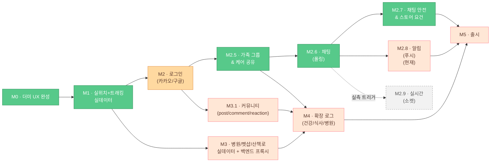

# 개발 로드맵 / 마일스톤

> Pawloop(포루프) — 반려동물 산책·동반장소·커뮤니티 앱의 단계별 개발 로드맵. **더미 UX(M0)** 에서 출발해 실위치 → 로그인 → **가족·채팅** → 실데이터/백엔드 → 확장 로그 → 출시까지의 마일스톤과 산출물을 정리한다. **현재 위치는 2.x 밴드 끝자락(M2.8 앞)이고, M1 은 2026-09-01 에 닫혔다.**

관련 문서: [기술 스택](../02-architecture/tech-stack.md) · [ERD](../03-database/erd.md)

---

## 한눈에 보기

| 마일스톤 | 목표 | 핵심 산출물 | 상태 |
|---|---|---|---|
| **M0** | 더미 UX 완성 | 5탭 셸 + 홈/지도/산책/커뮤니티/통계 화면, KTO 실연동 지도 | **완료** |
| **M1** | 실위치 + 실시간 트래킹 실데이터 | `geolocator` 도입, GPS 경로 저장(walk.path), 통계 실데이터화 | **완료(#145, 2026-09-01) — 마일스톤 닫힘** |
| **M2** | 로그인 | 카카오/구글 소셜 로그인, 사용자/강아지 프로필 서버 연동 | **하위 닫힘 — 실기기 확인 남음(#198)** |
| **M2.5** | 가족 그룹 & 케어 공유 | 방·멤버십·초대 3테이블, 가족 그룹, 오늘의 케어, 산책 주의사항 | **하위 전부 닫힘(#73~#76) — 앱 그룹 생성 경로 남음(#196)** |
| **M2.6** | 채팅(폴링) | `chat_message`(방별 `room_seq`), 방 목록·미읽음, 폴링 송수신 | **하위 전부 닫힘(#78~#81) — 폴링 실측·메시지 삭제 남음(#197)** |
| **M2.7** | 채팅 안전 & 스토어 요건 | 신고·차단(가리기)·강퇴·재입장 금지, 14세 미만 게이트, 운영자 연락처 | **완료(#82, 2026-08-31) — 마일스톤 닫힘** |
| **M2.8** | 알림(푸시) | FCM/APNs, `device_token`, 방별 음소거 | 예정 |
| **M2.9** | 실시간(소켓) | nginx 업그레이드 경로, 받기만 소켓 | **트리거 기반** |
| **M3** | 병원/펫샵/산책로 실데이터 + 백엔드 프록시 | LOCALDATA·두루누비 연동, ~~KTO 프록시+캐싱~~ | **KTO 프록시+캐싱 완료(#40) — LOCALDATA·두루누비 남음** |
| **M3.1** | 커뮤니티 | `post`·`comment`·`reaction` 3표, `/api/community` 6엔드포인트, 앱 연결·글쓰기 | 예정 — **착수 전 결정 셋(ADR-0016)** |
| **M4** | 확장 로그 | 건강/식사/병원(접종) 로그, care_log 도메인 | 예정 |
| **M5** | 출시 | 스토어 심사 통과, CI/CD, 모니터링, 정식 배포 | 예정 |

각 마일스톤은 앞 단계 산출물을 전제로 한다(선형 의존). 단, M2(로그인)와 M3(실데이터)는 병렬 진행 가능하다.

**M3.1(커뮤니티)은 M3 과 병렬이다.** 실데이터 적재와 의존이 없다. 다만 **M4 보다는 앞이어야 한다** — M4 절이 "커뮤니티 게시판 건강·병원 보드와 연동" 을 서버가 이미 있다는 전제로 적는다.

**2.x 밴드(M2.5~M2.9)는 계정 위에 바로 올라가는 다인(多人) 축이다.** 계정이 전제라 M2 이후에 진행하되 M3와는 전부 병렬 가능하다. 밴드 안에서는 M2.5 → M2.6 이 하드 의존이고(방이 있어야 메시지를 붙인다), M2.7(안전)과 M2.8(푸시)은 M2.6 뒤에서 서로 병렬이며, M2.9(소켓)는 실측 트리거가 걸릴 때만 연다. M4가 필요로 하는 것은 M2.5의 `care_log` 뿐이라 채팅이 늦어져도 확장 로그는 막히지 않는다. 프론트 화면(`chat_list_screen`·`family_chat_screen`·`family_screen`)은 이미 더미로 존재한다.

> **번호 규칙.** 2.x 밴드는 여기서 닫는다. 더 나눌 일이 생기면 마일스톤이 아니라 해당 마일스톤 안의 Epic 이슈로 쪼갠다.
>
> **M3.1 은 이 규칙의 예외다(2026-09-02).** 커뮤니티 서버화는 이 문서가 "아직 남았다" 고만 적어 두고 **어느 마일스톤도 소유하지 않는 상태**로 오래 떠 있었다. Epic 이슈로 쪼개는 대신 마일스톤을 판 이유는, 이것이 M3 의 하위 작업이 아니라 **독립된 축**이고 M4 가 그 결과물을 전제로 적혀 있기 때문이다. 규칙을 어긴 것이 아니라 규칙이 다루지 않던 경우다 — "이미 있는 마일스톤을 더 나누는 것" 과 "소유자가 없는 축에 자리를 주는 것" 은 다르다. 기존 M3·M4·M5를 밀지 않는 이유는 ① 다시 매겨도 **다음** 삽입에는 아무 도움이 안 되고 ② 닫힌 이슈(#26·#29)가 M3를 근거로 인용하고 있어 고치면 그때의 기록이 아니게 되며 ③ 소수점이 "계정을 전제로 한다" 는 밴드의 의미를 스스로 말해 주기 때문이다.

---

## M0 — 더미 UX 완성

**목표.** 반려 앱으로 피벗한 뒤 전 화면의 UX/디자인 시스템을 더미 데이터로 완성해 "돌아가는 제품"의 형태를 확정한다.

**완료된 산출물**

- **네비게이션.** `go_router` → `MainShell`(`lib/v2/screens/main_shell.dart`), 5탭 구조 홈 / 지도 / [산책 FAB] / 커뮤니티 / **채팅**. 통계(`insight_screen`)는 탭에서 내려가 `me_screen` 에서 진입한다.
- **홈(today_screen).** 강아지 히어로 + 오늘 산책 요약(그때는 상수 0).
- **지도(explore_screen).** 관광공사 KTO **실연동**(서울 반려동반 장소) + 병원/펫샵/산책로 **더미 레이어** + 카테고리 필터·범례·장소 시트.
- **실시간 산책(walk_tracking_screen).** **더미 시뮬레이션**(서울숲 고정 좌표 루프를 타이머로 한 점씩 그림) + 경로 폴리라인 + 라이브 스탯(시간/거리).
- **통계(insight_screen).** `fl_chart` 주간 막대 + 요약 + 자주 가는 곳. **더미 데이터**.
- **커뮤니티(feed_screen / post_detail_screen / create_screen).** 게시판·반응·댓글 UI. **더미 데이터**(`kPetPosts`).
- **강아지 프로필(me_screen / edit_screen).** `DogProfile`(견종/크기/나이/중성화) 표시·편집, 전역 `kMyDog` ValueNotifier.
- **디자인 시스템.** AuroraBackground + GlassCard, 플로팅 글래스 네비(가운데 산책 FAB), 따뜻한 그라데이션(#FFA96B→#FF7E8A), Fluent Emoji 3D 아이콘, Pretendard, `T` 디자인 토큰.

**남은 더미/미연동(다음 마일스톤 대상)** — 위는 M0 시점의 기록이고, 아래는 그 뒤로 어떻게 됐는지다.

- ~~산책 경로 저장(`walk.path`)~~ · ~~통계 실데이터화~~ · ~~iOS 위치 사용 문구~~ · ~~강아지 프로필·산책 기록의 서버화~~ → **M1 에서 닫혔다(#145).**
- 병원/펫샵/산책로 실데이터(M3 잔여) · **커뮤니티 서버화(M3.1)** · 건강/식사/병원 로그(M4) — **아직 남았다.**

**완료 기준(DoD).** 5탭 전 화면 크래시 없이 탐색 가능, KTO 지도 실 응답 렌더, 디자인 토큰 일관 적용.

---

## M1 — 실위치 + 실시간 트래킹 실데이터

**목표.** ~~"서울 고정 좌표 + 시뮬 이동"을 실제 GPS로 대체~~ — 그 대체는 끝났다. 남은 목표는 **그 좌표를 실제로 저장하고 집계해** 산책이 **진짜 기록되는** 핵심 루프를 완성하는 것이다.

**작업**

- ~~`geolocator ^13.0.1` 실제 도입 — 위치 권한 요청 플로우, `LocationSettings`.~~ **완료** — `app/lib/v2/data/location_service.dart`(단발 조회 + 5m distanceFilter 스트림).
  - Android: `ACCESS_FINE_LOCATION` / `ACCESS_COARSE_LOCATION`, 백그라운드 산책 시 `FOREGROUND_SERVICE_LOCATION` 검토(minSdk 23).
  - iOS: ~~`NSLocationWhenInUseUsageDescription`~~ **완료(#145)** — 그 키가 없는 동안 iOS 는 권한 프롬프트를 아예 안 띄웠고, 앱은 GPS 실패로 보고 시뮬 경로로 떨어졌다. `AlwaysAndWhenInUse` 는 백그라운드 트래킹을 넣는 날 함께 판단한다.
- ~~**지도 초기 위치**를 서울 고정 → 사용자 실좌표로.~~ **완료** — 현위치로 카메라와 `fetchNearby` 중심을 잡고, 실패했을 때만 서울시청으로 떨어진다.
- ~~**산책 트래킹 재작성**: 타이머 시뮬 → 위치 스트림 구독.~~ **완료** — 실 위치로 시작해 스트림을 구독하고 폴리라인·거리·페이스를 실시간 계산한다.
- ~~**로컬 저장.**~~ **완료(#145) — 다만 로컬이 아니라 서버다.** 종료하면 `POST /api/walks` 로 `walk(distance_m, duration_s, path LINESTRING SRID 4326)` 에 남는다. 못 보낸 것은 초안 큐(`shared_preferences`)에 남아 연결되면 나간다 — 로컬 저장의 역할을 그 큐가 한다.
- ~~**통계 실데이터화.**~~ **완료(#145)** — `kWeekKm`·`kWalks`·`kWalkTodayIdx`·`WalkToday`·`WalkLog` 를 지웠고 `GET /api/walks/stats/weekly`(이번 주 + 전체 기간)가 그 자리를 채운다. `kWalkTodayIdx` 는 상수 6 이라 오늘 막대 강조가 영원히 일요일이었다.
- **화면 꺼짐 방지**(wakelock) 및 배터리/정확도 절충값 튜닝. **안 했다** — M1 의 잔여가 아니라 다음에 볼 것으로 넘긴다.

**산출물**

- 실 GPS 기반 실시간 트래킹 화면, 로컬에 누적되는 산책 기록, 실데이터 통계, 위치 권한 온보딩.

**완료 기준(DoD).** ~~백엔드 없이 로컬 완결~~ → **서버에 저장**으로 바뀌었다. M2(로그인)와 M2.5(가족)가 먼저 끝나면서 "로컬에만 두었다가 나중에 올린다" 가 이중 작업이 됐다.

**충족 확인(2026-09-01, #145).** 에뮬레이터에서 실제로 걸어 확인했다 — 0.56km · 00:58 이 `POST /api/walks` 201 로 저장되고 홈이 "1회 · 0.6km" 로 자동 갱신됐다. DB 에서 `distance_m = 646`, `ST_Length(path,'metre') = 646.1` 로 **앱이 잰 거리와 서버가 경로에서 잰 길이가 0.1m 차이로 맞는다.**

**리스크.** 백그라운드 위치·배터리 정책(스토어 심사와 직결) → M5 심사 항목으로 연결.

---

## M2 — 로그인 (카카오 / 구글)

**목표.** 익명 로컬 사용에서 벗어나 사용자 계정을 도입, 이후 서버 동기화·커뮤니티 작성 권한의 기반을 만든다.

**작업**

- 소셜 로그인 — `flutter_web_auth_2 ^4.1.0`(이미 pubspec) 기반 OAuth 콜백, **카카오·구글**. SVG 버튼 에셋(`assets/icons/kakao.svg`, `google.svg`) 이미 존재.
  - 공급자를 둘로 정한 것은 [ADR-0010](../99-decisions/decision-log.md#adr-0010--소셜-로그인-공급자와-앱-세션-토큰-전략) 이다. 네이버는 보류이며 앱 화면에서는 #3 에서 내렸다.
- 토큰 보관 — `flutter_secure_storage ^9.2.4`(이미 pubspec)로 액세스/리프레시 토큰 저장.
- 백엔드 `auth` 패키지 연동 — 소셜 토큰 검증 → 자체 세션 발급. `users(id, provider, social_id, role, email nullable, nickname)`(→ [ERD](../03-database/erd.md)) 생성/조회. 앱 세션 토큰은 액세스 토큰(JWT, 1시간) + refresh 토큰(불투명 43자, 14일, `refresh_token` 원장)이다.
- **강아지 프로필 서버화.** 전역 `kMyDog`(로컬 ValueNotifier) → 로그인 사용자에 귀속되는 `dog` 레코드로. 로그인 없이도 게스트 탐색은 유지(로그인은 작성/동기화 시점 게이트).
- 약관 동의 플로우 — `assets/terms/*.md`(이미 존재) 연결.

**산출물**

- 소셜 로그인/로그아웃, 세션 유지, 서버 귀속 사용자·강아지 프로필, 약관 동의.

**완료 기준(DoD).** 카카오/구글로 로그인 후 앱 재시작에도 세션 유지, 프로필이 서버와 동기화된다.

**의존.** M3 백엔드와 함께 진행 시 시너지(사용자 귀속 데이터가 실데이터 위에서 의미를 가짐).

---

## M2.5 — 가족 그룹 & 케어 공유

**목표.** 반려는 혼자가 아니라 **가족이 함께** 돌본다. 케어 공유로 이중 급여(밥 두 번)·산책 누락을 막고 앱을 매일 열 이유를 만든다. 그리고 뒤따르는 모든 다인(多人) 기능이 딛고 설 **"방과 멤버십"** 을 여기서 세운다.

**작업**

- **방·멤버십·초대 3테이블.** `chat_room(origin_kind, origin_ref, title, last_seq)` · `chat_room_member(room_id, user_id, role, last_read_seq, removed_at, rejoin_blocked)` · `chat_room_invite(room_id, code, expires_at, max_uses, used_count, revoked_at)`. 이름은 `chat_` 인데 하는 일은 "방과 멤버십" 이라 채팅(M2.6)보다 먼저 태어난다. **chat 경계 밖으로 나가는 FK 는 0개다** — 근거는 [ADR-0011](../99-decisions/decision-log.md#adr-0011--채팅은-가족-그룹-종속이-아니라-범용-다중-방이다). API: `POST /api/chat/rooms/{roomId}/invites` · `DELETE /api/chat/rooms/{roomId}/invites/{code}` · `POST /api/chat/invites/{code}/join`.
- **가족 그룹.** 그룹 생성·초대코드로 참여·멤버 목록 — `family_group(id, name, created_at)`. **초대코드는 `chat_room_invite` 로 나가고 `group_member` 는 만들지 않는다.** 방이 `origin_kind`/`origin_ref` 쌍으로 그룹을 불투명하게 가리키고, `UNIQUE(origin_kind, origin_ref)` 가 같은 그룹에 방이 둘 생기는 것을 DB 수준에서 막는다. API: `POST /api/groups`(생성) · `GET /api/groups/me`(내 그룹+멤버).
- **오늘의 케어 공유.** 물 갈아주기/밥/산책 여부를 누가·언제 했는지 공유 — `care_log(id, dog_id FK, group_id FK nullable, type[water/meal/walk/med/vet], done_by(user_id), occurred_at, memo)`. API: `GET/POST /api/groups/{groupId}/care-logs`.
- **산책 시 주의사항.** 가족 공유 메모 — `walk_note(id, group_id FK, body, created_at)`. API: `GET/PUT /api/groups/{groupId}/walk-notes`.
- **프론트.** 홈 "오늘의 케어" 카드 · `family_screen`(멤버·초대코드·케어 현황·주의사항·채팅 진입). 도메인 SSOT(`lib/v2/domain/pet.dart`)에 `CareType`/`CareTask`/`kCareToday`/`FamilyMember`/`kFamilyMembers`/`kFamilyInviteCode`/`kWalkNotes` 가 이미 더미 상수로 있다 — UX 는 확정돼 있고 남은 것은 서버 연동이다.
- UI/UX는 기존 바이브 유지 — AuroraBackground + GlassCard, 따뜻한 그라데이션(#FFA96B→#FF7E8A), Pretendard, Fluent Emoji 톤.

**산출물**

- 방·멤버십·초대 3테이블, 가족 그룹 생성/참여, 초대코드 발급·회수·재발급, 오늘의 케어 공유 카드, 산책 주의사항 메모.

**완료 기준(DoD).** 두 계정이 초대코드로 한 가족에 묶여 오늘의 케어(물·밥·산책)를 서로 확인·기록한다. 방장이 코드를 재발급하면 이전 코드가 즉시 막히되 기존 멤버는 그대로 남는다. `ChatBoundaryArchitectureTest`(chat 패키지 엔티티에 chat 밖 연관 0개)가 초록불이다.

**post-MVP.** 친구 추가(가족 외), 케어 알림/리마인더, 케어 히스토리 통계.

**의존.** 사용자 계정이 전제 → M2(로그인) 이후. M3와 병렬 진행 가능하다.

---

## M2.6 — 채팅 (폴링)

**목표.** 이미 만들어져 있는 채팅 화면에 서버를 붙인다. 가족 방과 산책 크루 방이 **같은 코드**로 돈다 — 방 종류는 `tag`(=`origin_kind`)로만 갈린다.

**작업**

- **`chat_message` 와 방별 `room_seq`.** `chat_message(id, room_id, room_seq, sender_user_id, sender_name, content_type, body, created_at, deleted_at)` + `UNIQUE (room_id, room_seq)`. **`id` AUTO_INCREMENT 를 커서로 쓰지 않는다** — 배정 시점과 가시성 시점이 달라 `afterId` 폴링이 메시지를 영구히 건너뛴다. 발급은 `UPDATE chat_room SET last_seq = LAST_INSERT_ID(last_seq + 1)` 이고 **메시지 INSERT 와 같은 트랜잭션**이다.
- **엔드포인트 4종.** `GET /api/chat/rooms`(방 목록·미읽음) · `GET|POST /api/chat/rooms/{roomId}/messages`(`afterSeq` 델타 / `clientMsgId` 멱등 전송) · `POST /api/chat/rooms/{roomId}/read`(읽음 워터마크, 단조 증가) · `DELETE /api/chat/messages/{messageId}`(소프트 삭제). 멤버 확인은 서비스 경계의 `requireMember(roomId, userId)` 한 곳이고, 남의 방 id 로 403 이 나오는 통합 테스트를 함께 넣는다.
- **미읽음은 세지 않고 뺀다** — `room.last_seq − member.last_read_seq`. 읽음 표(`chat_message_read`)를 만들지 않는다. 추가 쿼리가 0이다.
- **rate limit 버킷과 메트릭.** 폴링 경로를 `ApiRateLimitFilter.resolveRule` 의 새 버킷으로 등록한다(표에 없는 경로는 지금 무제한이다). `chat.poll{result}`·`/api/chat/**` p95·`hikaricp_connections_pending` 기준선을 **도입 전에** 찍어 둔다 — M2.9 트리거가 이 셋을 읽는다.
- **프론트.** `chat_list_screen`·`family_chat_screen` 을 서버에 붙인다 — 적응형 폴링 간격, 낙관적 전송(+`clientMsgId` 재시도), 방 만들기·초대코드 참여. 폴링 호출에 `.timeout()` 을 반드시 단다.

**산출물**

- `chat_message` 테이블, 채팅 API 4종, 방 목록·미읽음 뱃지가 실데이터로 도는 채팅 탭, 채팅 전용 rate limit 버킷과 메트릭 3종.

**완료 기준(DoD).** 같은 방의 두 계정이 메시지를 주고받고, 방 목록의 미읽음 뱃지가 실제 미읽음과 일치한다. 한쪽이 폴링을 30초 끊었다 다시 붙여도 그 사이 메시지를 하나도 놓치지 않는다. 도입 전 기준선 대비 `hikaricp_connections_pending` 이 1분 이상 0을 넘지 않는다.

**의존.** M2.5 가 하드 전제다 — 방이 있어야 메시지를 붙인다.

---

## M2.7 — 채팅 안전 & 스토어 요건

**목표.** 채팅을 켠 채로 스토어 심사를 통과할 수 있게 만든다. 이건 제품 판단이 아니라 **스토어가 강제하는 요건**이다.

**작업**

- **신고.** 단위는 메시지이고 한 번에 최대 3개. 서버가 `room_id`·`room_seq`·발신자·**본문 사본**·시각·유형을 스냅샷으로 남기고 **앞뒤 각 5개의 `room_seq` 범위**를 함께 기록한다 — 원본 참조만 하면 지워졌을 때 판단이 불가능하다. 신고자는 익명이고 피신고자에게 알림이 가지 않는다.
- **차단은 가리기다.** `chat_block(blocker_id, blocked_id)` 한 장을 두고 그 사람의 **과거·미래 메시지를 모두 접어서** 내려준다. 삭제가 아니다 — 다른 사람 화면에는 그대로 남는다. **자동 차단은 하지 않는다**(체크박스, 기본값 꺼짐) — 가족방에서 되돌릴 수 없는 사고가 된다.
- **강퇴와 재입장 금지.** 방장(`role = OWNER`)만 한다. 멤버 행을 **지우지 말고** `removed_at`·`removed_by` 를 찍는다 — 미읽음이 그 행의 `last_read_seq` 뺄셈이라 지우면 되돌릴 수 없다. 강퇴당한 계정은 유효한 초대코드로도 못 들어온다.
- **만 14세 미만 게이트.** `users.age_group enum('OVER14','UNDER14')` 은 `01_schema.sql` 에 **이미 있고 아무 데도 쓰이지 않는다.** 채팅을 켜는 시점이 그 값을 쓰는 지점이다 — 방 생성과 초대코드로 새 방 참여를 막고 **가족방만 예외로 허용**한다. 방 안 대화는 건드리지 않는다.
- **스토어 요건 나머지.** 설정 화면 하단에 운영자 연락처 고정, 채팅 첫 진입에 이용약관·운영정책 동의. 그리고 탈퇴 화면(`account_delete_screen.dart`)의 "모든 데이터가 삭제되며 복구할 수 없습니다" 와 `privacy_ko.md` 3항을 **채팅 본문은 남는다**는 사실에 맞게 고친다.

**산출물**

- 신고·차단·강퇴 API 와 화면, 신고 스냅샷 저장소, 14세 미만 게이트, 운영자 연락처·약관 동의, 탈퇴 문구 정합.

**완료 기준(DoD).** 신고한 메시지가 원본이 지워진 뒤에도 스냅샷으로 조회된다. 가린 사람의 메시지가 과거·미래 모두 접힌다. 강퇴당한 계정이 유효한 초대코드로도 재입장하지 못한다. `age_group='UNDER14'` 계정이 가족방 외의 방을 만들거나 참여할 수 없다. 탈퇴 화면과 개인정보처리방침이 "채팅 본문은 남는다"를 말한다.

**의존.** M2.6 이후. M2.8(푸시)과 서로 병렬이다 — 붙여 두면 애플 계정 대기가 신고 기능을 막는다. **그리고 이것이 M5의 하드 전제다.**

---

## M2.8 — 알림 (푸시)

**목표.** 앱이 꺼져 있어도 메시지와 케어가 도착한 것을 안다.

**작업**

- **지금 저장소에 푸시가 0이다.** `google-services.json`·`GoogleService-Info.plist` 둘 다 없고, `pubspec.yaml` 에 firebase 의존성 0건, `build.gradle` 에 firebase-admin 0건, 발송 코드 0줄이다. 그러니 첫 작업은 기능이 아니라 **Firebase 프로젝트·APNs 키·애플 개발자 계정** 이다.
- **`device_token` 테이블과 등록/해지 경로.** 로그아웃·탈퇴에서 토큰을 지운다.
- **발송은 커밋 뒤 비동기.** 메시지 저장 트랜잭션 안에서 FCM 을 호출하지 않는다 — 락을 쥔 채 외부 호출을 하면 그 방의 모든 전송이 최대 `innodb_lock_wait_timeout`(기본 50초) 막힌다.
- **방별 음소거**와 알림 설정 화면.

**산출물**

- FCM/APNs 연동, `device_token` 관리, 메시지·케어 알림 발송 경로, 방별 음소거.

**완료 기준(DoD).** 앱을 완전히 종료한 상태에서 다른 계정이 보낸 메시지가 Android·iOS **실기기**에 알림으로 도착한다. 방을 음소거하면 그 방만 오지 않는다. 메시지 저장 응답 시간이 FCM 지연에 영향받지 않는다.

**의존.** M2.6 이후. M2.7과 서로 병렬.

---

## M2.9 — 실시간 (소켓) · 트리거 기반

**목표.** 폴링이 실제로 부족하다는 **실측**이 나왔을 때만 착수한다. 이 마일스톤은 "할 일" 이 아니라 **"조건이 충족되면 할 일"** 이다.

**착수 트리거(하나라도 넘으면)**

- `chat.poll{result=empty}` 비율이 **0.5 밑**으로 내려간다.
- `/api/chat/**` p95 가 **500ms** 를 5분 넘긴다.
- `hikaricp_connections_pending` 이 **1분 이상** 0을 넘는다. 이건 동시에 롤백 조건이기도 하다.

**작업**

- **nginx 가 코드보다 먼저 막힌다.** `nginx-production-template.conf` 의 location 6개가 전부 `proxy_set_header Connection "";` 이고 `Upgrade` 헤더도 `map $http_upgrade $connection_upgrade` 블록도 없다. 이 상태에서 101 Switching Protocols 은 업스트림에 닿지 못한다 — 지금 소켓을 넣으면 **로컬에서만 초록불**이다. SockJS 폴백으로 덮지 않는다.
- **받기만 소켓, 보내기는 HTTP.** 전송이 HTTP 로 남아야 M2.6의 멱등키와 rate limit 이 그대로 산다. 소켓이 끊기면 폴링으로 되돌아간다.
- **인스턴스 지역 상태가 여기서 처음 생긴다.** WebSocket 세션 자체가 그렇다. 인스턴스를 늘리는 날 함께 옮길 목록은 `backend/TODO/refresh-token-redis.md` §3 에 있다.

**산출물**

- nginx 업그레이드 경로, 수신 전용 소켓 핸들러, 소켓↔폴링 폴백, 소켓 테스트 베이스.

**완료 기준(DoD).** 두 기기가 같은 방에 있을 때 한쪽이 보낸 메시지가 상대 화면에 1초 안에 나타난다. 소켓을 강제로 끊으면 폴링으로 되돌아가 메시지를 하나도 놓치지 않는다. **운영 nginx 를 거쳐 실기기에서** 확인한다 — 로컬 초록불은 DoD 가 아니다.

**의존.** M2.6 이후. **트리거가 안 걸리면 열지 않고, 열지 않은 채로 M5에 들어가도 된다.**

---

## M3 — 병원/펫샵/산책로 실데이터 + 백엔드 프록시

**목표.** 더미 레이어(vet/shop/trail)를 공공데이터 실연동으로 채우고, KTO 직접 호출을 백엔드 프록시로 이관해 키 보호·캐싱·호출 한도(1000콜/일)를 해결한다.

**작업**

- ~~**백엔드 프록시**~~ → **완료**(#40). 앱 → 백엔드 → KTO. 다만 캐시가 `place` 표의 공간 인덱스가 아니라 **`place_cell` 격자 스냅샷**이다 — 조회가 `(lat_idx, lng_idx)` PK 하나뿐이라 공간 인덱스가 할 일이 없고, 그러면 `hibernate-spatial` 의존성도 필요 없다.
- **동물병원(LOCALDATA 인허가).** 전국 ~9,445건, 좌표 **EPSG:5174 → WGS84** 변환 후 `place(source=localdata_vet, category=vet, geom POINT)` 적재. 지도 `vet` 레이어 실데이터화.
- **펫샵/미용/호텔(LOCALDATA).** `place(source=localdata_shop, category=shop)` 적재 → `shop` 레이어.
- **산책로(두루누비 걷기여행길).** 코스 좌표/GPX → `trail(source, name, path LINESTRING, length_m)` 적재. 더미 폴리라인 → 실 코스로 교체.
- **공간쿼리.** `ST_Distance_Sphere` / `MBRContains` + SPATIAL INDEX로 "내 주변 N km" 반경 조회를 백엔드에서 처리.
- 캐싱/갱신 배치 — POI 주기적 재적재, `updated_at` 기준 무효화.

**산출물**

- 실데이터 지도 3개 레이어(병원/펫샵/산책로) + KTO, 백엔드 프록시·POI 캐시, 반경 공간쿼리 API.

**완료 기준(DoD).** 지도의 모든 레이어가 실데이터로 렌더되고, KTO 서비스키가 앱 번들에서 제거(서버로 이동)된다.

**참조.** 데이터 스키마는 [ERD](../03-database/erd.md), 스택은 [기술 스택](../02-architecture/tech-stack.md).

---

## M3.1 — 커뮤니티

**목표.** 반려동물 커뮤니티를 서버에 붙인다. 지금 앱은 화면 로컬 더미(`kPetPosts` 4건)를 그리고 백엔드에는 커뮤니티 코드가 **0줄**이다(`grep -rni community backend/src/` 0건).

**왜 M3 과 M4 사이인가.** M4 가 "커뮤니티 게시판 건강·병원 보드와 연동" 을 **서버가 이미 있다는 전제**로 적는다. 그 전제를 여기서 만든다. M3(실데이터)과는 의존이 없어 순서를 바꿔도 되지만, M4 앞이어야 한다.

**착수 전에 정할 것**

- **신고·차단을 chat 밖으로 올릴 것인가**(#166). 지금 `chat_report` 가 `room_id`·`context_from_seq`·`context_to_seq` 를 NOT NULL 로 들고 있어 채팅 좌표에 못박혀 있다. 게시글 신고가 생기는 날 이 표를 나눌지 올릴지는 **표를 짜기 전에** 정해야 두 번 안 만든다.
- **반응 카디널리티**(#164). 레거시 `card_reaction` 은 `UNIQUE (card_id, user_id, reaction_type)` 로 사용자당 복수인데, 계약의 `ReactionSummary.mine` 은 단수 nullable 이다. 이게 정해져야 reaction 표를 쓴다.
- **게스트 읽기**. 커뮤니티 GET 셋만 계약에서 `security: []` 인데 `SecurityConfig` 의 publicMatchers 에 `/api/community/**` 가 없고, 그 목록은 경로만 받고 **메서드를 안 받는다**. GET 만 열려면 그 구조부터 손봐야 한다.

셋을 **ADR-0016** 으로 함께 적는다.

**작업 — 직렬이다**

어느 하나도 앞을 건너뛸 수 없다. 표가 없으면 API 를 못 만들고, API 가 없으면 앱을 못 붙이고, 읽기가 없으면 글쓰기가 어디로 가는지 확인할 수 없다.

1. **표 셋**(#169) — `post`·`comment`·`reaction`. `mysql/post-start/13_community.sql`. `schema.md`·`erd.md` 정본 갱신.
2. **API 여섯**(#170) — `/api/community` 도메인 패키지 신설. 재사용 자산이 실재한다(`SocialService` 의 `findByCardIdIn`·`countByCardIdInGroupBy`·`toggleReaction`).
3. **앱 연결**(#171) — `kPetPosts` 를 걷어내고 `community_repository.dart` 를 만든다. `PetPost` 에 `placeId` 가 없어 계약과 어긋나는 것도 여기서 맞춘다.
4. **글쓰기 화면**(#172) — 저장소에 없다. `create_screen.dart` 를 재사용하지 않는다 — 그 화면의 호출부 셋이 전부 산책 축이다.

**문서 선행**(#167·#168·#175) — 이 셋을 만드는 사람이 `community.md`·`api-spec.md` 를 베낀다. 지금 그 문서들이 금지된 인증 패턴(`HttpServletRequest req`)을 지시하고, 계약에 없는 경로와 board 코드를 적고, 산책 화면을 커뮤니티 글쓰기라고 지목한다. **구현 전에 안 고치면 틀린 것이 코드가 된다.**

**산출물**

- 서버에 붙은 커뮤니티 — 목록·상세·작성·댓글·반응. 화면 로컬 더미 0건.

**완료 기준(DoD).** 앱에서 글을 쓰고, 앱을 껐다 켜고, 다른 계정으로 로그인해도 그 글이 보인다. `grep -rn kPetPosts app/lib` 가 0건이다.

**참조.** 결정은 ADR-0016, 청사진은 [community.md](../02-architecture/backend/community.md), 계약은 [openapi.yaml](../04-api/openapi.yaml) `/api/community`.

---

## M4 — 확장 로그 (건강 / 식사 / 병원·접종)

**목표.** 산책 wedge를 "반려 일상 로그"로 확장. 산책 외 케어 기록을 추가해 리텐션과 데이터 자산을 키운다.

**작업**

- **care_log 도메인**(ERD의 post-MVP 확장) — M2.5에서 도입한 `care_log`를 확장: `care_log(dog_id FK, type[meal/health/vet/med], occurred_at, title, value, memo, photo)`.
- **식사 로그.** 사료/간식/급여량·시간, 간단 통계.
- **건강 로그.** 체중 추이(`fl_chart` 라인), 증상 메모, 사진(`image_picker` 이미 pubspec).
- **병원·접종 기록.** 방문/진료/예방접종 이력, 다음 접종 리마인더(`table_calendar` 이미 pubspec 활용).
- 커뮤니티 게시판 `건강·병원` 보드와 연동(로그 → 글 작성 진입).
- 홈 화면에 "오늘의 케어" 요약 카드 추가(산책 요약과 나란히).

**산출물**

- 건강/식사/병원 로그 화면, 체중·접종 추이, 캘린더 기반 리마인더.

**완료 기준(DoD).** 강아지 1마리에 대해 산책·식사·건강·병원 이력이 한 타임라인에서 조회된다.

**주의.** MVP 범위 밖(post-MVP)이므로 M1~M3 안정화 이후 착수. 반려인 매칭/산책 크루는 이 마일스톤 이후 별도 검토.

---

## M5 — 출시

**목표.** 스토어 정식 배포. 안정성·정책·운영 체계를 갖춘다.

**작업**

- **스토어 준비.** 앱스토어명 `Pawloop: Pet Walk & Community` / `포루프: 반려동물 산책 커뮤니티`. 앱 아이콘(`flutter_launcher_icons` 설정 완료), 스크린샷, 개인정보처리방침(`privacy_ko.md`).
- **권한 정책.** 위치(특히 백그라운드), 사진 접근 사유 명문화 — Play/App Store 심사 대응(M1 리스크 정산).
- **CI/CD.** 빌드 자동화, 버전/`versionCode` 관리(현재 `version: 2.0.0+1`), Android AGP 8.11.1 / Kotlin 2.2.20 / Gradle 8.13 / compileSdk 36 / minSdk 23 / Java 17.
- **품질.** 크래시/에러 모니터링, 성능(지도·트래킹 프레임), KTO 프록시 호출 한도 모니터링.
- **UGC 심사 요건(M2.7 정산).** 채팅을 켠 채로 심사에 넣으려면 Apple App Store Review Guideline 1.2(필터링 · 신고 창구와 적시 대응 · 차단 · 공개 연락처, https://developer.apple.com/app-store/review/guidelines/#user-generated-content)와 Google Play UGC 정책(인앱 신고·차단, https://support.google.com/googleplay/android-developer/answer/9876937)이 전부 동작해야 한다. **M2.7이 닫히지 않았으면 채팅을 끄고 심사에 넣거나 심사를 미룬다.**
- **베타 → 정식.** 내부 테스트 → 클로즈드 베타 → 프로덕션 단계 출시.

**산출물**

- Play Store / App Store 심사 통과 릴리스, 개인정보처리방침·권한 문구, CI/CD 파이프라인, 모니터링 대시보드.

**완료 기준(DoD).** 양대 스토어에 정식 버전이 게시되고, 크래시-프리 세션·프록시 호출량이 모니터링된다.

---

## 마일스톤 흐름

M2(로그인)와 M3(실데이터/백엔드)는 M1 이후 **병렬 진행 가능**하며, M2 뒤에 2.x 밴드(가족·채팅)와 M3.1(커뮤니티)이 이어진다. M3.1 은 계정을 전제로 하고 M3(실데이터)과는 의존이 없다. M4는 M2.5의 `care_log`와 M3의 실데이터만 전제로 하므로 채팅 밴드가 늦어져도 막히지 않는다. **M2.7(채팅 안전)만은 M5의 하드 전제다** — 채팅을 켠 채로는 스토어 UGC 요건 없이 심사에 들어갈 수 없다. M2.9(소켓)를 점선으로 그린 것은 실측 트리거가 걸리기 전에는 열지 않는다는 뜻이다.
