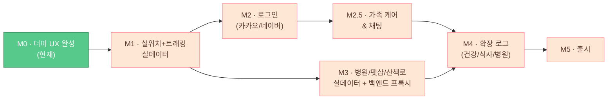

# 개발 로드맵 / 마일스톤

> Pawloop(포루프) — 반려동물 산책·동반장소·커뮤니티 앱의 단계별 개발 로드맵. **더미 UX가 완성된 현재(M0)** 에서 출발해, 실위치 → 로그인 → 실데이터/백엔드 → 확장 로그 → 출시까지의 마일스톤과 산출물을 정리한다.

관련 문서: [기술 스택](../02-architecture/tech-stack.md) · [ERD](../03-database/erd.md)

---

## 한눈에 보기

| 마일스톤 | 목표 | 핵심 산출물 | 상태 |
|---|---|---|---|
| **M0** | 더미 UX 완성 | 5탭 셸 + 홈/지도/산책/커뮤니티/통계 화면, KTO 실연동 지도 | **완료(현재)** |
| **M1** | 실위치 + 실시간 트래킹 실데이터 | `geolocator` 도입, GPS 경로 저장(walk.path), 통계 실데이터화 | 예정 |
| **M2** | 로그인 | 카카오/네이버 소셜 로그인, 사용자/강아지 프로필 서버 연동 | 예정 |
| **M2.5** | 가족 케어 & 채팅 | 가족 그룹(초대코드), 오늘의 케어 공유, 산책 주의사항 메모, 가족 채팅(폴링) | 예정 |
| **M3** | 병원/펫샵/산책로 실데이터 + 백엔드 프록시 | LOCALDATA·두루누비 연동, KTO 프록시+캐싱 | 예정 |
| **M4** | 확장 로그 | 건강/식사/병원(접종) 로그, care_log 도메인 | 예정 |
| **M5** | 출시 | 스토어 심사 통과, CI/CD, 모니터링, 정식 배포 | 예정 |

각 마일스톤은 앞 단계 산출물을 전제로 한다(선형 의존). 단, M2(로그인)와 M3(실데이터)는 병렬 진행 가능하다. M2.5(가족 케어 & 채팅)는 사용자 계정이 전제라 M2 이후 진행하되, M3와 병렬 가능하다(프론트 더미 UI는 그 전에도 선행 가능).

---

## M0 — 더미 UX 완성 (현재)

**목표.** 반려 앱으로 피벗한 뒤 전 화면의 UX/디자인 시스템을 더미 데이터로 완성해 "돌아가는 제품"의 형태를 확정한다.

**완료된 산출물**

- **네비게이션.** `go_router` → `MainShell`(`lib/v2/screens/main_shell.dart`), 5탭 구조 홈 / 지도 / [산책 FAB] / 커뮤니티 / 통계.
- **홈(today_screen).** 강아지 히어로 + 오늘 산책 요약(`WalkToday`, 현재 0부터 시작).
- **지도(explore_screen).** 관광공사 KTO **실연동**(서울 반려동반 장소) + 병원/펫샵/산책로 **더미 레이어** + 카테고리 필터·범례·장소 시트.
- **실시간 산책(walk_tracking_screen).** **더미 시뮬레이션**(서울숲 고정 좌표 루프를 타이머로 한 점씩 그림) + 경로 폴리라인 + 라이브 스탯(시간/거리).
- **통계(insight_screen).** `fl_chart` 주간 막대(`kWeekKm`) + 요약 + 자주 가는 곳. **더미 데이터**.
- **커뮤니티(feed_screen / post_detail_screen / create_screen).** 게시판·반응·댓글 UI. **더미 데이터**(`kPetPosts`).
- **강아지 프로필(me_screen / edit_screen).** `DogProfile`(견종/크기/나이/중성화) 표시·편집, 전역 `kMyDog` ValueNotifier.
- **디자인 시스템.** AuroraBackground + GlassCard, 플로팅 글래스 네비(가운데 산책 FAB), 따뜻한 그라데이션(#FFA96B→#FF7E8A), Fluent Emoji 3D 아이콘, Pretendard, `T` 디자인 토큰.

**남은 더미/미연동(다음 마일스톤 대상)**

- 실제 위치(서울 고정, `geolocator` 미도입) · 실시간 트래킹 실 GPS · 병원/펫샵/산책로 실데이터 · 로그인 · 건강/식사/병원 로그 · 백엔드 반려 API.

**완료 기준(DoD).** 5탭 전 화면 크래시 없이 탐색 가능, KTO 지도 실 응답 렌더, 디자인 토큰 일관 적용.

---

## M1 — 실위치 + 실시간 트래킹 실데이터

**목표.** "서울 고정 좌표 + 시뮬 이동"을 실제 GPS로 대체해, 산책이 **진짜 기록되는** 핵심 루프를 완성한다.

**작업**

- `geolocator ^13.0.1`(이미 pubspec에 있음) 실제 도입 — 위치 권한 요청 플로우, `LocationSettings`(정확도/거리 필터).
  - Android: `ACCESS_FINE_LOCATION` / `ACCESS_COARSE_LOCATION`, 백그라운드 산책 시 `FOREGROUND_SERVICE_LOCATION` 검토(minSdk 23).
  - iOS: `NSLocationWhenInUseUsageDescription` / `AlwaysAndWhenInUse`.
- **지도 초기 위치**를 서울 고정 → 사용자 실좌표로. `PetPlacesRepository.fetchNearby(lat, lng)`에 실 좌표 주입(코드상 이미 파라미터화됨).
- **산책 트래킹 재작성**(`walk_tracking_screen.dart`): 타이머 시뮬 → `Geolocator.getPositionStream()` 구독. 경로 폴리라인, 거리(누적 하버사인), 페이스, 경과 시간을 실시간 계산. 일시정지/재개/종료.
- **로컬 저장.** 산책 종료 시 `WalkLog` + 경로를 로컬 영속화(초기엔 `shared_preferences`/파일, 경로는 인코딩 폴리라인). ERD의 `walk(distance_m, duration_s, path LINESTRING)` 스키마와 정합.
- **통계 실데이터화.** `kWeekKm`/`kWalks` 더미 → 저장된 산책 집계로 교체. 주간 막대·요약·자주 가는 곳을 실 기록에서 산출.
- **화면 꺼짐 방지**(wakelock) 및 배터리/정확도 절충값 튜닝.

**산출물**

- 실 GPS 기반 실시간 트래킹 화면, 로컬에 누적되는 산책 기록, 실데이터 통계, 위치 권한 온보딩.

**완료 기준(DoD).** 실제 산책 1회가 거리/시간/경로로 정확히 기록되고, 통계 화면에 반영된다(백엔드 없이 로컬 완결).

**리스크.** 백그라운드 위치·배터리 정책(스토어 심사와 직결) → M5 심사 항목으로 연결.

---

## M2 — 로그인 (카카오 / 네이버)

**목표.** 익명 로컬 사용에서 벗어나 사용자 계정을 도입, 이후 서버 동기화·커뮤니티 작성 권한의 기반을 만든다.

**작업**

- 소셜 로그인 — `flutter_web_auth_2 ^4.1.0`(이미 pubspec) 기반 OAuth 콜백, 카카오/네이버(+선택 구글). SVG 버튼 에셋(`assets/icons/kakao.svg`, `naver.svg`, `google.svg`) 이미 존재.
- 토큰 보관 — `flutter_secure_storage ^9.2.4`(이미 pubspec)로 액세스/리프레시 토큰 저장.
- 백엔드 `auth` 패키지 연동 — 소셜 토큰 검증 → 자체 세션 발급. `app_user(id, provider, social_id, nickname)`(ERD) 생성/조회.
- **강아지 프로필 서버화.** 전역 `kMyDog`(로컬 ValueNotifier) → 로그인 사용자에 귀속되는 `dog` 레코드로. 로그인 없이도 게스트 탐색은 유지(로그인은 작성/동기화 시점 게이트).
- 약관 동의 플로우 — `assets/terms/*.md`(이미 존재) 연결.

**산출물**

- 소셜 로그인/로그아웃, 세션 유지, 서버 귀속 사용자·강아지 프로필, 약관 동의.

**완료 기준(DoD).** 카카오/네이버로 로그인 후 앱 재시작에도 세션 유지, 프로필이 서버와 동기화된다.

**의존.** M3 백엔드와 함께 진행 시 시너지(사용자 귀속 데이터가 실데이터 위에서 의미를 가짐).

---

## M2.5 — 가족 케어 & 채팅

**목표.** 반려는 혼자가 아니라 **가족이 함께** 돌본다. 가족 간 케어 공유로 이중 급여(밥 두 번)·산책 누락을 막고, 앱의 일일 사용 이유(리텐션)를 만든다.

**작업**

- **가족 그룹.** 그룹 생성·초대코드로 참여·멤버 목록 — `family_group(id, name, invite_code, created_at)` / `group_member(id, group_id FK, user_id FK, role[owner/member], joined_at)`. API: `POST /api/groups`(생성) · `POST /api/groups/join`(초대코드) · `GET /api/groups/me`(내 그룹+멤버).
- **오늘의 케어 공유.** 물 갈아주기/밥/산책 여부를 누가·언제 했는지 공유 — 기존 care_log 계획 확장: `care_log(id, dog_id FK, group_id FK nullable, type[water/meal/walk/med/vet], done_by(user_id), occurred_at, memo)`. API: `GET/POST /api/groups/{groupId}/care-logs`(오늘 케어 조회/기록).
- **산책 시 주의사항.** 가족 공유 메모 — `walk_note(id, group_id FK, body, created_at)` 또는 그룹의 공유 메모. API: `GET/PUT /api/groups/{groupId}/walk-notes`.
- **가족 채팅.** 그룹 채팅 — `chat_message(id, group_id FK, user_id FK, body, created_at)`. API: `GET/POST /api/groups/{groupId}/messages`(커서 페이지네이션). **MVP는 폴링**, 실시간(WebSocket/STOMP)은 post-MVP.
- **프론트.** 홈 "오늘의 케어" 카드 · `family_screen`(멤버·초대코드·케어 현황·주의사항·채팅 진입) · `family_chat_screen`. 도메인 SSOT(`lib/v2/domain/pet.dart`)에 `CareType`/`CareTask`/`kCareToday`/`FamilyMember`/`kFamilyMembers`/`kFamilyInviteCode`/`kWalkNotes`/`ChatMessage`/`kChatMessages` 추가. 더미(로컬 상수)로 선행 구현 가능 — 백엔드 연동 전에 UX 확정.
- UI/UX는 기존 바이브 유지 — AuroraBackground + GlassCard, 따뜻한 그라데이션(#FFA96B→#FF7E8A), Pretendard, Fluent Emoji 톤.

**산출물**

- 가족 그룹 생성/참여(초대코드), 오늘의 케어 공유 카드, 산책 주의사항 메모, 폴링 기반 가족 채팅.

**완료 기준(DoD).** 두 계정이 한 그룹에 속해 오늘의 케어(물/밥/산책)를 서로 확인·기록하고, 가족 채팅으로 메시지를 주고받는다.

**post-MVP.** 친구 추가(가족 외), 케어 알림/리마인더, 케어 히스토리 통계, 실시간 푸시.

**의존.** 그룹·케어·채팅 모두 사용자 계정이 전제 → M2(로그인) 이후. M3와 병렬 진행 가능하며, 프론트 더미 UI는 M2 이전에도 선행 가능.

---

## M3 — 병원/펫샵/산책로 실데이터 + 백엔드 프록시

**목표.** 더미 레이어(vet/shop/trail)를 공공데이터 실연동으로 채우고, KTO 직접 호출을 백엔드 프록시로 이관해 키 보호·캐싱·호출 한도(1000콜/일)를 해결한다.

**작업**

- **백엔드 프록시(tour 패키지).** 앱 → 백엔드 → KTO. 응답을 `place` 테이블(POI 캐시, `geom POINT`, `raw_json`, `updated_at`)에 저장. 앱은 `PetPlacesRepository`가 백엔드 엔드포인트를 호출하도록 전환(현재 `apis.data.go.kr` 직접 호출 제거, `.env`의 서비스키를 서버로 이동).
- **동물병원(LOCALDATA 인허가).** 전국 ~9,445건, 좌표 **EPSG:5174 → WGS84** 변환 후 `place(source=localdata_vet, category=vet, geom POINT)` 적재. 지도 `vet` 레이어 실데이터화.
- **펫샵/미용/호텔(LOCALDATA).** `place(source=localdata_shop, category=shop)` 적재 → `shop` 레이어.
- **산책로(두루누비 걷기여행길).** 코스 좌표/GPX → `trail(source, name, path LINESTRING, length_m)` 적재. 더미 폴리라인 → 실 코스로 교체.
- **공간쿼리.** `ST_Distance_Sphere` / `MBRContains` + SPATIAL INDEX로 "내 주변 N km" 반경 조회를 백엔드에서 처리.
- 캐싱/갱신 배치 — POI 주기적 재적재, `updated_at` 기준 무효화.

**산출물**

- 실데이터 지도 3개 레이어(병원/펫샵/산책로) + KTO, 백엔드 프록시·POI 캐시, 반경 공간쿼리 API.

**완료 기준(DoD).** 지도의 모든 레이어가 실데이터로 렌더되고, KTO 서비스키가 앱 번들에서 제거(서버로 이동)된다.

**참조.** 데이터 스키마는 [ERD](../03-database/erd.md), 스택은 [기술 스택](../02-architecture/tech-stack.md).

---

## M4 — 확장 로그 (건강 / 식사 / 병원·접종)

**목표.** 산책 wedge를 "반려 일상 로그"로 확장. 산책 외 케어 기록을 추가해 리텐션과 데이터 자산을 키운다.

**작업**

- **care_log 도메인**(ERD의 post-MVP 확장) — M2.5에서 도입한 `care_log`를 확장: `care_log(dog_id FK, type[meal/health/vet/med], occurred_at, title, value, memo, photo)`.
- **식사 로그.** 사료/간식/급여량·시간, 간단 통계.
- **건강 로그.** 체중 추이(`fl_chart` 라인), 증상 메모, 사진(`image_picker` 이미 pubspec).
- **병원·접종 기록.** 방문/진료/예방접종 이력, 다음 접종 리마인더(`table_calendar` 이미 pubspec 활용).
- 커뮤니티 게시판 `건강·병원` 보드와 연동(로그 → 글 작성 진입).
- 홈 화면에 "오늘의 케어" 요약 카드 추가(산책 요약과 나란히).

**산출물**

- 건강/식사/병원 로그 화면, 체중·접종 추이, 캘린더 기반 리마인더.

**완료 기준(DoD).** 강아지 1마리에 대해 산책·식사·건강·병원 이력이 한 타임라인에서 조회된다.

**주의.** MVP 범위 밖(post-MVP)이므로 M1~M3 안정화 이후 착수. 반려인 매칭/산책 크루는 이 마일스톤 이후 별도 검토.

---

## M5 — 출시

**목표.** 스토어 정식 배포. 안정성·정책·운영 체계를 갖춘다.

**작업**

- **스토어 준비.** 앱스토어명 `Pawloop: Pet Walk & Community` / `포루프: 반려동물 산책 커뮤니티`. 앱 아이콘(`flutter_launcher_icons` 설정 완료), 스크린샷, 개인정보처리방침(`privacy_ko.md`).
- **권한 정책.** 위치(특히 백그라운드), 사진 접근 사유 명문화 — Play/App Store 심사 대응(M1 리스크 정산).
- **CI/CD.** 빌드 자동화, 버전/`versionCode` 관리(현재 `version: 2.0.0+1`), Android AGP 8.11.1 / Kotlin 2.2.20 / Gradle 8.13 / compileSdk 36 / minSdk 23 / Java 17.
- **품질.** 크래시/에러 모니터링, 성능(지도·트래킹 프레임), KTO 프록시 호출 한도 모니터링.
- **베타 → 정식.** 내부 테스트 → 클로즈드 베타 → 프로덕션 단계 출시.

**산출물**

- Play Store / App Store 심사 통과 릴리스, 개인정보처리방침·권한 문구, CI/CD 파이프라인, 모니터링 대시보드.

**완료 기준(DoD).** 양대 스토어에 정식 버전이 게시되고, 크래시-프리 세션·프록시 호출량이 모니터링된다.

---

## 마일스톤 흐름

M2(로그인)와 M3(실데이터/백엔드)는 M1 이후 **병렬 진행 가능**하며, M2 뒤에 M2.5(가족 케어 & 채팅)가 이어져 두 축이 M4에서 합류한다.
