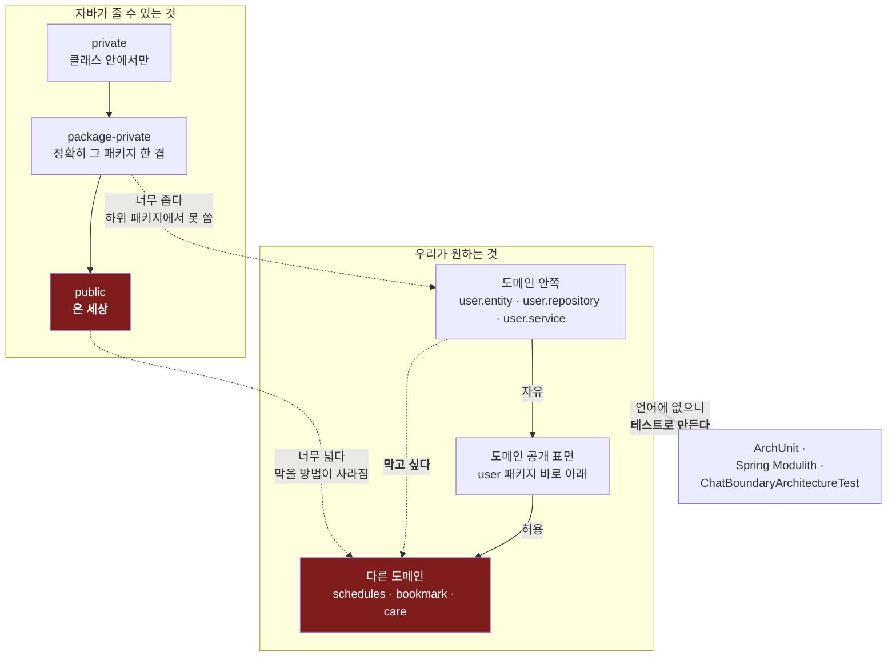
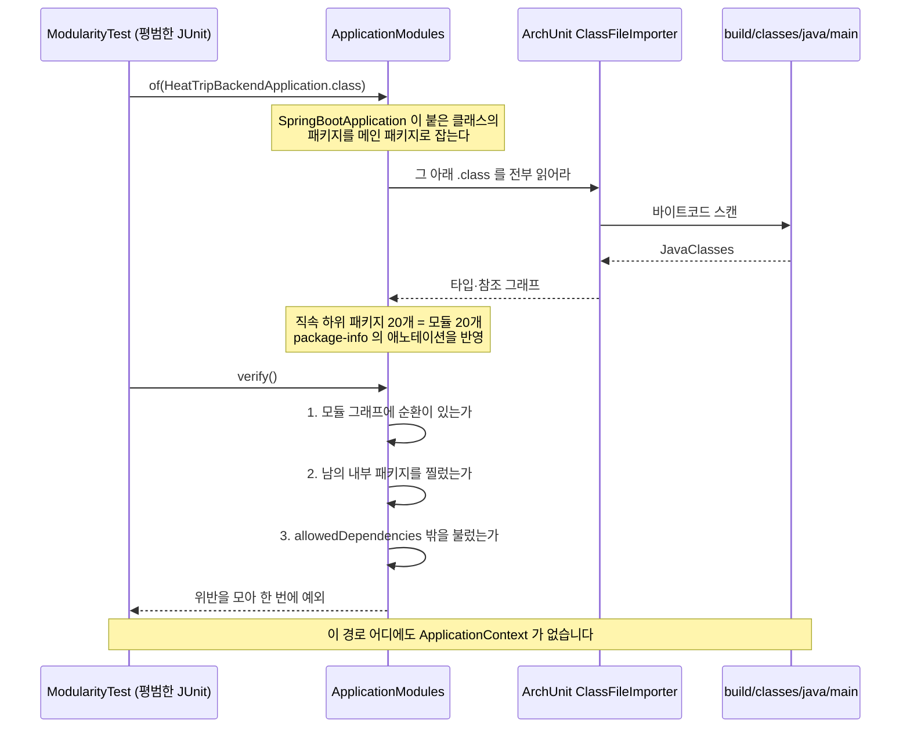
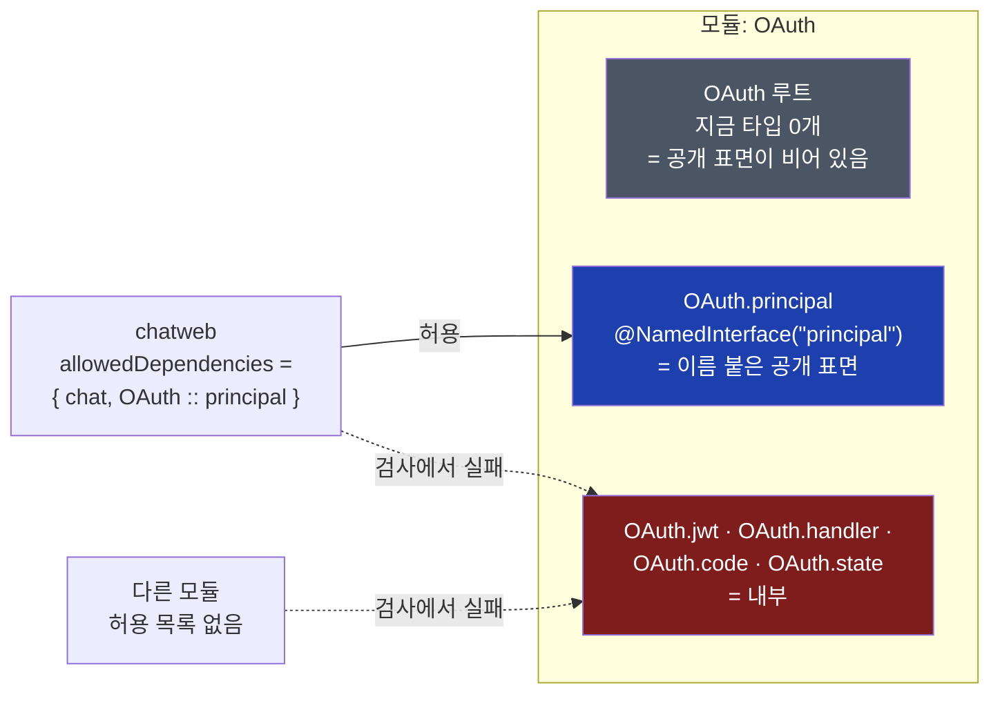
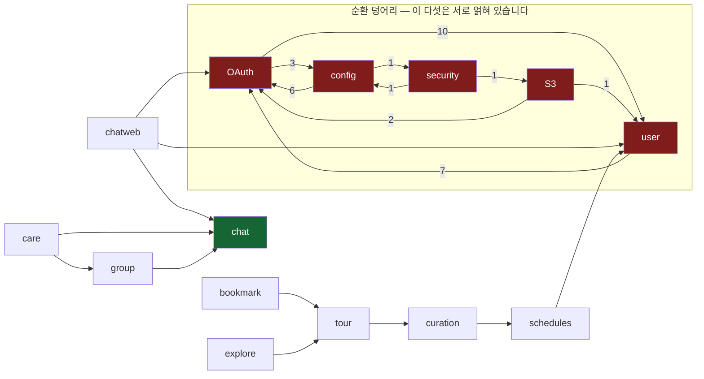
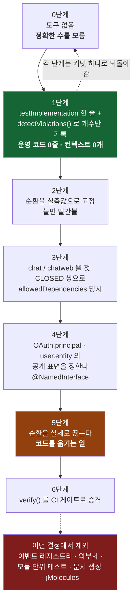

# 의사결정 기록 (ADR 로그)

> Pawloop(포루프) — 반려동물 산책·동반장소·커뮤니티 앱 — 의 주요 아키텍처/제품 결정을 시간순으로 기록한 ADR(Architecture Decision Record) 목록. 각 결정은 **맥락 · 결정 · 대안 · 결과**로 정리한다. 결정의 근거는 실제 코드/설정(`app/pubspec.yaml`, `app/lib/v2`, `android/*.gradle.kts`, `app/.env`)에 정렬한다.

관련 문서: [기술 스택](../02-architecture/tech-stack.md) · [외부 공개데이터 연동](../02-architecture/external-data.md) · [ERD](../03-database/erd.md)

---

## ADR 인덱스

| # | 결정 | 상태 | 날짜 |
|:---:|:---|:---|:---|
| [0001](#adr-0001--감정여행heattrip--반려앱pawloop-피벗) | 감정여행(heattrip) → 반려앱(Pawloop) 피벗 | 채택 (Accepted) | 2026-07 |
| [0002](#adr-0002--앱-이름-pawloop포루프-채택) | 앱 이름 Pawloop(포루프) 채택 | 채택 (Accepted) | 2026-07 |
| [0003](#adr-0003--rdbmysql-공간형-중심-nosql-보류) | RDB(MySQL 공간형) 중심, NoSQL 보류 | 채택 (Accepted) | 2026-07 |
| [0004](#adr-0004--관광공사-kto-반려동반-apikorpettourservice2-채택) | 관광공사 KTO 반려동반 API(KorPetTourService2) 채택 | 채택 (Accepted) | 2026-07 |
| [0005](#adr-0005--flutter-332--344-업그레이드--fl_chart-도입) | Flutter 3.32 → 3.44 업그레이드 + fl_chart 도입 | 채택 (Accepted) | 2026-07 |
| [0006](#adr-0006--kto-앱에서-직접-호출임시--백엔드-프록시-계획) | KTO 앱에서 직접 호출(임시) → 백엔드 프록시 계획 | **대체됨 (Superseded, → 0013)** | 2026-07 |
| [0007](#adr-0007--fluent-emoji-3d-아이콘-채택) | Fluent Emoji 3D 아이콘 채택 | 채택 (Accepted) | 2026-07 |
| [0008](#adr-0008--저장소가-담는-문서의-범위) | 저장소가 담는 문서의 범위 — 기술 문서를 코드와 함께 관리 | 채택 (Accepted) | 2026-08 |
| [0009](#adr-0009--소셜-로그인에-pkce-를-도입하지-않는다) | 소셜 로그인에 PKCE 를 도입하지 않는다 — 백엔드가 공급자와 코드 교환을 수행하는 동안 | 채택 (Accepted) | 2026-08 |
| [0010](#adr-0010--소셜-로그인-공급자와-앱-세션-토큰-전략) | 소셜 로그인 공급자(카카오·구글)와 앱 세션 토큰 전략 — 네이버·Redis 보류 | 채택 (Accepted) | 2026-08 |
| [0011](#adr-0011--채팅은-가족-그룹-종속이-아니라-범용-다중-방이다) | 채팅 아키텍처 — 범용 다중 방 · 방별 room_seq · 폴링 우선, STOMP·Redis 보류 | 채택 (Accepted) | 2026-08 |
| [0012](#adr-0012--모듈-경계는-spring-modulith-의-구조-검사만-들인다) | 모듈 경계 검사에 Spring Modulith 도입 — 구조 검사만, 이벤트 절반은 보류 | 채택 (Accepted) | 2026-08 |
| [0013](#adr-0013--kto-프록시는-격자-캐시와-일일-호출-예산으로-간다) | KTO 프록시 — 0.02° 격자 캐시 + DB 행이 지키는 일일 호출 예산 | 채택 (Accepted) | 2026-08 |
| [0014](#adr-0014--제품-기획-문서도-저장소에-넣는다) | 제품 기획 문서(`00-product/`)도 저장소에 넣는다 — ADR-0008 의 한 줄을 뒤집는다 | 채택 (Accepted) | 2026-09 |
| [0015](#adr-0015--산책-경로는-linestring-으로-저장하되-spatial-index-는-만들지-않는다) | 산책 경로는 LINESTRING 으로 저장하되 SPATIAL INDEX 는 만들지 않는다 — ADR-0013 의 절반을 뒤집는다 | 채택 (Accepted) | 2026-09 |
| [0016](#adr-0016--커뮤니티-착수-전-결정-셋--신고는-미루고-반응은-복수로-열고-게스트-읽기는-메서드-축으로-연다) | 커뮤니티 착수 전 결정 셋 — 신고 미룸(모양만 고정) · 반응은 복수 · 게스트 읽기는 메서드 축 | 채택 (Accepted) | 2026-09 |
| [0017](#adr-0017--계약이-지키는-여섯-규약--이름을-손으로-적는-대신-전체를-도는-검사로-잠근다) | 계약이 지키는 여섯 규약 — `required` · 목록 봉투 · 404 · 부분수정 · 사람 참조 · 선택적 인증 | 채택 (Accepted) | 2026-09 |
| [0018](#adr-0018--좌표가-기기를-떠나는-것은-컴파일-타임에-정한다--전송-경로를-정책-하나로-모은다) | 좌표가 기기를 떠나는 것은 컴파일 타임에 정한다 — 전송 경로를 정책 하나로 모은다 | 채택 (Accepted) | 2026-09 |
| [0019](#adr-0019--커뮤니티에-동의-창을-만들지-않는다--비어-있던-것은-시점이-아니라-내용이다) | 커뮤니티에 동의 창을 만들지 않는다 — 비어 있던 것은 시점이 아니라 내용이다 | 채택 (Accepted) | 2026-09 |
| [0020](#adr-0020--동의는-이력으로-남긴다--서버는-문서-버전을-모르고-재동의는-앱이-정한다) | 동의는 이력으로 남긴다 — 서버는 문서 버전을 모르고 재동의는 앱이 정한다 | 2026-09-05 | 채택 |
| [0021](#adr-0021--인증이-선택인-핸들러는-보는-사람의-id-를-받는다--principal-타입은-열지-않는다) | 인증이 선택인 핸들러는 "보는 사람의 id" 를 받는다 — principal 타입은 열지 않는다 | 2026-09-05 | 채택 |
| [0022](#adr-0022--로그인은-소셜만이-정본이다--이메일-가입로그인은-개발qa-전용) | 로그인은 소셜만이 정본이다 — 이메일 가입·로그인은 개발·QA 전용 | 2026-09-05 | 채택 |

> 상태 범례: **채택(Accepted)** = 현재 유효 · **임시(Accepted, 임시)** = 채택했으나 대체 계획 존재 · (필요 시) 폐기(Superseded)/거절(Rejected).

---

## ADR-0001 — 감정여행(heattrip) → 반려앱(Pawloop) 피벗

- **상태**: 채택 (Accepted)
- **날짜**: 2026-07

### 맥락
기존 제품은 "감정 여행(heattrip)" — 사용자의 감정 상태에 맞춰 장소를 추천하는 감정 기반 여행 앱이었다. 감정 매칭은 (1) 사용자가 자기 감정을 매번 입력해야 하는 진입 마찰, (2) "감정→장소" 매칭의 검증 어려움·설득력 부족, (3) 좁고 명확한 반복 사용 고리(retention loop)의 부재라는 문제를 안고 있었다. 반면 개발자가 이미 확보한 자산(관광공사 장소 데이터 연동, 지도, 커뮤니티/추천 파이프라인 골격)은 "위치 기반 생활 서비스"에 그대로 재활용 가능했다.

### 결정
2026-07, 감정 여행 앱을 **반려동물(강아지 중심) 산책·동반장소·커뮤니티 앱**으로 피벗한다. **감정 요소는 전부 제거**한다. 산책(실시간 GPS 트래킹)을 wedge로 좁게 시작해 "반려 일상 로그(산책→건강·식사·병원·동네) + 동반장소 지도 + 커뮤니티"로 확장한다.

### 대안
1. **감정앱 존속·개선**: 감정 입력 마찰과 매칭 설득력 문제가 구조적이라 반복 사용 고리가 약함. 기각.
2. **일반 여행/로컬 추천 앱으로 순화**: 차별점이 사라지고 대형 플랫폼과 정면 경쟁. 기각.
3. **반려 앱으로 피벗(채택)**: 산책은 매일 반복되는 강한 사용 고리를 제공하고, 반려동반 장소·동물병원 등 위치 데이터 수요가 명확하며, 기존 지도/장소/커뮤니티 자산을 재활용할 수 있음.

### 결과
- 제품 정체성 재정의: "반려동물과 함께 걷고, 동네 반려인들과 연결되는 공간". 회사 cetaceaLab.
- 감정 관련 화면/도메인 제거, 신규 화면은 `app/lib/v2/` 하위로 재구축(홈/지도/산책 트래킹/통계/커뮤니티/프로필).
- 도메인 모델을 반려 중심으로 재설계: `app_user`/`dog`/`walk`/`place`/`trail`/`post`/`comment`/`reaction`/`bookmark` (→ [ERD](../03-database/erd.md)).
- **레거시 잔재**: 감정여행 시절의 FastAPI+OpenAI 추천 파이프라인과 일반 관광 `TourApiClient`는 코드에 남아 있으며 반려 맥락에서 **재검토 대상**(→ ADR-0004, ADR-0006). Android `applicationId`/`namespace`는 `com.cetacealab.heattrip`를 유지(마이그레이션 비용 회피).

---

## ADR-0002 — 앱 이름 Pawloop(포루프) 채택

- **상태**: 채택 (Accepted)
- **날짜**: 2026-07

### 맥락
피벗(ADR-0001)으로 제품명이 필요해졌다. 이름은 (1) 반려/산책 정체성을 담고, (2) 국문·영문 모두 자연스럽고, (3) 앱스토어 검색·브랜딩에 유리해야 했다. 제품의 핵심 반복성(매일 산책·케어 루틴, 동네 커뮤니티, 산책 경로)을 하나의 상징으로 묶고 싶었다.

### 결정
앱 이름을 **Pawloop(한국어명 포루프)**로 채택한다. `Paw`(발/반려동물) + `loop`(반복 고리)의 합성어.

- 앱스토어명: **Pawloop: Pet Walk & Community** / **포루프: 반려동물 산책 커뮤니티**
- `loop`의 3중 의미: ① 매일 반복되는 산책·케어 루틴 기록 loop ② 동네 반려인 커뮤니티 loop ③ 산책 경로(경로 자체가 loop) loop
- 문서/UI 표기 규칙: 항상 **"Pawloop(포루프)"**.

### 대안
- 직역/일반명("펫워크", "멍산책" 등): 검색 경쟁 심하고 확장성(케어/커뮤니티) 표현 약함. 기각.
- 감정앱 브랜드(heattrip) 재사용: 반려 정체성과 불일치. 기각.

### 결과
- 브랜드 상징을 `loop`로 통일 — 제품 서사(반복 사용 고리)와 로고/네이밍이 일관됨.
- 내부 기술 식별자는 당장 바꾸지 않음: Android `applicationId` `com.cetacealab.heattrip`, KTO 호출 파라미터 `MobileApp=heattrip`(`pet_places_repository.dart`) 등 레거시 문자열 잔존 → 스토어 등록/재서명 시점에 일괄 정리 예정.

---

## ADR-0003 — RDB(MySQL 공간형) 중심, NoSQL 보류

- **상태**: 채택 (Accepted)
- **날짜**: 2026-07

### 맥락
Pawloop의 데이터는 대부분 **공간(geo) 데이터**다: 산책 경로(LINESTRING), 장소 POI(POINT), 산책로(LINESTRING). 지도 bbox/반경 조회, "내 주변 동반장소"가 핵심 쿼리다. 1인 개발 포트폴리오 겸 실서비스로, 운영 복잡도를 낮추면서 공간질의를 안정적으로 처리할 저장소가 필요했다.

### 결정
초기 저장소를 **MySQL(공간형) 단일 RDB**로 간다. NoSQL/전용 검색엔진/캐시는 **규모 확장 시점까지 보류**한다.

- 공간 타입: `POINT`(장소), `LINESTRING`(산책 경로·산책로) + `SPATIAL INDEX`.
- 공간질의: `ST_Distance_Sphere` / `MBRContains` (반경·bbox 조회).
- GPS 경로는 **`walk.path` 단일 컬럼**(LINESTRING/인코딩 폴리라인)에 저장 — 포인트를 행마다 쪼개지 않음.

### 대안
1. **MongoDB 등 도큐먼트 NoSQL**: GPS 시계열/유연 스키마에 유리하나, 트랜잭션·조인(커뮤니티·프로필 관계형)에서 손해. 운영 요소 추가. 보류.
2. **PostgreSQL + PostGIS**: 공간 기능은 가장 강력하나, 팀 친숙도/기존 스택(MySQL) 고려 시 초기 이득 대비 전환 비용. 보류(후보로 유지).
3. **Elasticsearch(장소 검색) + Redis(캐시) 조합 선반영**: MVP 규모(서울 수십~수백 POI)에 과설계. 보류.
4. **MySQL 공간형 단일 RDB(채택)**: 관계형(커뮤니티/프로필)과 공간질의를 하나의 저장소에서 처리, 운영 단순, MVP 규모에 충분.

### 결과
- 하나의 트랜잭션 경계 안에서 관계형+공간 데이터를 다룸 → 운영/백업 단순화.
- 대량 GPS 시계열/장소 검색(ES)·캐시(Redis)·NoSQL은 **규모 확장 시 옵션**으로 명시(초기엔 RDB-only). (→ [ERD](../03-database/erd.md), [기술 스택 §3](../02-architecture/tech-stack.md))
- 리스크: 초대량 GPS/동시성이 커지면 시계열 분리 필요 → 그 시점에 재평가(이 ADR 갱신).

---

## ADR-0004 — 관광공사 KTO 반려동반 API(KorPetTourService2) 채택

- **상태**: 채택 (Accepted)
- **날짜**: 2026-07

### 맥락
지도의 "반려동반 가능 장소" 레이어를 채울 실데이터가 필요했다. 반려동반 가능 여부가 검증된, 좌표·주소·이미지를 갖춘 공개데이터가 요구됐다. 자체 데이터 구축은 비현실적이었다.

### 결정
한국관광공사 **반려동물 동반여행 서비스 `KorPetTourService2`**(data.go.kr, 데이터 PK `15135102`)를 동반장소 레이어의 소스로 채택한다.

- Base URL: `https://apis.data.go.kr/B551011/KorPetTourService2`
- 사용 오퍼레이션: `locationBasedList2`(좌표 반경 내 거리순) — 현재 사용. `areaBasedList2`/`searchKeyword2`/`detailPetTour2`는 후보.
- 응답 필드 매핑: `mapx`=경도, `mapy`=위도, `contenttypeid`(12관광지/14문화/28레포츠/32숙박/38쇼핑/39음식점), `addr1`/`tel`/`firstimage`.
- 좌표계는 **WGS84** → 변환 불필요.

### 대안
1. **자체 반려동반 DB 구축/크라우드소싱**: 초기 데이터 확보 불가, 검증 비용 과다. 기각.
2. **LOCALDATA(행안부 인허가)만 사용**: 동물병원/펫샵은 커버하나 "반려동반 관광/카페/숙박"은 커버 못 함. 또한 좌표가 **EPSG:5174**라 변환 필요. → 별도 레이어로 병행(대체가 아님).
3. **네이버/카카오 로컬 등 상용 API**: 반려동반 여부 필드가 없고 호출 비용/약관 부담. 기각.
4. **KTO KorPetTourService2(채택)**: 반려동반이 검증된 관광 POI를 좌표와 함께 무료 제공.

### 결과
- 서울 ~45곳을 **실연동**해 지도에 표시(유일한 실데이터 레이어). 병원/펫샵(LOCALDATA)·산책로(두루누비)는 **더미** 상태로 남아 향후 연동 대상(→ [외부 공개데이터 연동](../02-architecture/external-data.md)).
- **호출 한도 1,000 calls/day**(개발계정) → 프리로드/캐시 전제, 앱 직접 호출은 임시(→ ADR-0006).
- **serviceKey 취급 주의**: `--dart-define=YOUR_DECODING_SERVICE_KEY`로 주입하는 값(`Env.tourServiceKey`)은 명칭과 달리 **이미 URL 인코딩된** 키라 재인코딩 금지(재인코딩 시 이중 인코딩 → `SERVICE_KEY_IS_NOT_REGISTERED_ERROR`). 예전에는 이 값이 `.env` 에셋에 있었고 #29 가 `--dart-define` 으로 옮겼다.
- 응답 형태 불안정(`items` 빈 문자열, `item` 객체/배열 혼재) → 방어적 파싱 구현(`pet_places_repository.dart`의 `_parse`).

> **후속(2026-08-31).** 위 두 줄은 **앱이 KTO 를 직접 부르던 시절의 기록**이다. #40 이 호출을
> 서버로 옮겼으므로, 키 취급도 방어적 파싱도 지금은 백엔드
> (`place/service/KtoApiClient`)의 일이다. 앱에는 그 키가 없다.

---

## ADR-0005 — Flutter 3.32 → 3.44 업그레이드 + fl_chart 도입

- **상태**: 채택 (Accepted)
- **날짜**: 2026-07

### 맥락
반려 앱 재구축(ADR-0001)과 함께 최신 툴체인/패키지 요구가 생겼다. 특히 산책 통계 화면(주간 막대·요약)에 차트 위젯이 필요했고, `fl_chart` 최신 버전과 다른 신규 의존성(`flutter_naver_map`, `lottie`, `google_fonts` 등)이 최신 Dart/Flutter SDK와 Android 툴체인을 요구했다.

### 결정
- **Flutter 3.44.4 / Dart 3.12.2**(SDK `^3.8.1`)로 업그레이드한다.
- 산책 통계 차트에 **`fl_chart ^1.2.0`**을 도입한다.
- 이에 맞춰 Android 툴체인을 상향: **AGP 8.11.1 / Kotlin 2.2.20 / Gradle 8.13 / compileSdk 36 / minSdk 23 / Java 17**.

### 대안
- **기존 Flutter 3.32 유지**: 신규 패키지(특히 `flutter_naver_map`, `fl_chart ^1.x`)와 SDK/Android 툴체인 제약 충돌. 기각.
- **차트 라이브러리로 `syncfusion_flutter_charts` / `charts_flutter`**: `charts_flutter`는 사실상 유지보수 중단, syncfusion은 라이선스 부담. `fl_chart` 채택.

### 결과
- `pubspec.yaml` 앱 버전 **2.0.0+1**, `environment.sdk: ^3.8.1`.
- 산책 통계 화면에서 `fl_chart` 주간 막대 차트 + 요약 + 자주 가는 곳 구현.
- `minSdk 23`은 `flutter_naver_map` 요구(→ [Android 빌드/기술 스택 §4](../02-architecture/tech-stack.md)).
- 업그레이드가 다른 신규 의존성(`flutter_naver_map ^1.3.1`, `geolocator ^13.0.1`, `lottie ^3.4.0`, `google_fonts ^8.1.0`)의 전제가 됨.

---

## ADR-0006 — KTO 앱에서 직접 호출(임시) → 백엔드 프록시 계획

- **상태**: **대체됨 (Superseded)** — 2026-08-31, [ADR-0013](#adr-0013--kto-프록시는-격자-캐시와-일일-호출-예산으로-간다) 이 대체한다 ([#40](https://github.com/sanghyunbang/heattrip/issues/40))
- **날짜**: 2026-07

### 맥락
ADR-0004로 KTO를 채택했으나, KTO는 **1,000 calls/day 한도**와 응답 형태 불안정을 갖고, **serviceKey가 앱 번들에 노출**되며, 지도 이동마다 사용자별 직접 호출 시 한도가 금세 소진된다. 반면 MVP 단계에서 백엔드 프록시+캐시(`place` 테이블) 구축은 아직 진행 전이었다.

### 결정
- **당장은 앱이 KTO를 직접 호출**한다(`lib/v2/data/pet_places_repository.dart` → `PetPlacesRepository.fetchNearby()`). 개발 속도 우선.
- 단, 이를 **명시적으로 임시**로 규정하고, **백엔드 프록시 + `place`/`trail` 캐싱**으로 이전하는 것을 목표 아키텍처로 확정한다.

### 대안
1. **처음부터 백엔드 프록시 구축 후 연결**: 정석이나 MVP 속도 저해, 백엔드 스키마·배치 선행 필요. 지금은 보류(목표로 유지).
2. **앱 직접 호출 영구 유지**: 한도 소진·키 노출·응답 정규화 부담이 사용자 증가 시 치명적. 기각.
3. **앱 직접 호출(임시) + 프록시 계획(채택)**: 지금은 빠르게 실데이터를 보여주고, 확장 시 프록시로 전환.

### 결과
- 현재: KTO만 앱이 직접 호출, 병원/펫샵·산책로는 더미.
- **목표 아키텍처**: 앱 `GET /api/places?bbox=&category=` → Spring Boot `place/trail` API → MySQL(`place.geom`/`trail.path` + SPATIAL INDEX). 동기화 배치가 KTO/LOCALDATA/두루누비를 주기 수집·좌표변환·정규화해 캐시.
- 이전 로드맵: ① KTO 프록시 엔드포인트 신설 → 앱 전환 ② LOCALDATA 배치(EPSG:5174→WGS84) → `place`(vet/shop) 적재 ③ 두루누비 배치 → `trail` 적재. (상세 → [외부 공개데이터 연동 §5·§6](../02-architecture/external-data.md))
- 참고: 백엔드에 레거시 `TourApiClient`(일반 관광 `areaBasedList2`)가 있어, 반려 프록시는 이 `WebClient`+`serviceKey` 패턴을 재사용 가능.

> **후속(2026-08-31).** 프록시로 옮겼다(#40). 다만 여기 적은 목표 아키텍처와 **두 군데가 다르다** —
> 경로가 `?bbox=` 가 아니라 `?lat&lng&radius` 이고(앱이 갖고 있는 것이 중심 좌표와 반경이다),
> 캐시가 `place.geom` + SPATIAL INDEX 가 아니라 **격자 스냅샷**이다. 이유는 ADR-0013 에 있다.
> `TourApiClient` 의 `WebClient` 는 **재사용하지 않았다** — 타임아웃이 하나도 없어서
> 공개 경로 뒤에 두면 위험하다.

---

## ADR-0007 — Fluent Emoji 3D 아이콘 채택

- **상태**: 채택 (Accepted)
- **날짜**: 2026-07

### 맥락
디자인 시스템(파스텔 오라 그라데이션 배경 + 반투명 글래스 카드, 따뜻한 그라데이션 `#FFA96B→#FF7E8A`)에 맞는 **따뜻하고 친근한 아이콘 세트**가 필요했다. 카테고리/감정 표현·강조 포인트에 쓸 일관된 3D 그래픽이 요구됐다.

### 결정
**Microsoft Fluent Emoji의 3D PNG 에셋**을 앱 아이콘 그래픽으로 채택한다. 에셋은 `assets/emoji/`에 번들하고, 폰트는 Pretendard로 통일한다.

### 대안
1. **머티리얼/Cupertino 벡터 아이콘만 사용**: 톤이 밋밋하고 글래스+파스텔 무드와 덜 어울림. (보조로는 `iconsax`/`flutter_svg` 병행)
2. **커스텀 일러스트 제작**: 1인 개발 리소스로 일관성/물량 확보 어려움. 기각.
3. **다른 오픈 이모지(Noto/Twemoji 등)**: 3D 질감·무드 적합도에서 Fluent Emoji가 우위. 기각.
4. **Fluent Emoji 3D(채택)**: 오픈 라이선스, 3D 질감이 따뜻한 무드와 정합, 물량·일관성 확보.

### 결과
- `assets/emoji/`에 Fluent Emoji 3D PNG 번들, `pubspec.yaml` 에셋 등록(`assets/emoji/`).
- 벡터가 필요한 곳은 `flutter_svg`(google/kakao/naver 로그인 아이콘)·`iconsax`로 병행.
- 디자인 토큰(T)·글래스 카드(GlassCard)·오라 배경(AuroraBackground)과 함께 브랜드 룩앤필을 구성(→ [디자인 시스템](../01-design/design-system.md)).

---

## ADR-0008 — 저장소가 담는 문서의 범위

- **상태**: 채택 (Accepted)
- **날짜**: 2026-08

### 맥락

문서가 두 세계로 갈라져 있었다. `backend/docs/`(백엔드 운영·아키텍처 문서)는 저장소에 추적되는 반면, 루트 `docs/`는 통째로 `.gitignore`에 들어 있어 GitHub에서 볼 수 없었다.

그 결과 세 가지가 막혔다.

1. **이슈·PR에서 API 계약을 링크할 수 없다.** `docs/04-api/openapi.yaml`은 프론트와 백엔드가 합의한 계약인데, 그 변경 이력이 코드 이력과 분리되어 있었다. 소셜 로그인 작업(#2)에서 계약 정합을 다루는 이슈들이 경로를 링크가 아닌 코드 표기로만 남겨야 했다.
2. **ADR이 PR 리뷰 대상이 되지 않는다.** 결정 기록이 그 결정을 구현하는 코드 변경과 함께 검토되지 않는다.
3. **로드맵과 개발 환경 세팅 문서가 저장소 밖에 있다.** 새 참여자에게 따로 전달해야 한다.

한편 `.gitignore`의 `docs/` 규칙은 **앵커가 없어 모든 depth의 `docs` 디렉터리**를 잡고 있었다 — `app/docs/`, `app/lib/docs/`, `backend/docs/`까지. `backend/docs/`가 추적되고 있던 것은 규칙이 추가되기 *전에* 커밋됐기 때문이지 의도한 결과가 아니었다. 즉 규칙 자체가 의도보다 넓게 걸려 있었다.

### 결정

**이 저장소의 `docs/`는 기술 문서 세트로 정의한다.** 코드와 함께 버전 관리되고, PR에서 함께 리뷰되어야 하는 문서를 담는다.

| 폴더 | 내용 |
| --- | --- |
| `01-design/` | 디자인 시스템 · 화면 명세 · 정보구조 · 사용자 플로우 |
| `02-architecture/` | 시스템 개요 · 백엔드/프론트 구조 · 도메인별 구현 청사진 |
| `03-database/` | ERD · 스키마 · 마이그레이션 |
| `04-api/` | **`openapi.yaml` — 프론트/백엔드 합의 계약** · API 명세 |
| `05-build/` | 로드맵 · MVP 범위 · 구현 현황 · 개발 환경 세팅 |
| `06-testing/` | 테스트 체크리스트 |
| `99-decisions/` | ADR 로그 (이 문서) |

**제품 기획·전략 문서는 저장소 범위 밖에서 관리한다.** 코드 변경과 함께 리뷰될 성격이 아니고, 변경 주기와 독자가 다르다.

**생성물은 추적하지 않는다.** `backend/generated-reference/`(OpenAPI 제너레이터가 만든 Java 참조 코드)는 소스가 아니라 산출물이므로 `.gitignore`에 넣는다.

`.gitignore`의 넓은 `docs/` 규칙은 **루트 앵커가 붙은 구체적 경로**로 교체한다. 그래야 `backend/docs/`나 `app/lib/docs/` 같은 다른 위치의 문서가 우연히 걸리지 않는다.

추적 전환 전 대상 문서 전체를 자격증명 기준으로 스캔했다(api key · secret · password · token · AKIA · PEM 헤더 · 32자 이상 base64). 실제 키·토큰·비밀번호는 없었고, 검색에 걸린 것은 변수명과 파일 경로뿐이었다.

### 대안

1. **현행 유지(루트 `docs/` 전체 제외)**: 위 세 가지 문제가 그대로 남는다. 특히 계약(`openapi.yaml`)이 버전 관리 밖에 있는 것은 프론트/백엔드 정합에 직접적인 위험이다. 기각.
2. **계약과 ADR만 추적**(`04-api`·`99-decisions`): 가장 좁은 범위. 그러나 `05-build/setup.md`(개발 환경 세팅)와 `roadmap.md`가 빠지면 새 참여자가 저장소만 보고 시작할 수 없고, 마일스톤 설명을 매번 이슈 본문에 복사해야 한다. 기각.
3. **별도 문서 저장소**: 분리는 되지만 코드와 문서의 커밋이 어긋나고 저장소 두 개를 동기화해야 한다. 문서가 코드 변경과 함께 리뷰되어야 한다는 목적에 반한다. 기각.

### 결과

- 이슈·PR에서 `openapi.yaml`·`auth.md`·`erd.md`를 링크로 걸 수 있다. 소셜 로그인 Epic(#2)의 서브이슈들이 코드 표기로만 남겨둔 경로를 실제 링크로 교체한다.
- ADR이 PR 리뷰 대상이 된다. 이 ADR 자체가 첫 사례다(#16 → PR).

> **후속(2026-09-01).** 여기서 뺀 `00-product/` 가 결국 **아무도 못 고치는 문서**가 됐다.
> 저장소 밖이라 PR 에서 안 보이고, 코드가 바뀌어도 같이 안 바뀐다. `feature-family-care.md`
> 가 **존재하지 않는 엔드포인트**를 계약처럼 적고 있는 것이 그 결과다. [ADR-0014](#adr-0014--제품-기획-문서도-저장소에-넣는다) 가
> 이 한 줄을 뒤집는다 — 나머지 결정(생성물 미추적 · 앵커 붙은 경로)은 그대로다.
- 새 문서를 만들 때 **"이건 코드와 함께 리뷰될 문서인가"** 를 기준으로 위치를 정한다. 그렇다면 `docs/` 아래, 아니면 저장소 밖.
- `docs/README.md`의 폴더 인덱스는 저장소에 실제로 있는 문서만 나열한다.

---

## ADR-0009 — 소셜 로그인에 PKCE 를 도입하지 않는다

- **상태**: 채택 (Accepted)
- **날짜**: 2026-08
- **관련**: 이슈 #14 · [`docs/04-api/openapi.yaml`](../04-api/openapi.yaml) 의 `POST /auth/oauth/{provider}/callback`

### 맥락

이슈 #14 는 소셜 로그인 딥링크에서 토큰을 걷어내고 **1회용 인가 코드 교환**으로 바꿨다. 그 과정에서 "인가 코드를 다루는데 PKCE 가 없어도 되는가" 라는 질문이 나왔고, 이슈 본문은 그 판단을 **ADR 로 남기라**고 명시했다. 계약 문서 두 곳(`api-spec.md`·`openapi.yaml`)에 한 줄씩 각주가 있었지만, 각주는 ADR 인덱스에 걸리지 않아 다음 사람이 검색할 수 없다. ADR-0008 자체가 "결정 기록이 그 결정을 구현하는 코드 변경과 함께 검토되어야 한다"고 정한 규칙이므로, 각주만 남기는 것은 저장소 자체 규약 위반이기도 하다.

PKCE(RFC 7636)가 푸는 문제는 **공개 클라이언트(앱)가 공급자와 직접 말할 때 인가 코드가 가로채이는 것**이다. 앱이 `code_verifier` 를 만들고 그 해시(`code_challenge`)를 인가 요청에 실어 보내면, 코드를 가로챈 쪽은 원본 `code_verifier` 가 없어 토큰 교환을 완료하지 못한다.

이 저장소의 흐름은 그 모양이 아니다.

1. 앱은 **우리 서버**의 `GET /oauth2/authorization/{provider}` 를 연다.
2. 공급자와의 인가 코드 교환은 **백엔드**(Spring Security `oauth2Login`)가 클라이언트 시크릿으로 끝낸다. 앱은 공급자의 인가 코드를 본 적이 없다.
3. 앱이 딥링크로 받는 `code` 는 공급자의 것이 아니라 **우리가 만든 1회용 난수**(`AuthCodeStore`, 256bit, TTL 60초, 1회 소비)다.

즉 이 흐름에서 `code_verifier` 를 만들 주체(앱)와 그것을 검증할 주체(공급자)가 연결되지 않는다. 앱이 PKCE 파라미터를 만들어도 그것을 받아 줄 상대가 없다.

### 결정

**백엔드가 공급자와의 인가 코드 교환을 수행하는 현 구조에서는 PKCE 를 채택하지 않는다.**

딥링크 구간(우리 서버 → 앱)의 코드 가로채기는 PKCE 가 아니라 다음 셋으로 막는다.

- **1회성** — `AuthCodeStore.consume` 이 꺼내는 즉시 지운다. 정당한 앱이 먼저 교환하면 그 코드는 죽는다.
- **60초 TTL** — 가로채도 쓸 수 있는 창이 사실상 없다.
- **`state` 대조** — 앱이 만든 난수를 앱이 대조한다(응답 바꿔치기·로그인 CSRF). 서버도 코드 발급 시점의 `state` 와 교환 요청의 값을 대조하고, **빈 `state` 로 발급된 코드는 교환하지 않는다** — 그렇지 않으면 검사의 존재 여부를 왕복을 시작한 쪽이 정하게 된다.

### 대안

1. **지금 PKCE 를 도입한다.** 앱이 공급자와 직접 말하지 않으므로 `code_verifier` 를 검증할 주체가 없다. 우리 서버가 스스로 낸 코드에 대해 자기가 만든 challenge 를 자기가 검증하는 형태가 되는데, 그것은 위 세 장치가 이미 하는 일과 겹치면서 이름만 PKCE 인 의식이 된다. 기각.
2. **앱↔공급자 직결로 전환하고 PKCE 를 넣는다.** 리다이렉트 왕복이 한 번 줄고 표준 모바일 패턴에 가까워진다. 그러나 클라이언트 시크릿 관리, 사용자 upsert 위치(`CustomOAuth2UserService`), 이메일 중복 처리(#7), 딥링크 계약이 **전부** 함께 바뀐다. #14 의 범위를 훨씬 넘고, 지금 그 변경을 정당화하는 문제가 없다. 기각(보류).
3. **아무 기록도 남기지 않는다.** 지금 상태다. 조건부 결정("앱이 직접 말하게 되면 PKCE 가 필수")이 계약 각주에만 있어 검색되지 않는다. 기각.

### 결과

- 코드에 PKCE 파라미터를 넣지 않는다. 계약 문서 두 곳의 각주는 이 ADR 로 링크되는 요약으로 남는다.
- **트리거:** 앱이 공급자와 **직접** 말하도록 바꾸는 PR 은 이 ADR 을 `Superseded` 로 바꾸고 PKCE 를 필수로 넣는 새 ADR 을 추가한다. 그 PR 에서 함께 바뀌는 것: 클라이언트 시크릿의 위치, 사용자 upsert 지점, 딥링크 계약, `AuthCodeStore` 의 존재 이유.
- 위 세 장치 중 하나라도 약해지면 이 결정의 전제가 무너진다. 그래서 셋은 각각 독립된 테스트로 잠겨 있다 — `AuthCodeStoreTest`(1회성·만료가 서로 독립), `OAuthCodeExchangeServiceTest`(`state` 부재·불일치), `social_login_callback_test.dart`(앱쪽 대조).

---

## ADR-0010 — 소셜 로그인 공급자와 앱 세션 토큰 전략

- **상태**: 채택 (Accepted)
- **날짜**: 2026-08
- **관련**: Epic #2 · 이슈 #15 · #3 · #7 · #9 · #13 · #14 · ADR-0003(RDB 단일 저장소) · ADR-0009(PKCE)

### 맥락

M2(로그인) Epic 에서 **되돌리기 비싼 결정을 다섯 개** 내렸는데, 그 결정들이 전부 코드에만 남았다. 코드는 "무엇을 했는가" 를 말하지만 "무엇을 하지 않기로 했는가" 는 말하지 않는다. 그래서 안 한 결정(네이버·Redis)이 가장 먼저 잊힌다.

문서와 코드가 이미 서로 다른 말을 하고 있었다.

| 무엇 | 문서가 말한 것 | 실제 |
| --- | --- | --- |
| 소셜 공급자 | 로드맵 M2 는 "카카오/네이버" (5곳) | 앱 로그인 화면은 카카오·구글 둘만 띄운다. 네이버 버튼은 **#3 에서 내렸다** |
| 계약 enum | `parameters.Provider` 와 `User.provider` 가 `naver` 를 포함 | 같은 파일의 설명은 이미 "MVP 는 kakao·google" — **설명과 enum 이 서로 모순** |
| 사용자 테이블 | `schema.md`·`erd.md` 가 `app_user` 를 정의 | 실제 테이블은 `users` (`@Table(name = "users")`). `refresh_token` 은 양쪽 문서에 **0건** |

즉 결정 자체가 없는 것이 아니라, 결정이 **한 곳에 적혀 있지 않아서** 문서마다 다른 시점의 사실이 굳어 있었다. 이 ADR 은 그 다섯 결정을 한자리에 적고, 각각이 어느 파일에서 기계로 잠기는지까지 남긴다.

### 결정

**1. 소셜 공급자는 카카오·구글 둘이다. 네이버는 보류한다.**

계약(`docs/04-api/openapi.yaml`)의 `parameters.Provider` enum 과 `User.provider` enum, 그리고 코드의 `AuthController.SUPPORTED_PROVIDERS` 가 **같은 집합**이어야 한다. 세 곳에서 `naver` 를 뺐다.

> ⚠️ **그 셋만으로는 부족하다.** 앱이 여는 것은 우리 호환 래퍼(`GET /auth/oauth/{provider}`)가
> 아니라 Spring 의 진입점이다 — `social_login_service.dart` 가 `/oauth2/authorization/{provider}` 를
> 직접 연다. 즉 클라이언트 등록이 살아 있으면 `SUPPORTED_PROVIDERS` 를 좁혀도
> `/oauth2/authorization/naver` 가 그대로 열려 있고, 그 경로로 만들어진 계정의
> `GET /auth/me` 응답이 계약 enum 을 위반한다 — **계약이 지킬 수 없는 약속을 하는 상태**다.
>
> 그래서 `application-dev.properties`·`application-prod.properties` 의 네이버 클라이언트
> 등록과 매핑 파서(`NaverOAuth2User`)도 함께 걷어냈다. 되살리면
> `OAuthClientRegistrationsTest` 와 `CustomOAuth2UserServiceTest` 가 빨간불이 되므로,
> 이 ADR 을 먼저 고쳐야 되살릴 수 있다.

**2. JWT 의 `sub` 는 `users.id` 다.** 이메일도 소셜 ID 도 아니다.

카카오의 `account_email` 은 **선택 동의**라서 사용자가 거부하면 이메일이 오지 않고, 나중에 동의를 켜면 값이 생긴다(#7). 시간에 따라 나타났다 사라지는 값은 식별 키가 될 수 없다. 소셜 계정의 식별 키는 `(provider, social_id)` 쌍이고, 토큰이 싣는 주체는 그 행의 `users.id` 하나다.

**3. Refresh Token 은 JWT 가 아니라 불투명 랜덤 문자열 + MySQL 원장이다.**

`SecureRandom` 32바이트를 패딩 없는 Base64URL 로 적은 43자이고, 서버는 원문이 아니라 **SHA-256 해시**를 저장한다(`refresh_token.token_hash`). 회전(refresh 때 새 RT 발급 + 옛 RT 폐기)과 재사용 감지(폐기된 RT 가 다시 오면 그 사용자의 RT 전부 폐기)가 여기에 얹혀 있다(#9). **폐기는 삭제가 아니다** — 행을 남긴 채 `revoked_at` 을 찍는다.

**4. Redis(RT 검증 캐시 · 액세스 토큰 블록리스트)는 이번에 넣지 않는다.**

인증 상태의 진실은 MySQL 원장이다. Redis 는 그 원장의 대체가 아니라 캐시이고, 지금은 캐시가 값을 하지 못한다(→ 대안 5). ADR-0003 이 이미 "캐시(Redis)는 규모 확장 시 옵션" 이라고 정했고, 이 ADR 은 그것을 **인증 맥락에서 재확인**한다. 남은 작업 목록은 `backend/TODO/refresh-token-redis.md` 가 소유한다.

**5. 소셜 로그인 딥링크는 토큰이 아니라 1회용 코드를 싣는다.**

`heattrip://login-callback?code=<1회용 코드>&state=<앱이 만든 난수>` 다(#14). 코드는 우리가 만든 256bit 난수이고 TTL 60초·1회 소비다. 구현이 왕복 한 번만큼 복잡해지는 대가를 치르는 이유: 커스텀 스킴은 어느 앱이든 등록할 수 있고, URL 은 302 의 `Location` 헤더와 브라우저 히스토리에 남는다. 예전에는 그 채널로 1시간짜리 액세스 토큰과 14일짜리 refresh 토큰이 함께 나갔다.

> **PKCE 는 이 ADR 이 다루지 않는다.** 그 판단은 [ADR-0009](#adr-0009--소셜-로그인에-pkce-를-도입하지-않는다) 가 소유한다 — 백엔드가 공급자와 코드 교환을 수행하는 동안에는 `code_verifier` 를 검증할 주체가 없다는 내용이다. 계약 두 곳이 그 번호로 링크를 걸고 있으므로 여기서 다시 쓰지 않는다.

### 대안

**1. 네이버를 지금 켠다.** 기각(보류).

공급자를 하나 더 켜는 비용은 코드가 아니라 **운영과 데이터 모델**에 붙는다.

- 개발자센터 앱 등록·검수, 개인정보 제3자 제공 항목, 프로덕션 시크릿 관리가 하나씩 더 생긴다.
- 식별 키가 `(provider, social_id)` 이므로(#7) **같은 사람이 공급자를 바꾸면 다른 계정**이 된다. 이메일로 합치지 않기로 이미 정했기 때문에 병합은 자동으로 되지 않는다. 공급자가 셋이면 그 갈래가 세 개가 되고, MVP 에서 계정 병합 UX 를 감당할 수 없다.
- 얻는 것은 "네이버로만 가입할 수 있는 사람" 인데, 그 집합은 카카오도 구글도 없는 사람이다. 지금 그 크기를 측정할 방법이 없다. **측정되지 않은 이득을 위해 위 비용을 먼저 치르지 않는다.**

무엇보다 제품은 이미 두 공급자로 돌고 있었다 — 앱 로그인 화면은 **#3 에서 네이버 버튼을 내렸다.** 계약과 로드맵만 셋을 광고하고 있었다. 이 결정은 새로 좁히는 것이 아니라 이미 벌어진 일을 문서에 맞추는 것이다.

**2. 세 공급자를 계약 enum 에 남기고 코드만 좁힌다.** 기각.

계약이 "이 값을 보내도 된다" 고 광고하는데 서버가 400 을 주면, 계약만 보고 만든 클라이언트가 조용히 깨진다. 반대로 코드만 넓으면 계약에 없는 값이 302 로 통과한다. `docs/02-architecture/backend/auth.md` 가 이 불변식을 글로 적어 두었지만 글은 지켜지지 않았다 — 그래서 이번에 테스트로 옮겼다.

**3. JWT 의 `sub` 를 email 또는 소셜 ID 로 둔다.** 기각.

email 은 카카오 경로에서 null 일 수 있고(#7) 사용자가 바꿀 수도 있다. 소셜 ID 는 공급자마다 형식이 다르고 공급자가 바뀌면 같은 사람을 못 알아본다. `users.id` 는 우리가 발급하고 우리가 보증하는 유일한 불변 키다.

**4. Refresh Token 도 JWT 로 만든다.** 기각.

"JWT 면 DB 없이 된다" 는 것이 그대로 문제다. 서명만으로 검증되는 토큰은 **폐기할 수 없다.** 로그아웃·회전·재사용 감지는 전부 "이 토큰이 지금도 살아 있는가" 를 서버가 판정해야 성립하는데, 그 판정에는 상태가 필요하다. 상태를 어차피 둘 것이라면 토큰 안에 클레임을 넣을 이유가 없다 — 불투명 난수가 더 짧고, 유출됐을 때 알려주는 정보도 없다.

**5. Redis 를 지금 넣는다.** 기각(보류).

- 지금 배포 단위는 `backend/docker-compose.yml` 의 `app` 서비스 하나, 즉 **단일 인스턴스**다. 인스턴스 간에 공유할 상태가 없으므로 캐시가 주는 이득이 없고, 운영 요소만 하나 늘어난다.
- 액세스 토큰 블록리스트(`jti`)는 Redis 가 있어야 값을 하는데, 지금 AT 수명이 1시간이라 블록리스트가 줄이는 창이 **최대 1시간**이다. 그 대가로 모든 인증 요청에 조회가 1회 붙는다. MySQL 로 대신하면 그 조회가 DB 로 간다 — 더 나쁘다.
- 재사용 감지에 필요한 것은 캐시가 아니라 **영속 원장**이다(#9). Redis 를 넣어도 MySQL 원장은 남는다. 즉 Redis 는 지금 있는 것을 대체하지 않고 얹히기만 한다.

**6. 딥링크에 토큰을 그대로 싣는다(현행 유지).** 기각 — #14 가 걷어냈다. 이유는 결정 5 에 적었다.

### 결과

- **잠긴 곳.** 이 ADR 의 결정들은 산문이 아니라 테스트로 지켜진다.
  - `OpenApiAuthContractTest` — 계약의 `Provider`·`User.provider` enum 이 `[kakao, google]`(+`local`·`null`)인지, 그리고 **코드의 `AuthController.SUPPORTED_PROVIDERS` 와 같은 집합**인지. `naver` 를 어느 한쪽에 되돌리면 빨간불이다.
  - `DecisionLogTest` — 이 ADR 이 인덱스에 있고 앵커가 살아 있는지, 4개 절과 다섯 결정이 있는지.
  - `AuthSubjectContractSpecTest` — `sub` 가 `users.id` 라는 규약.
  - `RefreshTokenServiceTest`·`AuthTokenRefreshIntegrationTest` — 회전과 재사용 감지.
  - `AuthCodeStoreTest`·`OAuthCodeExchangeServiceTest`·`social_login_callback_test.dart` — 1회용 코드·`state` 대조.
- **아직 덮지 못한 것 — 네이버는 계약에서만 닫혔다.** 백엔드에는 네이버 클라이언트 등록(`application-dev.properties`·`application-prod.properties`)과 `CustomOAuth2UserService` 의 `naver` 분기·`NaverOAuth2User` 가 그대로 있다. 앱이 실제로 여는 것은 `GET /auth/oauth/{provider}` 래퍼가 아니라 스프링 시큐리티 자체 진입점 `/oauth2/authorization/{provider}` 이고(`social_login_service.dart`), 그 경로는 `permitAll` 이다. **따라서 `/oauth2/authorization/naver` 는 지금도 열려 있다.** 이 ADR 은 그 구멍을 닫지 않는다 — 닫는 일은 **#13** 이 소유한다(등록 제거 + 매핑 코드 제거 + `CustomOAuth2UserServiceTest` 의 네이버 블록 제거).
  - 매핑 코드를 이번에 지우지 않은 이유: 등록이 살아 있는 동안 그 분기는 **죽은 코드가 아니다.** 코드만 먼저 지우면 네이버로 들어온 요청이 매핑 예외로 죽는다 — 지금과 다른 실패지 닫힌 상태가 아니다. 등록과 코드는 같은 변경에서 함께 나가야 한다.
- **되돌리는 조건(트리거).**
  - 네이버를 켜려면: 이 ADR 을 갱신하고 계약 enum·`SUPPORTED_PROVIDERS` 를 함께 넓힌다. 한쪽만 넓히면 위 테스트가 막는다.
  - Redis 를 넣으려면: 인스턴스가 둘 이상이 되거나, AT 수명을 늘려 블록리스트의 창이 의미 있어질 때다. 그 시점에 `backend/TODO/refresh-token-redis.md` 의 목록을 실행하고 이 ADR 을 `Superseded` 로 바꾼다.
- 문서 정합도 함께 맞췄다: 로드맵 M2 의 "카카오/네이버" 5곳, `schema.md`·`erd.md` 의 `app_user` → 실제 테이블 `users`(+`refresh_token` 추가), 구현현황의 "로그인 ❌ 미구현".

---

## ADR-0011 — 채팅은 가족 그룹 종속이 아니라 범용 다중 방이다

- **상태**: 채택 (Accepted)
- **날짜**: 2026-08
- **관련**: M2.5 · M2.6 · M2.7 · M2.9 · 이슈 #20(로드맵) · #4(규약) · #21(테스트 정책) · #45 · #9(refresh_token 원장) · ADR-0003(RDB 단일 저장소) · ADR-0010(Redis 보류)

### 맥락

채팅은 그린필드가 아닙니다. **화면이 먼저 커밋돼 있고, 그 화면이 이미 데이터 모양을 정해 놨습니다.**

- `app/lib/v2/domain/pet.dart:437` 의 `kChatRooms` 는 **방이 둘입니다** — `우리 가족`(`tag: '가족'`, `isDefault: true`, `unread: 2`)과 `서울숲 산책 크루`(`tag: '산책 크루'`, `memberCount: 6`). 즉 화면은 "가족 채팅 하나"가 아니라 **여러 방**을 전제합니다.
- `app/lib/v2/screens/main_shell.dart:111` 이 네 번째 탭을 `채팅`으로 배선했고, `chat_list_screen.dart` 는 `kChatRooms` 를 그냥 순회하면서 각 방을 같은 화면(`FamilyChatScreen(title:, subtitle:, messages:)`)으로 넘깁니다. **방별 화면은 이미 범용입니다.** 방 종류는 `tag` 로만 갈립니다.
- 방 목록에는 **방별 미읽음 뱃지**가 붙습니다(`ChatRoom.unread`).

반대편에서 백엔드는 뒤처져 있습니다. 그것도 "덜 만들어진" 것이 아니라 **다른 모양으로 계획돼 있습니다.**

| 무엇 | 문서가 말하는 것 | 실제 |
| --- | --- | --- |
| `chat_message` | `docs/03-database/schema.md:454-478` 이 "가족 그룹 채팅"으로 정의 — `group_id BIGINT NOT NULL` + `fk_chat_group … REFERENCES family_group(id) ON DELETE CASCADE` + `fk_chat_user … REFERENCES users(id) ON DELETE CASCADE`, 커서는 `id` | `backend/mysql/init/01_schema.sql` 의 실제 `CREATE TABLE` **26개에 없습니다** |
| `family_group` | `schema.md:398-418` 에 `invite_code VARCHAR(12) NOT NULL` + `UNIQUE KEY uq_group_invite` | 같습니다 — **정본 스키마에 없습니다** |
| 방의 개수 | 그룹당 하나(`group_id` 가 NOT NULL 이라 가족 그룹 없는 방은 존재할 수 없음) | 화면은 이미 둘을 그립니다 |

그래서 이 ADR 이 하는 일은 **마이그레이션이 아니라 문서를 고쳐 쓰는 일입니다.** 표가 아직 태어나지 않았으니 지금 바꾸면 비용이 텍스트 수정이고, 태어난 뒤에 바꾸면 스키마 변경 + 발급 API 변경 + 참여 API 변경이 한꺼번에 옵니다. `schema.md:19` 가 "§3 이하는 아직 계획"이라고 스스로 밝히고 있어 지금 누구를 오도하지는 않습니다 — 그래서 "당장 폐기"가 아니라 **"만드는 커밋에서 함께 교체"** 입니다.

한 가지가 더 있습니다. 채팅은 이 저장소가 지금까지 만든 어떤 기능과도 다르게 **앱 스토어 심사 게이트를 끌고 옵니다.** 케어 공유(물/밥/산책 체크)에는 안 걸리는 것이 채팅에는 걸립니다. 그래서 안전 장치를 "나중에 여유 되면"으로 미룰 수 없고, 이 ADR 이 그 항목들까지 함께 적습니다.

### 결정

**1. 방 모델은 `chat_room` · `chat_room_member` · `chat_message` 세 장이고, `family_group` 은 FK 가 아니라 불투명 참조로 닿습니다.**

`chat_room` 이 `origin_kind`(`'FAMILY'` 같은 문자열)와 `origin_ref`(그 도메인의 id 를 문자열로) 한 쌍을 들고, `UNIQUE (origin_kind, origin_ref)` 를 겁니다. 가족 그룹이 방을 만들면 `('FAMILY', '<family_group.id>')` 한 행이 생기고, 산책 크루 방은 `origin_kind` 가 다를 뿐 같은 표에 삽니다.

왜 `group_id BIGINT NOT NULL` 이 아닌가 — 계획 DDL(`schema.md:461`)대로 가면 **가족 그룹이 없는 방을 만들 수 없습니다.** 그런데 화면에는 이미 그런 방이 있습니다(`서울숲 산책 크루`). 방 종류가 늘 때마다 nullable FK 가 하나씩 늘어나는 모양이 됩니다.

**멤버십 표는 `chat_room_member` 하나입니다. `group_member` 를 따로 만들지 않습니다.** 둘을 두면 "가족인데 방에 없는 사람" / "방에 있는데 가족이 아닌 사람" 이라는 상태가 생기고, 그걸 막는 코드를 영원히 씁니다. 강퇴·재입장 금지·차단이 전부 `chat_room_member` 에 붙으므로(→ 결정 6), 멤버십이 둘이면 강퇴가 어느 쪽인지를 매번 물어야 합니다. `family_group` 은 이름과 생성 시각만 듭니다.

**이 쌍을 ACL(Anti-Corruption Layer)이라고 부르지 않겠습니다.** ACL 은 두 컨텍스트 사이에 번역 계층을 두는 것이고, 여기 있는 것은 참조를 문자열로 바꾼 것뿐입니다 — 정확히는 "FK 없는 결합 완화"입니다(https://github.com/ddd-crew/context-mapping). 이름을 크게 부르면 없는 계층이 있는 줄 압니다.

**멤버 확인은 한 곳입니다.** 이 저장소에 `@PreAuthorize`·`hasRole`·`@Secured` 가 **0건**입니다(전수 grep). 컨트롤러마다 손으로 쓰면 메서드가 늘 때마다 한 곳씩 빠집니다 — `/api/curation/admin/**` 이 `.authenticated()` 하나에 걸려 있는 것과 같은 형태의 구멍입니다(#45). 서비스 경계에 `requireMember(roomId, userId)` 하나를 두고 모든 진입점이 그것을 지나가게 하며, **남의 방 id 로 403 이 나오는 통합 테스트**를 함께 넣습니다.

**2. 순서·델타·미읽음의 기준은 방별 `room_seq` 입니다. `id` AUTO_INCREMENT 를 커서로 쓰지 않습니다.**

계획 DDL 은 `id` 커서였습니다(`schema.md:456,477`). 이건 폴링과 함께 쓰면 **메시지를 영구히 잃습니다.** AUTO_INCREMENT 값은 INSERT 시점에 배정되지만 다른 세션에 보이는 것은 커밋 시점입니다. id 4 를 배정받은 트랜잭션이 아직 커밋 전인데 id 5 가 먼저 커밋되면, 그 순간 `afterId=5` 로 폴링한 클라이언트에게 **4 는 영원히 오지 않습니다.** 커서는 "내가 본 것보다 큰 것"만 묻지 되돌아가지 않기 때문입니다.

그래서 발급을 우리가 합니다.

```sql
UPDATE chat_room SET last_seq = LAST_INSERT_ID(last_seq + 1) WHERE id = ?;
SELECT LAST_INSERT_ID();
```

MySQL 이 문서화한 시퀀스 에뮬레이션 패턴입니다(https://dev.mysql.com/doc/refman/8.0/en/information-functions.html#function_last-insert-id). `SELECT … FOR UPDATE` 두 문장보다 락 보유 시간이 왕복 한 번만큼 짧고, 부수 효과가 더 중요합니다 — 이렇게 하면 **`chat_room.last_seq` 가 "발급기"이자 "미읽음 계산의 기준"** 둘 다가 되어, 두 값이 서로 다른 문장에서 움직여 어긋날 여지가 사라집니다. `room_seq` 와 `room.last_seq` 는 별개가 아니라 같은 컬럼입니다.

**seq 발급과 메시지 INSERT 는 하나의 트랜잭션입니다.** 발급만 짧은 별도 트랜잭션으로 떼는 최적화를 하지 않습니다 — 그 순간 위의 "4 를 영원히 못 보는" 시나리오가 그대로 돌아옵니다. **이 락은 성능이 아니라 커서의 무결성을 위한 것입니다.** 락은 DB 가 잡으므로 인스턴스가 몇 대든 같은 방의 발급은 직렬화됩니다(https://dev.mysql.com/doc/refman/8.0/en/innodb-locking-reads.html).

받침 셋을 같이 겁니다.

- `UNIQUE (room_id, room_seq)` — 이 저장소는 확인-후-쓰기를 늘 DB 유니크 제약으로 받쳐 왔습니다(`users(provider, social_id)`·`bookmarks(user_id, content_id)`·`card_reaction(card_id, user_id, reaction_type)`). 그리고 `FOR UPDATE|@Lock|LockModeType|@Version|PESSIMISTIC` 전수 grep 이 **0건**이라 `room_seq` 가 이 저장소의 **첫 비관적 락**입니다. 처음 쓰는 도구는 제약으로 받쳐 둡니다 — 발급이 틀렸을 때 조용한 중복 대신 즉시 오류가 납니다.
- **락 순서는 항상 `chat_room` → `chat_room_invite` → `chat_room_member` → `chat_message`.** (이 문장은 처음에 `chat_room` → `chat_room_member` 두 표만 적었습니다. #75 가 초대 잠금을, #78 이 `chat_message` 를 들여오면서 넓어졌습니다 — **정본은 `ChatRoomRepository#lockForMemberChange` javadoc** 이고 `schema.md` §12 가 같은 표를 적습니다.) 전송은 `chat_room`(발급) → `chat_message`(INSERT), 참여는 앞의 셋, 읽음 처리는 `chat_room_member` 만 건드립니다. 넷 중 둘 이상을 잡는 경로는 전부 이 순서를 따르므로 서로 같은 방향의 부분열이고 순환이 없습니다. 반대 순서로 잡는 경로를 하나라도 만들면 그 순간 데드락이 가능해집니다(https://dev.mysql.com/doc/refman/8.0/en/innodb-deadlocks.html). 그리고 **락을 쥔 트랜잭션 안에서 외부 호출(푸시·S3·LLM)을 하지 않습니다** — `innodb_lock_wait_timeout` 기본값이 50초라, 느린 외부 호출 하나가 그 방의 모든 전송을 최대 50초 막습니다.
- `client_msg_id` + `UNIQUE (room_id, client_msg_id)`. 전송은 재시도 가능한 HTTP POST 인데(→ 결정 5) 앱의 `AuthedClient` 경유 호출에 타임아웃이 없어서(`app/lib/core/net/authed_client.dart:290`), 사용자가 답답해 다시 누르면 같은 메시지가 두 번 들어갑니다. 채팅은 중복이 눈에 바로 보이는 도메인입니다. 키는 순수 Dart 로 만듭니다(`Random.secure()` 16바이트 → base64url) — `uuid` 패키지를 넣지 않는 이유는 결정 5 에 적었습니다.

**3. 미읽음은 세지 않고 뺍니다 — `room.last_seq − member.last_read_seq`.**

읽음 상태를 메시지×사용자 표로 만들지 않습니다. 그 표는 방 하나에 메시지 N, 멤버 M 이면 행이 N×M 으로 늡니다. 뺄셈은 정수 둘이고, 방 목록 화면이 필요로 하는 것도 정확히 그 정수 하나입니다(`ChatRoom.unread`).

두 가지를 서버가 조입니다.

- `UPDATE chat_room_member SET last_read_seq = GREATEST(last_read_seq, :seq)` — 읽음 보고는 재시도나 백그라운드 복귀로 **순서가 뒤집혀 도착**합니다. 뒤늦게 온 작은 값이 큰 값을 덮으면 이미 읽은 메시지가 다시 미읽음으로 뜹니다.
- 상한도 함께 `LEAST(:seq, room.last_seq)`. 잘못된 큰 값이 오면 뺄셈이 **음수**가 됩니다.

이 결정이 "채팅은 Redis 를 요구하지 않는다"(→ 결정 11)의 첫 번째 근거입니다.

**4. chat 경계 밖으로 나가는 FK 는 0개입니다.**

`chat_*` 어느 표도 `users`·`family_group`·`dog` 에 FK 를 걸지 않습니다. `chat_message.sender_user_id BIGINT NOT NULL`(FK 없음), `chat_room_invite.created_by`(FK 없음), `chat_report`·`chat_block` 의 사용자 id 도 전부 값만 듭니다.

전례가 있습니다 — **#9 의 `refresh_token.user_id` 가 같은 판단이었습니다.** 그리고 `emotion_card.handle`·`card_comment.handle` 이 이미 "FK 없이 값 + 스냅샷"으로 돌고 있습니다(`01_schema.sql`).

계획 DDL 을 그대로 두면 안 되는 이유가 하나 더 있습니다. `schema.md:470` 의 `fk_chat_user … ON DELETE CASCADE` 는 **한 사람이 탈퇴하는 순간 그 사람이 가족방에 쓴 말을 전부 증발시킵니다.** 조사한 다섯 앱 중 그렇게 하는 곳이 하나도 없습니다(→ 결정 7).

**대가는 정직하게 적습니다. DB 가 막아 주던 것을 우리가 막아야 합니다.**

- `ChatBoundaryArchitectureTest` 로 "chat 패키지의 엔티티에 chat 밖을 가리키는 연관이 0개"를 강제합니다.
- `UNIQUE (origin_kind, origin_ref)` 로 같은 그룹에 방이 둘 생기는 것을 DB 가 막습니다.
- **고아 방 정리 경로를 함께 만듭니다.** `family_group` 이 사라져도 방은 남고 DB 는 막지 않습니다. #9 때 `RefreshTokenPurgeScheduler` 를 만든 것과 같은 이유이고, 멱등한 DELETE 라 인스턴스가 늘어도 안전한 것도 같습니다.

**5. 지금은 폴링(`afterSeq`)이고, 소켓은 날짜가 아니라 트리거로 엽니다.**

폴링 단계에 **새 의존성이 0개**입니다. `backend/build.gradle` 과 `app/pubspec.yaml` 을 열어 확인했습니다. 백엔드는 `web`·`data-jpa`·`validation`·`security`·`mysql-connector-j`·`actuator`+`micrometer-registry-prometheus`, 테스트는 `testcontainers:mysql` 이 이미 있고 `room_seq` 발급도 표준 JPA/JDBC 로 됩니다. 앱은 `Timer.periodic`(`dart:async`, 이미 `walk_tracking_screen.dart:69` 에서 사용)과 `http: ^1.4.0` + `AuthedClient` 로 끝납니다. **새로 들어오는 것은 표 몇 장과 엔드포인트 몇 개뿐입니다.** 멱등키 때문에 `uuid` 를 넣을 뻔했지만 넣지 않습니다 — "신규 의존성 0" 이라는 사실이 UUID 형식보다 값집니다.

같이 거는 것 둘. ① 폴링 경로를 `ApiRateLimitFilter.resolveRule`(`backend/.../security/ApiRateLimitFilter.java:72-119`)의 **새 버킷으로 등록**합니다 — 그 표에 없는 경로는 지금 무제한이고(`POST /auth/signup` 이 정확히 그렇게 빠져 있습니다), 폴링은 사용자당 상시 트래픽이라 빠뜨리면 한도 체계 전체가 무의미해집니다. ② 앱 폴링 호출에 `.timeout()` 을 답니다 — 응답 없는 서버에서 폴링 future 가 쌓입니다.

**소켓은 "실측이 폴링의 부족을 보여줄 때" 엽니다.** 하나라도 넘으면 착수합니다.

- `chat.poll{result=empty}` 비율이 **0.5 밑**(폴링이 거의 매번 새 메시지를 물어 옴 → 간격을 줄여야 하는데 줄이면 부하가 늚)
- `/chat/**` p95 > **500ms** 가 5분 지속
- `hikaricp_connections_pending` > 0 이 **1분 지속** — 이건 동시에 **롤백 조건**입니다. 채팅 하나가 커넥션 풀을 굶기면 앱 전체가 느려집니다.

넣는 날의 모양도 지금 정합니다 — **받기만 소켓, 보내기는 HTTP.** 한 방향만 필요하면 구독·수신확인·목적지 라우팅이 잉여이고, 전송이 HTTP 로 남아야 결정 2 의 멱등키와 rate limit 이 그대로 삽니다. 소켓이 끊기면 폴링으로 되돌아갑니다.

**그리고 nginx 가 코드보다 먼저 막힙니다.** `backend/docs/operations/public-operation-transition/nginx-production-template.conf` 의 location **6개(27·38·49·60·71·82행)가 전부 `proxy_set_header Connection "";`** 이고, `Upgrade` 헤더도 `map $http_upgrade $connection_upgrade` 블록도 없습니다. 이 상태에서 101 Switching Protocols 은 업스트림에 닿지 못합니다. `proxy_read_timeout` 은 120s 라 STOMP 기본 하트비트(10초)보다 충분히 길어 그대로 둡니다. **SockJS 폴백으로 이걸 덮지 않습니다** — nginx 가 고장 난 상태를 감춥니다.

**6. 신고·차단·강퇴를 채팅과 같은 마일스톤에 넣습니다. 이건 제품 판단이 아니라 스토어 심사 요건입니다.**

- **Apple App Store Review Guideline 1.2** — UGC·소셜 기능이 있는 앱은 넷을 반드시 갖춰야 합니다: 부적절한 내용을 거르는 방법 · 신고 창구와 적시 대응 · 문제 사용자 차단 · **공개된 연락처**. (https://developer.apple.com/app-store/review/guidelines/)
- **Google Play User Generated Content 정책** — 인앱 신고·차단을 제공해야 하고, "direct messaging 같은 1:1 상호작용 기능"에는 **차단이 필수**이며, **UGC 를 만들기 전에 약관 동의**를 받으라고 요구합니다. (https://support.google.com/googleplay/android-developer/answer/9876937)

국내 법령은 이걸 요구하지 않습니다. 정보통신망법 제44조의2 는 대상이 "일반에게 공개를 목적으로 제공된 정보"라 초대코드 전용 비공개 방이 빠지고, 전기통신사업법의 사전조치의무사업자 기준(시행령 제30조의6: 전년 매출 10억원 또는 일평균 이용자 10만명)에도 해당하지 않습니다. **그래서 "법적으로는 안 해도 되지 않나"는 통하지 않습니다 — 스토어에서 막힙니다.**

세부는 여섯 앱의 공통 동작을 그대로 따릅니다.

- **신고의 단위는 메시지이고 최대 3개**입니다(카카오 1:1·그룹 채팅방과 같은 수 — https://cs.kakao.com/helps_html/1073199392, https://cs.kakao.com/helps_html/1073199393). 방 단위 신고는 넣지 않습니다.
- **서버에 스냅샷을 남깁니다.** 고른 메시지의 `room_id`·`room_seq`·`sender_id`·**본문 사본**·`created_at`·`content_type` 을 복사하고, **앞뒤 각 5개의 `room_seq` 범위**를 함께 기록합니다. 원본 참조만 하면 지워졌을 때 판단이 불가능합니다 — 왓츠앱이 본문뿐 아니라 전송 시각과 유형까지 받는 이유이고(https://faq.whatsapp.com/1142481766359885), 라인이 고른 메시지 ± 앞뒤 9건을 함께 보내는 이유입니다(https://help.line.me/line/smartphone?contentId=20000298&lang=ja). 여성가족부의 랜덤채팅앱 고시가 최소 안전장치로 "대화 저장"을 꼽는 것도 같은 이야기입니다(우리는 랜덤 매칭이 아니라 직접 적용 대상은 아닙니다 — https://www.korea.kr/briefing/policyBriefingView.do?newsId=148880823).
- **신고자는 익명이고 피신고자에게는 아무 알림도 가지 않습니다.** 왓츠앱·카카오·라인·디스코드 넷 다 문서에 명시합니다(https://discord.com/safety/360044103651-reporting-abusive-behavior-to-discord).
- **신고와 차단·나가기를 한 화면에 둡니다.** 신고만 하고 아무 일도 안 일어나는 앱은 없습니다. **다만 자동 차단은 하지 않습니다** — 카카오는 자동 차단이고 "신고 후에는 신고를 취소할 수 없습니다"라고 경고까지 답니다(https://cs.kakao.com/helps_html/1073199401). 가족방에서 그건 되돌릴 수 없는 사고입니다. 체크박스로 두고 기본값은 꺼 둡니다.
- **차단은 원래 1:1 전용이고 그룹에는 통하지 않습니다.** 왓츠앱이 도움말에 문장으로 적어 뒀습니다 — 차단해도 같이 있는 그룹에서는 서로의 메시지가 보이고, 그룹은 차단 자체가 안 됩니다(https://faq.whatsapp.com/414631957536067). 카카오·라인도 같습니다. **여기서 한 곳만 벗어납니다**: 우리 방은 초대코드 전용이고 사용자에게 방이 둘뿐이라 "나가라"가 답이 되지 않습니다. `chat_block(blocker_id, blocked_id)` 한 장을 두고 그 사람의 **과거·미래 메시지를 모두 접어서** 내려줍니다(카카오 오픈채팅의 "가리기"와 같은 동작). **삭제하지 않습니다** — 다른 사람 화면에는 그대로 남습니다.
- **강퇴는 방장(`chat_room_member.role = OWNER`)만** 합니다. 멤버 행을 **지우지 말고** `removed_at`·`removed_by` 를 찍습니다 — 미읽음이 그 행의 `last_read_seq` 뺄셈이라(결정 3) 행을 지우면 되돌릴 수 없습니다. **강퇴당한 사람의 메시지는 남깁니다.** 지우면 신고 근거가 사라집니다(디스코드도 "최근 N일 삭제" 옵션을 kick 이 아니라 ban 에만 붙였습니다).
- **강퇴 = 재입장 금지입니다.** 초대코드를 다시 받아도 못 들어오고, 방장이 나중에 풀 수 있습니다. 카카오 오픈채팅이 "내보내기 + 재입장 차단"이고, 라인 오픈챗은 이걸 **12.9.0 에서 나중에 따로 붙였습니다**(https://openchat-jp.line.me/other/notice_block_left_abusers) — "내보냈는데 링크로 다시 들어온다"가 실제로 생기는 문제라는 뜻입니다.
- **설정 화면 하단에 운영자 연락처를 고정**하고, **채팅 첫 진입에 이용약관·운영정책 동의**를 받습니다. 각각 Apple 1.2 의 네 번째 항목과 Google Play 의 "UGC 생성 전 동의" 요구입니다. 빼면 심사에서 막힙니다.

**7. 탈퇴한 사용자의 메시지는 남기고, 이름만 "알 수 없음"으로 바꿉니다.**

`chat_message` 는 `sender_user_id BIGINT NOT NULL`(FK 없음, 결정 4)과 **`sender_name VARCHAR(255) NOT NULL`(작성 시점 `users.nickname` 스냅샷)** 을 함께 듭니다. 폭은 `users.nickname varchar(255)` 와 같게 맞추고, 모양은 `emotion_card.handle`·`card_comment.handle` 이 이미 쓰는 것과 같습니다.

응답의 `senderName` 규칙을 여기서 고정합니다 — **`users` 에 있으면 현재 닉네임, 없으면(탈퇴) "알 수 없음"** 입니다. **"익명"은 쓰지 않습니다**: `feed_screen.dart:132` 와 `together_feed.dart:192,548` 에서 그 단어가 이미 "이름을 안 붙인 것"을 뜻하고 있어, 여기에 두 번째 뜻을 얹으면 화면 두 곳이 서로 다른 말을 하게 됩니다. `senderAvatarUrl` 은 null 로 내려보냅니다 — 앱의 `_avatar(name)`(`family_chat_screen.dart:171,206`)이 이름 첫 글자로 아바타를 그리므로 앱은 고칠 것이 없습니다.

레퍼런스가 한 방향입니다. 슬랙은 계정을 비활성화해도 "Messages and files you've sent won't be deleted" 라고 적고(https://slack.com/help/articles/203953146-Deactivate-your-Slack-account), 디스코드는 계정 삭제 시 식별정보만 지우고 나머지는 익명화한 채 계속 보여준다고 적습니다(https://discord.com/privacy — 보존 기간 문서는 직접 fetch 가 403 이라 검색 결과 스니펫으로만 확인했습니다). 카카오는 탈퇴 시 **본인 계정에서** 채팅 목록과 대화 내용을 지우는 것이지 상대 방에서 지우는 것이 아닙니다(https://cs.kakao.com/helps_html/1073209556?locale=ko).

**따라오는 정합 작업을 같이 적습니다. 이걸 안 하면 문서가 거짓말을 합니다.**

- `account_delete_screen.dart:66,122` 의 "모든 데이터가 삭제되며 복구할 수 없습니다" 를 고칩니다. 채팅 본문을 남기기로 한 이상 지금 문구는 사실이 아닙니다.
- `app/assets/terms/privacy_ko.md` 3항(보유 및 파기)에 한 줄 — 본문은 남고 발신자 식별정보는 파기하며 표시가 "알 수 없음"으로 바뀐다는 것. 개인정보 보호법 제21조의 파기 의무는 **식별정보**에 걸립니다.
- `SocialService.mapCard`/`mapComment` 가 `users` 를 보지 않아 커뮤니티 카드·댓글에 탈퇴자 닉네임이 계속 뜹니다. 페이지의 `user_id` 집합을 한 번 조회해(`MAX_LIMIT` 100 이라 조회 1회) 없는 id 의 `handle` 을 "알 수 없음"으로 바꿉니다. **안 하면 탈퇴 정책이 채팅과 커뮤니티에 두 개가 됩니다.**

**8. 초대코드는 별도 표에 두고, 유효기간·사용횟수·회수를 처음부터 갖춥니다.**

`chat_room_invite(id, room_id, code, created_by, expires_at, max_uses, used_count, revoked_at, created_at)` 에 `UNIQUE (code)`. `expires_at` NULL 은 무기한, `max_uses` NULL 은 무제한입니다.

왜 `family_group.invite_code`(`schema.md:406`)가 아닌가 — 그건 **그룹당 코드 하나가 영구히 사는 모양**입니다. 만료·사용횟수·폐기를 걸 자리가 없고, 코드를 바꾸려면 그룹 행을 UPDATE 해야 해서 **누가 언제 발급했는지가 남지 않습니다.** 조사한 여섯 앱 중 초대를 그룹 행의 컬럼 하나로 둔 곳이 없습니다.

기본값은 **7일 · 사용 횟수 무제한**입니다. 디스코드 API 가 `max_age` 기본 86400·범위 0~604800(0=never), `max_uses` 기본 0(무제한)이고(https://docs.discord.com/developers/resources/channel), 클라이언트 UI 기본은 7일입니다(https://support.discord.com/hc/en-us/articles/208866998-Invites-101 — 직접 fetch 가 403 이라 검색 색인이 보여준 본문으로 확인했습니다). 슬랙은 "Each invite link is active for 30 days, and can be used by up to 400 people" 로 다른 값을 쓰지만(https://slack.com/help/articles/201330256-Invite-new-members-to-your-workspace), 가족 초대는 한 번 보내고 곧 쓰므로 짧은 쪽을 택합니다. 무기한은 컬럼으로 가능하되 기본값으로 쓰지 않습니다.

**회수·재발급이 1단계입니다.** 방장이 재발급하면 **이전 코드는 즉시 무효(`revoked_at`)이고 기존 멤버는 그대로 남습니다** — 왓츠앱 Reset link, 텔레그램 revoke(https://core.telegram.org/api/invites), 디스코드 초대 삭제가 전부 같은 동작입니다. 이게 코드가 유출됐을 때의 유일한 대응 수단입니다. 폐기한 `code` 는 UNIQUE 라 재사용하지 않습니다(디스코드도 삭제한 초대 코드는 재생성되지 않습니다). 가입 승인제는 2단계로 미룹니다.

`created_by` 에 FK 를 걸지 않는 것은 결정 4 그대로입니다.

**9. 만 14세 미만은 방 생성과 초대코드 참여를 막고, 채팅 진입 시점에 법정대리인 동의를 확인합니다.**

**개인정보 보호법 제22조의2** 는 만 14세 미만 아동의 개인정보를 처리하려 동의를 받아야 할 때 법정대리인의 동의를 받고 **동의했는지 확인**하도록 합니다(https://casenote.kr/법령/개인정보보호법/제22조의2). 그리고 `users.age_group enum('OVER14','UNDER14')` 이 `01_schema.sql:395` 에 **이미 실재합니다.** 값을 들고 있으면서 아무 데도 쓰지 않던 컬럼인데, **채팅을 켜는 시점이 이 확인을 해야 하는 지점입니다.** 국내 법령이 초대코드 전용 비공개 채팅에 요구하는 최소치는 사실상 이것 하나입니다.

게이트를 거는 자리는 방 안이 아니라 **모르는 사람과 연결되는 지점**입니다 — 방 생성과 초대코드로 새 방 참여를 막고, **가족방(`origin_kind` 가 가족)만 예외로 허용**합니다. 카카오의 미성년자 보호조치가 정확히 "오픈채팅방 생성 및 신규 참여 불가"이고 방 안 대화는 건드리지 않습니다(https://cs.kakao.com/helps_html/1073202354). 여섯 앱을 겹쳐 봐도 **닫힌 방 안에서 미성년자에게 다르게 동작하는 앱을 하나도 찾지 못했습니다.** 가족은 이미 법정대리인이 있는 관계라 예외로 두는 것이 자연스럽습니다.

한 가지 다릅니다 — **카카오는 신청제이고 우리는 자동입니다.** 카카오는 본인·법정대리인이 신청해야 보호조치가 걸립니다(https://talksafety.kakao.com/policy/usersafety/protectminor). 우리는 `age_group` 을 이미 들고 있고 신청 창구를 운영할 여력이 없습니다.

**확인하지 못한 것**: 구 정보통신망법 제23조의2 에서 개인정보 보호법 제22조의2 로의 이관 관계 자체는 조문으로 확인하지 못했습니다. 현행 조문이 개인정보 보호법 제22조의2 에 있다는 것만 확인했습니다.

**10. 사용자당 방 개수에 상한을 두지 않습니다. 플랜은 `ChatLimits` 인터페이스 하나로만 대비합니다.**

방 개수 상한을 두는 곳은 디스코드(가입 서버 100, Nitro 200 — https://discord.com/nitro)와 텔레그램인데, 디스코드의 숫자는 **클라이언트 성능** 때문이지 과금 설계에서 출발한 것이 아닙니다. 우리에게는 지금 그 제약이 없습니다. **방 정원은 50명**으로 정합니다 — 카카오 3,000·라인 500 은 우리 용도와 무관하고(카카오 관계자도 정원 선정에 "특별한 이유는 없다"고 했습니다 — https://www.mediatoday.co.kr/news/articleView.html?idxno=204671), 이미 만들어진 화면이 3명·6명입니다.

**지금 만들지 않는 것부터 적습니다.** `users.plan` 컬럼(값이 하나뿐인 컬럼은 나중에 어차피 지웁니다), `plan`/`plan_feature`/`user_entitlement` 표, 기능 플래그 시스템, 결제 SDK — 넷 다 만들지 않습니다. `01_schema.sql` 26개 표에 plan·subscription·tier·entitlement 가 0건이고 이 상태를 유지합니다. 결제 SDK 는 넣는 순간 구독 복원·가격 표시·해지 경로 같은 심사 항목이 따라옵니다.

대신 한도를 한 곳에 모읍니다.

```java
public interface ChatLimits {
    int maxMembersPerRoom(long userId);
    Duration inviteTtl(long userId);
    Integer maxInviteUses(long userId);   // null = 무제한
}
```

**지금 구현체는 인자를 무시하고 상수를 돌려줍니다.** 요점은 시그니처가 처음부터 사용자 기준이라는 것, 그래서 **호출부가 플랜을 모른다는 것**입니다. 나중에 이 구현체 하나만 DB 를 읽게 바꾸면 호출부는 그대로입니다. 텔레그램이 `channels_limit_default`/`channels_limit_premium` 쌍을 `help.getAppConfig` 로 클라이언트에 내려주는 것(한도가 코드가 아니라 서버 데이터 — https://core.telegram.org/api/premium), 스트라이프 Entitlements 가 플랜 이름 대신 `lookup_key` 로 검사하라는 것(https://docs.stripe.com/billing/entitlements.md)이 같은 이유입니다. 기능 플래그로 대신하지 않는 것도 여기서 갈립니다 — 플래그는 코드의 상태라 단명하고, entitlement 는 계약의 상태라 플랜만큼 오래 삽니다. 둘을 같은 통에 넣으면 나중에 **지워야 할 것과 지우면 안 될 것이 섞입니다.**

**한도 위반 응답 코드도 지금 정합니다** — `ROOM_MEMBER_LIMIT`(409) · `INVITE_EXPIRED`(410) · `INVITE_REVOKED`(410) · `INVITE_USES_EXHAUSTED`(409). 나중에 유료 유도 화면이 붙을 분기점이라 앱이 문자열이 아니라 코드로 갈라야 합니다. **봉투를 새로 만들지 않습니다** — `ApiRateLimitFilter` 가 이미 `GlobalExceptionHandler.ErrorResponse`(`{error:{code,message,traceId}}`)를 그대로 쓰고 앱이 `error.code` 로 분기합니다. 사본을 만들면 한쪽만 낡습니다.

**대가는 인터페이스 하나와 표 하나**입니다. 상수 세 개면 될 일에 간접층을 씌우는 값이고, 치르는 이유는 표가 아직 없는 지금이 가장 싼 시점이기 때문입니다.

**11. 채팅은 Redis 를 요구하지 않습니다.**

이 문장을 명시적으로 적습니다. **안 하기로 한 결정이 가장 먼저 잊히기 때문입니다** — ADR-0010 이 쓰인 이유가 그것이고, 다음에 이 문서를 여는 사람은 "채팅 = Redis" 통념을 들고 옵니다.

근거는 앞의 결정들입니다. 미읽음은 정수 뺄셈이라 캐시할 것이 없고(결정 3), 최근 메시지 조회는 `(room_id, room_seq)` 인덱스의 끝 범위 스캔이며(결정 2), 폴링 부하는 적응형 간격·ETag 조건부 요청·전용 rate limit 버킷으로 풉니다(결정 5). 그리고 **폴링 단계에서 새로 들어오는 의존성이 0개**입니다.

**ADR-0010 을 뒤집지 않습니다.** 그 ADR 의 되돌리기 조건은 "인스턴스가 둘 이상이 되거나, AT 수명을 늘려 블록리스트의 창이 의미 있어질 때" 인데, 채팅은 이 둘 중 어느 것도 건드리지 않습니다. 상태는 `채택` 그대로입니다.

**바뀌는 것은 하나입니다 — 옮길 항목의 개수.** ADR-0010 은 Redis 를 "RT 검증 캐시 + AT 블랙리스트"라는 인증 맥락에서만 기각했는데, 이제 소비자가 하나 더 생겼습니다. 인스턴스를 2대로 늘리는 날 함께 옮겨야 할 것이 **네 개**입니다: `AuthCodeStore` · rate limit 카운터 · Security 인가요청 저장소 · **소켓 팬아웃**. 적을 자리는 이 ADR 도 ADR-0010 본문도 아니라 **`backend/TODO/refresh-token-redis.md`** 입니다 — ADR-0010 이 그 파일을 되돌리기 목록의 소유자로 명시했기 때문입니다. 소유 관계를 스스로 어기지 않습니다.

**폴링 단계에서 인스턴스 지역 상태를 만들지 않습니다.** 그러려면 셋을 범위에서 빼야 합니다 — **타이핑 표시 · 온라인/접속 표시 · 인메모리 미읽음 캐시.** 셋 다 "화면에 있으면 예쁜데 서버에 상태를 만드는" 것들입니다. 소켓 단계는 다릅니다 — WebSocket 세션 자체가 인스턴스 지역 상태이고, 구독자가 붙은 인스턴스와 전송 HTTP 를 받은 인스턴스가 다르면 메시지가 안 갑니다. **그때가 ADR-0010 이 보류한 Redis 를 되살리는 결정입니다.** 그러니 소켓을 여는 날의 작업 목록에 이 항목을 처음부터 넣어 둡니다.

### 대안

**1. 강의 자료의 5테이블 범용 방 + STOMP + Redis pub/sub 구성을 그대로 따릅니다.** 기각(일부만 채택).

출발점으로 삼은 것은 맞습니다. "방을 도메인에서 떼어 범용으로 둔다" 는 뼈대는 그 자료에서 가져왔고, 그게 우리 앱 화면과 이미 같은 모양이었습니다(`app/lib/v2/domain/pet.dart:437` 의 `kChatRooms` 가 '우리 가족'(`isDefault`)과 '서울숲 산책 크루' 둘, `tag` 로 방 종류를 나눕니다). 그런데 나머지 셋은 우리 상황에서 값을 하지 못합니다.

- **테이블 다섯 장 중 둘을 안 만듭니다.** 읽음 표는 아래 4번에서, 첨부 표는 지금 보낼 파일이 없어서 뺍니다. 남는 것이 `chat_room` · `chat_room_member` · `chat_message` 셋입니다.
- **STOMP 와 Redis pub/sub 는 인스턴스가 여러 대라는 전제 위에 서 있습니다.** 우리 배포 단위는 `backend/docker-compose.yml` 의 `app` 서비스 하나입니다. 단일 인스턴스에서 simple broker 는 in-JVM 루프백이라 이득이 정확히 0이고, pub/sub 은 자기 자신에게 보냈다가 자기가 받는 일이 됩니다.
- 그리고 **그 조합 자체가 성립하지 않습니다.** Spring 레퍼런스(`web/websocket/stomp/handle-broker-relay`)가 `enableStompBrokerRelay` 의 대상으로 드는 것은 RabbitMQ 와 ActiveMQ 이고 **Redis 는 없습니다** — Redis 가 STOMP 를 말하지 못하기 때문입니다. 같은 문서가 simple broker 를 "not suitable for clustering" 이라고 적습니다. "STOMP + Redis" 로 가려면 simple broker 를 두고 릴레이를 **직접 짜야** 합니다. 이건 의존성 한 줄이 아닙니다.

일반적으로 옳은 구성이라는 것과 **지금 우리 배포에서 값을 한다는 것**은 다른 말입니다.

**2. 채팅을 가족 그룹에 종속시킨 채로 둡니다.** 기각.

이미 커밋된 계획 DDL 이 그 모양입니다 — `docs/03-database/schema.md:459-471` 의 `chat_message` 가 `group_id BIGINT NOT NULL` + `CONSTRAINT fk_chat_group ... REFERENCES family_group (id) ON DELETE CASCADE` 를 들고, `roadmap.md:105` 와 이슈 #20 의 표가 `GET|POST /api/groups/{groupId}/messages` 를 적습니다. 그룹당 채팅 하나라는 전제입니다.

**그 전제는 이미 깨져 있습니다.** 앱이 방을 둘 들고 있고 그중 하나('서울숲 산책 크루')는 가족이 아닙니다. `main_shell.dart:111` 에서 채팅은 이미 1급 탭입니다. 종속을 유지하면 산책 크루 방을 붙이는 날 `chat_message.group_id` 의 의미를 바꾸는 마이그레이션이 옵니다 — 그때는 데이터가 들어 있습니다. 지금은 `01_schema.sql` 에 `chat_message` 도 `family_group` 도 **없어서** 마이그레이션이 아니라 문서를 고쳐 쓰는 일입니다. **가장 싼 시점입니다.**

그래서 방과 그룹을 불투명 쌍(`origin_kind`/`origin_ref`)으로만 잇고 `UNIQUE(origin_kind, origin_ref)` 로 같은 그룹에 방이 둘 생기는 것을 DB 가 막게 했습니다. 이건 #9 에서 `refresh_token.user_id` 에 FK 를 안 건 것과 같은 계열입니다.

**3. 커서를 `id` AUTO_INCREMENT 로 둡니다.** 기각. **이 결정이 이번에서 가장 되돌리기 비쌉니다.**

계획 DDL 이 `id` 를 커서로 쓰고 있고, 흔한 선택입니다. 그런데 AUTO_INCREMENT 값은 **INSERT 시점에 배정되고 커밋 시점에 보입니다.** 두 시점이 다릅니다. id 4 를 받은 트랜잭션이 아직 커밋 전인데 id 5 가 먼저 커밋되면, 그 순간 `afterId=5` 로 폴링한 클라이언트는 **메시지 4 를 영영 못 봅니다.** 폴링 커서는 "내가 본 것보다 큰 것" 만 묻기 때문에 되돌아가지 않습니다. 실패가 조용하고, 재현이 안 되고, 데이터로 남지도 않습니다.

그래서 방별 `room_seq` 를 씁니다. 그리고 **같은 함정을 seq 에서도 피하려면 조건이 하나 붙습니다** — seq 발급과 메시지 INSERT 가 **하나의 트랜잭션**이어야 합니다. 발급만 짧은 별도 트랜잭션으로 떼는 최적화를 하면 id 커서와 똑같은 구멍이 생깁니다. 이 락은 성능이 아니라 **커서의 무결성**을 위한 것입니다.

**4. 메시지별 읽음 테이블(`chat_message_read`)을 둡니다.** 기각.

누가 어느 메시지를 읽었는지 행으로 남기면 "1" 표시(안 읽은 사람 수)까지 갈 수 있습니다. 대가가 큽니다 — 행이 **메시지 × 멤버**로 늘고, 미읽음 개수를 낼 때마다 COUNT 가 붙습니다. 지금 우리 미읽음은 `room.last_seq − member.last_read_seq` **뺄셈**이고, 그 두 컬럼은 방 목록 조회가 **이미 읽어 오는 값**입니다. 추가 쿼리가 0입니다.

읽음 표가 필요해지는 날의 트리거는 "읽은 사람이 누구인지를 화면에 그린다" 입니다. 그날 표를 추가하는 것은 뺄셈을 유지한 채로도 됩니다 — 지금 넣으면 쓰지도 않는 행을 메시지마다 곱해서 쌓습니다.

**5. 지금 STOMP(웹소켓)를 넣습니다.** 기각(보류, M2.9 로).

**코드보다 nginx 가 먼저 막힙니다.** `backend/docs/operations/public-operation-transition/nginx-production-template.conf` 의 location **6개(27·38·49·60·71·82행)가 전부 `proxy_set_header Connection "";`** 이고, `Upgrade` 헤더도 `map $http_upgrade $connection_upgrade` 블록도 없습니다. 이 상태에서 101 Switching Protocols 은 업스트림에 닿지 못합니다. 즉 지금 소켓을 넣으면 **로컬에서만 초록불**입니다.

그리고 지금 넣어야 할 근거가 없습니다. 방 둘·멤버 3~6명 규모에서 폴링이 부족하다는 실측이 없습니다. 폴링의 비용은 "DB 를 읽는 것" 이 아니라 "아무것도 없는데 왕복하는 것" 이고, 그건 적응형 간격 → ETag 조건부 요청 → 롱폴링 순으로 훨씬 싸게 줄어듭니다. 소켓은 그 셋을 다 쓰고도 모자랄 때의 도구입니다.

**6. 지금 Redis 를 넣습니다.** 기각(보류). **ADR-0010 을 뒤집지 않습니다.**

Redis 를 부를 것 같은 자리를 하나씩 봤습니다. **채팅이 새로 만드는 Redis 사유는 0개입니다.**

| 자리 | 판정 |
| --- | --- |
| 소켓 팬아웃 | 지금 소켓이 없습니다. 그리고 위 1번대로 **Redis 가 답이 아닙니다.** 트리거는 인스턴스 2대 |
| 연결/세션 상태 | 인스턴스가 하나면 "누가 어느 인스턴스에 붙었는가" 라는 질문이 성립하지 않습니다 |
| 미읽음 개수 캐시 | 뺄셈이라 **없앨 쿼리가 없습니다.** 캐시를 넣으면 발행마다 무효화가 붙어 순증입니다 |
| 최근 메시지 캐시 | `(room_id, room_seq)` 인덱스 끝 50행 범위 스캔 하나입니다. 같은 이유로 순증입니다 |
| 폴링 부하 | 캐시는 왕복을 못 없앱니다. 간격·ETag·롱폴링이 답입니다 |
| rate limit 카운터 공유 | **채팅과 무관하게 지금 이미 있는 성질입니다** — `ApiRateLimitFilter` 의 `counters` 가 `ConcurrentHashMap` 이라 인스턴스가 N대면 실효 한도가 N배입니다 |
| `AuthCodeStore`(#14) | 이미 인메모리이고 클래스 javadoc 이 스스로 적어 뒀습니다. 채팅이 그 시점을 앞당기지 않습니다 |

남은 넷(팬아웃 · 세션 상태 · rate limit · `AuthCodeStore`)이 전부 **"인스턴스 2대"** 하나로 환원되는데, 그건 ADR-0010 이 이미 적어 둔 되돌리기 조건과 **글자 그대로 같습니다.** 그러니 ADR-0010 에 얹을 트리거가 없습니다. 상태도 `채택` 그대로입니다.

**7. 공개 방 목록(방 찾기)을 만듭니다.** 기각.

"산책 크루" 가 있으니 동네 방을 찾아 들어가는 화면이 자연스러워 보입니다. **그런데 방을 공개하는 순간 규제 등급이 바뀝니다.** 정보통신망법 제44조의2(임시조치 30일)와 전기통신사업법 제22조의5(불법촬영물등 유통방지)는 둘 다 대상이 "**일반에게 공개**" 된 정보입니다(casenote.kr/법령/정보통신망_이용촉진_및_정보보호_등에_관한_법률/제44조의2). 초대코드 전용 비공개 방의 대화는 여기 들어가지 않습니다. 공개 목록을 만들면 들어갑니다.

여성가족부 랜덤채팅앱 청소년유해매체물 고시(2020-12-11 시행)가 회원관리·대화 저장·신고 기능 셋을 최소 안전장치로 꼽는 것도 같은 방향의 신호입니다. 우리는 랜덤 매칭이 아니라 직접 적용 대상이 아니지만, **모르는 사람이 들어오는 방**을 여는 것과 초대코드로만 들어오는 방을 여는 것은 감당해야 할 것이 다릅니다. 신고를 처리하는 사람이 저 하나인 동안에는 열지 않습니다.

**8. 1:1 채팅(DM)을 만듭니다.** 기각(보류).

데이터 모델은 이미 준비돼 있습니다 — `origin_kind='dm'` 이면 됩니다. 방을 범용으로 둔 덕에 `chat_*` 테이블을 하나도 안 건드리고 붙습니다. 그런데 **붙이는 날 따라오는 것이 스토어 요건입니다.** Google Play UGC 정책이 "direct messaging, tagging, mentioning 같은 1:1 상호작용 기능" 에 **차단을 필수**로 못 박습니다(support.google.com/googleplay/android-developer/answer/9876937). 우리 차단은 "방 안 가리기" 라 1:1 에서는 의미가 다릅니다 — 1:1 에서 상대를 가리면 남는 것이 빈 방입니다.

그리고 지금 앱 화면에 DM 진입점이 없습니다. 없는 화면을 위해 스토어 요건을 먼저 지지 않습니다.

**9. `users.plan` 컬럼을 넣습니다.** 기각.

나중에 유료 플랜을 붙일 것을 대비해 컬럼 하나를 미리 두자는 것인데, **값이 하나뿐인 컬럼은 나중에 어차피 지웁니다.** `01_schema.sql` 에 plan·subscription·tier 어느 것도 없고 이 상태를 유지합니다. 조사한 여섯 앱 중 **방 정원(인원수)을 파는 곳이 없었습니다** — 파는 것은 히스토리 보관 기간·파일 크기·개수 한도·기능 잠금입니다.

대신 **호출부가 플랜을 모르게** 두는 자리만 비웁니다: `ChatLimits` 인터페이스 하나(`maxMembersPerRoom` · `inviteTtl` · `maxInviteUses`)이고, 지금 구현체는 인자를 무시하고 상수를 돌려줍니다. 텔레그램이 `channels_limit_default`/`_premium` 을 `help.getAppConfig` 로 서버에서 내려주고(core.telegram.org/api/premium), 스트라이프 Entitlements 가 플랜 이름 대신 `lookup_key` 로 검사하라고 하는 것이 같은 이유입니다. 기능 플래그 시스템도 넣지 않습니다 — 플래그는 **지워야 할 것**이고 entitlement 는 **지우면 안 되는 것**인데, 둘 다 없는 상태에서 플래그부터 넣으면 그 둘이 같은 통에 섞입니다.

**10. `group_member` 를 따로 만듭니다.** 기각.

가족 멤버십과 방 멤버십을 나누면 "가족인데 방에 없는 사람" · "방에 있는데 가족이 아닌 사람" 이라는 상태가 생기고, 그걸 막는 코드를 계속 써야 합니다. 강퇴·재입장 금지·차단이 전부 `chat_room_member` 에 붙는 이상 멤버십이 둘이면 **강퇴가 어느 쪽인지 매번 물어야 합니다.** 멤버십은 `chat_room_member` 하나로 갑니다. 대가는 정직하게 적습니다 — **가족 그룹이 방을 전제하게 됩니다.** `family_group` 은 이름과 생성 시각만 듭니다.

### 결과

**얻는 것.** 이미 만들어져 있는 채팅 화면(`chat_list_screen.dart` · `family_chat_screen.dart`)이 더미를 걷어내고 서버에 붙습니다. 가족 방과 산책 크루 방이 **같은 코드로** 돌고, 방 종류는 `tag` 로만 다릅니다. 새 방 종류(장소별 방, 나중의 DM)를 붙일 때 `chat_*` 테이블을 건드리지 않습니다. 그리고 **폴링 단계의 신규 의존성이 0개**입니다 — 백엔드는 이미 있는 `spring-boot-starter-web`/`data-jpa`/`validation`/`security` + `mysql-connector-j` 로 끝나고, 프론트는 `http: ^1.4.0` + `AuthedClient`(401 자동 갱신·single-flight 가 이미 거기 있습니다) + `dart:async` 의 `Timer.periodic`(이미 `walk_tracking_screen.dart:69` 에서 씁니다)로 끝납니다. 전송 멱등키에 `uuid` 도 넣지 않습니다 — `Random.secure()` 16바이트를 base64url 로 적으면 순수 Dart 로 됩니다. 새로 들어오는 것은 **테이블 3장과 엔드포인트 넷**뿐입니다.

**잃는 것.** 실시간이 아닙니다. 방을 보고 있어도 최선이 3초 지연이고, 앱을 닫아 두면 알림이 없습니다(푸시는 M2.8, 소켓은 M2.9). 그리고 방 정원 50명·초대코드 7일 같은 상수를 `ChatLimits` 라는 간접층 뒤에 둡니다 — 지금 당장은 상수 세 개면 될 일입니다. 그 값을 치르는 이유는 하나입니다: 지금은 마이그레이션이 아니라 문서 수정이고, 나중에 하면 스키마 변경 + 발급 API 변경 + 참여 API 변경이 한꺼번에 옵니다.

#### 하지 않기로 한 것과 되돌리는 트리거

안 하기로 한 결정이 가장 먼저 잊힙니다. 그래서 각각에 **무엇을 보면 되돌리는가**를 붙입니다.

| 하지 않은 것 | 되돌리는 트리거 |
| --- | --- |
| **웹소켓/STOMP** | `chat.poll{result=empty}` 비율이 **0.5 밑**으로 내려가거나, `/chat/**` p95 > **500ms** 가 5분 지속되거나, `hikaricp_connections_pending` > 0 이 **1분 지속**. 하나라도 넘으면 M2.9 를 엽니다. 트리거 없이 착수하지 않습니다. 그날 **nginx 를 먼저 고칩니다** |
| **Redis** | ADR-0010 의 문장 그대로입니다 — 인스턴스가 둘 이상이 되거나, AT 수명을 늘려 블록리스트의 창이 의미 있어질 때. **채팅은 여기에 아무것도 더하지 않습니다** |
| **미읽음/최근 메시지 캐시** | 없습니다. 뺄셈에는 없앨 쿼리가 없고 캐시는 무효화만 순증입니다. 되살리려면 **실측 근거**를 함께 붙이십시오 |
| **메시지별 읽음 테이블** | "누가 읽었는지" 를 화면에 그리기로 정하는 날 |
| **공개 방 목록** | 열려면 정보통신망법 제44조의2·전기통신사업법 제22조의5 의 "일반에게 공개" 요건을 먼저 검토하고, 신고를 처리할 사람이 저 말고 더 있을 때 |
| **1:1 채팅** | 앱에 DM 진입점을 만들기로 하는 날. 그 PR 에 Google Play UGC 의 차단 요건이 함께 옵니다 |
| **`users.plan`·플랜 테이블·결제 SDK·기능 플래그** | 실제로 팔 물건이 정해질 때. 그날 고치는 것은 `ChatLimits` 구현체 하나입니다 |
| **푸시(FCM/APNs)** | M2.8. **애플 개발자 계정 유무를 먼저 확인해야 합니다** — 지금 확인하지 못했습니다 |
| **모더레이션 도구(관리자 화면)** | 신고가 실제로 쌓이기 시작할 때. 그때까지는 DB 직접 조회입니다 |
| **자동 차단 · 누적 신고 자동 조치 · 이의제기 창구 · 부방장** | 오탐이 곧바로 가족방 사고가 됩니다. 사람이 처리할 수 없는 양이 될 때 |
| **메시지 '나에게서만 삭제'** | 만들지 않습니다. 서버가 유일한 사본이라 멤버별 숨김 표가 하나 더 필요하고 값에 비해 비쌉니다 |

#### 마일스톤 재편 — M2.5 하나를 다섯으로 펼칩니다

M2.5(가족 케어 & 채팅)는 이슈가 **0개**입니다. 만들어진 적이 없어서 지금 모양을 바꾸는 비용이 가장 쌉니다. **번호는 다시 매기지 않습니다** — 소수점 밴드를 그대로 씁니다.

| # | 제목 | 이 마일스톤이 닫는 질문 | 의존 |
| --- | --- | --- | --- |
| **M2.5** | 가족 그룹 & 케어 공유 | 그룹·초대·케어 공유. **방·멤버십·초대 3테이블(`chat_room`·`chat_room_member`·`chat_room_invite`)이 여기서 태어납니다** — 초대코드를 `family_group.invite_code` 컬럼에서 뗀 이상 가족 그룹이 방을 먼저 필요로 합니다 | M2 |
| **M2.6** | 채팅 (폴링) | `chat_message` + `room_seq`, 폴링 API 4종, 적응형 간격 + ETag, 채팅 전용 rate limit 버킷, 커스텀 메트릭 3종 | M2.5 |
| **M2.7** | 채팅 안전 & 스토어 요건 | 신고·차단·강퇴·재입장 금지·만 14세 미만 게이트·운영자 연락처·약관 동의. **M5(출시)의 하드 전제** | M2.6 |
| **M2.8** | 알림 (푸시) | FCM/APNs, `device_token`, 알림 설정 화면. 코드보다 계정·인프라가 대부분입니다 | M2.6 (M2.7 과 병렬) |
| **M2.9** | 실시간 (소켓) · **트리거 기반** | nginx 웹소켓 경로 + 받기만 소켓. **조건이 충족될 때만 엽니다** | M2.6 + 트리거 |

**왜 다시 매기지 않는가.** 다시 매기면 살아 있는 편집이 18곳입니다(로드맵 32건은 어차피 다시 쓰므로 실비용 0). 못 할 일은 아닌데 **그 대가로 사는 것이 없습니다** — 다음에 또 끼울 것이 생기면 같은 18곳을 또 밉니다. 소수점은 매번 0곳입니다. 그리고 **고칠 수 없는 곳이 7건 있습니다**: 닫힌 이슈 #26(3곳)·#29(4곳)가 M3 를 본문에서 판단 근거로 씁니다. 닫힌 이슈는 그때 무엇을 근거로 판단했는가의 기록이라, 고치면 기록이 아니게 되고 안 고치면 틀린 말이 됩니다. 소수점을 쓰면 이 문제가 아예 생기지 않습니다 — M3 는 여전히 KTO 프록시입니다.

**밴드가 꽉 찬다는 것은 인정합니다.** M2.5~M2.9 는 다섯 자리이고 다섯을 다 씁니다. 그래서 규칙을 같이 못 박습니다: **2.x 밴드는 여기서 닫습니다. 더 나눌 일이 생기면 마일스톤이 아니라 그 마일스톤 안의 Epic 이슈로 쪼갭니다.** (M2.10 은 문자열 정렬에서 M2.5 앞으로 갈 위험이 있는데, GitHub 마일스톤 목록의 실제 정렬 규칙은 확인하지 못했습니다 — due date 가 전부 null 입니다.)

**M4 의 진입 조건도 바뀝니다.** 지금 로드맵은 `M2.5 → M4` 인데 M4 가 실제로 필요로 하는 것은 M2.5 의 `care_log` 뿐입니다. 채팅 밴드는 M4 의 전제가 아닙니다. 화살표를 `M2.5 → M4` 로 그대로 두고 채팅 밴드는 M5 로만 잇습니다 — **채팅이 늦어져도 확장 로그가 막히지 않습니다.**

#### 인스턴스를 2대로 늘리는 날 함께 옮겨야 하는 것은 넷입니다

ADR-0010 은 Redis 를 **인증 맥락**(RT 검증 캐시 · AT 블록리스트)에서만 보류했습니다. 이번에 소비자가 하나 더 생겼으니, 그날 함께 깨지는 것이 인증 것 몇 개가 아니라 **넷**이라는 사실이 어딘가에 적혀야 합니다.

1. **`AuthCodeStore`(#14)** — `ConcurrentHashMap`, TTL 60초. 안 옮기면 **정상 로그인이 절반쯤 401 이 됩니다.** 클래스 javadoc 이 이 문장을 이미 적고 있습니다.
2. **`ApiRateLimitFilter` 카운터** — `ConcurrentHashMap`, 열쇠 `IP|버킷`. 안 옮기면 실효 한도가 인스턴스 수만큼 곱해집니다. **채팅과 무관하게 지금 이미 있는 문제입니다.**
3. **Security 인가요청 저장소** — `HttpSessionOAuth2AuthorizationRequestRepository`(기본값, 세션). 같은 javadoc 이 "이미 있던 제약" 이라고 지목합니다.
4. **소켓 팬아웃** — 소켓을 넣은 **뒤에만** 문제가 됩니다. ⚠️ 그리고 **Redis 로는 안 됩니다**(위 대안 1·6).

**이 목록의 소유자는 `backend/TODO/refresh-token-redis.md` 입니다.** ADR 본문이 아닙니다 — ADR-0010 이 그 파일을 되돌리기 목록의 소유자로 **명시**했기 때문입니다. 그 파일 §2 뒤에 "인스턴스가 2대가 되는 날 함께 옮겨야 하는 것 (인증 밖)" 절을 새로 만들어 넷을 표로 적습니다. 인증 항목과 섞지 않습니다. 파일 제목("TODO: Redis(RT 검증캐시 · AT 블랙리스트)")은 넓히지 않습니다 — 넓히면 그 소유 관계가 흐려집니다. 대신 새 절의 제목이 "인증 밖" 이라고 스스로 말하게 둡니다.

같은 파일에서 낡은 줄 하나를 함께 고칩니다: §5 의 "401 시 자동 재발급(dio 인터셉터)" 은 틀렸습니다. `app/pubspec.yaml` 에 `dio` 가 없고, 실제 구현은 `http` 위의 `AuthedClient`(`app/lib/core/net/authed_client.dart`)이며 single-flight 도 거기 있습니다.

#### 채팅은 새 인스턴스 지역 상태를 추가하지 않습니다

위 넷이 **채팅 때문에 생긴 것이 아니라는 점**이 중요합니다. 이번 설계는 인메모리 상태를 하나도 만들지 않습니다.

- **`room_seq` 는 DB 락입니다.** 락을 잡는 것은 MySQL 이므로 인스턴스가 몇 대든 같은 방의 발급은 직렬화됩니다. 애플리케이션 메모리에 아무것도 안 둡니다. 이 저장소에는 명시적 락이 지금 **0건**이라 이게 첫 비관적 락이고, 그래서 `UNIQUE (room_id, room_seq)` 를 backstop 으로 겁니다 — 발급 로직이 틀렸을 때 조용한 중복 대신 즉시 오류가 납니다. 데드락 순서도 지금 못 박습니다: **락 순서는 항상 `chat_room` → `chat_room_invite` → `chat_room_member` → `chat_message`** (위 결정에 적은 대로 #75·#78 로 넓어진 표입니다. 정본은 `ChatRoomRepository#lockForMemberChange` javadoc), 그리고 락을 잡은 트랜잭션 안에서 외부 호출(푸시·S3)을 하지 않습니다(`innodb_lock_wait_timeout` 기본 50초).
- **폴링은 무상태입니다.** 상태가 전부 DB 에 있어서 어느 인스턴스가 요청을 받아도 같은 답이 나옵니다.

**그래서 처음부터 빼 두는 것이 셋 있습니다: 타이핑 표시 · 온라인 표시 · 인메모리 미읽음 캐시.** 셋 다 화면에 있으면 예쁜데 **서버에 지역 상태를 만듭니다.** 한 번 들어가면 위 목록에 줄이 늘어납니다. 소켓 단계는 다릅니다 — WebSocket 세션 자체가 인스턴스 지역 상태입니다. 그래서 팬아웃이 위 목록의 4번으로 들어가 있습니다.

#### 잠기는 곳

- `ChatBoundaryArchitectureTest` — chat 경계 밖 FK 0개. `SchemaDdlDriftTest` 와 함께 겁니다(#9 의 `refresh_token` 전례).
- `DecisionLogTest` — 이 ADR 이 인덱스에 있고 앵커가 살아 있는지, 4개 절이 있는지.
- **통합 테스트 하나** — 남의 방 id 로 403. 이 저장소에는 `@PreAuthorize`·`hasRole`·`@Secured` 가 **0건**이라, 멤버십 인가를 컨트롤러마다 손으로 쓰면 메서드가 늘 때마다 한 곳씩 빠집니다. 서비스 경계에 `requireMember(roomId, userId)` 하나를 두고 모든 진입점이 통과하게 합니다.
- **테스트 컨텍스트 증가 0** — 폴링은 그냥 HTTP GET 입니다. 지금 `@SpringBootTest @AutoConfigureMockMvc`(4번 컨텍스트, 5개 클래스 공유) 조합을 글자 그대로 맞추면 하나도 안 늡니다. 소켓을 넣는 날에만 6 → 7 로 늘고, 그건 피할 수 없습니다(실제 포트가 필요합니다).

#### 알려진 한계

- **실기기에서 검증하지 못했습니다.** 지금 근거는 코드·설정·문서를 읽은 것과 레퍼런스 조사입니다. 폴링 간격·ETag 의 효과도 실측이 아니라 쿼리 모양에서 나온 추론입니다. 그래서 M2.6 착수 **전에** 기준선을 찍습니다 — 지금 grafana 로 평상시 `MySQL Queries/s` · `hikaricp_connections_active` · HTTP p95 하루치. 안 찍으면 나중에 "채팅 때문에 늘었다" 를 증명할 방법이 없고, 이건 코드 없이 오늘 할 수 있습니다.
- **모더레이션 도구가 없습니다.** 신고는 받는데 그걸 보는 화면이 없습니다. 처리하는 사람이 저 하나인 동안은 DB 직접 조회로 갑니다. 그래서 디스코드처럼 **처리 목표 시간을 공개하지 않습니다** — 공개하면 못 지킵니다. Apple 1.2 의 "신고에 대한 적시 대응" 을 사람이 하는 사후 조치만으로 통과할 수 있는지는 **확인하지 못했습니다.** 막히면 단순 금칙어 목록부터 붙입니다.
- **보관·삭제 정책은 정하지 않았습니다. 이 "정하지 않았다" 를 결정으로 적습니다.** 정한 것은 셋뿐입니다 — ① 방이 사는 동안 무기한 보관(방이 지워지면 그 방 메시지도 지웁니다. `chat_room` → `chat_message` FK 는 chat 경계 **안**이라 규칙에 안 걸립니다), ② '모두에게서 삭제' 창 **5분** 규약을 문서에 적되 **구현은 M2.7 에서 하지 않습니다**, ③ 흔적은 "삭제된 메시지입니다" 를 남기고 행은 지우지 않습니다(`deleted_at` 을 채우고 `body` 를 비웁니다 — `room_seq` 가 빈틈 없어야 델타 폴링과 미읽음 뺄셈이 성립합니다).
  안 정한 것은 **백업 보관 기간의 상한**과 **`chat_report` 스냅샷의 보존 기간**입니다. 근거가 될 법령 확인이 덜 됐습니다: 표준 개인정보 보호지침 제10조의 "5일 이내" 는 law.go.kr 본문을 열지 못하고 검색 요약으로만 봤고, 역일인지 영업일인지도 모릅니다. Pawloop 이 통신비밀보호법상 전기통신사업자에 해당하는지도 확인하지 못했습니다 — 해당한다면 접속 로그 3개월 보관 의무가 생기고, `privacy_ko.md` 3항의 "접속 로그 3개월 이상" 이 근거를 얻습니다. 지금 그 문구가 검토를 거친 것인지 관행을 베낀 것인지 모릅니다. **모르는 것을 아는 것처럼 적는 대신, 정하지 않았다는 사실과 무엇을 확인해야 정할 수 있는지를 적어 둡니다.**
- **레퍼런스 조사에는 원문을 못 읽은 항목이 있습니다.** cs.kakao.com·faq.whatsapp.com·help.line.me 는 JS 렌더링이나 403 이라 2차 출처 또는 검색 스니펫에 의존한 것이 있습니다. 어느 것이 그런지는 각 이슈 본문의 "확인하지 못한 것" 목록이 소유합니다.

> 인덱스 행의 앵커는 본문 제목이 `## ADR-0011 — 채팅 아키텍처` 일 때의 값입니다(GitHub 규칙: 소문자화 → 글자·숫자·`_`·공백·`-` 외 제거 → 공백을 `-` 로. em dash 가 지워지면서 양옆 공백 둘이 하이픈 둘로 남습니다). 제목을 다르게 쓰면 `DecisionLogTest.index_anchorsResolveToRealHeadings` 가 빨간불이 되니 앵커를 함께 고쳐야 합니다.

---

## ADR-0012 — 모듈 경계는 Spring Modulith 의 구조 검사만 들인다

- **상태**: 채택 (Accepted)
- **날짜**: 2026-08
- **관련 이슈**: [#99 참조 이슈](https://github.com/sanghyunbang/heattrip/issues/99) · 개념 #97 · 우리 저장소 적용 #98 · 첫 작업 #100 · 패키지 규약 #95

> 상태: 제안(Proposed) · 날짜: 2026-08-31 · 대상: `backend/`
>
> 이 글은 `@ApplicationModule` 이라는 애노테이션을 오늘 처음 보는 사람이 읽는다는 전제로 썼습니다. 그래서 결정문 앞에 용어부터 풀어 놓았습니다. 이미 아는 부분은 §1 부터 읽으시면 됩니다.
> 확인하지 못한 것은 "확인 못 했습니다" 라고 그대로 적었습니다.

---

### 0. 먼저, 용어부터 — 모듈이 무엇이고 왜 패키지만으로는 안 되는가

#### 0.1 "모듈" 은 폴더가 아닙니다

코드 덩어리 하나가 **모듈(module)** 이 되려면 두 가지가 있어야 합니다.

1. **경계** — 어디부터 어디까지가 이 덩어리인가.
2. **공개 표면(API)** — 그중 바깥에 내주기로 한 것은 무엇이고, 안쪽에만 두기로 한 것은 무엇인가.

2번이 없으면 그건 모듈이 아니라 그냥 폴더입니다. 폴더는 "여기 파일들이 모여 있다" 만 말하고 "이건 밖에서 써도 되고 저건 안 된다" 는 말하지 않습니다.

Spring Modulith 공식 문서는 애플리케이션 모듈을 셋으로 쪼개 정의합니다 (<https://docs.spring.io/spring-modulith/reference/fundamentals.html>).

| 조각 | 뜻 | 우리 저장소의 예 |
|---|---|---|
| 제공 인터페이스(provided interface) | 밖에서 불러도 되는 것 | `chat.ChatRoomService`, `chat.ChatRoomView` |
| 내부 구현(internal implementation) | 밖에서 부르면 안 되는 것 | `chat.entity.ChatMessage`, `chat.repository.*` |
| 필요 인터페이스(required interface) | 이 모듈이 남에게 요구하는 것 | `chat` 은 아무것도 요구하지 않습니다(의도적으로) |

#### 0.2 자바 패키지로는 왜 이게 안 되는가

자바의 접근 제어자는 넷입니다 — `private`, package-private(아무것도 안 붙인 것), `protected`, `public`. 이 중 **패키지 경계를 지키는 것은 package-private 하나뿐인데, 그것은 딱 한 겹만 막습니다.**

핵심은 이겁니다. 자바에서 `com.acme.order` 와 `com.acme.order.entity` 는 이름이 이어져 있을 뿐 **접근 제어 관점에서는 완전히 남남인 두 패키지**입니다. 포함 관계가 아닙니다.

그래서 이렇게 됩니다.

- `order.entity.Order` 를 package-private 으로 두면 → 같은 도메인인 `order.OrderService` 조차 못 씁니다.
- 그래서 `public` 을 붙입니다 → 그 순간 `bookmark` 도 `care` 도 그걸 `import` 할 수 있습니다.

즉 자바에는 **"내 도메인 트리 안에서는 공개, 도메인 밖에서는 비공개"** 라는 중간 단계가 없습니다. 공식 문서도 같은 상황을 두고 "the Java compiler is not of much use to prevent these illegal references" 라고 적어 뒀습니다(같은 문서).



#### 0.3 Spring Modulith 의 기본 규칙 — 딱 두 줄입니다

공식 문서가 정한 자동 인식 규칙은 이렇습니다.

> "The application's *main package* is the one that the main application class resides in. … By default, each direct sub-package of the main package is considered an *application module package*."

우리 저장소로 번역하면, 메인 패키지는 `com.heattrip.heat_trip_backend` 이고(`backend/src/main/java/com/heattrip/heat_trip_backend/HeatTripBackendApplication.java`), **그 바로 아래 20개 폴더가 애노테이션 한 줄 없이도 각각 모듈 하나가 됩니다.** 실제로 세어 보면 `OAuth S3 bookmark care chat chatweb config curation explore feedback group kakao llm login observability schedules security social tour user` 20개입니다.

그다음 규칙이 전부입니다.

| | 다른 모듈이 부를 수 있나 |
|---|---|
| 모듈 패키지 **바로 아래**의 `public` 타입 | 된다 (= 공개 표면) |
| 모듈의 **하위 패키지** 안에 있는 모든 것 | 안 된다 (= 내부) |

**이 규칙은 우리가 이미 손으로 만들어 둔 것과 글자 그대로 같습니다.** `backend/src/test/java/com/heattrip/heat_trip_backend/chat/ChatBoundaryArchitectureTest.java:575-578` 이 그 자리입니다. 주석이 "chat 패키지 **바로 아래**의 타입 이름 — 밖에서 부를 수 있는 것은 이것뿐이다" 이고, 구현이 `Files.list(root)` 입니다. `Files.walk` 가 아니라 `Files.list` 라서 하위 패키지로 내려가지 않습니다. 그래서 저는 이 도구를 "새로운 개념" 이 아니라 **"우리가 chat 하나에 손으로 건 규칙을 20개 패키지에 자동으로 거는 것"** 으로 봅니다.

#### 0.4 검사는 테스트 한 줄입니다

```java
// backend/src/test/java/com/heattrip/heat_trip_backend/ModularityTest.java
class ModularityTest {
    @Test
    void 모듈_경계가_지켜진다() {
        ApplicationModules.of(HeatTripBackendApplication.class).verify();
    }
}
```

`verify()` 가 검사하는 것은 셋뿐이라고 문서가 명시합니다 (<https://docs.spring.io/spring-modulith/reference/verification.html>).

1. 모듈 그래프에 **순환이 없을 것** — "the dependencies between modules have to form a directed acyclic graph"
2. **남의 내부 패키지를 부르지 말 것** — "all references to types that reside in application module internal packages are rejected"
3. (선언했다면) **`allowedDependencies` 를 지킬 것**

중요한 성질 하나 — `ApplicationModules` 는 `org.springframework.modulith.core` 아래에 있고, 하는 일은 **컴파일된 `.class` 를 ArchUnit 으로 읽는 정적 분석**입니다. 스프링 컨텍스트를 하나도 띄우지 않습니다. 이게 §4 에서 비용 계산의 핵심이 됩니다.



#### 0.5 기본값을 비트는 두 개의 손잡이

**`@ApplicationModule`** (`org.springframework.modulith.ApplicationModule`) — 패키지에 붙이는 애노테이션입니다. 자바에서 패키지에 애노테이션을 다는 유일한 방법이 `package-info.java` 라는 특수 파일이고, 우리 저장소에는 이미 그 파일이 하나 있습니다 — `backend/src/main/java/com/heattrip/heat_trip_backend/chatweb/package-info.java` (지금은 애노테이션 없이 Javadoc 만 있습니다).

```java
// chatweb/package-info.java — "이 모듈은 chat 만 부를 수 있다"
@org.springframework.modulith.ApplicationModule(
        displayName = "Chat Web Adapter",
        allowedDependencies = { "chat" })
package com.heattrip.heat_trip_backend.chatweb;
```

속성 넷입니다(Javadoc: <https://docs.spring.io/spring-modulith/docs/1.4.13/api/org/springframework/modulith/ApplicationModule.html>).

| 속성 | 기본값 | 뜻 |
|---|---|---|
| `id` | `""` | 모듈 식별자. **`::` 를 포함하면 안 됩니다** — 이게 문서화된 유일한 이름 제약입니다 |
| `displayName` | `""` | 사람이 읽는 이름. 검사에는 영향 없음 |
| `allowedDependencies` | (설정 안 함 표식) | 의존해도 되는 모듈 목록. **안 쓰면 제한 없음, 빈 배열이면 아무 데도 못 부름** |
| `type` | `CLOSED` | `OPEN` 으로 두면 그 모듈의 내부까지 전부 공개됩니다 |

`type = OPEN` 은 문서가 용도를 못 박아 뒀습니다 — 레거시를 점진적으로 옮길 때 쓰는 탈출구입니다. **그리고 OPEN 은 내부 접근 검사만 끄고 순환 검사는 그대로 둡니다.**

**`@NamedInterface`** (`org.springframework.modulith.NamedInterface`) — "이 하위 패키지도 공개 표면이다" 라고 이름을 붙여 여는 장치입니다. 기본 규칙("하위 패키지는 전부 내부")이 너무 뻣뻣할 때 씁니다.

```java
// OAuth/principal/package-info.java — 이 하위 패키지만 이름 붙여 연다
@org.springframework.modulith.NamedInterface("principal")
package com.heattrip.heat_trip_backend.OAuth.principal;
```

부르는 쪽은 **더블 콜론 `::`** 로 그 표면만 콕 집습니다.

```java
// chatweb/package-info.java
@org.springframework.modulith.ApplicationModule(
        allowedDependencies = { "chat", "OAuth :: principal" })
package com.heattrip.heat_trip_backend.chatweb;
```

`"OAuth :: *"` 는 그 모듈의 모든 이름 붙은 표면을 뜻합니다. 공식 문서 예시는 항상 `::` 양옆에 공백을 넣습니다 — 공백 없이 써도 되는지는 문서에 명시가 없어 **확인 못 했습니다.** 문서 표기를 따르겠습니다.



---

### 1. 맥락 — 지금 우리 저장소의 실측값

`backend/build.gradle:5` 가 Spring Boot 3.5.4, `:17` 이 Java 21 입니다. `dependencies` 블록에 `org.springframework.modulith` 도 `com.tngtech.archunit` 도 **한 줄도 없습니다.** 아직 도입 전입니다.

#### 실측 (2026-08-31, #100 · PR #111)

이 ADR 을 처음 쓸 때는 소스 텍스트로 세어 **104 / 106건, 순환 1~2덩어리**로 적었습니다. 그다음 도구를 실제로 붙여 돌렸고, **둘 다 틀렸습니다.**

| 항목 | 소스로 센 추정 | **도구 실측** |
|---|---:|---:|
| 모듈 수 | 20 | **19** (#110 이 `login` 을 지운 뒤) |
| 남의 내부 패키지 참조 = 위반 | 104 ~ 106 | **620** |
| 순환 | 1 ~ 2 덩어리 | **5 경로** |

**여섯 배 차이가 난 이유**를 확인했습니다. Spring Modulith 는 소스의 `import` 가 아니라 **바이트코드의 타입 참조**를 셉니다 — 필드 타입 · 파라미터 · 반환형 · 애노테이션 값 · 생성자 시그니처가 각각 한 건입니다. `MediaController` 하나가 `user.entity.User` 를 파라미터로 네 번, `getId()` 호출로 네 번 쓰면 그것만 8건입니다. 소스에서 `import` 한 줄로 보이는 것이 바이트코드에서는 수십 건이 됩니다.

**어디서 나오는가** — 모듈 쌍 상위와 침범당한 하위 패키지 상위입니다.

| 모듈 쌍 | 건수 | | 침범당한 하위 패키지 | 건수 |
|---|---:|---|---|---:|
| `bookmark → user` | 90 | | **`user.entity`** | **329** |
| `schedules → user` | 84 | | `OAuth.principal` | 59 |
| `OAuth → user` | 82 | | `tour.domain` | 50 |
| `tour → curation` | 40 | | `user.repository` | 38 |
| `care → user` | 36 | | `curation.entity` | 31 |
| `chatweb → user` | 31 | | `group.entity` | 18 |

**순환 5경로는 전부 인증 언저리입니다.**

```
OAuth  -> config -> OAuth
OAuth  -> config -> security -> S3 -> OAuth
OAuth  -> config -> security -> S3 -> user -> OAuth
OAuth  -> user   -> OAuth
config -> security -> config
```

쌍이 아니라 **경로**입니다. 소스로 셌을 때 양방향 쌍 3개(`OAuth↔config` · `OAuth↔user` · `config↔security`)로 보인 것을 도구는 경로로 펼쳐 5개로 셉니다. 같은 사실의 다른 표현입니다.

그중 `security → S3` 가 낀 것은 예상 밖이었습니다. `security/ApiRateLimitFilter.java:281` 이 429 본문을 만들려고 `S3.media.error.GlobalExceptionHandler$ErrorResponse` 를 부릅니다. #95 §10 에 "전역 예외 처리기가 S3 밑 3단계에 있다" 를 **자리가 이상하다**는 정도로 적어 뒀는데, 실제로는 순환으로 얽혀 있었습니다.

그리고 **메인 패키지 직속인 `BootstrapRunner.java` 도 검사 대상입니다.** 문서에 명시가 없어 몰랐는데 돌려 보니 `root:com.heattrip.heat_trip_backend → tour` 8건으로 잡힙니다.

위반이 어디서 나오는지는 두 실측이 일치합니다. **20개 모듈 중 13개는 공개 표면이 아예 비어 있습니다.** 모듈 패키지 바로 아래에 `.java` 파일이 한 개도 없다는 뜻입니다.

| 모듈 | 루트 타입 수 | 밖에서 받는 참조 | 위반 |
|---|---|---|---|
| `user` | **0** | 50 | 50 |
| `OAuth` | **0** | 25 | 25 |
| `tour` | **0** | 10 | 10 |
| `curation` | **0** | 6 | 6 |
| `group` | **0** | 5 | 5 |
| `observability` | **0** | 3 | 3 |
| `schedules` | **0** | 2 | 2 |
| `chat` | 16 | 25 | **0** |
| `config` | 9 | 4 | **0** |
| `security` | 2 | 1 | **0** |

한 문장으로 줄이면 이렇습니다. **`user.entity.User`(38건)와 `OAuth.principal.CurrentUser`(15건) 두 타입이 전체 위반의 절반을 만듭니다.** 이 둘은 사실상 이 애플리케이션의 공용 어휘인데, 위치가 하위 패키지라서 기본 규칙으로는 전부 불법입니다.

그리고 순환입니다. 이게 우리가 이 조사에서 **새로 알게 된 유일한 사실**입니다.



`chat` 을 초록으로 뒀습니다. **나가는 화살표가 0개**입니다 — 20개 중 유일하게 다른 도메인을 하나도 모르는 도메인이고, `chat` 밖의 어떤 소스도 `chat.entity` / `chat.repository` 를 참조하지 않습니다(0건). 이건 `ChatBoundaryArchitectureTest` 의 §B 가 지켜 낸 결과이고, 동시에 **`chat` 은 이 도구를 켜도 새로 알게 되는 것이 0** 이라는 뜻이기도 합니다.

기존 제약도 확인했습니다. `backend/build.gradle:208-213` 의 커버리지 게이트 대상은 `OAuth/**` 와 `user/**` 두 패키지고, 구조 검사 테스트는 그 패키지의 라인을 실행하지 않으므로(바이트코드를 파일로 읽을 뿐입니다) 하한 0.80 에 영향이 없습니다. `backend/build.gradle:123-185` 의 `test` 태스크 입력 선언도 손댈 게 없습니다 — 읽는 것이 `docs/` 가 아니라 `build/classes` 이기 때문입니다. 다만 **한 번 돌려서 확인하지는 않았습니다.**

---

### 2. 결정

**Spring Modulith 의 구조 검사 절반만 들입니다. 이벤트 절반은 들이지 않습니다.**

구체적으로 다섯입니다.

1. **`org.springframework.modulith:spring-modulith-core` 를 `testImplementation` 으로만** 넣습니다. 버전은 `spring-modulith-bom:1.4.13` 으로 고정합니다(Spring Boot 3.5 라인에 대응하는 계열입니다).
2. **첫 테스트는 게이트가 아니라 기준선 기록**입니다. `verify()` 로 바로 빨간불을 내지 않고, `detectViolations()` 로 위반을 세어 **"오늘의 개수"를 저장소에 적어 두고, 그 수보다 늘면 실패**시킵니다. 늘어나는 것만 막고, 이미 있는 빚은 그대로 보이게 둡니다.
3. **순환은 별도 항목으로 즉시 고정**합니다. 순환은 `type = OPEN` 으로도 `@NamedInterface` 로도 꺼지지 않는 유일한 검사이고, 우리가 새로 알게 된 유일한 사실이기 때문입니다.
4. **공개 표면을 여는 방법은 `@NamedInterface` 를 기본으로 하고, `type = OPEN` 은 쓰지 않습니다.** 애노테이션이 필요한 모듈이 생기는 시점에만 `spring-modulith-api` 를 `implementation` 으로 추가합니다.
5. **다음 넷은 이 결정에서 명시적으로 제외합니다.** Event Publication Registry, 이벤트 외부화(`@Externalized`), `@ApplicationModuleTest`, `Documenter` 문서 생성, 그리고 jMolecules. 필요해지면 그때 **별도 ADR** 로 다시 판단합니다.

그리고 **`ChatBoundaryArchitectureTest` 는 지우지 않습니다.** 이건 결정의 일부입니다. 이유는 §3-4 에 적습니다.



---

### 3. 근거

#### 3-1. 우리가 새로 알게 되는 것은 "순환" 하나인데, 그게 큽니다

내부 패키지 접근 규칙은 `chat` 에서 이미 손으로 달성했습니다. 하지만 **순환 탐지는 지금 우리 테스트에 아예 없습니다.** 그리고 실측 결과 `{OAuth, S3, config, security, user}` 다섯이 한 덩어리로 얽혀 있습니다 — 이건 인증·설정 계층 전체입니다. 이걸 모르고 있었다는 사실 자체가 이 도구를 들이는 이유로 충분하다고 봅니다.

#### 3-2. 비용이 진짜로 테스트 스코프 한 줄입니다

`spring-modulith-core` 는 `com.tngtech.archunit:archunit` 을 compile 스코프로 데려오고, `spring-boot-autoconfigure` 는 **optional** 의존이라 딸려 오지 않습니다. 그래서 이 테스트는 **`ApplicationContext` 를 하나도 만들지 않습니다.** 지금 우리 테스트가 만드는 스프링 컨텍스트는 애노테이션 조합 기준 6종(스프링을 띄우는 클래스 24개)인데, **그 수가 그대로 유지됩니다.** 이건 이 저장소가 의식적으로 관리하고 있는 예산이라 중요합니다 — 예를 들어 `backend/src/test/java/com/heattrip/heat_trip_backend/user/controller/AuthMeIntegrationTest.java:56-58` 이 "글자 그대로 같아야 캐시를 공유한다" 를 적어 두었고, `backend/src/test/java/com/heattrip/heat_trip_backend/config/OAuthClientRegistrationsTest.java:35-39` 는 아예 컨텍스트를 안 띄우려고 프로퍼티 파일을 직접 읽는 쪽을 골랐습니다.

`backend/src/test/java/com/heattrip/heat_trip_backend/support/IntegrationTestsRunOnMySqlTest.java` 의 검사에도 안 걸립니다 — `@SpringBootTest` 도 `@DataJpaTest` 도 안 쓰므로 `AbstractMySqlIntegrationTest` 를 상속할 필요가 없고, **MySQL 컨테이너도 안 뜹니다.**

#### 3-3. 규칙이 우리 규칙과 이미 같습니다

`ChatBoundaryArchitectureTest.java:575-578` 의 `Files.list` 정의와 Spring Modulith 의 기본 규칙이 같습니다. 새 규칙을 배워서 코드를 그쪽에 맞추는 게 아니라, **이미 하고 있던 것을 나머지 19개 패키지로 넓히는 것**입니다. `chat` / `chatweb` 쌍은 켜자마자 위반 0건입니다 — `chatweb → chat` 참조 19건이 전부 `chat` 루트 타입입니다.

#### 3-4. 그래도 `ChatBoundaryArchitectureTest` 는 지울 수 없습니다

이건 이 도구의 한계를 정확히 알아야 하는 대목입니다. `verify()` 가 보는 것은 **바이트코드의 타입 참조**입니다. 그래서 우리 테스트가 잡는 것 중 둘은 원리적으로 못 잡습니다.

- **§C — JPQL·네이티브 쿼리 문자열 안의 JOIN.** 문자열은 바이트코드의 타입 참조가 아닙니다.
- **§D — 정본 `mysql/init/01_schema.sql` 의 FK·UNIQUE·인덱스.** SQL 파일은 바이트코드에 없습니다.

이 판단은 이미 우리 테스트 안에 적혀 있습니다 — `ChatBoundaryArchitectureTest.java:91-102` 가 ArchUnit 을 넣지 않은 이유로 정확히 이걸 들고 있습니다. 그리고 §B("chat 소스에 다른 도메인 패키지 이름 금지")도 소스 텍스트 검사라서 성질이 다릅니다. 주석 안의 도메인 이름은 §B 가 걸고 `verify()` 는 안 겁니다. 반대 방향(제네릭 소거로 사라지는 참조 등)은 **확인 못 했습니다.**

정리하면 **이 도구는 20개 모듈에 얇게 깔리는 그물이고, `ChatBoundaryArchitectureTest` 는 한 모듈에 두껍게 걸린 그물입니다.** 둘 다 있어야 합니다. 도구가 하나 줄지 않고 하나 늘어난다는 뜻이고, 이건 비용입니다.

#### 3-5. 첫날부터 빨간불인 게이트를 만들지 않습니다

이 저장소는 이미 이 실패 모드를 알고 있습니다. `backend/build.gradle:196-207` 이 그 기록입니다 — 커버리지 하한을 목표치 0.80 에 바로 걸지 않고 실측 0.17 에서 시작한 이유가 "실패하는 게이트는 며칠 안에 무시당하고, 그러면 없느니만 못하다" 입니다. 같은 논리를 그대로 적용합니다. **첫 테스트는 "오늘의 수를 적어 두고 늘어나면 실패" 입니다.**

---

### 4. 대안과 기각 이유

여기에는 이 결정에 반대하는 조사 결과를 정직하게 싣습니다. 반대편 논거 중 제가 반박하지 못한 것도 그대로 남깁니다.

#### 대안 A — 아무것도 하지 않는다

**주장:** 1인 개발이다. 경계 도구가 막는 것은 "규칙을 모르는 사람이 무심코 `import` 하는 것" 인데, 그 사람이 없으면 막을 대상도 없다.

**기각 이유:** 이 논거는 우리가 이미 반쯤 기각해 둔 것입니다. `ChatBoundaryArchitectureTest.java:41-44` 가 인용하는 문장이 "몇 달 뒤 누군가 `chat_message` 에서 `users` 를 조인하고, 설계가 조용히 사라진다" 입니다. 여기서 "누군가" 는 다른 사람이 아니라 3개월 뒤의 저입니다. 그리고 이번에는 **모르고 있던 사실(순환 다섯 덩어리)이 실제로 나왔습니다.** 아무것도 안 하면 그 사실이 다시 안 보이는 상태로 돌아갑니다.

#### 대안 B — Spring Modulith 대신 ArchUnit 을 직접 쓴다

**주장이 셉니다.** 우리가 새로 얻는 정보인 순환은 ArchUnit 한 줄이면 나옵니다.

```java
slices().matching("com.heattrip.heat_trip_backend.(*)..").should().beFreeOfCycles()
```

그리고 ArchUnit 은 **Spring Boot 버전 축에 묶이지 않습니다.** Spring Modulith 는 메이저 버전이 Boot 메이저 버전에 묶여 있어서(1.4 = Boot 3.5, 2.x = Boot 4.0 — <https://docs.spring.io/spring-modulith/reference/1.4/appendix.html>), Boot 4.0 으로 갈 때 이 도구도 같이 올려야 합니다. 1인 개발자에게 업그레이드 축이 하나 느는 것은 작은 비용이 아닙니다.

**그래도 기각한 이유는 셋입니다.**

1. **의존성 비용이 같습니다.** `spring-modulith-core` 가 ArchUnit 을 데려옵니다. 즉 ArchUnit 을 쓰든 이걸 쓰든 저장소에 들어오는 것은 어차피 ArchUnit 입니다.
2. **"하위 패키지 = 내부" 규칙을 20개 모듈에 거는 코드를 직접 쓰지 않아도 됩니다.** ArchUnit 으로는 규칙을 손으로 씁니다. 여기서는 기본값입니다.
3. **`allowedDependencies` 로 허용 목록을 패키지 옆에 적어 둘 수 있습니다.** 규칙이 테스트 파일 한 곳이 아니라 그 패키지의 `package-info.java` 에 남습니다 — 다음 사람이 그 패키지를 열었을 때 바로 보입니다.

**다만 이 기각은 아슬아슬합니다.** 반대편이 옳을 수 있는 축(버전 결합)이 실재하고, 저는 그걸 "테스트 스코프에만 두면 업그레이드 부담이 작다" 로 눌렀을 뿐입니다. 이 판단이 틀리는 조건을 §7 에 적어 뒀습니다.

#### 대안 C — 20개 모듈에 다 걸고, 안 되는 곳은 `type = OPEN` 으로 덮는다

**기각 이유: 이게 가장 위험합니다.** `OPEN` 을 붙인 모듈은 내부 접근 검사가 통째로 꺼집니다. 위반 620건이 5분 만에 0이 되지만, 그 순간 **초록불이 거짓말을 시작합니다.** 이 저장소는 그 실패 모드를 이미 문장으로 갖고 있습니다 — `backend/build.gradle` 의 H2 관련 주석이 "넣는 순간 … 그 초록불은 거짓말이 된다" 입니다. 그리고 `chatweb/package-info.java` 가 예외를 열지 않은 이유로 "예외를 하나 열면 다음 사람은 그 예외가 어디까지인지를 판단해야 한다" 를 적어 뒀습니다. 같은 실수를 다른 도구로 반복하지 않습니다.

덧붙여, **`OPEN` 은 순환 검사를 끄지 못합니다.** 우리가 가장 알고 싶은 것이 순환인데 그건 `OPEN` 으로 안 꺼지므로, `OPEN` 은 "알고 싶은 것은 안 꺼 주고 정보만 없애는" 선택입니다.

#### 대안 D — 순환 덩어리 다섯 모듈을 검사에서 통째로 뺀다

`ApplicationModules.of(App.class, resideInAnyPackage("...OAuth..", "...user..", ...))` 로 그래프에서 제거하면 나머지 15개 모듈에 대해 진짜 게이트가 생깁니다.

**기각 이유:** 뺄 다섯이 인증 계층 전부입니다. `backend/build.gradle:208-213` 이 커버리지 게이트를 거는 유일한 구역이 `OAuth/**` 와 `user/**` 인데, 구조 검사에서는 그 둘을 빼는 것은 방향이 거꾸로입니다. 가장 지켜야 할 곳을 사각지대로 만듭니다.

#### 대안 E — 이벤트 절반까지 함께 들인다

**주장:** Event Publication Registry 는 정직한 아웃박스 구현이고, 나중에 서비스를 떼어낼 때 "DB 는 커밋됐는데 메시지는 안 나갔다" 를 원천 봉쇄해 줍니다. `@ApplicationModuleListener` 하나로 `@Async` + `@TransactionalEventListener(AFTER_COMMIT)` + `@Transactional(REQUIRES_NEW)` 세 줄이 한 줄이 됩니다.

**기각 이유가 이 ADR 에서 가장 분명합니다.**

1. **우리 도메인 이벤트는 0개입니다.** `backend/src/main/java` 전체에서 `@EventListener` 는 두 곳뿐이고(`llm/RecommenderHealthChecker.java:23`, `tour/bootstrap/TraitBootstrap.java:37`) 둘 다 `ApplicationReadyEvent` 기동 훅입니다. `@TransactionalEventListener` 는 0개입니다. **얻을 것이 0입니다.**
2. **반대로 짊어질 것은 다섯입니다.** ① `EVENT_PUBLICATION` 테이블의 `INSERT` 가 원 트랜잭션 안에서, 리스너 수만큼 일어납니다 — 즉 그 테이블의 성능 문제가 곧바로 사용자 응답 시간입니다. ② 기본 `completion-mode` 가 `update` 라 완료된 행이 남고 **테이블이 무한히 자랍니다** — 정리 작업을 우리가 붙여야 합니다. ③ 자동 재시도가 없습니다. 재시도·멱등성·중복 실행 방지를 우리가 설계해야 합니다. ④ 호출 스택이 끊깁니다 — 지금 "가족 그룹을 만들면 같은 트랜잭션에서 채팅방과 방장이 생긴다"(`ChatBoundaryArchitectureTest.java:64-66`) 를 이벤트로 바꾸면 "그룹은 생겼는데 방은 없는 상태" 가 **정상 상태로 존재**하게 되고, 그 상태를 앱이 어떻게 보여 줄지를 새로 설계해야 합니다. 지금은 트랜잭션이 그걸 공짜로 해 주고 있습니다. ⑤ 스타터를 넣으면 Boot 메이저 업그레이드에 DB 스키마가 묶입니다.
3. **운영 고통이 공식 이슈로 실재합니다.** 100만 행 근처에서 풀 테이블 스캔(<https://github.com/spring-projects/spring-modulith/issues/251>), 락 경합(<https://github.com/spring-projects/spring-modulith/issues/544>), 대량 발행 시 데드락(<https://github.com/spring-projects/spring-modulith/issues/486>), 진행 중 건수가 늘수록 느려지는 선형 탐색(<https://github.com/spring-projects/spring-modulith/issues/1146>).
4. **클래스패스에 있는 것만으로 기존 동작이 바뀔 수 있습니다.** <https://github.com/spring-projects/spring-modulith/issues/1630> — 레지스트리가 `@ApplicationModuleListener` 뿐 아니라 `AFTER_COMMIT` 인 **모든** `@TransactionalEventListener` 를 등록해서, 직렬화 불가능한 이벤트가 있으면 기동이 실패했다는 보고입니다. 우리는 오늘 0개라 안 걸리지만, 이건 "지금은 안전하다" 지 "안전한 설계다" 가 아닙니다.
5. **큰 팀도 절반만 가져갔습니다.** 카카오뱅크 기술블로그가 제목에 "체리픽" 을 달았고, 쓴 것은 경계 검사, 안 쓴 것은 이벤트 기능이라고 적혀 있습니다(<https://tech.kakaobank.com/posts/2507-legacy-to-modular-monolith-with-spring-modulith/>).

#### 대안 F — jMolecules 를 같이 들인다

**기각 이유:** 필요 없습니다. jMolecules 는 DDD 용어를 애노테이션으로 적어 두는 사전이고, 공식 문서가 이 연동을 "optionally" 라고 적습니다. 우리 #95 규약이 정한 것은 패키지 이름 규약이지 DDD 전술 패턴이 아니라서 `@AggregateRoot` 를 붙여 얻을 것이 없습니다. 그리고 jMolecules 의 `@Entity` 는 `jakarta.persistence.Entity` 와 이름이 같습니다 — 한 파일에 섞이면 완전수식명을 써야 합니다. 순수 마이너스입니다.

#### 반박하지 못한 논거 하나

**"나중에 넣기가 더 어렵다."** 파일 275개일 때 620건이면 500개일 때는 천 건을 넘습니다. 지금이 가장 싼 시점인 것은 맞습니다. 다만 이 논거는 **"경계를 지금 갚아라"** 를 지지하는 것이지 **"이 도구를 지금 넣어라"** 를 지지하지 않습니다. `bookmark/entity/Bookmark.java` 의 `@ManyToOne User` 를 `Long userId` 로 바꾸는 일은 사람이 하는 일이고, 도구를 넣는 것은 그 일을 시작한 것처럼 보이게 하지만 실제로는 시작하지 않은 상태입니다. **그래서 이 ADR 의 결정은 "도구를 넣는다" 가 아니라 "도구로 빚을 세고, 세어 둔 수보다 늘지 않게 막고, 그다음에 갚는다" 입니다.**

---

### 5. 결과

#### 좋은 점

1. **순환 다섯 덩어리가 측정값으로 고정됩니다.** 지금은 아무도 안 보고 있는 사실이 테스트가 지키는 수가 됩니다.
2. **빚이 늘어나는 것만 막힙니다.** 이미 있는 620건은 그대로 보이지만, 새 참조 하나가 늘면 그날 빨간불이 뜹니다. 실제로 넣어 보니 620 → 621 로 떴습니다(#100).
3. **테스트 컨텍스트 예산이 그대로입니다.** 이 검사는 스프링을 띄우지 않습니다. `backend/build.gradle:208-213` 의 커버리지 하한 0.80 도 움직이지 않습니다.
4. **`chat` / `chatweb` 판단이 옳았다는 것이 도구로 확인됩니다.** `chatweb → chat` 19건 전부가 합법이고, 그 쌍은 켜자마자 위반 0건입니다.
5. **`@NamedInterface` 가 #95 규약과 짝이 맞습니다.** #95 가 핵심 도메인에 `api/ application/ domain/ infrastructure/` 를 정했는데, 기본 규칙에서 저 넷은 전부 내부입니다. `api` 하위 패키지에 `@NamedInterface("api")` 를 붙이는 것이 자연스러운 짝이고, 그러면 "밖에서 부를 수 있는 것" 이 **파일 위치로 드러납니다.**

#### 나쁜 점

1. **도구가 하나 줄지 않고 하나 늡니다.** `ChatBoundaryArchitectureTest` 는 §C·§D 때문에 그대로 남습니다. 앞으로 경계를 볼 때 두 곳을 봐야 합니다.
2. **Spring Boot 버전 축에 하나가 묶입니다.** Boot 4.0 으로 갈 때 이것도 2.x 로 같이 가야 합니다. 테스트 스코프뿐이라 부담은 작지만 0은 아닙니다.
3. **`chat` 에는 아무 값도 안 줍니다.** 이미 통과하는 유일한 모듈입니다.
4. **13개 모듈이 "공개 표면이 비어 있다" 는 사실이 눈에 보이게 됩니다.** 이건 좋은 점이자 나쁜 점입니다 — 보이면 고치고 싶어지고, 고치는 일은 `@ManyToOne` 을 ID 참조로 바꾸는 큰 일입니다. **경계 넘는 JPA 연관을 가진 엔티티가 8개 있습니다.** 그 일을 지금 시작하지 않기로 한 것이 §2 의 2번(기준선 기록)입니다.
5. **`OAuth` / `S3` 는 모듈 이름이 대문자로 시작합니다.** 문서화된 이름 제약은 "`::` 를 포함하지 말 것" 하나뿐이라 문제는 아니지만, `allowedDependencies` 에 `"OAuth"` 처럼 대소문자를 그대로 적어야 합니다. 그리고 `OAuth` 안에 `OAuth/user/` 하위 패키지가 있어서 **리포트를 읽는 사람이 `user` 모듈과 헷갈릴 수 있습니다.**
6. **`BootstrapRunner.java` 가 메인 패키지 직속에 있고, 검사 대상입니다.** 문서에 명시가 없어 처음에는 몰랐는데 돌려 보니 `root:` 라는 가상 모듈로 묶여 `tour` 8건이 잡힙니다. 메인 패키지에 클래스를 두면 그것도 경계를 넘습니다.

---

### 6. 되돌릴 때

단계마다 되돌리는 방법이 다릅니다. 뒤 단계일수록 되돌리기 어렵다는 뜻이고, 그래서 순서를 이렇게 잡았습니다.

| 단계 | 되돌리는 법 | 운영 영향 |
|---|---|---|
| 1단계 — `testImplementation` 한 줄 + 기준선 테스트 | 커밋 하나 `revert`. `build.gradle` 의 BOM 한 줄과 의존 한 줄, 테스트 파일 하나를 지우면 끝 | **없음.** 운영 클래스패스에 아무것도 안 올라갑니다 |
| 2단계 — 순환 고정 테스트 | 테스트 파일 삭제 | 없음 |
| 3~4단계 — `package-info.java` 애노테이션 | 애노테이션을 지우고, `implementation 'spring-modulith-api'` 도 함께 지웁니다. **순서가 중요합니다** — 의존을 먼저 지우면 main 소스가 컴파일되지 않습니다 | 없음. 이 애노테이션들은 런타임 동작이 없습니다 |
| 5단계 — 순환을 끊는 코드 이동 | **일반 되돌리기가 아닙니다.** 코드를 실제로 옮긴 것이므로 되돌리려면 반대 방향 리팩터링이 필요합니다. 그래서 이 단계는 순환 하나당 PR 하나로 쪼갭니다 | 있습니다. 인증 계층이 대상이라 회귀 테스트가 필요합니다 |
| 6단계 — 게이트 승격 | 기준선 방식으로 되돌립니다(한 줄) | 없음 |

**전체를 버리는 경우:** `build.gradle` 에서 `spring-modulith-bom` 과 `spring-modulith-core` / `spring-modulith-api` 두 줄을 지우고, `ModularityBaselineTest` 계열 테스트 파일과 `package-info.java` 의 애노테이션을 지웁니다. `ChatBoundaryArchitectureTest` 는 그대로 남으므로 **`chat` 의 보호는 하나도 잃지 않습니다.** 이게 이 결정을 낮은 위험으로 만드는 핵심입니다.

---

### 7. 이 결정이 틀리게 되는 조건

미리 적어 둡니다. 하나라도 참이 되면 다시 판단합니다.

1. **1단계 실측에서 위반이 200건을 넘거나, 순환 덩어리가 3개 이상으로 나온다.** 그러면 "세어 두고 늘지 않게 막는다" 로는 부족하고, 갚는 계획을 먼저 세워야 합니다.
2. **`verify()` 실행 시간이 CI 에서 눈에 띌 만큼 든다.** 지금은 스프링을 안 띄우니 무시할 만하다고 보지만, **실제로 재 보지 않았습니다.**
3. **모듈 간 비동기 통신이 실제로 필요해진다.** 예를 들어 산책 종료 → 큐레이션 재계산처럼 "실패해도 원 작업은 살아야 하는" 흐름이 생기면, 그때는 아웃박스가 필요하고 §4 대안 E 를 다시 봅니다. **별도 ADR 로 씁니다.**
4. **Spring Boot 4.0 으로 올린다.** 그때 이 도구도 2.x 로 가야 하므로, 그 시점에 "계속 쓸 것인가" 를 한 번 다시 묻습니다.
5. **사람이 둘이 된다.** 경계 도구의 값어치는 규칙을 모르는 사람 수에 비례합니다. 0명에서 1명이 되는 순간 계산이 유리한 쪽으로 완전히 바뀝니다.

---

### 8. 아직 확인하지 못한 것

정직하게 남깁니다. 아래는 전부 1단계에서 실행해 확인할 것들입니다.

**#100 에서 확인이 끝난 것** — 취소선 대신 답을 적습니다.

- ~~`verify()` 를 실제로 돌린 결과~~ → **위반 620건.** 추정 104/106 은 여섯 배 낮았습니다.
- ~~순환이 1개인지 2개인지~~ → **5경로.** `{curation, tour}` 는 순환이 아니었습니다 — `tour → curation` 단방향 40건입니다.
- ~~메인 패키지 직속 타입이 검사 대상인지~~ → **대상입니다.** `root:` 가상 모듈로 잡힙니다.
- ~~`test` 태스크 입력 선언과의 상호작용~~ → **문제없습니다.** `./gradlew build` 가 그대로 통과했고 tests 591 / failures 0 입니다.

**아직 확인하지 못한 것**

- **`allowedDependencies` 에서 `"chat::spi"` 처럼 공백 없이 써도 되는지.** 문서 예시는 항상 `" :: "` 입니다. `@ApplicationModule` 을 실제로 붙이는 #103 에서 확인합니다.
- **실제 스프링 컨텍스트 캐시 개수.** #100 에서 `-Dlogging.level.org.springframework.test.context.cache=DEBUG` 를 걸었지만 **그 시스템 프로퍼티가 테스트 JVM 까지 전달되지 않아** 로그가 안 잡혔습니다. 대신 `HikariPool-N` 최대 번호로 셌고 이 변경 전후 모두 7 이었습니다 — 컨텍스트가 늘지 않은 것은 맞지만 요구된 방법으로 센 것은 아닙니다. 제대로 세려면 `build.gradle` 의 `test` 블록에 `systemProperty` 를 넣어야 합니다.

---

### 참고

**공식 문서 (1.4 라인 — 우리 Boot 3.5.4 에 맞는 계열)**
- 모듈 기초(모듈 정의, simple/advanced, `@ApplicationModule`, `@NamedInterface`, OPEN/CLOSED) — <https://docs.spring.io/spring-modulith/reference/1.4/fundamentals.html>
- 구조 검증(`verify()`, `detectViolations()`) — <https://docs.spring.io/spring-modulith/reference/1.4/verification.html>
- 이벤트(레지스트리, `completion-mode`, staleness, 외부화) — <https://docs.spring.io/spring-modulith/reference/events.html>
- 통합 테스트(`@ApplicationModuleTest`, `Scenario`) — <https://docs.spring.io/spring-modulith/reference/testing.html>
- 부록(Boot 호환표, 아티팩트 목록, 프로퍼티 기본값) — <https://docs.spring.io/spring-modulith/reference/1.4/appendix.html>
- Javadoc `@ApplicationModule` — <https://docs.spring.io/spring-modulith/docs/1.4.13/api/org/springframework/modulith/ApplicationModule.html>
- Javadoc `@NamedInterface` — <https://docs.spring.io/spring-modulith/docs/1.4.13/api/org/springframework/modulith/NamedInterface.html>
- 1.4 GA(Boot 3.5 기준선 선언) — <https://spring.io/blog/2025/05/28/spring-modulith-1-4-1-3-6-and-1-2-13-released/>

**반대편 근거**
- 운영 이슈 — <https://github.com/spring-projects/spring-modulith/issues/251> · <https://github.com/spring-projects/spring-modulith/issues/486> · <https://github.com/spring-projects/spring-modulith/issues/544> · <https://github.com/spring-projects/spring-modulith/issues/1146> · <https://github.com/spring-projects/spring-modulith/issues/1630>
- 카카오뱅크 도입 후기(절반만 가져간 기록) — <https://tech.kakaobank.com/posts/2507-legacy-to-modular-monolith-with-spring-modulith/>
- ArchUnit User Guide — <https://www.archunit.org/userguide/html/000_Index.html>
- jMolecules — <https://github.com/xmolecules/jmolecules>

**우리 저장소**
- `backend/build.gradle:5` — Spring Boot 3.5.4 / `:17` — Java 21 / `:30-42` — 기존 BOM import 블록(여기에 한 줄 추가) / `:123-185` — `test` 태스크 설정 / `:196-213` — 커버리지 하한 이력과 게이트 대상
- `backend/src/main/java/com/heattrip/heat_trip_backend/HeatTripBackendApplication.java` — 메인 패키지를 정하는 클래스
- `backend/src/main/java/com/heattrip/heat_trip_backend/chatweb/package-info.java` — 예외를 열지 않으려고 층을 얹은 기록
- `backend/src/test/java/com/heattrip/heat_trip_backend/chat/ChatBoundaryArchitectureTest.java:41-44` — 설계가 조용히 사라지는 방식 / `:64-66` — 그룹 생성과 방 생성이 한 트랜잭션이라는 사실 / `:91-102` — ArchUnit 을 넣지 않은 이유 / `:575-578` — `Files.list` 로 정의한 공개 표면
- `backend/src/test/java/com/heattrip/heat_trip_backend/support/IntegrationTestsRunOnMySqlTest.java` — 스프링 띄우는 테스트가 MySQL 베이스를 상속하는지 보는 검사
- `backend/src/test/java/com/heattrip/heat_trip_backend/user/controller/AuthMeIntegrationTest.java:56-58`, `backend/src/test/java/com/heattrip/heat_trip_backend/config/OAuthClientRegistrationsTest.java:35-39` — 컨텍스트 예산을 의식적으로 관리한 기록
- `backend/src/main/java/com/heattrip/heat_trip_backend/llm/RecommenderHealthChecker.java:23`, `backend/src/main/java/com/heattrip/heat_trip_backend/tour/bootstrap/TraitBootstrap.java:37` — 저장소에 존재하는 이벤트 수신부 전부(둘 다 기동 훅)

**관련 이슈:** #95(패키지 구조 규약) · #93(작업 루틴) · #86(아키텍처 원칙) · #46(테스트 컨텍스트 개수) · #21(커버리지 정책) · #75(chatweb 분리)

## ADR-0013 — KTO 프록시는 격자 캐시와 일일 호출 예산으로 간다

- **상태**: 채택 (Accepted)
- **날짜**: 2026-08-31
- **대체**: [ADR-0006](#adr-0006--kto-앱에서-직접-호출임시--백엔드-프록시-계획)
- **이슈**: [#40](https://github.com/sanghyunbang/heattrip/issues/40)

### 맥락

ADR-0006 이 "앱 직접 호출은 임시" 라고 못 박았지만 그 상태가 남아 있었다. `--dart-define`(#29)은
완화일 뿐이다 — 값이 컴파일 타임에 코드로 박히고 **문자열은 바이너리에 남아 `strings` 한 번이면
나온다.** 그 키는 쿼터·과금이 걸린 자격증명이고, 폐기하려면 **앱을 새로 배포**해야 해서 즉시
대응이 불가능하다.

그리고 한도가 **일 1,000콜**이다. 앱의 위치 갱신은 5m 마다 오므로 좌표를 그대로 호출 키로 쓰면
**한 번의 산책이 수백 콜**이 된다.

### 결정

1. **호출을 서버로 옮긴다.** 키는 서버 환경변수 `TOUR_API_SECRET` 으로만 존재한다.
2. **좌표를 0.02° 격자로 접는다.** 셀 하나가 하루 한 번만 갱신되므로 같은 셀의 두 번째 이후
   사용자는 아웃바운드 호출이 0 이다.
3. **일 상한을 DB 행이 지킨다.** `kto_call_budget(day, pool)` 의 조건부 UPDATE 한 문장이고,
   조건이 `SET` 이 아니라 `WHERE` 에 있다.
4. **캐시에 만료를 두지 않는다.** 예산이 없으면 오래된 스냅샷을 계속 준다.

### 대안

1. **`place.geom` + SPATIAL INDEX 캐시**(ADR-0006 의 목표): 조회가 `(lat_idx, lng_idx)` PK
   하나뿐이라 공간 인덱스가 할 일이 없고, `hibernate-spatial` 의존성과 `SchemaDdlDriftTest` 의
   geometry 대조 문제가 따라온다. 기각.
2. **Caffeine 인메모리 캐시**: 재기동마다 사라지고 인스턴스마다 따로 센다. **예산 카운터가
   그러면 상한이 무너진다** — 하루 세 번 배포하면 구조적으로 3배다. 기각.
3. **야간 배치로 전량 적재**: 전국 장소 수 N 을 모르고, 인스턴스 2대에서 스케줄러가 중복
   실행되는 문제(저장소 전역에 ShedLock 0건)가 있다. 온디맨드 워밍이면 둘 다 없다. 기각.

### 결과

- **서울 전역이 154셀**이라 하루에 다 데워도 `nearby` 상한 300 의 절반이다. 사용자가 몇 명이든
  이 수는 안 변한다 — 상한을 만드는 것이 사람 수가 아니라 땅 넓이다.
- **일 총량을 1,000 이 아니라 500 으로 잡았다.** 상대의 쿼터 리셋 시각을 모르기 때문이다.
  경계가 어긋나면 상대의 24시간 창에 우리 두 날이 겹칠 수 있어 `2 × 500 ≤ 1,000` 이 안전
  조건이다. 확인되면 프로퍼티 둘만 올리면 된다.
- **계약의 `radius` 최댓값을 20,000 → 18,000 으로 내렸다.** 셀 안에서 보장되는 반경이
  `20,000 − δ(1,421) = 18,578` 이라, 그보다 크게 허용하면 서버가 **200 으로 조용히 덜 덮인
  답**을 준다.
- **`detailIntro2` 를 안 부른다.** 앱이 그 응답에서 쓰던 것은 추가 이미지뿐이었고, 넣으면
  상세 1건이 3콜이 되어 하루 상세가 75건에서 50건으로 준다. 갤러리 이미지가 줄어드는 것을
  받아들였다.
- **`vet`/`shop`/`trail` 은 여전히 미구현**이다. LOCALDATA·두루누비는 좌표변환(EPSG:5174→4326)과
  대량 적재가 필요해 이 범위 밖이다.
- **모르는 것을 적어 둔다**: 쿼터 리셋 시각 · 한도가 서비스별인지 · 전국 장소 수 N · 예상 DAU.
  위 상한은 그 넷 중 무엇에도 의존하지 않는다 — 상한을 만드는 것은 DB 행 하나다.

## ADR-0014 — 제품 기획 문서도 저장소에 넣는다

- **상태**: 채택 (Accepted)
- **날짜**: 2026-09-01
- **부분 대체**: [ADR-0008](#adr-0008--저장소가-담는-문서의-범위) 의 "제품 기획 문서는 저장소 범위 밖" 한 줄

### 맥락

ADR-0008 은 "코드 변경과 함께 리뷰될 성격이 아니고, 변경 주기와 독자가 다르다" 는 이유로
`docs/00-product/` 를 `.gitignore` 에 뒀다. 그 판단은 그때 합리적이었다.

그런데 한 달을 지나고 보니 **그 폴더가 아무도 못 고치는 문서**가 됐다. 2026-09-01 의 stale
감사에서 다섯 파일이 낡은 것이 확인됐는데, 저장소에 없어서 PR 로 고칠 수가 없었다.

가장 나쁜 것은 `feature-family-care.md` 였다. **존재하지 않는 엔드포인트**를
`POST /api/groups/join` · `GET|POST /api/groups/{groupId}/messages` 처럼 계약 표에 적어
두고 있었다. 실제 경로는 ADR-0011 에 따라 `chat` 쪽으로 나갔다. 그 표를 믿고 클라이언트를
짜면 404 를 부른다.

즉 **"코드와 함께 리뷰되지 않아도 된다" 는 전제가 틀렸다.** 기획 문서도 엔드포인트·테이블·
화면 구조를 적고, 그것들은 코드와 함께 낡는다.

### 결정

`docs/00-product/` 를 추적한다. ADR-0008 의 나머지 결정 — 생성물(`generated-reference/`)
미추적, `.gitignore` 에 루트 앵커 붙은 구체적 경로 — 은 그대로다.

추적 전환 전 자격증명 기준으로 스캔했다(api key · secret · password · token · AKIA ·
PEM 헤더 · 32자 이상 base64). 걸린 셋은 전부 인용한 **기사 URL** 이었고 실제 키는 없었다.
ADR-0008 이 04-api 계열을 올릴 때 쓴 것과 같은 기준이다.

### 대안

1. **로컬에서만 고친다**: 같은 드리프트가 다음 달에 또 생기고, 다른 사람은 볼 수 없다. 기각.
2. **SSOT 선언을 내린다**(파일은 두되 "이 문서가 정본" 이라는 문장을 뺀다): 낡은 것을 고치는
   대신 **아무도 안 믿게 만드는** 방향이다. 그러면 그 문서를 왜 쓰는지가 사라진다. 기각.
3. **별도 문서 저장소**: ADR-0008 이 이미 기각한 이유(커밋이 어긋나고 동기화가 필요하다)가
   그대로 유효하다. 기각.

### 결과

- 기획 문서가 PR 에서 보이고, 코드 변경과 함께 낡은 것을 잡을 수 있다.
- **문서 드리프트 검사는 아직 이 폴더를 안 본다.** `DocDriftTest` 가 잠그는 것은 다섯 개
  (`roadmap` · `implementation-status` · `schema` · `erd` · `openapi.yaml`)뿐이다. 추적만으로는
  자동으로 안 잡히고, 사람이 PR 에서 보는 것이 방어의 전부다. **그 한계를 그대로 적어 둔다** —
  검사 대상을 넓힐지는 별도 판단이다.
- `monetization.md` 와 `legal-lbs-compliance.md` 도 함께 올라간다. 둘은 이번 감사 대상이
  아니었으므로 **내용이 최신인지 확인되지 않았다.**


---

## ADR-0015 — 산책 경로는 LINESTRING 으로 저장하되 SPATIAL INDEX 는 만들지 않는다

- **상태**: 채택 (Accepted)
- **날짜**: 2026-09-01
- **부분 대체**: [ADR-0013](#adr-0013--kto-프록시는-격자-캐시와-일일-호출-예산으로-간다) 의 "`hibernate-spatial` 의존성을 들이지 않는다" 판단
- **이슈**: [#145](https://github.com/sanghyunbang/heattrip/issues/145)

### 맥락

`schema.md §4` 는 처음부터 `path LINESTRING SRID 4326 NOT NULL` 과 `SPATIAL INDEX spx_walk_path`
를 적어 뒀고, 계약의 `Walk.path` 도 "DB엔 LINESTRING으로 저장" 이라고 말한다. 그런데 **ADR-0013
이 `hibernate-spatial` 을 기각했다.** 근거가 둘이었다.

1. 조회가 `(lat_idx, lng_idx)` PK 하나뿐이라 공간 인덱스가 할 일이 없다.
2. `hibernate-spatial` 의존성과 `SchemaDdlDriftTest` 의 geometry 대조 문제가 따라온다.

이 둘은 **`place` 에 대한 판단**이었다. `walk` 에서도 같은지 확인하지 않은 채로 남아 있었고,
확인하지 않으면 계약과 스키마 문서가 코드와 다른 말을 하는 상태가 계속된다.

### 결정

**둘째 근거만 뒤집는다. 첫째는 `walk` 에도 그대로 유효하다.**

1. **`org.hibernate.orm:hibernate-spatial` 을 들인다.** 버전은 Boot BOM 이 관리한다.
2. **`path` 는 `LINESTRING SRID 4326`.** `@Column(columnDefinition = "linestring srid 4326")`
   으로 **명시한다.**
3. **`SPATIAL INDEX` 는 만들지 않는다.**
4. **`path` 는 NULL 을 허용한다.** `schema.md §4` 의 `NOT NULL` 을 뒤집는다.

### 대안

1. **`path_json LONGTEXT` 에 JSON 배열로 저장**(ADR-0013 의 회피안을 walk 로 연장): 의존성이
   안 늘고 드리프트 걱정이 없다. 그런데 **서버가 경로를 이해하지 못한다** — 거리를 다시 잴 수도,
   좌표가 말이 되는지 볼 수도 없고, 나중에 "이 산책로를 지난 산책" 같은 질문이 생기면 통째로
   마이그레이션이다. 무엇보다 계약과 `schema.md` 가 이미 LINESTRING 이라고 적혀 있어서, 이 안을
   고르면 **문서 두 곳을 코드에 맞춰 내려야 한다.** 기각.
2. **LINESTRING + SPATIAL INDEX**(`schema.md §4` 원안): MySQL 의 `SPATIAL INDEX` 는 컬럼이
   `NOT NULL` 이어야 한다. 그러면 **경로 없는 산책을 저장할 수 없다** — 손입력 기록과 위치 권한을
   거부한 기록이 그렇다. 없는 경로를 만들어 넣는 것 말고는 방법이 없고, 그건 화면이 거짓말을
   하게 만든다. 게다가 지금 저장소에 **`walk` 를 공간으로 묻는 질의가 하나도 없다.** 쓰지 않는
   인덱스를 위해 쓰기 비용과 NOT NULL 제약을 사는 셈이다. 기각.
3. **`hibernate-spatial` 없이 네이티브 쿼리로만 다루기**: `ST_GeomFromText` 로 넣고
   `ST_AsText` 로 읽으면 의존성이 없다. 그런데 엔티티가 그 컬럼을 못 들어서 `@ManyToOne` 하나
   없는 스칼라 매핑이 되고, `ddl-auto=validate` 가 매핑 없는 컬럼을 어떻게 볼지 또 확인해야
   한다. 의존성 한 줄이 이 전부보다 싸다. 기각.

### 결과

- **실측으로 확인하고 결정했다.** 버리는 브랜치에서 의존성 한 줄과 엔티티 하나로 돌렸다.
  Hibernate 6.6.22 가 `linestring /*!80003 SRID 4326 */` 을 발행하고, `SchemaDdlDriftTest`
  4/4 가 통과하고(즉 그 DDL 이 **빈 DB 에 재적용된다**), 3점을 넣고 비운 뒤 다시 읽어
  좌표와 `getSRID() == 4326` 이 그대로 돌아왔다.
- **`columnDefinition` 을 빼면 `geometry` 가 된다.** 같은 스파이크에서 확인했다. `geometry`
  컬럼은 점이든 다각형이든 받고 SRID 도 없다. **명시가 선택이 아니다.**
- **`SchemaDdlDriftTest` 는 SRID 를 못 본다.** `information_schema.columns.column_type` 이
  `linestring` 뿐이라 SRID 가 들어 있지 않다. 즉 **SRID 가 빠진 스키마와 있는 스키마를 같다고
  본다.** 그래서 SRID 검증은 마이그레이션 사후검증에서 `st_geometry_columns.srs_id` 로 따로
  한다. 이 구멍은 `walk` 밖의 다른 공간 컬럼이 생기면 그때도 그대로다.
- **`ST_Length(path, 'metre')` 가 동작한다.** 서버가 경로에서 직접 거리를 잴 수 있다는 뜻이라,
  앱이 신고한 `distanceM` 을 교차검증할 수단이 생겼다. 지금은 쓰지 않는다 — 두 값이 다를 때
  무엇을 믿을지 정하지 않았고, GPS 표본이 성기면 실제보다 짧게 나오기 때문이다.
- **`schema.md §4` 를 고쳐야 한다.** `NOT NULL` 과 `SPATIAL INDEX` 두 줄이다. 문서가 코드보다
  먼저 쓰였고 이번에 코드가 그것과 다르게 간다.
- **`place` 는 그대로다.** ADR-0013 의 격자 캐시는 아무것도 안 바뀐다. `hibernate-spatial` 이
  클래스패스에 올라오지만 `place` 엔티티는 여전히 `lat`/`lng` 스칼라다 — 나중에 누군가 "이제
  의존성이 있으니" 하고 `place` 를 공간 컬럼으로 바꾸려 하면, 그건 ADR-0013 의 **첫째** 근거를
  다시 뒤집는 일이라 별도 판단이 필요하다.
- **모르는 것을 적어 둔다**: 경로 점 수의 실제 분포(상한을 20,000 으로 잡았지만 관측이 아니다) ·
  DAU(그래서 `walk` 표가 얼마나 커질지 모른다) · 점별 시각을 나중에 넣을지(LINESTRING 은 x,y 만
  담으므로 넣으려면 컬럼이 하나 더 필요하다 — **넣었다.** 이슈 #155 가 `path_t JSON` 을 더했다).

---

## ADR-0016 — 커뮤니티 착수 전 결정 셋 — 신고는 미루고, 반응은 복수로 열고, 게스트 읽기는 메서드 축으로 연다

- **상태**: 채택 (Accepted)
- **날짜**: 2026-09-02
- **이슈**: [#166](https://github.com/sanghyunbang/heattrip/issues/166) · [#164](https://github.com/sanghyunbang/heattrip/issues/164) · [#211](https://github.com/sanghyunbang/heattrip/issues/211) · 참조 이슈 [#216](https://github.com/sanghyunbang/heattrip/issues/216)
- **관련**: [ADR-0011](#adr-0011--채팅은-가족-그룹-종속이-아니라-범용-다중-방이다) · [ADR-0017](#adr-0017--계약이-지키는-여섯-규약--이름을-손으로-적는-대신-전체를-도는-검사로-잠근다)

### 맥락

M3.1(커뮤니티)의 **표를 짜기 전에** 정해야 하는 것이 셋이다. 셋 다 "나중에 정하면 마이그레이션"
이라는 공통점이 있고, [#169](https://github.com/sanghyunbang/heattrip/issues/169) 가 스스로
*"이 결정 전에는 이 표를 만들지 않습니다"* 로 막아 뒀다.

세 결정의 근거를 각각 코드에서 모으고, **모은 근거를 다시 반박**했다. 반박이 **첫 결론 둘을 뒤집었다** —
아래에 무엇이 어떻게 뒤집혔는지 함께 적는다. 그 과정이 결정의 일부다.

---

### 결정 1 — 신고·차단은 **지금 옮기지 않는다.** 대신 **모양을 지금 못 박는다**

> [!IMPORTANT]
> **이 결정은 2026-09-03 에 뒤집혔습니다 — 신고·차단을 커뮤니티에 지금 붙입니다.**
>
> **왜 뒤집혔나.** 이 결정이 스스로 정한 방아쇠가 *"M5 심사 준비를 시작하는 날"* 이었는데,
> **공모전 출품을 위한 배포가 곧 그 날**입니다. 사용자가 글·댓글을 쓰는 앱에 신고 수단이
> 없으면 스토어 심사에서 걸립니다.
>
> **기각 근거 셋이 전부 유효하지 않게 됐습니다.**
>
> | 당시 근거 | 지금 |
> |:---|:---|
> | `mvp-scope.md` 가 신고·차단을 Out-of-scope 로 적었다 | 그 줄의 다른 칸이 이미 자기모순입니다 — 커뮤니티 Out-of-scope 에 "백엔드 연동(현재 더미 데이터)" 이 남아 있는데 같은 파일이 "✅ 서버 연동(#171·#172)" 이라고 적습니다 |
> | `CREATE TABLE` 3 이 4가 된다 | 표는 이미 다 섰습니다(#169). 표를 만들기 전의 산정이었습니다 |
> | 신고가 0행이다 | 아래에서 이 근거를 스스로 폐기했습니다 — 컨테이너 DB(3307) 숫자였습니다 |
>
> **아래 내용 중 살아 있는 것**: 표의 모양(`context_from_seq`·`context_to_seq`·`room_id NOT NULL`,
> `chat_reported_message.room_seq NOT NULL` + `UNIQUE(report_id, room_seq)`), 표 이름이
> `report` 라는 것, 차단은 옮길 것이 표가 아니라 패키지 위치뿐이라는 진단,
> 그리고 되돌리기 비용 산정(`INSERT ... SELECT`). **미룬다는 결론만 뒤집힙니다.**
>
> 실행은 [#166](https://github.com/sanghyunbang/heattrip/issues/166) 이 갖습니다.

[#166](https://github.com/sanghyunbang/heattrip/issues/166) 의 제목은 *"커뮤니티 착수 전이 가장 싸다"* 인데,
**그 전제가 절반만 참이다.**

`chat_report` 는 [#82](https://github.com/sanghyunbang/heattrip/issues/82) 에서 **이미 섰다.**
그래서 "표가 서기 전" 이라는 창은 채팅 쪽에서는 이미 닫혔고, 열려 있는 것은 커뮤니티 쪽뿐이다.

#### 무엇이 채팅 좌표에 못박혀 있나

| | |
|:---|:---|
| `chat_report.context_from_seq` · `context_to_seq` · `room_id` | 셋 다 `NOT NULL`. 앞의 둘은 `room_seq` 라는 **채팅 전용 좌표**다 |
| `chat_reported_message.room_seq` | `NOT NULL` 이고 `UNIQUE (report_id, room_seq)` — 게시글에는 **이 값을 채울 것이 없다** |
| **"무엇을 신고했나" 축** | **없다.** 컬럼 아홉 중 대상 종류·대상 id 가 0개다 |

**차단은 다르다.** `chat_block` 은 컬럼 넷(`blocker_user_id`·`blocked_user_id`·`created_at`·`id`)에
`UNIQUE (blocker_user_id, blocked_user_id)` 뿐이라 **이미 사람 단위**이고, 가리는 일도 이미 chat **밖**에서
한다(`chatweb/ChatMessages.java` 가 장당 한 번 `blocks.blockedBy(userId)` 를 부른다).
즉 차단은 옮길 것이 표가 아니라 **패키지 위치**뿐이다.

#### 왜 지금 안 옮기나

처음에는 *"커뮤니티 전용 신고 표를 지금 만든다"* 로 결론냈다. **반박이 그 비용 산정을 무너뜨렸다.**

- [#169](https://github.com/sanghyunbang/heattrip/issues/169) 의 완료 조건이 **표 개수를 숫자로 못박는다** —
  *"`CREATE TABLE` 이 **3** 늘어나고 `post`·`comment`·`reaction` 이 거기 있다"*. 신고 표를 얹으면 4가 되어
  그 조건이 빨간불이다.
- `SchemaDdlDriftTest` 가 **엔티티 없는 표를 정본에서 금지**한다. 그런데 #169 는 *"엔티티를 만들지 않습니다"* 다.
  그러니 표는 #169 가 아니라 **#170 에 붙어야** 하고, "마이그레이션 파일 0개" 라는 계산이 성립하지 않는다.
- `mvp-scope.md` 가 신고·차단을 커뮤니티 **Out-of-scope** 로 이미 적었고 #169·#170 이 그것을 되짚는다.
  지금 저장소는 **미루는 쪽으로 일관돼 있다.**

또 하나 — *"신고가 0행이라 아직 안 쌓였다"* 는 근거는 **컨테이너 DB(3307)** 에서 나왔다. 개발이 실제로
쓰는 것은 **호스트 3306** 이다(`application-dev.properties`). 그 근거는 쓰지 않는다.

#### 그래서 무엇을 정하나

**미루되, 그날 값이 싸도록 모양을 지금 적는다.** 커뮤니티 신고를 만드는 날 이 모양을 쓴다.

```
report(id, target_type, target_id, reporter_user_id, reason, memo, created_at)
  + 스냅샷 자식표 — 원본이 사라진 뒤에 읽는 기록이라 본문까지 베낀다
```

`target_type` 축이 있으면 채팅 신고를 합치는 것이 재설계가 아니라 `INSERT ... SELECT` 다.
`chat_report` 는 그날 이 모양으로 흡수한다.

> **2026-09-04 정정 — 이 산정은 틀렸습니다(#254).** 그날이 와서 실제로 해 보니 `INSERT ... SELECT`
> 가 아니었습니다. `report` 부모가 좌표를 **하나** 드는데 채팅 신고는 한 건에 메시지가 **셋까지**라,
> 부모 한 칸으로는 안 담깁니다. 그래서 좌표를 `report_snapshot` 자식으로 내리는 **부모↔자식 재배치**가
> 됐습니다(`17_report_target_to_snapshot.sql`). 그리고 SQL 로 그냥 옮기면 대상 줄이 셋이 되어
> `Reports.file` 의 "대상 종류가 하나, 상한 이하" 규칙과 DB 가 서로 다른 말을 하게 됩니다 —
> `report_snapshot` 에는 role 개수를 세는 제약이 없기 때문입니다.
>
> **틀린 것은 비용 산정이지 방향이 아닙니다.** `target_type` 축을 둔 것 자체는 옳았고, 그것이 없었다면
> 이 재배치조차 못 했습니다. 다만 "공짜다" 라고 적어 둔 것이 실제 착수를 늦추지 않은 것은 운이었습니다 —
> 표에 행이 하나라도 쌓였으면 사람이 이관을 정해야 하는 일이 됐을 것입니다.

**방아쇠를 적어 둔다** — *"M5(출시) 심사 준비를 시작하는 날."* 스토어 UGC 정책이 신고 수단을 요구하고,
채팅 쪽 신고를 만든 근거도 그것이었다.

> **주의** — 신고 대상이 될 UGC 가 커뮤니티 하나가 아니다. `emotion_card`·`card_comment` 가 정본에 살아
> 있고 `/api/social/cards` 로 서빙되며 앱이 부른다. 그래서 표 이름을 `community_report` 로 좁히면
> 그 축을 또 못 담는다 — 이름은 **`report`** 다.

---

### 결정 2 — 반응은 **복수**다. 요청은 `POST` / `DELETE .../reactions/{type}`

**이것이 반박으로 뒤집힌 결론이다.** 처음에는 *단수 + `PUT .../reactions {type|null}}`* 로 결론냈고,
근거는 *"복수를 지지하는 실측은 더미 화면 하나뿐"* 이었다.

**그 근거가 틀렸다.** 설계 문서 **넷**이 복수를 화면 규약으로 적고 있다.

```
feature-spec.md:135   버튼 탭 시 로컬 토글(카운트 ±1, `_picked` Set)
screen-spec.md:200    `_toggleReaction(i)` — 로컬 토글(`_picked`)
user-flows.md:129     `_picked` 집합 토글
information-architecture.md:164-165
```

여기에 레거시 표(`UNIQUE (card_id, user_id, reaction_type)`)와 서비스(`SocialService.toggleReaction`,
응답이 `myReactions` **리스트**)가 전부 복수다. 그리고 **제품 의미가 그렇다** — 도움돼요·귀여워요·공감은
서로 배타적인 개념이 아니다. 한 글이 도움도 되고 귀엽기도 하다.

#### 요청 모양

지금 계약의 `POST .../reactions` 는 **토글**이라 요청에 의도가 없다. **재시도 한 번이 사용자의 반응을
조용히 되돌린다.** 어느 안을 골라도 그 모양은 사라져야 한다.

복수는 **집합**이고, 집합 원소를 켜고 끄는 모양은 이 계약이 **이미 풀어 뒀다.**

```
POST   /api/blocks                   → "이미 가려 뒀어도 201"
DELETE /api/blocks/{userId}          → "없던 것을 풀어도 204"
```

반응도 그대로 쓴다.

```
POST   /api/community/posts/{postId}/reactions/{type}   → 200 ReactionSummary  (이미 눌렀어도 200)
DELETE /api/community/posts/{postId}/reactions/{type}   → 200 ReactionSummary  (안 눌렀어도 200)
```

둘 다 **구조적으로 멱등**이다. 응답에 최신 집계를 실어 왕복을 한 번으로 줄인다.

> **`POST` 가 멱등해도 되는가.** 된다. 이 계약에 이미 셋 있다 — `/auth/logout`(*"이미 폐기된 상태여도 204"*),
> `POST /api/blocks`, `POST /api/chat/invites/{code}/join`(*"두 번 들어와도 멤버 행도 usedCount 도
> 늘지 않고 200"*). 처음 근거에 *"이 계약에 멱등한 POST 는 한 자리도 없다"* 고 적었는데 **사실이 아니었다.**

#### 표와 스키마

- **`UNIQUE (post_id, user_id, type)`** — `schema.md`·`community.md` 의 초안이 이미 이 모양이다. **안 고친다.**
- **`ReactionSummary.mine` 은 배열이 된다.** 그리고 **nullable 을 잃으면 안 된다** —
  `$ref: ReactionType` 으로 바꾸면 그 enum 이 `null` 을 허용하지 않아 **게스트 응답이 계약 위반**이 된다.
  `anyOf` 로 쓴다.
- **게스트는 `null`, 로그인했는데 안 누른 사람은 `[]`** 다. 둘을 같게 두면 `[]` 가 *"아무것도 안 눌렀다"* 로
  읽혀 거짓말이 된다.
- 카운트는 **"몇 번" 이지 "몇 명" 이 아니다.** 한 사람이 셋을 다 누를 수 있다. 화면이 사람 수로 읽히게
  적으면 안 된다.

#### 뒤집는 값

A(단수)→B(복수)는 계약의 파괴적 변경이고, B→A 는 **행을 지우는** 마이그레이션이다(어느 반응을 남길지
제품이 다시 답해야 한다). 지금은 **표도 컨트롤러도 없어서 둘 다 0** 이다. 그래서 이 결정은
**지금이 유일하게 공짜인 시점**이고, 제품 의미가 이기게 둔다.

---

### 결정 3 — 게스트 읽기는 **같은 체인에 메서드 축 한 줄**. 주체는 **컨트롤러 밖**에서 읽는다

계약 쪽은 [ADR-0017](#adr-0017--계약이-지키는-여섯-규약--이름을-손으로-적는-대신-전체를-도는-검사로-잠근다)
규약 6 이 정했다 — 커뮤니티 GET 셋은 `security: [{}, {bearerAuth: []}]`(인증 선택)다. 여기서는 **서버**를 정한다.

#### 왜 경로만으로는 못 여는가

커뮤니티는 **같은 경로에 GET(인증 선택)과 POST(인증 필수)가 겹친다.** 그런데 `SecurityConfig` 의
`publicMatchers` 는 `List<String>` 이라 **메서드 축이 없다.**

경로로 열면 어떻게 되는지 보여 주는 자리가 **이미 있다** — `/api/explore/**` 가 `permitAll` 이고
그 아래에 `POST .../{contentId}/feedback` 이 있다. **토큰 없이 행을 만드는 쓰기**다.

> 다만 그 경로는 rate limit 표가 덮고 있다(`feedback` 버킷). 처음 근거에 *"인증 없음 + 한도 무한"* 이라고
> 적었는데 **한도는 있었다.** 정작 없는 것은 **계약 등재**다 — `openapi.yaml` 에 `feedback` 이 0건이다.

#### 정하는 것

```java
.requestMatchers(HttpMethod.GET,
        "/api/community/posts",
        "/api/community/posts/*",
        "/api/community/posts/*/comments").permitAll()
```

`anyRequest().authenticated()` **앞**에 둔다. 같은 경로의 `POST` 는 그대로 401 이다.
*"먼저 일치하는 규칙이 이긴다"* 는 순서 규약이 같은 파일에 이미 문서화·테스트돼 있다.

**체인은 하나로 둔다.** 별도 `SecurityFilterChain` 을 만들면 필터 순서
(`chatBodySizeLimit` → `apiRateLimit` → `JWTAuthentication` → `chatRateLimit`)를 어느 체인에 복제할지
매번 정해야 하고, 빠뜨리면 **게스트 경로만 한도 없이 열린다.** 그리고 `securityMatcher` 가 결국 같은
경로에서 GET/POST 를 갈라야 해서 **메서드 축을 쓰는 것은 똑같다** — 얻는 것 없이 조립 지점만 둘이 된다.

**와일드카드(`/api/community/**`)는 쓰지 않는다.** `SecurityConfig` 가 `/api/places/**` 를 거부한 이유가
그것이고, `/api/explore/**` 가 그 반례다.

#### 주체는 어디서 읽나

**`@CurrentUser` 는 지금 그대로 둔다.** 그것은 실패를 전부 401 로 만드는 것이 **설계**이고,
`@CurrentUser` 자신이 *"`required=false` 같은 것을 두면 '인증이 선택인 엔드포인트' 라는 개념이
되살아난다"* 고 적어 뒀다. 지금 `@CurrentUser User` 파라미터가 **64개 / 17개 파일**인데, 그것들은
**한 줄도 안 바뀌어야 한다.**

**새 애노테이션도 만들지 않는다.** 처음에는 그쪽으로 기울었는데, 반박이 두 가지를 짚었다 —
(1) springdoc 무시 등록을 함께 안 하면 생성 계약이 오염되고, (2) *"서명은 멀쩡한데 계정이 사라진 토큰"*
갈래를 어디로 보낼지 정하지 않은 채였다.

**대신 컨트롤러 밖에서 읽는다.** 필터가 넣는 principal(`AuthenticatedUser`)이 이미 *"없으면 없는 대로"*
인 표현이고, 토큰이 없으면 `SecurityContext` 가 비어 있을 뿐이다. **새 파일 0개, 리졸버 수정 0줄**이다.

#### 함께 해야 하는 것

- **rate limit 규칙**을 커뮤니티 GET 셋에 붙인다. **표에 없는 경로는 한도가 0 이 아니라 무한**이고,
  지금은 `authenticated` 가 방어선인데 게스트에 열면 그 방어선이 사라진다.
- `AuthEndpointAuthorizationTest` 에 *"GET 은 안 막히고 같은 경로 POST 는 401"* 쌍을 넣는다.
  **단, 엔드포인트가 실재하는지 먼저 확인하는 가드를 함께 넣는다** — 지금 커뮤니티는 백엔드 0줄이라
  `permitAll` 만 붙이면 `GET` 이 **404** 로 끝나고, "401 이 아니다" 는 404 로도 통과한다.
  같은 저장소가 `GeneratedOpenApiSpecTest` 에서 이미 그 공회전을 막는 방식을 쓴다.

---

### 대안

세 결정의 안과 비용은 위 각 절에 적었다. 셋을 **하나의 ADR 로 묶은 것**은 로드맵이 그렇게 예약해서이기도
하지만, 실제로 서로 물려 있어서다 — 결정 2 가 표의 `UNIQUE` 를 정하고, 결정 3 이 그 표를 읽는 경로의
인가를 정하며, 결정 1 이 그 표 **옆에 무엇을 더 만들지 않을지**를 정한다. 따로 내면 세 번 같은 맥락을
다시 쌓아야 한다.

### 결과

- **[#169](https://github.com/sanghyunbang/heattrip/issues/169) 가 풀린다.** `reaction` 의 `UNIQUE` 는
  `(post_id, user_id, type)` 이고, 그건 `schema.md`·`community.md` 의 초안 그대로라 **고칠 것이 없다.**
- **마이그레이션 번호는 `14` 다.** `13` 은 [#155](https://github.com/sanghyunbang/heattrip/issues/155) 의
  `13_walk_path_t.sql` 이 이미 쓴다. 로드맵과 #169 본문이 적은 `13_community.sql` 은 충돌한다.
  그리고 `backend/mysql/README.md` 의 실행 목록과 표가 **`12_walk.sql` 에서 끝난다** — 13 도 등재돼 있지 않다.
- **계약이 바뀐다** — 반응 오퍼레이션이 `POST`/`DELETE .../reactions/{type}` 둘로 갈리고,
  `ReactionSummary.mine` 이 `anyOf` 배열이 된다. 새 오퍼레이션은 `401` 을 선언해야
  [ADR-0017](#adr-0017--계약이-지키는-여섯-규약--이름을-손으로-적는-대신-전체를-도는-검사로-잠근다) 규약 3 의
  검사를 통과한다. 그리고 반응에 **`400` 이 없다** — 잘못된 `type` 을 받는 자리라 함께 붙인다.
- **청사진과 설계 문서를 고쳐야 한다.** `community.md` 는 단수를 **여덟 자리**에 박아 뒀고, 게스트 읽기
  근거로 *"openapi `security: []` 계약과 어긋난다"* 를 드는데 **ADR-0017 이 그 `security: []` 를 뒤집었다.**
  `api-spec.md §6.9` 는 더 나쁘다 — 없는 경로(`POST /api/posts/{postId}/reactions`)를 **"✅ 구현(개편)"**
  으로 적고 필드 이름도 `myReaction` 이다.
- **만료 토큰이 게스트로 떨어진다.** 인증 선택 경로에서는 깨진 토큰이 401 이 아니라 **200 + `mine: null`**
  이 되고, 앱은 **401 에서만** 갱신한다. 다만 영구는 아니다 — `AuthState.init()` 이 실행마다
  `GET /auth/me` 를 부르고 그 경로는 반드시 401 을 준다. **창은 "앱을 켠 뒤 커뮤니티 읽기만 만지는 한 세션"**
  이다. 계약이 이 상태를 아직 말하지 않으므로 `mine` 설명에 한 줄 적는다.
- **차단은 이 결정에서 뗐지만 먼 미래가 아니다.** ADR-0017 이 `PersonRef{userId, nickname}` 을 넣은 이유
  중 하나가 *"`Comment.author` 에 식별자가 없어 차단이 계약상 불가능하다"* 였다. 즉 오늘 결정이 이미
  그날을 준비했다. 미루는 근거는 *"요구가 없다"* 가 아니라 **"표를 옮기는 값이 지금 제일 비싸다"** 다.
- **모르는 것을 적어 둔다**: 게스트 읽기에 붙일 rate limit 의 적정값(관측이 없다) ·
  `report` 표를 만드는 날 `emotion_card` 계열까지 담을지(레거시 셸 처리 [#94](https://github.com/sanghyunbang/heattrip/issues/94) 와 물린다) ·
  복수 반응에서 카운트를 화면이 어떻게 읽히게 쓸지(*"7명"* 이 아니라 *"7"* 이다).

---

## ADR-0017 — 계약이 지키는 여섯 규약 — 이름을 손으로 적는 대신 전체를 도는 검사로 잠근다

- **상태**: 채택 (Accepted)
- **날짜**: 2026-09-02
- **이슈**: [#24](https://github.com/sanghyunbang/heattrip/issues/24) · 참조 이슈 [#207](https://github.com/sanghyunbang/heattrip/issues/207)
- **관련**: [#201](https://github.com/sanghyunbang/heattrip/issues/201) 의 `x-status` 표시 규약 · [#4](https://github.com/sanghyunbang/heattrip/issues/4) "계약이 코드보다 우선"

### 맥락

`openapi.yaml` 첫머리는 **design-first(계약 우선)** 를 선언한다. 그러면 이 문서가 구현의 기준인데,
2026-08 감사가 여섯 도메인에서 **58건**의 어긋남을 찾았다([#24](https://github.com/sanghyunbang/heattrip/issues/24)).

착수하면서 그 58건을 **오늘 파일과 다시 대조했다.** 감사는 2026-08 에 쓰였고 그 뒤로 M1·M2·M2.5·M2.6·M2.7 이
나갔다. 결과가 이 ADR 이 필요한 이유를 그대로 말해 준다.

| | 건수 |
|:---|---:|
| 지금도 살아 있음 | **42** |
| 이미 해소됨 | 11 |
| 반박되어 취소 | 6 |

`high` 14건 중 다섯은 해소됐다. 그런데 **나머지가 남은 방식이 문제다.** 예를 들어 응답 `required` 는
`Dog`·`Walk`·`User`·`AuthTokens`·`Page` 에서 채워졌는데 — 채워진 자리마다 그때그때 손으로 채운 것이라 —
그 뒤 M2.5~M2.7 에서 들어온 `ChatRoom`·`ChatMessage`·`CareLog`·`GroupMember` 는 **같은 자리가 다시 비었다.**

지금 응답에 쓰이는 객체 스키마 **22개 중 `required` 가 있는 것은 9개**다. 그리고 그것을 **검사하는 테스트는
스키마 이름 셋을 손으로 적어 대조한다**(`AuthContractSpecTest.java:70-74` — `AuthTokens`·`User`·`Page`).

> 손으로 적은 목록은 목록에 없는 것을 못 본다. 그래서 새 스키마는 언제나 통과한다.

같은 모양이 다섯 자리에서 반복된다. 그러므로 **개별 42건을 고치는 것이 아니라 규약을 정하고 전체를 도는
검사로 잠그는 것**이 이 ADR 이 하는 일이다.

### 결정

#### 규약 1 — 응답에 쓰이는 모든 객체 스키마는 `required` 를 선언한다

`required` 는 **"서버가 항상 채우는 필드"** 의 최소집합이다. 두 방향으로 틀릴 수 있다.

- **넣지 말아야 할 것을 넣으면** 그 순간부터 서버가 계약 위반이다. `Dog.ageMonths` 가 지금 그렇다 —
  계약은 non-null 인데 `birth` 가 없는 반려동물에게 서버가 `null` 을 낸다.
- **넣어야 할 것을 빼면** 계약이 아무것도 보장하지 않는다. `id` 가 선택이면 코드 생성기가 그것을
  nullable 로 만들고, 앱은 온통 `!` 강제 언랩이 된다.

그래서 최소집합은 **응답 DTO 와 그것을 만드는 서비스 코드에서 뽑는다.** 계약을 보고 정하지 않는다.

#### 규약 2 — 목록의 기본은 커서 봉투다. 예외는 **열거한다**

지금 `info.description` 은 *"목록은 커서 페이지네이션"* 이라고 단서 없이 선언하는데, 목록 오퍼레이션
아홉 중 **여섯이 벌거벗은 배열**이다. 선언이 틀린 것이 아니라 **예외를 안 적은 것**이다.

배열이 허용되는 경우는 하나뿐이다 — **상한이 코드에 있는 목록.**

| 목록 | 상한 |
|:---|:---|
| `GET /api/dogs` | `DogService.MAX_PETS` |
| `GET /api/chat/rooms` | 사용자가 든 방 수 |
| `GET /api/groups/{groupId}/care-logs` | 하루치 |

사용자가 **계속 쌓는** 목록은 봉투여야 한다. 배열로 내보낸 뒤 봉투로 바꾸는 것은 파괴적 변경이라,
**구현이 붙기 전이 유일하게 공짜인 시점**이다.

채팅 메시지는 `ChatMessagePage`(`roomSeq` 기반)를 쓴다. 공용 `Page` 와 다른 봉투인 것은
[ADR-0011](#adr-0011--채팅은-가족-그룹-종속이-아니라-범용-다중-방이다) 이 정한 의도된 예외다.

#### 규약 3 — 남의 것과 없는 것은 구별되지 않는다. 인증 오퍼레이션은 `401` 을 반드시 선언한다

**처음에는 이 규약을 "남의 리소스는 403 이 아니라 404" 로 적었다. 검사를 붙이고 돌려 보니
열여덟 자리가 걸렸고, 그것들이 틀린 게 아니라 내가 틀렸다.**

Chat·Groups 는 **반대로** 갔는데 이유가 같다. `openapi.yaml` 이 그 자리에 적어 둔 말이다.

> 없는 `groupId` 도 404 가 아니라 403 입니다 — 404 로 답하면 id 를 훑어 "있는 가족/없는 가족" 을
> 가려낼 수 있고, 가족의 존재 여부는 그 가족에게만 의미가 있는 정보입니다.

`ChatRoomService` javadoc 도 *"없는 방은 이제 비멤버와 같은 답(403)을 받는다"* 라고 적는다.

**그러니 불변식은 코드가 아니다.** 지켜야 할 것은 **"남의 것과 없는 것이 구별되지 않는다"** 이고,
어느 코드로 합칠지는 **도메인이 정하고 그 이유를 계약에 적는다.**

| 도메인 | 합치는 코드 | 왜 |
|:---|:---|:---|
| Dogs · Walks | `404` | 남의 산책·남의 반려동물은 없는 것과 바이트까지 같다 |
| Chat · Groups | `403` | 없는 방·없는 그룹도 비멤버와 같은 403 — 가족의 존재는 그 가족에게만 의미가 있다 |

계약이 구현과 **반대**를 말하는 자리가 하나 있었다 — `PATCH`·`DELETE /api/dogs/{dogId}` 는 `403` 을
선언하는데 `DogController` javadoc 은 *"남의 반려동물과 없는 반려동물은 바이트까지 같은 404"* 라고
적는다. 그건 고친다.

전역 `security` 를 상속하면서 `401` 을 선언하지 않은 오퍼레이션은 **0개**여야 한다.

#### 규약 4 — 부분 수정은 생성 스키마를 재사용하지 않는다

전용 `*Patch` 스키마 + `minProperties: 1` + `requestBody.required: true`.

`PATCH /api/dogs/{dogId}` 는 스스로 "부분 수정" 이라 적고 생성용 `DogInput`(`required: [name, size]`)을
쓴다. **계약대로면 부분 수정이 불가능하다** — `{"neutered": true}` 만 보내면 검증 실패다.

옳은 모양은 이미 같은 파일에 있다. `PUT /auth/me` 가 전용 `UserUpdate` 에 `minProperties: 1` 을 건다.

#### 규약 5 — 사람 참조는 `PersonRef { userId, nickname }` 하나다

지금 다섯 모양으로 갈려 있고, 그중 **`Comment.author` 에는 사용자 식별자가 아예 없다.**
`{ nickname }` 뿐이라 "내 댓글인가" 판별·프로필 이동·차단이 **계약상 불가능**하다.
앱이 그 결함을 그대로 드러낸다 — `post_detail_screen.dart:58` 이 문자열 `'나'` 를 내 댓글 표식으로 쓴다.

`ChatMessage` 의 `senderUserId`/`senderName` 평평한 쌍은 **바꾸지 않는다.** 이미 구현·테스트가 잠근
모양이고, 방 안의 발신자라 중첩할 이유가 없다. **명시적 예외로 적어** 다음 감사가 같은 것을 또 잡지 않게 한다.

`PersonRef` 의 설명이 반드시 답해야 하는 것이 하나 있다 — **`nickname` 이 현재 값인가 작성 시점
스냅샷인가.** 채팅은 "있으면 현재 닉네임, 탈퇴면 `알 수 없음`" 으로 이미 정해져 있는데
[#169](https://github.com/sanghyunbang/heattrip/issues/169) 는 `post`·`comment` 표에 작성 시점 스냅샷
컬럼을 넣으라고 한다. 계약이 어느 쪽을 싣는지 말하지 않으면 **저장은 스냅샷, 표시는 현재값이라는 서로
다른 두 규칙이 한 화면에서 만난다.**

#### 규약 6 — 인증이 선택인 경로는 `security: []` 가 아니다

`security: []` 는 **인증을 계약에서 제거한다.** 서버가 토큰을 읽지 않아야 한다는 뜻이다.
그런데 게시글 목록·상세·댓글이 그렇게 선언해 놓고 **사용자별 필드 `mine`(내가 누른 반응)** 을 반환한다.
계약대로면 `mine` 은 영원히 `null` 인 죽은 필드다.

게스트 읽기는 취향이 아니라 MVP 정의다(`mvp-scope.md:11` *"로그인 없이도 … 네 축"*).
그러니 지워야 할 것은 `mine` 이 아니라 **`security: []`** 다.

```yaml
security: [{}, {bearerAuth: []}]   # 인증은 선택 — 있으면 개인화한다
```

`ReactionSummary.mine` 의 설명에 **"비인증 요청에서는 항상 null"** 을 못박는다.

#### 장소 식별자 — `contentId` 로 통일한다

`contentId`(조회)와 `placeId`(북마크·게시글)로 갈려 있다. **`contentId` 로 통일한다.**

방향이 그쪽인 이유는 값이 싸서다. `contentId` 쪽은 앱과 서버에 이미 박혀 있고,
`placeId` 를 쓰는 곳은 **전부 미구현**이다(북마크 3개 오퍼레이션과 Community 는 `x-status: planned`).

이름이 KTO 의 것이라 좋지 않다는 것을 안다. 그런데 **지금 서버가 만드는 `source` 는 `kto` 하나뿐**이고
병원·펫샵·산책로는 여전히 앱 안 하드코딩 더미다. 복합키(`{source}:{id}`)는 오늘 터지는 버그가 아니라
잠복한 빚이다.

**그 빚을 갚는 날의 방아쇠를 여기 적어 둔다** — *"KTO 가 아닌 출처의 장소가 서버 응답에 처음 실리는 날."*
그날 `Place.contentId` 를 `{source}:{id}` 복합키로 올릴지 별도 ADR 로 판단한다.

### 대안

1. **개별 42건을 하나씩 고친다.** 규약을 안 정하고 항목만 닫는다. 지금까지 그렇게 해 왔고, 그 결과가
   *"`Dog`·`Walk` 는 채워졌는데 그 뒤 들어온 `ChatRoom`·`CareLog` 는 다시 비었다"* 다. 같은 일이
   M3.1 의 새 스키마에서 또 벌어진다. **기각.**
2. **규약만 적고 검사는 안 붙인다.** ADR 은 읽는 사람이 있을 때만 작동한다. 지금도 `openapi.yaml:37` 이
   커서 페이지네이션을 표준이라 적어 뒀는데 여섯이 그것을 어긴다 — **문서에 적혀 있다는 것이 지켜진다는
   뜻이 아님을 이 저장소가 이미 증명했다.** 기각.
3. **손으로 적은 목록을 늘린다.** `AuthContractSpecTest` 의 세 이름에 열둘을 더한다. 오늘은 맞지만
   **다음에 들어오는 스키마는 또 목록 밖**이다. 문제가 "목록이 짧다" 가 아니라 "목록이 손으로 적혀 있다"
   이므로 이 안은 문제를 못 건드린다. 기각.
4. **`required` 를 전 필드에 건다.** 최소집합을 고민하지 않고 스키마의 모든 속성을 `required` 로 만든다.
   그러면 서버가 `null` 을 낼 수 있는 필드마다 계약 위반이 된다 — `Dog.ageMonths` 가 지금 그 상태이고,
   그 한 필드가 이미 실제 위반이다. **계약이 거짓말을 하는 것이 아무 말도 안 하는 것보다 나쁘다.** 기각.

### 결과

- **검사가 이름을 손으로 적지 않는다.** `paths` 를 훑어 응답으로 도달 가능한 스키마를 전부 모으고
  그 각각에 `required` 가 있는지 본다. 새 스키마가 `required` 없이 들어오면 **그날 빨간불**이다.
  규약 3(401 선언)도 같은 방식이다 — 전역 `security` 를 상속하는 오퍼레이션 전부를 돈다.
- **`required` 최소집합은 응답 DTO 에서 뽑는다.** 계약을 보고 정하면 계약이 자기를 근거로 삼는 셈이다.
  이미 구현·배포된 도메인(chat·care·group)은 틀리면 **지금 도는 서버가 위반**이 되므로,
  상태에 따라 비는 필드(삭제된 메시지·탈퇴한 멤버·회수된 초대)를 특히 살펴야 한다.
- **Community 는 지금 고치는 것이 공짜다.** 컨트롤러가 없어서 살아남은 42건 중 아홉이 거기 있는데,
  뒤집으면 **구현 전이라 무료**라는 뜻이다. 그리고 이것이 M3.1 의 착수 조건이다 —
  [#170](https://github.com/sanghyunbang/heattrip/issues/170) 이 `mine`/게스트 조합을,
  [#169](https://github.com/sanghyunbang/heattrip/issues/169) 가 반응 카디널리티를
  *"결정 전에는 표를 만들지 않는다"* 로 스스로 막아 뒀다.
- **`Dog.ageMonths` 는 지금 이 순간 계약 위반이다.** 규약 1 이 이것을 드러냈다. 계약을 고칠지
  서버를 고칠지는 Dogs 후속에서 정한다 — 규약이 정해졌으니 그건 이제 판단이 아니라 적용이다.
- **바꾸지 않는 것을 적어 둔다.** `ChatMessage` 의 평평한 발신자 쌍, `ChatMessagePage` 봉투,
  `ChatLimit`(기본 50)이 공용 `Limit`(기본 20)과 다른 것 — 셋 다 근거와 함께 이미 잠긴 예외다.
  규약이 이것들을 "위반" 으로 잡으면 그 검사가 며칠 안에 지워진다.
- **`/api/places/nearby` 의 이름 없는 `limit`** (기본 80·상한 200)은 이름 있는 파라미터로 뽑아야 한다.
  `ChatLimit` 은 근거와 함께 잠겼는데 이것만 인라인이라, 다음 사람이 공용 `Limit` 과 다른 이유를 모른다.
- **모르는 것을 적어 둔다**: `nickname` 스냅샷/현재값 결정이 M3.1 표 설계와 어느 쪽으로 맞물릴지 ·
  게스트 개인화를 서버에서 어떻게 표현할지(`SecurityConfig.publicMatchers` 는 경로만 받고 메서드를
  못 가른다 — `GET` 만 여는 표현이 따로 필요하다) · 장소 복합키의 실제 비용(두 번째 출처가 붙는 날까지 모른다).

---

## ADR-0018 — 좌표가 기기를 떠나는 것은 컴파일 타임에 정한다 — 전송 경로를 정책 하나로 모은다

- **상태**: 채택 (Accepted)
- **날짜**: 2026-09-03
- **이슈**: [#235](https://github.com/sanghyunbang/heattrip/issues/235) · 참조 이슈 [#238](https://github.com/sanghyunbang/heattrip/issues/238)
- **관련**: [#200](https://github.com/sanghyunbang/heattrip/issues/200) 신고 · [#40](https://github.com/sanghyunbang/heattrip/issues/40) KTO 프록시 · `docs/00-product/legal-lbs-compliance.md`

### 맥락

위치기반서비스사업 신고(위치정보법 제9조)는 **사업자등록이 있어야** 할 수 있다. 그것이 없는
동안에도 배포해야 하는 사정이 생겼고(공모전 출품), 그러면 그 빌드는
`legal-lbs-compliance.md:28` 의 **A안(완전 온디바이스)** 이어야 한다 — 좌표가 단말을 떠나지
않으면 신고 대상이 아니라는 것이 그 문서의 전제다.

그래서 "좌표를 안 보내는 빌드" 를 만들 수 있어야 하는데, **어디를 막아야 하는지부터 몰랐다.**
전수 조사에서 나가는 자리가 **아홉 군데**였고, 손으로 훑은 결과는 **다섯**이었다. 놓친 넷은
이런 것들이다.

- **산책 중 5m 마다 반복되는 주변 장소 조회.** `_poisLoaded` 가 참이 되어야 멈추는데, 응답이
  비면 그 플래그가 영영 안 서서 산책 내내 현위치가 나간다. `path` 를 안 보내도 **서버 접근
  로그만으로 경로가 재구성된다.**
- **산책 시작 지점** — 대개 집 앞이다.
- **큐의 자동 재전송.** 저장에 실패한 초안이 다음 실행에서 사용자 탭 없이 올라간다.
- **서버 로그.** `backend/.env` 가 로그 레벨을 DEBUG 로 올려 두어 스프링이 쿼리스트링을 통째로 찍고
  있었다(별건으로 먼저 고쳤다).

사람이 훑어서 다섯을 찾고 넷을 놓쳤다는 사실이 이 결정의 출발점이다.

### 결정

**1. 값을 죽이는 자리를 하나 둔다.** `app/lib/v2/data/location_upload_policy.dart` 의
`LocationUploadPolicy` 가 그 자리다. 좌표를 실어 보내는 코드는 이것을 지나고, 정책이 꺼져
있으면 `null` 을 받거나 요청 자체를 안 만든다.

| 무엇을 | 어떻게 |
|---|---|
| 산책 경로 `path`·`pathT` | `pathForUpload` / `pathTimesForUpload` 가 `null` 을 준다. 서버가 둘 다 optional 이라 산책은 그대로 저장된다 |
| 주변 장소 조회 | `canQueryNearbyPlaces` 가 거짓이면 **요청을 만들지 않는다**. 빈 목록은 이 저장소가 실패에서도 주는 값이라 부르는 쪽이 이미 다룬다 |
| 커뮤니티 글의 `loc`·`contentId` | `placeNameForUpload` / `placeIdForUpload` 가 `null` 을 준다 |

**2. 판정은 컴파일 타임이다.** `const bool.fromEnvironment('UPLOAD_LOCATION')` 이고 **기본이
꺼짐**이다. 켜려면 `--dart-define=UPLOAD_LOCATION=true` 를 명시해야 한다.

**3. 테스트 창구는 `assert` 안에 둔다.** Dart 는 릴리스 빌드에서 `assert` 를 통째로 제거하므로
배포본에는 갈아끼우는 갈래가 **없다.** `lib/` 안에서 그 창구를 부르는 코드는 검사가 막는다.

**4. 지키는 것은 사람이 아니라 검사다.** `location_upload_policy_test.dart` 가 두 가지를 잰다.

- **소스 스캔** — 좌표 키를 실으면서 정책을 안 지나는 파일이 있는가. "어디에서도 안 보낸다" 는
  **없음의 주장**이라 동작만으로는 증명이 안 된다(`legacy_shell_reachability_test` 가 같은 이유로
  같은 방식이다).
- **동작** — 진짜 저장소에 목을 꽂아 값이 실제로 죽는가. 부르기만 하고 결과를 버리는 코드는
  스캔을 통과하므로 둘 다 있어야 한다.

### 대안

| | 대안 | 왜 아닌가 |
|---|---|---|
| A | **호출부마다 `if`** | 아홉 곳에 흩으면 열 번째가 생기는 날 아무도 모른다. 사람이 훑어서 넷을 놓친 것이 그 증거다 |
| B | **런타임 토글**(원격 설정·설정 화면) | APK 안에 전송 코드가 살아 있고 설정 하나로 켜진다. "안 보냅니다" 를 증명하기 어렵다 |
| C | **전송 코드를 지웠다가 나중에 되살리기** | 되살릴 때 무엇을 지웠는지 아무도 모른다. 이 결정이 존재하는 이유가 정확히 그것을 안 하기 위해서다 |
| D | **좌표를 격자 셀로 접어 보내기** | 서버가 어차피 `GridCell.of()` 로 0.02° 로 접으므로 기능을 살린 채 정밀도만 낮출 수 있다. 다만 **셀이 개인위치정보인지부터 정해야** 해서 지금은 안 쓴다 — 답이 오면 이 정책 안에서 바꾸면 된다 |

### 결과

- **신고 전 빌드는 아무것도 더 하지 않는 것으로 만들어진다.** `UPLOAD_LOCATION` 과
  `NAVER_MAP_CLIENT_ID` 를 **주지 않으면** 된다. 후자는 이미 있던 장치다 — `Env.hasNaverMap` 이
  거짓이면 지도 세 화면이 `MapUnavailable` 로 떨어져서 SDK 에 카메라 중심(= 사용자 좌표)이
  안 넘어간다. 레시피는 `setup.md` 3.3.
- **신고를 마치면 `--dart-define` 하나를 붙인다.** 코드를 되돌릴 필요가 없다.
- **켜진 쪽을 테스트할 수 없게 되는 비용이 실제로 났다.** 컴파일 타임 상수는 한 프로세스 안에서
  못 바꾸고, 그래서 기존 테스트 **열하나가 깨졌다** — 좌표 순서·키 이름·charset 같은 정책과
  무관한 계약을 재던 것들이다. `assert` 창구가 그 비용을 갚는다.
- **검사가 곧바로 열 번째를 잡았다.** `walk_outbox.dart` 가 `'path'` 를 쓰는데 그건
  `shared_preferences` 로컬 직렬화였다. 오탐이지만 좋은 오탐이라, 스캔을 "HTTP 를 부르는 파일" 로
  좁히고 왜 outbox 가 대상이 아닌지 적었다 — 예외 목록에 파일 이름을 적기 시작하면 진짜 전송이
  그 목록에 숨는다.
- **이 정책은 법 판단을 하지 않는다.** 무엇이 위치정보인지, 공모전 배포가 사업 개시인지,
  격자 셀이 개인위치정보인지는 여기서 정하지 않는다([#235](https://github.com/sanghyunbang/heattrip/issues/235) §5).
  정책이 하는 일은 **끄고 켜는 자리를 하나로 만드는 것**뿐이고, 답이 오면 그 자리만 바꾼다.
- **모르는 것을 적어 둔다**: 큐에 남은 옛 초안을 배포 전에 비우는 방법 · 레거시 감정여행 트리의
  좌표 경로 셋(UI 도달 불가지만 APK 에 실린다) · 타일 없이 경로를 그리는 화면의 모양.

---
## 부록 — ADR 작성 규칙

- 새 결정은 **이 부록 바로 앞**에 다음 번호로 추가하고(부록이 문서의 끝이다), 상단 [ADR 인덱스](#adr-인덱스) 표에 한 줄 등록한다.
- 각 ADR은 **맥락 · 결정 · 대안 · 결과** 4개 항목을 반드시 포함한다.
- 기존 결정을 뒤집을 때는 원본 ADR을 지우지 말고 **상태를 폐기(Superseded by ADR-XXXX)**로 바꾸고, 대체 ADR을 새로 추가한다.
- 사실은 실제 코드/설정(`app/pubspec.yaml`, `app/lib/v2`, `android/*.gradle.kts`, `app/.env`)에 정렬한다.

---

---

## ADR-0019 — 커뮤니티에 동의 창을 만들지 않는다 — 비어 있던 것은 시점이 아니라 내용이다

- **상태**: 채택 (Accepted)
- **날짜**: 2026-09-04
- **이슈**: [#253](https://github.com/sanghyunbang/heattrip/issues/253) · 참조 이슈 [#263](https://github.com/sanghyunbang/heattrip/issues/263)
- **관련**: [#82](https://github.com/sanghyunbang/heattrip/issues/82) `ChatTermsGate` ·
  [#180](https://github.com/sanghyunbang/heattrip/issues/180) `ConsentGate` ·
  [#166](https://github.com/sanghyunbang/heattrip/issues/166) 커뮤니티 신고·차단 ·
  [#190](https://github.com/sanghyunbang/heattrip/issues/190) 동의를 서버에 남긴다

### 맥락

이슈는 **"커뮤니티에 UGC 약관 게이트가 없다 — 채팅에만 있다"** 였습니다. 채팅에는
`ChatTermsGate` 가 있고 커뮤니티에는 없으니, 같은 게이트를 커뮤니티에도 달자는 것이었습니다.

그런데 재어 보니 **시점 요건은 이미 충족돼 있었습니다.**

- `app/lib/app/auth_redirect.dart` 가 `signedIn && consented == false` 를 다른 어떤 규칙보다
  **먼저** 붙잡아 `/consent` 로 보냅니다.
- 커뮤니티 글쓰기·댓글은 로그인이 필요합니다(`SecurityConfig` 가 GET 셋만 `permitAll`).

즉 **커뮤니티에 글을 쓴 사람은 예외 없이 동의 화면을 지났습니다.** 여기에 창을 하나 더
띄우면 같은 사람에게 두 번 묻는 것이고, 이슈의 완료 조건 2가 바로 그것을 금지합니다.

비어 있던 것은 **무엇에 동의했는가** 였습니다. `app/assets/terms/*.md` 에
'공개'·'누구나'·'비회원'·'신고'·'가리기' 가 커뮤니티에 대해 **한 줄도** 없었습니다(실측).

그리고 **세 군데가 거짓을 말하고 있었습니다.** `post`·`comment`·`reaction` 의 `user_id` 는
`ON DELETE SET NULL` 입니다(`backend/mysql/post-start/14_community.sql:212·225·236`) — 즉
탈퇴해도 남습니다. 그런데

| 자리 | 적혀 있던 말 | 실제 |
| --- | --- | --- |
| `privacy_ko.md` 수집 항목 | 산책 회고 글·채팅 메시지·산책 주의사항 | **커뮤니티가 통째로 없음** |
| `privacy_ko.md` 파기 | "본인이 남긴 기록은 파기합니다"(채팅만 예외) | 커뮤니티도 남는다 |
| `account_delete_screen.dart` | "내가 남긴 기록이 삭제되며" | 글·댓글·반응이 남는다 |

마지막 자리는 #82 때 **"지키지 못할 약속을 화면에 띄우는 것이 정책 위반보다 더 위험하다"**
고 스스로 적어 둔 곳입니다. 커뮤니티가 붙으면서 같은 자리가 두 번째로 깨졌습니다.

### 결정

**1. 커뮤니티에 동의 창을 만들지 않습니다.** 시점 요건이 이미 충족돼 있고, 창을 더하면
같은 사람에게 두 번 묻습니다. 이 결정은 `post_write_test.dart` 와
`community_post_actions_test.dart` 의 `AlertDialog` `findsNothing` 단언이 잠급니다.

**2. 약관과 방침에 커뮤니티를 적습니다.** 이용약관 제7조4(공개 범위)·제7조의2(신고와
가리기)·제9조2(탈퇴 후 잔존)를 더하고, 개인정보처리방침의 수집 항목과 파기 조항을
고칩니다. `terms_cover_community_test.dart` 가 **조 번호와 함께** 잽니다 — 문자열만 grep 하면
조문을 지우고 다른 데 같은 말을 흘려 놔도 초록불입니다.

**3. 사실은 그 사실이 일어나는 화면에서 상시로 말합니다.** 글쓰기 화면과 댓글 입력칸에
"로그인하지 않은 사람에게도 보여요" 한 줄을 답니다. 동의 창은 한 번 누르면 두 번째 글부터
아무 말도 안 하는데, **게시물이 게스트에게도 보인다는 것은 쓸 때마다 알아야 하는 사실**입니다.

**4. `ChatTermsGate` 는 그대로 둡니다 — 그리고 커뮤니티가 그 키를 재사용하지 않습니다.**
그 다이얼로그는 법적 동의를 받는 자리가 아니라 **그 공간의 규칙을 알리는 고지**입니다
(동의는 `ConsentScreen` 이 이미 받았습니다). 네 줄이 말하는 것은 채팅의 사실이고
(`chat_terms_dialog.dart`), 거기에 **게스트 공개도 글 잔존도 없습니다.** 다음 사람이
`chat_terms_agreed_v1_` 키를 커뮤니티나 다른 UGC 자리에 재사용하면, 채팅 네 줄만 본 사람이
**다른 것에 동의한 것으로 세어집니다.** 하지 마십시오.

**5. 재동의 장치는 여기서 만들지 않습니다.** 약관을 v1.2 로 올리면서 저장 키
(`account_consent_v1_<id>`)를 그대로 두므로, **이미 동의한 계정은 새 조항을 다시 보지
않습니다.** 지금은 배포된 클라이언트가 없어 실질 대상이 0이지만, 이것은 방어가 아니라
시한입니다 — 첫 배포 전에 [#190](https://github.com/sanghyunbang/heattrip/issues/190) 이
먼저 들어가야 합니다.

**6. 개정은 자기 약관대로 밟습니다.** 이용약관 제3조2가 "변경 시 사전 공지합니다" 라고
적어 뒀습니다. 그래서 머리줄에 **게시일과 시행일을 나눠** 적고, 시행일을 게시일보다 뒤에
둡니다(2026-09-04 게시 · 2026-09-11 시행). 첫 개정부터 자기 조문을 어기면 그 조문이
그날로 죽습니다.

### 대안

**최소 변경 — 커뮤니티에만 별도 게이트.** 키를 채팅과 나누면 이슈의 완료 조건 2("같은
사람에게 두 번 안 묻는다")를 못 지킵니다. 게이트 자리를 `writePost()` 앞에 두는 판단은
옳았지만, 그 앞에 이미 `ConsentScreen` 이 있다는 것이 이 대안의 전제를 무너뜨립니다.

**통합 게이트 — `ChatTermsGate` 를 UGC 전반으로 승격.** 코드 구조는 셋 중 가장 단단했지만
게이트를 `_submit()` 에 두어 **사용자가 글을 다 쓴 뒤에야 처음 고지를 봅니다.**
`chat_terms_dialog.dart` 가 스스로 적어 둔 **"강제로 동의시키지 않는다 — 그러면 그건 동의가
아니라 통보다"** 를 정면으로 어깁니다. 그리고 문구를 합치면 채팅에서 이미 동의한 사람이
새 문구를 못 본 채 통과합니다.

### 결과

**좋은 점.** 새 창이 0개입니다. 다 쓴 뒤 거절당하는 자리가 없고, 잃는 초안이 없고, 게스트
읽기는 그대로입니다. 그리고 **거짓이던 세 문장이 참이 됩니다** — 이것이 이 작업의 실질입니다.

**나쁜 점.** 약관을 고쳐도 **이미 동의한 사람에게는 도달하지 않습니다**(결정 5). 지금
대상이 0이라 값을 치르지 않을 뿐이고, 첫 배포가 그 시한입니다.

**나쁜 점 2.** 신고·가리기 수단은 여전히 **`ReportSheet` 를 열어 본 사람만** 자세히 압니다.
신고 버튼 자체는 게스트에게도 상시로 보이지만(`post_detail_screen.dart`), "가리기는 삭제가
아니다" 같은 사실은 약관에만 있습니다.

**되돌리려면.** 결정 1을 뒤집는 것은 두 `findsNothing` 단언을 지우는 일입니다. 그 단언의
주석이 왜 그것이 결정의 번복인지 말해 줍니다.

## ADR-0020 — 동의는 이력으로 남긴다 — 서버는 문서 버전을 모르고 재동의는 앱이 정한다

- **상태**: 채택 (Accepted)
- **날짜**: 2026-09-05
- **이슈**: [#190](https://github.com/sanghyunbang/heattrip/issues/190) · 참조 이슈 [#286](https://github.com/sanghyunbang/heattrip/issues/286)
- **관련**: [#180](https://github.com/sanghyunbang/heattrip/issues/180) `ConsentGate` ·
  [#253](https://github.com/sanghyunbang/heattrip/issues/253) 약관 v1.2 ·
  [#248](https://github.com/sanghyunbang/heattrip/issues/248) 시각 규약 ·
  [ADR-0019](#adr-0019--커뮤니티에-동의-창을-만들지-않는다--비어-있던-것은-시점이-아니라-내용이다)

### 맥락

동의는 기기 안 `shared_preferences` 의 불리언 하나였습니다(`account_consent_v1_<userId>`).
**버전이 없어서** 약관을 v1.2 로 올려도 이미 동의한 계정은 새 조항을 다시 보지 않았고, 서버는
소셜 가입자의 동의를 **아예 몰랐습니다** — `users` 의 `agree_*` 아홉 컬럼은 이메일 가입 경로만
채우고, v2 사용자는 전원 소셜입니다(dev DB 13행 중 5행 `agree_tos IS NULL`, 실측).

위치정보법은 동의를 **받았다는 사실을 다투게 되는 상황**을 전제합니다(제15조·제18조·제19조).
기기 안의 불리언은 그 증빙이 아닙니다.

### 결정

**1. `user_consent` 이력 표를 새로 둔다. `users` 의 아홉 컬럼은 건드리지 않는다.**
행은 덧붙이기만 합니다 — 동의도 철회도 새 행이고, "지금 상태" 는 계정·문서별 마지막 행입니다.
아홉 컬럼은 덮어쓰는 칸이라 철회한 순간 "언제까지 동의 상태였는지" 가 사라집니다. 위치정보법
제24조는 철회 **전**에 제공된 것은 그대로라 하므로 그 경계 시각이 남아야 합니다. 아홉 컬럼을
지울지는 별도로 정합니다 — 이메일 가입 경로가 아직 채웁니다.

**2. 서버는 문서 버전을 모른다. 재동의는 앱이 정한다.**
문서(`app/assets/terms/*.md`)는 앱이 들고 있습니다. 서버에 "최신 버전" 을 두면 앱의 문서와
조용히 갈립니다. 앱이 자기가 든 버전과 `GET /api/consents` 의 `version` 을 견줘서 다르거나
없으면 동의 화면을 띄웁니다. 서버는 받은 문자열을 그대로 적을 뿐입니다(모양만 `v1.2` 로 잠급니다).

**3. 계약은 `GET /api/consents` · `PUT /api/consents` 다 — `PUT /auth/me` 를 넓히지 않는다.**
동의는 법적 뜻이 있는 기록이고 버전을 듭니다. 프로필 갱신과 한 요청에 섞이면 "마케팅 하나
바꾸다가 약관 동의가 덮였다" 같은 갈래가 생깁니다. `auth` 는 보안 테스트가 촘촘해 손대지 않는
편이 안전하기도 합니다.

**4. `users` 로 FK 를 안 건다.** `report` 와 같은 판단입니다. 탈퇴가 `users` 행을 물리 삭제하는데
CASCADE 면 증빙이 사라지고 RESTRICT 면 탈퇴가 막힙니다. 값으로만 가리킵니다.

**5. 기기 저장소는 캐시다 — 버전을 함께 둔다.** 서버가 정본이고, 서버를 못 부르면 기기 값을
쓰되 버전이 다르거나 없으면 동의 화면을 띄웁니다. 그 방향의 실수(한 번 더 묻기)가 반대(동의
없이 진행)보다 낫습니다. 옛 불리언 키(`account_consent_v1_*`)는 읽지 않습니다 — 배포된
클라이언트가 없어 잃는 것이 없습니다.

**6. 제16조 확인자료는 이것과 다르며 여기서 정하지 않는다.** "언제 누구의 위치를 수집했는가"
의 로그입니다. A안(완전 온디바이스)에서는 서버에 위치가 오지 않아 기록할 사실이 없습니다.
B안으로 전환하는 이슈에서 `legal-lbs-compliance.md` §4.1 의 `location_access_log` 를 그때 정합니다.

### 결과

- 백엔드 `consent` 모듈(`allowedDependencies = { "user", "user :: entity" }`), `19_user_consent.sql`,
  계약 `Consents` 넷, `DateTimeFieldsAreInstantTest` 에 `Consent` 등재.
- 앱 `ConsentGate` 가 서버를 먼저 보고 기기를 캐시로 쓰며, `LegalDocument` 마다 버전을 들고
  그 버전이 문서 파일 머리와 같은지 테스트가 잠급니다.
- `sign_up_screen.dart` 의 `kTermsVersion = 'v1.0'` 하나로 문서 셋을 뭉개던 것을 문서별 버전으로.

## ADR-0021 — 인증이 선택인 핸들러는 "보는 사람의 id" 를 받는다 — principal 타입은 열지 않는다

- **상태**: 채택 (Accepted)
- **날짜**: 2026-09-05
- **이슈**: [#223](https://github.com/sanghyunbang/heattrip/issues/223) · 참조 이슈 [#296](https://github.com/sanghyunbang/heattrip/issues/296)
- **관련**: [#170](https://github.com/sanghyunbang/heattrip/issues/170) 커뮤니티 읽기(인증 선택) ·
  [#104](https://github.com/sanghyunbang/heattrip/issues/104) `OAuth` 공개 표면 ·
  [#5](https://github.com/sanghyunbang/heattrip/issues/5) principal 을 `Long id` 로 ·
  [ADR-0016](#adr-0016--커뮤니티는-신고와-차단을-moderation-으로-올린다) 결정 3 (이 문서가 그 중 "새 애노테이션을 만들지 않는다" 를 대체한다)

### 맥락

커뮤니티 읽기 셋(`GET /api/community/posts` 등)은 **인증이 선택**입니다. 게스트도 읽고, 로그인했으면
자기가 누른 반응이 `mine` 에 실립니다. `@CurrentUser` 는 주입 실패를 401 로 만드는 것이 설계라 게스트를
못 받습니다. 그래서 #170 은 컨트롤러 안의 `viewerId()` 가 `SecurityContext` 의 principal
(`OAuth.principal.AuthenticatedUser`)을 직접 읽게 했고, 그 타입은 `OAuth` 모듈 밖에 열려 있지 않아
모듈 경계 위반이 232 에서 234 로 늘었습니다. #223 은 "타입을 열지, 두 번째 사용처가 생길 때 정하자"
로 남겼습니다.

### 검토한 것

**1. `AuthenticatedUser` 에 `@NamedInterface("principal")` 을 붙인다.** 한 줄이고 위반 둘이 사라집니다.
대신 인증 주체의 표현(record 의 모양)이 다른 모듈의 컴파일 의존이 됩니다 — 필드를 하나 더하거나
이름을 바꾸면 커뮤니티가 같이 바뀝니다. 그리고 컨트롤러마다 `viewerId()` 를 복사하게 됩니다.

**2. 문자열 principal 에서 id 를 파싱한다** (`security.ChatRateLimitFilter` 가 쓰는 우회). #5 의 버그로
돌아가는 길입니다 — `AuthenticatedUser` javadoc 이 "principal 을 문자열로 두면 그 한 줄이 이 이슈의
버그였다" 고 못박아 둔 방향이라 제외합니다.

**3. "보는 사람의 id 를 주는 자리" 를 만든다** — `@ViewerId Long viewerId`. Spring Security 가 권하는
모양이 이것입니다: 컨트롤러가 `SecurityContextHolder` 를 직접 읽지 않고 `@AuthenticationPrincipal`
계열 메타 애노테이션으로 받고, 익명이면 `null` 을 받습니다(Spring Security 레퍼런스 "Method
Arguments — @AuthenticationPrincipal", `errorOnInvalidType`/메타 애노테이션 절). 우리는 그 자리에
자체 리졸버를 둡니다 — principal 이 우리 record 라 `id` 가 `Long` 인 것을 리졸버 한 곳이 보장하고,
Spring Modulith 의 "named interface 는 최소로" 도 지킵니다(타입이 아니라 애노테이션 하나만 공개).

### 결정

**1. `@ViewerId Long` 을 둔다.** 애노테이션은 `user` 루트(`@CurrentUser` 옆 — 부르는 쪽의 어휘, #107),
리졸버는 `OAuth.principal`(principal 을 읽는 유일한 자리). 로그인했으면 `users.id`, 아니면 `null`.
인증 없음 · 익명 토큰 · principal 타입 불일치 셋 다 `null` 입니다 — `@CurrentUser` 가 셋 다 401 인 것과
정확히 반대이고, 그래서 한 애노테이션의 속성으로 합치지 않습니다.

**2. `AuthenticatedUser` 는 열지 않는다.** 밖에서 부르는 자리가 0 이 되었으므로 기준선은 232 로
내려갑니다. 열어야 할 것은 타입이 아니라 자리였습니다.

**3. 인증이 선택인 엔드포인트는 `@ViewerId` 가 붙은 자리로만 존재한다.** 어느 핸들러가 게스트를
받는지 `grep @ViewerId` 로 셉니다. `@CurrentUser` 에 `required=false` 를 두지 않는 이유(인가 경계는
`SecurityConfig.publicMatchers` 가 정한다)는 그대로입니다 — `@ViewerId` 는 그 경계를 바꾸지 않고,
이미 permitAll 인 경로에서 "누구인가" 만 읽습니다.

**4. springdoc 무시 등록을 함께 한다.** 빠뜨리면 생성 계약에 `viewerId` query 파라미터가 새어
나옵니다 — `CurrentUserWebMvcConfig` 가 등록하고 `GeneratedOpenApiSpecTest` 가 `me`·`user` 와 같이
잠급니다.

### 결과

- 위반 234 → 232. `ModularityBaselineTest` 가 내려간 수를 기준선으로 잠급니다.
- `CommunityController` 의 `viewerId()` 와 `SecurityContextHolder` 참조가 사라집니다.
- 다음에 인증이 선택인 엔드포인트(장소 상세, 산책 공개 피드)가 생기면 파라미터 하나로 끝납니다.
- 만료 토큰이 게스트로 떨어지는 성질(ADR-0016 결정 3의 결과 절)은 그대로입니다 — 리졸버가
  필터의 판정을 바꾸지 않습니다.

## ADR-0022 — 로그인은 소셜만이 정본이다 — 이메일 가입·로그인은 개발·QA 전용

- **상태**: 채택 (Accepted)
- **날짜**: 2026-09-05
- **이슈**: 참조 이슈 [#300](https://github.com/sanghyunbang/heattrip/issues/300) · Apple 로그인 [#301](https://github.com/sanghyunbang/heattrip/issues/301)
- **관련**: [#12](https://github.com/sanghyunbang/heattrip/issues/12) `LoginScreen` 둘 중 정본 ·
  [#190](https://github.com/sanghyunbang/heattrip/issues/190) 동의 이력 ·
  [ADR-0010](#adr-0010--소셜-로그인-공급자와-앱-세션-토큰-전략) 소셜 로그인 공급자

### 맥락

로그인 화면이 둘입니다. 정본은 v2 소셜 로그인(카카오·구글, #12)이고, 이메일 가입·로그인 화면은 v1 잔재입니다 —
영문 제목에 크림 배경·주황 버튼으로 디자인이 다르고, 정본 화면에서 갈 수 있는 링크가 없어 사실상 죽은 화면이었습니다.
게다가 그 가입 화면이 약관 동의를 받은 뒤 로그인 뒤에 동의 화면이 또 묻고 있었습니다(에뮬레이터 실측, #293 에서 가입
화면의 동의 블록을 뺐습니다). 2026-09-05 에 사장님이 "어거지로 하고 있는 것 아니냐" 고 물었고, 정해야 했습니다.

### 검토한 것

**A. 소셜만 정식으로 두고 이메일은 개발·QA 전용으로 남긴다.** 카카오·구글이면 한국 사용자에게 충분하고, iOS 출시 전
Apple 이 더해집니다(심사 지침 4.8). 이메일 화면은 지우지 않습니다 — 통합 테스트와 에뮬레이터 확인이 그 경로로 계정을
만듭니다(`flutter run --route=/auth/sign-up`). 릴리스 빌드에는 라우트가 없습니다.

**B. 이메일도 정식으로 만든다.** 정본 화면에 "이메일로 시작하기" 진입, v2 디자인·한국어, 가입 뒤 자동 로그인,
비밀번호 찾기(지금 없음)까지 만들어야 하고, 그 뒤로 비밀번호 유출·재설정 메일 같은 지원 부담이 따라옵니다.

### 결정 — A

1. **릴리스 빌드에는 `/auth/login/email` · `/auth/sign-up` 라우트가 없다.** `buildAuthRoutes(emailAuth: kDebugMode)` —
   빌드 모드를 인자로 받아 테스트가 "릴리스 모양에는 소셜 하나뿐" 을 잽니다. 정본 로그인 화면에 이메일 링크를 넣지 않습니다.
2. **서버의 `POST /auth/signup` · `POST /auth/login` 은 남긴다.** 계약에 "앱에서는 디버그 빌드에서만" 이라고 적습니다.
   지우면 테스트 계정을 만들 길이 없어집니다.
3. **Apple 로그인은 iOS 출시 전 필수다.** #301 로 둡니다. 안드로이드만 내는 동안은 급하지 않습니다.

### 결과

- 사용자가 보는 로그인은 카카오·구글뿐이라 디자인 불일치가 사용자에게 안 보입니다. 이메일 화면의 v1 디자인은 손대지 않습니다 — 개발자만 봅니다.
- `/start` 화면(v1 잔재)의 "회원가입" 버튼은 릴리스에서 존재하지 않는 라우트 이름을 가리키게 됩니다. 그 화면으로 가는 링크는 없고(라우트 등록만 있음), 정리는 v1 잔재 정리 때 함께 합니다.
- 심사용 테스트 계정: 디버그 빌드의 이메일 경로로 만들거나, 카카오 테스트 계정을 씁니다.
